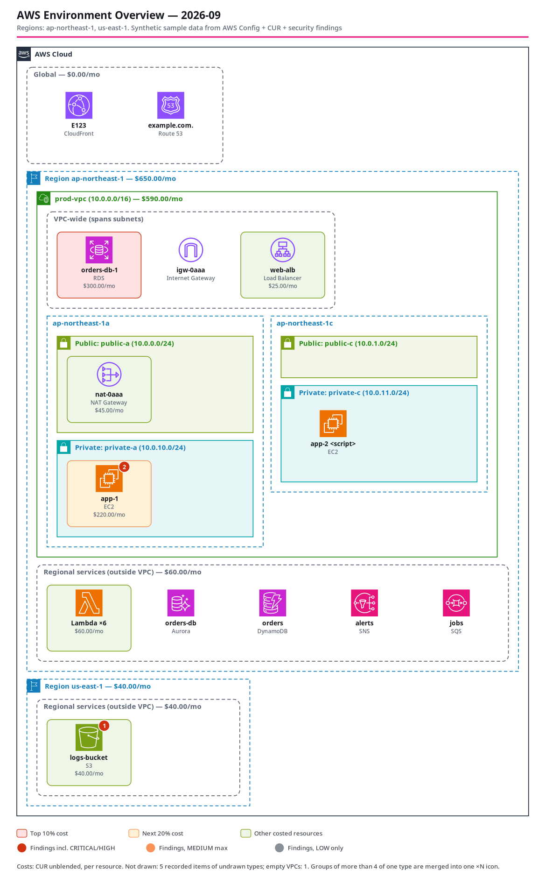
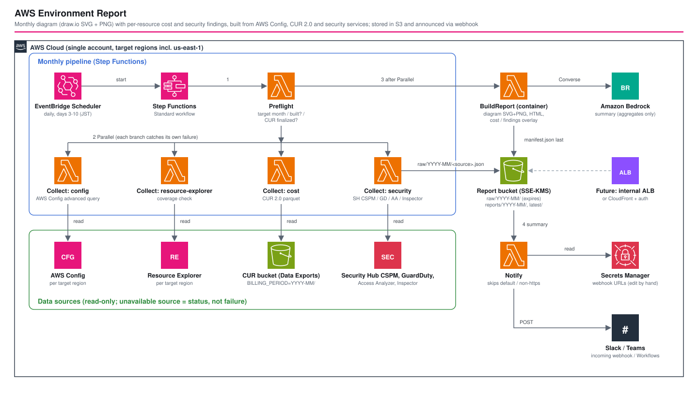

# AWS Environment Report — 構成図・コスト・セキュリティの月次レポート

*他の言語で読む(Read this in other languages):* [](./README.ja.md) [](./README.md)


> **Draft(一部を実機で検証済み、2026-10-24)。** 実アカウントにデプロイし、AWS Config、Resource Explorer、IAM Access Analyzer、Bedrockを使って最後まで実行しました。CUR、Security Hub CSPM・GuardDuty・Inspectorの指摘の読み取りは、実データでは未確認です。[実機検証の結果](#-実機検証の結果2026-10-24)と[未検証事項](#-未検証事項)を参照してください。

## はじめに

単一アカウントのAWS環境から毎月、次の成果物を自動で作り、S3に保存してSlack / TeamsのWebhookに通知するパイプラインです。

- **構成図**: draw.ioで開いて編集できるSVG(`aws-icon-diagram`スキルと同じ形式)とPNG
- **コストの重ね表示**: CUR 2.0のリソース単位のコストを各アイコンに表示し、上位10% / 次の20%を色分け。VPC・リージョンには小計を表示
- **セキュリティ指摘の重ね表示**: Security Hub CSPM、GuardDuty、IAM Access Analyzer、Inspectorの指摘件数を、該当リソースのバッジとして表示
- **HTMLレポート**: データソースの状態、Bedrockの要約、コスト上位、指摘一覧、網羅性(Resource ExplorerにあってConfigにないリソース)、インベントリ

DevOps Agentに環境調査を任せる構成に対して、このパターンは**収集を決定的なコードで行い、LLMは集計済みデータを読んで要約するだけ**にしています。毎月の資料を同じ手順・同じ網羅範囲で作り、前月と比べられることを優先した設計です。



*上図は合成データ(`src/report-builder/tests/fixtures.py`)から生成した出力例です。*

## 📑 目次

- [アーキテクチャ概要](#️-アーキテクチャ概要)
- [設計判断](#-設計判断)
- [セキュリティ考慮事項](#-セキュリティ考慮事項)
- [コスト](#-コスト)
- [前提条件](#-前提条件)
- [デプロイ手順](#-デプロイ手順)
- [テスト戦略](#-テスト戦略)
- [カスタマイズと拡張](#️-カスタマイズと拡張)
- [実機検証の結果](#-実機検証の結果2026-10-24)
- [未検証事項](#-未検証事項)
- [参考資料](#-参考資料)

## 🏗️ アーキテクチャ概要



### 処理の流れ

1. **EventBridge Scheduler**: 毎月3日〜10日の毎日9:00(JST)にStep Functionsを起動します。
2. **Preflight**: 対象月(前月)を決め、次の順に判定します。
   - `reports/YYYY-MM/manifest.json` がある → 作成済みなので終了
   - CURが確定済み → 実行
   - 未確定で、締め日(`finalizeDeadlineDay`、既定は10日)より前 → 終了して翌日に再判定
   - 締め日に達した → 「暫定」として実行
3. **Collect(Parallel)**: 4つのコレクターが並列に読み取り、`raw/YYYY-MM/<source>.json` に書き出します。各ブランチは自分の失敗を`Catch`し、`ERROR`状態に変換します。1つのデータソースが壊れても、レポートは作られます。
4. **BuildReport(Pythonコンテナ)**: 構成図、HTML、Bedrockの要約を作り、`reports/YYYY-MM/` と `reports/latest/` に書き出します。`manifest.json`は最後に書きます(完了マーカーを兼ねるため)。
5. **Notify**: Secrets Managerに登録したWebhookへ、集計値だけを送ります。

### データソースと状態

各データソースは、対象リージョンごとに次のいずれかの状態を返します。レポート冒頭の「データソースの状態」表と通知に表示されます。

| 状態 | 意味 |
|---|---|
| `OK` | 取得できた |
| `PARTIAL` | 一部のリージョンだけ使えた、Configの記録対象が一部のタイプのみ、または指摘数が上限で打ち切られた |
| `DISABLED` | サービスが有効になっていない |
| `DENIED` | IAM権限が足りない(`DISABLED`とは区別する) |
| `ERROR` | その他の失敗 |

| ソース | 判定方法 | 無効な場合の扱い |
|---|---|---|
| AWS Config | `DescribeConfigurationRecorderStatus` / `DescribeConfigurationRecorders` | **必須**。使えるリージョンが1つもなければ構成図を作らず、警告を通知 |
| Resource Explorer | `GetIndex` / `GetDefaultView` | 網羅性チェックだけを省略 |
| CUR 2.0 | パラメータの有無と `BILLING_PERIOD=YYYY-MM/` のparquetファイル | コスト表示を省略 |
| Security Hub CSPM | `DescribeHub` | 該当ソースを省略 |
| GuardDuty | `ListDetectors` / `GetDetector` | 同上 |
| IAM Access Analyzer | `ListAnalyzers`(ACTIVEなACCOUNTアナライザー) | 同上 |
| Inspector | `BatchGetAccountStatus` | 同上 |

## 🎯 設計判断

### 1. 収集はLLMに任せない

エージェントに収集をさせると、呼ぶAPIが毎回変わり、網羅性と前月比較を保証できません。収集はAPIを固定したLambdaで行い、Bedrockには集計済みのJSONだけを渡します。Bedrockには、AWS APIを呼ぶ権限を与えていません。

### 2. 配置はConfigの設定値から決める

構成図の「どのVPC・サブネットにあるか」は、Configの`relationships`ではなく、各設定項目の`vpcId` / `subnetId` / `subnetIds`などのフィールドから決めます。リソースタイプごとに記録される関係の種類が違うことに影響されないためです。

- サブネット1つ → そのサブネットの中に配置
- 複数サブネット(ALB、Multi-AZのRDSなど) → VPCの「VPC-wide」枠に配置
- VPC外 → リージョンの「Regional services」枠に配置
- CloudFront、Route 53 → 「Global」枠に配置
- パブリック/プライベートは、ルートテーブル(明示的な関連付け、なければメインルートテーブル)にIGWへのルートがあるかで判定

### 3. 自動レイアウトで、重なりを構造的に防ぐ

`aws-icon-diagram`スキルは座標を手で決めます。このパイプラインでは、コンテナが子要素を計測して積み上げるので、要素が重なりません。生成後に`find_overlaps`で再確認し、重なりがあれば警告として通知します。1つのコンテナに同じタイプが5つ以上ある場合は「Lambda ×42」のように1つにまとめます。

### 4. コストは割り当てられない分を明示する

CURのリソースIDとConfigの識別子(ARN、リソースID、末尾ID)を突き合わせます。EBSボリュームのコストは、アタッチ先のEC2に加算します。レポートでは合計を次の3つに分けて表示し、図の合計と請求額が合わない理由が分かるようにしています。

- 構成図上のリソースに割り当てたコスト
- 構成図に描いていないリソースのコスト
- リソースに割り当てられないコスト(データ転送、サポート、税など)

### 5. セキュリティの深刻度はLLMに判定させない

深刻度は各サービスの値をそのまま使います。GuardDutyの数値はGuardDutyの区分に変換し、深刻度を持たないAccess Analyzerは「パブリック = HIGH、それ以外の外部アクセス = MEDIUM」という固定ルールで扱います。Security Hubからは`ProductName = Security Hub`(CSPMのコントロール)だけを取得します。GuardDutyやInspectorの指摘は、各サービスから直接取得しているので、二重計上を避けるためです。

### 6. 公開時のバケットは分ける前提で作る

`reports/`は最初から静的サイトの構造になっています。将来、内部ALB + S3 PrivateLinkで公開する場合は、バケット名をホスト名と一致させる必要があります。バケット名は後から変更できないため、データ用のバケットとは別に公開用のバケットを作る前提にしています(`delivery.mode`は現時点では`none`だけを実装)。

## 🔒 セキュリティ考慮事項

- ✅ コレクターのIAMは、呼び出す読み取りAPI(`Describe*` / `Get*` / `List*` / `Select*` / `BatchGet*`、および`ListResources`の認可に使われる`resource-explorer-2:Search`)だけに限定。テストで書き込み系のアクションがないことを確認
- ✅ CURバケットへのアクセスは `<prefix>/<exportName>/` 配下の読み取りだけ
- ✅ レポートバケットはSSE-KMS、パブリックアクセスブロック、SSL必須、バージョニング有効。`raw/`は`retention.rawDays`で失効
- ✅ Step Functionsのログは`ERROR`レベルで、実行データは含めない(コストや指摘の件数をCloudWatch Logsに残さないため)
- ✅ Webhook URLは認証情報として扱い、ログに出力しない。Secretの初期値のままの場合と、`https`のURLでない場合は送信しない
- ✅ 通知とBedrockには集計値だけを渡す。Bedrockへの入力では、ARNと12桁のアカウントIDをマスクする
- ✅ HTMLと構成図に入る値(リソース名、タグ、指摘のタイトル)はすべてエスケープ
- ⚠️ 個別の指摘(リソースIDを含む)は、S3の`index.html` / `report.json`にだけ出力します。公開経路を追加する場合は、認証のない公開CloudFrontにしないでください
- ⚠️ `test/compliance`(cdk-nag)のスイートはまだありません

## 💰 コスト

料金はリージョンと環境の規模によって大きく変わるため、ここでは具体的な金額を示しません。[AWS 料金見積りツール](https://calculator.aws/#/estimate)で試算してください。主な課金要素は次のとおりです。

- **このパイプライン自体**: Lambda(コレクター4つ+コンテナ1つ、月1回の本実行と、それ以外の日のPreflight)、Step Functions、ECR(コンテナイメージ)、S3、KMS、Secrets Manager(シークレット1件)、Bedrock(月1回の要約)
- **データソース側**: AWS Config(記録した設定項目の数に応じて課金)、Security Hub CSPM、GuardDuty、Inspector、Resource Explorer。**このパイプラインのために有効化する場合は、その費用が支配的になります。**

## 📋 前提条件

- `<project>-<env>`という名前のプロファイルで設定済みのAWS CLI v2、Node.js 20以降、AWS CDK 2.x
- **Docker**: BuildReportはコンテナイメージのLambdaです。`cdk deploy`を実行する環境でDockerが動いている必要があります(イメージは`linux/amd64`でビルド)
- AWS Config: 対象リージョンで記録が有効(`us-east-1`はグローバルリソースのため必須)
- CUR 2.0(Data Exports、任意): parquet形式で、**「既存のレポートを上書きする」設定**にしてください(新しいレポートを毎回作る設定にすると、同じ期間のファイルが重複して合計が増えます)。リソースIDを含める設定も必要です
- Bedrock(任意): `summary.bedrockModelId`のモデルアクセスが有効であること

## 🚀 デプロイ手順

### 1. パラメータの設定

`parameters/dev-params.ts`を編集します。

| パラメータ | 内容 |
|---|---|
| `target.regions` | 収集対象のリージョン。**`us-east-1`を含めないとsynthでエラーになります** |
| `schedule` | 起動の時間帯(既定は毎月3〜10日の毎日)と、締め日(`finalizeDeadlineDay`) |
| `cur` | CURのバケット・プレフィックス・エクスポート名。省略するとコストなしで動作 |
| `security.maxFindingsPerSource` | ソース・リージョンごとに読む指摘数の上限 |
| `summary` | Bedrockの要約の有効/無効、モデルID、言語(`ja` / `en`) |

`summary.bedrockModelId`は、実在するIDかどうかを `aws bedrock list-inference-profiles` で確認してから設定してください(地域プレフィックスは推測できません。[ナレッジ](../../../docs/knowledge/aws-service-gotchas.md)参照)。

### 2. デプロイ

```sh
# infrastructure/workspaces/aws-environment-report で実行
npm install
PROJECT=myproj ENV=dev npm run bootstrap   # アカウント/リージョンごとに一度だけ
PROJECT=myproj ENV=dev npm run stage:deploy:all   # cdk deploy '**'(--allではStage内のスタックが展開されない)
```

### 3. Webhookの設定(手動)

Secrets Managerの `<project>-<env>-environment-report-webhooks` を編集します。初期値は次のとおりで、**このままでは何も送信しません**。

```json
{"webhooks":[{"type":"slack","url":"REPLACE_WITH_WEBHOOK_URL"},{"type":"teams","url":"REPLACE_WITH_WEBHOOK_URL"}]}
```

- `type`は`slack`か`teams`。Teamsは、**Workflows(「Teams Webhook要求を受信したとき」)のURL**を設定してください。旧来のOffice 365コネクタ(Incoming Webhook)は廃止が進んでいるため、対象にしていません
- 不要な要素は配列から削除してかまいません。`https`のURLでない要素は送信せずスキップし、理由をログに出します(URL自体はログに出しません)
- 手動で変更した値は、通常の再デプロイでは上書きされません。CloudFormationが値を書き換えるのは、テンプレート側の初期値(`DEFAULT_WEBHOOK_SECRET`)を変更したときだけです

### 4. 手動実行

```sh
aws stepfunctions start-execution \
  --state-machine-arn <StateMachineArn> \
  --input '{"targetMonth":"2026-09","force":true}'
```

`force: true`を付けると、作成済みの月も作り直します。CURが未確定なら「暫定」として作成します。

### クリーンアップ

```sh
PROJECT=myproj ENV=dev npm run stage:destroy:all
```

バケット、KMSキー、シークレットの`RemovalPolicy`は`isAutoDeleteObject`に従います(本番以外は削除、本番は保持)。

## 🧪 テスト戦略

```sh
# CDK と TypeScript Lambda(Jest)
npm test

# レポート生成(Python。cairosvgはPNGの生成にlibcairoが必要)
cd src/report-builder
python3 -m venv .venv && .venv/bin/pip install cairosvg==2.7.1 pytest
.venv/bin/python -m pytest -q tests
```

- `test/unit/aws-environment-report.test.ts`: パラメータの検証(`us-east-1`必須など)、バケット設定、IAMが読み取り系アクションだけであること、CURへのアクセスがプレフィックスに限定されていること、全コレクターの`Catch`、スケジュール
- `test/unit/lambda-logic.test.ts`: Preflightの判定、タイムゾーンでの前月計算、エラーから状態への変換、Configレコーダーの判定、CURの集計、Webhookのスキップ条件、深刻度の変換、通知のペイロード
- `src/report-builder/tests`: 配置、コストの突き合わせ(ボリュームをインスタンスに加算)、指摘の付与、×Nの集約、重なりがないこと、SVGがdraw.ioで開ける形式であること、エスケープ、`manifest.json`を最後に書くこと

## ⚙️ カスタマイズと拡張

- **描画するリソースタイプ**: `src/report-builder/app/catalog.py`の`CATALOG`に追加します。追加しないタイプも、インベントリ表では件数が出ます
- **静的プレビューのアイコン**: `app/assets/icons.json`には、`CATALOG`の全タイプとRegion / VPC / サブネットのグループバッジのアイコンを収録しています。出典は、このリポジトリの既存の`overview.drawio.svg`と、公式の[AWS Architecture Icons](https://aws.amazon.com/architecture/icons/)(2026年7月版)です。`CATALOG`にアイコンなしでタイプを追加すると色付きの四角+略称で表示されますが(draw.ioでは`resIcon`の正式なアイコンで表示)、その場合はテストが失敗します
- **公開経路**(未実装): `delivery.mode`に`internal-alb` / `cloudfront`を追加する想定です。どちらも公開用の別バケットを使います。CloudFrontの場合はWAFとLambda@Edge(us-east-1)による認証が必要です
- **データの流れの矢印**(未実装): 現在は収容関係だけを描いています。EventBridgeルールのターゲット、Lambdaのイベントソースマッピングなどから、必要な流れだけを追加してください

## 🔬 実機検証の結果(2026-10-24)

1つのアカウント(`ap-northeast-1`にデプロイ、対象は`us-east-1`と`ap-northeast-1`)で実行しました。AWS ConfigとACCOUNTタイプのAccess Analyzerは検証のためだけに有効化し、CURは設定していません。

| 項目 | 結果 |
|---|---|
| コンテナイメージのビルド(`public.ecr.aws/lambda/python:3.12`で`dnf install cairo dejavu-sans-fonts`) | ビルド・実行とも成功し、PNGも生成 |
| AWS Config(2リージョンで588件) | `OK`。構成図は19ノード、重なり0 |
| Resource Explorer | 初回は`DENIED`。`ListResources`の認可は`ListResources`ではなく **`resource-explorer-2:Search`** で行われるため。修正後の再デプロイで`OK`になり、網羅性の差分も出力 |
| Security Hub CSPM未有効 | `DescribeHub`が`InvalidAccessException`を返し、想定どおり`DISABLED` |
| GuardDuty / Inspector未有効 | ディテクターなし / `BatchGetAccountStatus`が`DISABLED`で、`DISABLED` |
| IAM Access Analyzer | `OK`、12件(パブリックなLambda 5件 = HIGH、外部アクセスのあるIAMロール7件 = MEDIUM)。LambdaのアイコンにHIGHのバッジを表示 |
| CUR未設定 | Preflightは`NOT_CONFIGURED`で即実行。構成図の全コンテナに`$0.00/mo`が出ていたため、コストデータがないときはコスト表示と凡例を出さないよう修正 |
| Bedrock(`jp.anthropic.claude-sonnet-4-6`) | `summaryStatus: OK`。`OK`以外のデータソースが欠けていることを要約に明記 |
| `force`なし / `{}`での再実行 | `SKIP`(「report for this month already exists」)。`{}`はAsia/Tokyoでの前月に解決 |
| Webhook | 初期値のシークレット → スキップ。`http://`のURL → 理由付きでスキップし、URL自体はCloudWatch Logsに出ない |
| アイコン | ECRとInternet GatewayがHTML / PNGで色付きの四角になっていた(静的アイコン未収録)。`CATALOG`の全アイコンを収録した。全名前をdraw.ioのAWS4ステンシル(v24.7.17)と照合した結果、`group_public_subnet` / `group_private_subnet`は存在しなかったため、リポジトリ内の他の図と同じ`group_security_group`に修正 |

既知の制約: PNGはDejaVu Sansで描画するため、CJKのグリフがなく、`diagram.png`では日本語のリソース名が空白になります(draw.io形式のSVGは影響を受けません)。Lambdaのベースイメージが使うAmazon Linux 2023のリポジトリにはCJKフォントのパッケージがないため、必要ならNoto Sans JPなどのフォントをイメージに同梱してください。

## ⚠️ 未検証事項

実機で確認するまでは、次の項目を前提として扱わないでください。

1. **CURの確定判定**: `bill_invoice_id`が確定前は空で、確定後に入るという前提です。実データで確認してから運用してください
2. **CURのパス構成**: `<prefix>/<exportName>/data/BILLING_PERIOD=YYYY-MM/*.parquet`を前提にしています
3. **指摘の実データ**: Security Hub CSPM、GuardDuty、Inspectorは「未有効」の経路だけを確認しました。指摘を読み取る経路は未確認です
4. **Bedrockのモデル ID**: 検証アカウントには`jp.anthropic.claude-sonnet-4-6`がありましたが、利用するアカウントで必ず確認してください

## 📚 参考資料

- [AWS Config 高度なクエリ](https://docs.aws.amazon.com/config/latest/developerguide/querying-AWS-resources.html)
- [AWS Resource Explorer ListResources](https://docs.aws.amazon.com/resource-explorer/latest/apireference/API_ListResources.html)
- [AWS Data Exports(CUR 2.0)](https://docs.aws.amazon.com/cur/latest/userguide/what-is-data-exports.html)
- [GuardDuty の重要度](https://docs.aws.amazon.com/guardduty/latest/ug/guardduty_findings-severity.html)
- [Amazon Bedrock Converse API](https://docs.aws.amazon.com/bedrock/latest/userguide/conversation-inference.html)
- 関連ワークスペース: [security-baseline](../security-baseline/)(Config / GuardDuty / Access Analyzer / Security Hub の有効化)、[aws-eol-monitor](../aws-eol-monitor/)(Scheduler + Step Functions + Bedrock要約)

## 📄 ライセンス

[LICENSE](../../../LICENSE) を参照してください。
