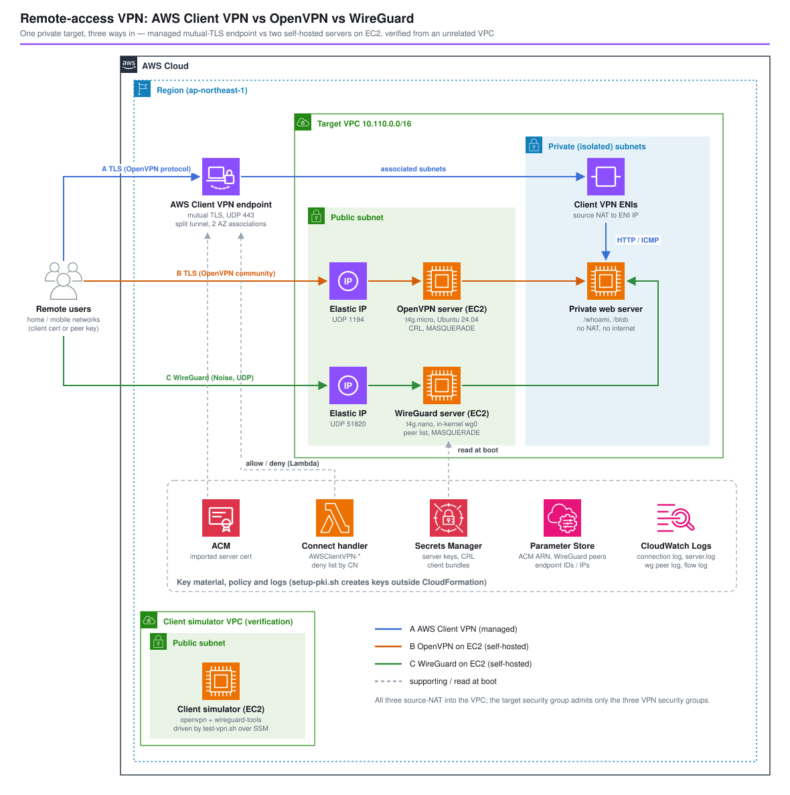

*Read this in other languages:* [](./README.ja.md) [](./README.md)

# リモートアクセス VPN: AWS Client VPN vs EC2 上の OpenVPN vs WireGuard - AWS CDK リファレンスアーキテクチャ


在宅や外出先のユーザーを VPC 内のプライベートなリソースにつなぐ方法は、たいてい次の 3 つのどれかになります。マネージドの **AWS Client VPN**、自前で運用する **OpenVPN** サーバー、自前で運用する **WireGuard** サーバーです。Client VPN は OpenVPN プロトコルを話すので、前の 2 つの違いは主に「誰がサーバーを運用するか」です。WireGuard は別のプロトコルで、証明書もユーザーという概念もありません。

このアーキテクチャは、3 つを同じプライベート Web サーバーの前にスタックを分けて並べ、無関係な VPC に置いた EC2（リモートの PC 役）から実機検証します。以下のデプロイ時間・接続時間・遅延・スループット・接続先から見える送信元・失効ユーザーの拒否のされ方・各方式のログは、ap-northeast-1 での実測です。



## 📑 目次

- [どれを選ぶか](#-どれを選ぶか)
- [アーキテクチャ概要](#️-アーキテクチャ概要)
- [設計判断とベストプラクティス](#-設計判断とベストプラクティス)
- [検証結果](#-検証結果ap-northeast-1-にデプロイ)
- [Well-Architected との対応](#️-well-architected-との対応)
- [コスト](#-コスト)
- [セキュリティ](#-セキュリティ)
- [前提条件](#-前提条件)
- [デプロイ](#-デプロイ)
- [使い方 (test-vpn.sh)](#使い方-test-vpnsh)
- [テスト戦略](#-テスト戦略)
- [カスタマイズ](#️-カスタマイズ)
- [トラブルシューティング](#-トラブルシューティング)
- [クリーンアップ](#-クリーンアップ)
- [参考資料](#-参考資料)

## 🧭 どれを選ぶか

| | A. AWS Client VPN | B. EC2 上の OpenVPN | C. EC2 上の WireGuard |
| --- | --- | --- | --- |
| サーバーの運用 | AWS（ENI を自分のサブネットに配置、マルチ AZ） | 自分（OS、パッチ、冗長化） | 自分（OS、パッチ、冗長化） |
| プロトコル | OpenVPN 互換 TLS、UDP/TCP 443 または 1194 | OpenVPN TLS | WireGuard（Noise）、UDP |
| ユーザー認証 | 証明書、Active Directory（MFA 可）、SAML（IAM Identity Center、Entra ID など）、または証明書＋いずれか | 証明書。LDAP/RADIUS/OIDC はプラグイン | 端末ごとの公開鍵のみ。ユーザー・MFA・SSO なし |
| ユーザー単位のポリシー | CIDR × AD/SAML グループの認可ルール、接続ハンドラー Lambda、端末状態チェック（Cedar） | 自分で書く iptables / `client-config-dir` | 自分で書く `AllowedIPs` + iptables |
| ユーザーの失効 | 接続ハンドラーの拒否リスト、CRL のインポート、IdP グループから外す | CRL ファイル（期限前に更新が必要） | ピアの鍵を削除 |
| 接続ログ | CloudWatch Logs（マネージド） | `server.log`（転送は自分で） | なし。ハンドシェイク経過時間から推定 |
| 規模・冗長性 | 関連付け 1 つで 7,000 接続、5 つで最大 126,000 | 作り込まない限りインスタンス 1 台 | 作り込まない限りインスタンス 1 台 |
| 今回の実測（クライアント 1 台） | 接続 4.2〜4.4 秒、RTT 4〜6 ms、170〜248 Mbit/s | 2.7 秒、RTT 0.8〜1.2 ms、272〜471 Mbit/s | 3.5 秒、RTT 0.8〜0.9 ms、1,674〜2,248 Mbit/s（MTU 1420） |
| この構成の月額（20 人 × 8 時間 × 21 日） | 約 $394 | 約 $13 | 約 $9 |

- **Client VPN** は、社内の IdP で認証したい、MFA やグループ単位のアクセス制御が必要、監査で接続ログを求められる、運用なしで数百人以上を収容したい、といった場合に選びます。代わりに関連付け 1 つあたり月約 $110 の固定費と、1 ユーザー 1 時間あたり $0.05 がかかります。
- **EC2 上の OpenVPN** は、証明書ベースのモデルで十分で、可用性よりコストを優先する場合に向きます。同じ CA とクライアント証明書がそのまま Client VPN でも使えるので、Client VPN への移行（またはその逆）の足場にもなります。
- **EC2 上の WireGuard** は、少人数のエンジニアや拠点・端末間の接続など、端末ごとの鍵で済む場合に向きます。最も安く、速く、シンプルですが、ユーザーの識別・失効の記録・ログ・冗長化はすべて自分で作ることになります。

## 🏗️ アーキテクチャ概要

### 主要コンポーネント

| コンポーネント | 設定 | 理由 |
| --- | --- | --- |
| 接続先 VPC | 2 AZ、パブリック + 隔離 `/24` サブネット、**NAT ゲートウェイなし**、フローログ（ALL） | 接続先には VPN 経由でしか届かない |
| プライベート Web サーバー | 隔離サブネットの Ubuntu 24.04 t4g.nano、Python の `/whoami`（受け取った送信元 IP を返す）と `/blob?mb=N` | 各 VPN の送信元 NAT を確認し、スループットを測る |
| A. Client VPN エンドポイント | 相互 TLS（サーバー証明書は ACM、クライアントも同じ CA）、UDP 443、スプリットトンネル、2 AZ に関連付け、セッション 8 時間、ログインバナー、接続ログ、`authorizeAllUsersToVpcCidr` | マネージドの基準 |
| A. 接続ハンドラー | Lambda `AWSClientVPN-<project>-<env>-connect-handler`（Python 3.14）、証明書の CN による拒否リスト | CRL に触らずにユーザーを止め、すべての判定をログに残す |
| B. OpenVPN サーバー | Ubuntu 24.04 t4g.micro、パブリックサブネット、Elastic IP、UDP 1194、`crl-verify`、VPC ルートを配布、`MASQUERADE` | A と同じ証明書で動く自前版 |
| C. WireGuard サーバー | Ubuntu 24.04 t4g.nano、パブリックサブネット、Elastic IP、UDP 51820、**MTU 1420**、ピアは SSM から、`MASQUERADE` | 自前・鍵ベース |
| 鍵・証明書 | `setup-pki.sh`：CA、サーバー・クライアント証明書、CRL、WireGuard 鍵 → ACM、Secrets Manager、SSM Parameter Store | 秘密鍵を CloudFormation テンプレートに含めない |
| ログ | Client VPN 接続ログ＋ハンドラーのログ。CloudWatch エージェントで OpenVPN の `server.log` と WireGuard の毎分のピアログを転送 | 「誰がつないだか」に 3 通りの答え方 |
| クライアントシミュレーター | 別 VPC（ピアリングなし）の Ubuntu 24.04 t4g.micro、`openvpn` + `wireguard-tools`、`vpn-test` スクリプト | リモート PC 役。`test-vpn.sh` から SSM 経由で操作 |

### スタック構成

| スタック | 内容 |
| --- | --- |
| `<project>-<env>-vpn-target` | VPC、フローログ、接続先 Web サーバーとそのセキュリティグループ |
| `<project>-<env>-vpn-client-vpn` | Client VPN エンドポイント、関連付け、認可ルール、接続ハンドラー、ロググループ |
| `<project>-<env>-vpn-openvpn` | OpenVPN 用ブートストラップを渡した `SelfHostedVpnServer` Construct |
| `<project>-<env>-vpn-wireguard` | WireGuard 用ブートストラップを渡した `SelfHostedVpnServer` Construct |
| `<project>-<env>-vpn-client-sim` | 検証用ハーネス（`clientSimulator.enabled: false` で無効化） |

各 VPN スタックは接続先スタックにだけ依存し、接続先のセキュリティグループへのインバウンドルールを自分のスタックで追加します。そのため、1 つの方式だけをデプロイ・削除できます。

## 🎯 設計判断とベストプラクティス

### 1. 鍵は CloudFormation の外で作る

Client VPN が必要とする ACM 証明書は CDK では作れません（相互認証にはインポートした証明書が必要）。また、サーバーの秘密鍵をテンプレートや CDK アセットに書き込むべきではありません。`setup-pki.sh` は `openssl ca` で小さな CA を作り（RSA 2048。Client VPN は 1024/2048 ビットの RSA しか受け付けない）、`client2` を失効させ、`openssl genpkey` で WireGuard の X25519 鍵を作り（`wireguard-tools` は不要）、サーバー証明書を ACM にインポートし、残りを `/<project>/<env>/vpn/` 配下の Secrets Manager と Parameter Store に保存します。スタックはその名前だけを参照し（`lib/vpn-names.ts`）、サーバーは起動時に鍵を読みます。スクリプトを再実行すると同じ ACM ARN に再インポートするので、エンドポイントはそのまま動き続けます。

### 2. Client VPN と OpenVPN で CA を共有する

Client VPN は、サーバー証明書とクライアント証明書が同じ CA で発行されていれば、サーバー証明書の ARN をクライアントのルート CA として受け付けます。OpenVPN も同じファイルを使います。そのため 1 枚のクライアント証明書でどちらのサーバーにもつながり、自前の OpenVPN から Client VPN への移行（またはその逆）はクライアントのプロファイルを差し替えるだけで済みます。

### 3. ユーザーを止める 3 つの方法

`client2` は有効な証明書（と WireGuard の鍵）を持っていますが、拒否されなければなりません。

- **Client VPN**：接続ハンドラーがその CN に `allow: false` を返します。ハンドラーは認証の後、認可ルールの前に実行され、CN・送信元パブリック IP・プラットフォーム・クライアントのバージョンを受け取り、エラーメッセージはユーザーに届きます。
- **OpenVPN**：証明書が CRL に載っています。`crl-verify` が TLS ハンドシェイクを拒否します。CRL には `nextUpdate` の日付があり、それを過ぎると OpenVPN は**すべての**クライアントを拒否します。`setup-pki.sh` は 365 日で発行しますが、期限前の更新が必要です。
- **WireGuard**：鍵がピアリスト（Parameter Store の `wireguard/peers`）に無いだけです。失効の記録はありません。ピアの追加・削除は、サーバー上で `wg-render.sh && wg syncconf wg0 <(wg-quick strip wg0)` を実行します。

### 4. ルートではなく送信元 NAT

3 方式とも、VPC 内のアドレスを送信元にして VPC に流します。Client VPN は関連付けたサブネットにある自分の ENI のアドレスに NAT し、自前サーバーは自分のアドレスに `MASQUERADE` します。そのため自前サーバーは送信元/送信先チェックを有効のままにでき、ルートテーブルの変更も要りません。接続先のセキュリティグループは 3 つの VPN のセキュリティグループだけを許可できます。代わりに、接続先は IP でユーザーを区別できません。各 VPN のログを使うか、クライアント IP を保持する Client VPN の Transit Gateway アタッチメントを使います。

### 5. WireGuard の MTU は 1420 に固定する

EC2 の ENI の MTU は 9001 バイトで、`wg-quick` はトンネルの MTU を経路の MTU − 80 に設定します。そのためサーバーも EC2 上のクライアントも MTU **8921** で起動しました。インターネット経路は 1500 バイトなのでトンネルのパケットが断片化され、スループットは 41〜81 Mbit/s に落ちました。`MTU = 1420` にすると同じテストで 1,674〜2,248 Mbit/s 出ました。サーバーは `wireGuard.mtu` から設定します。クライアントの設定にも `MTU = 1420` を入れてください。

### 6. すべてスプリットトンネル

トンネルを通るのは VPC の CIDR だけです（Client VPN の `splitTunnel`、OpenVPN の `push "route ..."`、WireGuard の `AllowedIPs`）。ユーザーのインターネット通信はそれぞれの回線を使い、Web 閲覧のデータ転送料金が VPN 側にかかりません。フルトンネルにするには、VPC から外に出る NAT 経路と `0.0.0.0/0` のルートが必要です。

### 7. Ubuntu、インスタンス 1 台、Elastic IP

`openvpn` と `wireguard-tools` は Ubuntu のアーカイブにはありますが Amazon Linux 2023 にはないため、すべてのインスタンスで Canonical の Ubuntu 24.04 arm64 AMI（SSM パブリックパラメーター）を使います。各サーバーは Elastic IP 付きのインスタンス 1 台です。インスタンスを置き換えても（ユーザーデータを変えると置き換わる）アドレスは変わらず、鍵は Secrets Manager から戻るので、クライアントの設定はそのまま使えます。ただし冗長ではありません。AZ 障害が起きると、新しいインスタンスが動くまですべてのセッションが切れます。本番では、AZ ごとに台数 1 の Auto Scaling グループを置いて起動時に EIP を付け替えるか、2 台のサーバーを用意して両方のアドレスをクライアントのプロファイルに入れます（OpenVPN は `remote` 行、WireGuard は 2 つ目のピア）。

### 8. SSH なし

サーバーとクライアントシミュレーターには SSH ポートがありません。管理とテストは SSM Session Manager / Run Command（`AmazonSSMManagedInstanceCore`）で行います。インターネットに開いているのは VPN のポートだけです。

## 🔬 検証結果（ap-northeast-1 にデプロイ）

2026-11-03 に `drillexercises-dev` でデプロイ（aws-cdk-lib 2.273）。クライアントは別 VPC の Ubuntu 24.04 t4g.micro（OpenVPN 2.6.19）で、インターネット経由で各サーバーのパブリックエンドポイントに接続。ダウンロードは `/blob` から 100 MiB を 3 回。

### 1. デプロイ時間

| スタック | 時間 |
| --- | --- |
| 接続先 / クライアントシミュレーター | 2 分 56 秒 / 2 分 51 秒 |
| OpenVPN / WireGuard | 3 分 15 秒 / 3 分 5 秒 |
| **Client VPN** | **9 分 14 秒**。エンドポイント 76 秒、その後 2 つのサブネット関連付けに **7 分 17 秒** |

自前サーバーはスタック完了の約 2 分後に使えるようになりました（cloud-init がパッケージを入れるため）。

### 2. 接続時間・遅延・スループット

| 方式 | 接続（プロセス起動 → 最初の HTTP 200） | ping RTT 平均 | HTTP ダウンロード | トンネル MTU | 接続先から見た送信元 IP |
| --- | --- | --- | --- | --- | --- |
| A. Client VPN | 4.2〜4.4 秒 | 4.0〜5.9 ms | 170〜248 Mbit/s | 1500 | `10.110.3.154`（エンドポイントの ENI） |
| B. OpenVPN | 2.7〜2.8 秒 | 0.8〜1.2 ms | 272〜471 Mbit/s | 1500 | `10.110.0.32`（サーバー） |
| C. WireGuard、MTU 1420 | 3.5 秒 | 0.8〜0.9 ms | 1,674〜2,248 Mbit/s | 1420 | `10.110.0.140` / 置き換え後 `.155`（サーバー） |
| C. WireGuard、wg-quick の既定値 | 3.5〜3.7 秒 | 0.8〜0.9 ms | 41〜81 Mbit/s | 8921 | `10.110.0.140` |

- Client VPN は数ミリ秒の遅延が加わります。クライアントとエンドポイントの ENI は同じリージョンにありますが、通信はインスタンスに直接ではなくマネージドサービスを経由します。接続あたりのスループットは最も低く、最も安定していました。
- 自前サーバーの数値は小さな Graviton インスタンスのバースト値です（t4g は「最大 5 Gbit/s」で、ベースラインはずっと低い）。多数のユーザーが継続的に流すなら大きいインスタンスが必要です。
- WireGuard の最速の結果には MTU の修正（設計判断 5）が必要でした。

### 3. `client2` の拒否

| 方式 | クライアントに見えたもの | 時間 | サーバー側の記録 |
| --- | --- | --- | --- |
| A. Client VPN | `AUTH_FAILED,This device is no longer authorized.` の後 `openvpn` が終了 | TLS ハンドシェイクの約 1 秒後 | ハンドラーのログ `{"decision": "deny", "common-name": "client2.vpn.internal", ...}`。`describe-client-vpn-connections` に `terminated` として記録 |
| B. OpenVPN | `TLS key negotiation failed to occur within 60 seconds` を延々と再試行。理由は届かない | クライアントが諦めるまで | `VERIFY ERROR: depth=0, error=certificate revoked: CN=client2.vpn.internal` |
| C. WireGuard | ハンドシェイクなし、`0 B received` | クライアントが諦めるまで | 何もなし。知らない鍵には応答もログもない |

### 4. 各方式が記録したもの

- **Client VPN**：接続ハンドラーの判定ごとに JSON 1 行（CN、パブリック IP、プラットフォーム、OpenVPN のバージョン）が数秒で届き、`describe-client-vpn-connections` では全試行の開始・終了時刻とクライアント IP がすぐに見えます。**接続ログ**はまとめて届きます。03:04〜03:07 の接続は 03:30:35 に一括で CloudWatch Logs に入りました（それまでストリーム自体が存在しない）。内容は `connection-attempt` の `successful` / `failed`（ハンドラーによる拒否の理由は `client-connect-failed`）と、開始・終了時刻とバイト数付きの `connection-reset`（1 回のダウンロードセッションで送信 332,121,271 バイト）です。リアルタイムのアラートには向きません。
- **OpenVPN**：CN と送信元アドレス付きの `Peer Connection Initiated`、`client2` の `certificate revoked`、通知なしでクライアントが消えたときの `Inactivity timeout`。
- **WireGuard**：タイマーが書く内容だけ。毎分、ピア名・最後のエンドポイント・ハンドシェイク経過時間・バイト数。クライアントが去った後もエンドポイントは残り、経過時間が増え続けるだけです。「接続中」は推定するしかありません（経過時間がおよそ 3 分未満）。

### 5. サーバーの置き換え

WireGuard のブートストラップを変えるとインスタンスが置き換わりました（スタック更新 50 秒）。Elastic IP は `54.249.117.55` のまま、サーバー鍵は Secrets Manager から戻り、既存のクライアント設定は変更なしで再接続できました。

### 6. 削除

5 スタックの `cdk destroy` は 13 分 44 秒でした。Client VPN スタックだけで約 10 分（サブネットの関連付け解除）、残りは各 1 分前後です。続けて `setup-pki.sh --delete` で ACM 証明書（エンドポイントが消えるまでは使用中）、シークレット、パラメーターを削除しました。残ったのは、デフォルトのセキュリティグループを制限する CDK カスタムリソースのロググループ（`/aws/lambda/<stack>-CustomVpcRestrictDefault-*`）で、手動で削除しました。

## 🏛️ Well-Architected との対応

| 柱 | このアーキテクチャでの対応 |
| --- | --- |
| 運用上の優秀性 | 方式ごとに 1 スタック、鍵の作成はスクリプト化（`setup-pki.sh`）、`test-vpn.sh status / run / logs` で準備状況の確認・計測・各方式のログ表示、SSH なしで SSM に一本化 |
| セキュリティ | プライベート CA による相互 TLS、秘密鍵は Secrets Manager のみ、接続先は 3 つの VPN のセキュリティグループからのみ、スプリットトンネル、方式ごとの失効を実証、IMDSv2・ボリューム暗号化・フローログ・接続ログ |
| 信頼性 | Client VPN は 2 AZ に関連付け。自前サーバーは置き換え後も Elastic IP と鍵を維持（1 台構成。冗長化は設計判断 7） |
| パフォーマンス効率 | 方式ごとに実測、WireGuard の MTU を経路 MTU に合わせる、Graviton インスタンス |
| コスト最適化 | 下記のユーザー時間モデルで方式ごとに試算。Client VPN の関連付けが最大の固定費で、本番以外では 1 つに減らせる |
| 持続可能性 | テスト負荷を流せる最小の Graviton インスタンス、スプリットトンネルで無関係な通信を VPN に載せない |

## 💰 コスト

ap-northeast-1、月 730 時間、2026-11-03 時点の Pricing API：Client VPN は関連付け 1 時間 $0.15、接続 1 時間 $0.05。t4g.nano $0.0054/h、t4g.micro $0.0108/h。パブリック IPv4 $0.005/h。利用例：20 人 × 8 時間 × 21 日 = 3,360 接続時間。

| 項目 | A. Client VPN | B. OpenVPN | C. WireGuard |
| --- | --- | --- | --- |
| エンドポイント / インスタンス | 関連付け 2 × 0.15 × 730 = **$219.0** | t4g.micro **$7.9** | t4g.nano **$3.9** |
| ユーザー単位の料金 | 3,360 × 0.05 = **$168.0** | — | — |
| パブリック IPv4 | ENI 2 つ × $3.65 = $7.3 | EIP $3.65 | EIP $3.65 |
| EBS 8 GiB gp3、ログ | 少額 | 約 $1 | 約 $1 |
| **合計（この利用量）** | **約 $394** | **約 $13** | **約 $9** |

- Client VPN の固定費は関連付け 1 つなら月 $109.5。常時接続のユーザーが 1 人増えるごとに月約 $36.5（730 時間 × $0.05）増えます。
- インターネットへのデータ転送料金は 3 方式とも同じ扱いです。スプリットトンネルなら VPC 宛ての通信分だけです。
- このパターンで共通の費用：接続先（t4g.nano）、接続ハンドラーとログ（数セント）、検証用クライアント（t4g.micro + IPv4、起動しっぱなしで月約 $12）。
- 自前サーバーの行に出てこないもの：パッチ適用、冗長化、ログ転送、ユーザーのライフサイクル管理にかかる作業時間。

## 🔒 セキュリティ

- **インバウンド**：自前サーバーは UDP ポート 1 つを `vpnIngressCidrs` に開けます（リモートユーザーはどのネットワークから来るか分からないため既定は `0.0.0.0/0`）。すべてのパケットはプロトコルで認証され、WireGuard は未認証のパケットに応答すらしません。ユーザーの送信元 IP が固定ならさらに絞ってください。
- **鍵**：`setup-pki.sh` が作り、Secrets Manager（サーバー鍵、クライアントのバンドル）と ACM に保存します。各サーバーのロールは自分のシークレットしか読めません。`.pki/`（CA 鍵を含むローカルコピー）は git の対象外です。本番では CA 鍵をオフラインで保管してください。ブートストラップは、鍵が変数に入っている間シェルのトレースを止め、`cloud-init-output.log` に残らないようにしています。
- **Client VPN**：このパターンは相互 TLS のみです。ユーザーの識別には SAML（IAM Identity Center）か MFA 付きの Active Directory を加え、グループごとの認可ルールを設定します。接続ハンドラーはフェイルクローズです。エラー・タイムアウト・不正な応答では接続を拒否します。
- **接続先**：隔離サブネット、NAT なし、セキュリティグループは 3 つの VPN のセキュリティグループからの HTTP と ICMP のみ許可。
- **インスタンス**：IMDSv2 必須、gp3 ボリューム暗号化、SSH なし、管理は SSM。

CDK Nag の抑制（すべて `test/compliance/cdk-nag.test.ts`）：EC23（VPN ポートのインターネット公開。設計上必要）、EC28/EC29（使い捨てインスタンスの詳細モニタリング・終了保護なし）、IAM4（`AmazonSSMManagedInstanceCore`、`AWSLambdaBasicExecutionRole`）、IAM5（CloudWatch エージェントのログストリーム、クライアントシミュレーターによるパターンのプレフィックス配下の読み取り）、VPC7（クライアントシミュレーターの VPC）。

## 📋 前提条件

- Node.js 24、AWS CDK CLI、ブートストラップ済みのアカウント
- `openssl` 3、`jq`、AWS CLI v2（`setup-pki.sh` と `test-vpn.sh` 用）

## 🚀 デプロイ

```bash
cd infrastructure/workspaces/client-vpn-vs-openvpn-wireguard

# 1. 鍵・証明書：CA、証明書、CRL、WireGuard 鍵 -> ACM / Secrets Manager / Parameter Store
./setup-pki.sh --project myproject --env dev        # プロファイルの既定は myproject-dev

# 2. スタック（Client VPN はサブネット関連付けのため約 9 分）
PROJECT=myproject ENV=dev npm run stage:deploy:all -- --require-approval never

# 3. cloud-init を 2 分ほど待ってから
./test-vpn.sh --project myproject --env dev status
```

一部の方式だけをデプロイする場合はスタックを指定します。例：`npx cdk deploy 'ClientVpnVsOpenvpnWireguardDev/WireGuard' -c project=myproject -c env=dev --profile myproject-dev`（接続先スタックは依存関係として一緒にデプロイされます）。

### 実際の PC からつなぐ

- **Client VPN**：`aws ec2 export-client-vpn-client-configuration --client-vpn-endpoint-id <id> --output text > cvpn.ovpn` に、`.pki/client1.crt` / `.pki/client1.key` から `<cert>` / `<key>` を追記し、AWS VPN Client か任意の OpenVPN クライアントで開きます。
- **OpenVPN**：同じ証明書で `remote <OpenVpnPublicIp> 1194`（完全なプロファイルは `vpn-test.sh` を参照）。
- **WireGuard**：`[Interface] PrivateKey = <.pki/client1.wg.key>`、`Address = 10.122.0.2/32`、`MTU = 1420`。`[Peer] PublicKey = <wireguard/server-public-key>`、`Endpoint = <WireGuardPublicIp>:51820`、`AllowedIPs = 10.110.0.0/16`。

## 使い方 (test-vpn.sh)

```bash
./test-vpn.sh --project myproject --env dev status   # エンドポイント/関連付け、サーバーのサービス、シミュレーターの準備状況
./test-vpn.sh --project myproject --env dev run      # client1 と client2 で 3 方式に接続し、接続時間・RTT・スループット・MTU・送信元 IP を計測
./test-vpn.sh --project myproject --env dev run --methods wireguard --clients client1 --mb 50 --runs 1
./test-vpn.sh --project myproject --env dev logs --since 30m   # ハンドラーの判定、OpenVPN の server.log、WireGuard のピアログ
```

`run` は SSM Run Command でクライアントシミュレーターに `vpn-test <method> <client> <mb> <runs>` を送ります。インスタンス上で `vpn-test wireguard client1 100 3 auto` を実行すると、wg-quick 既定の MTU を再現できます。

## 🧪 テスト戦略

```bash
npm test -w workspaces/client-vpn-vs-openvpn-wireguard
```

| スイート | 内容 |
| --- | --- |
| `test/unit/stage.test.ts` | CIDR/ネットマスクのヘルパーとユーザーデータのテンプレート展開、NAT なしの接続先 VPC・隔離されたサーバー・IMDSv2/暗号化・自前のインバウンドなし・SSM 出力、Client VPN の相互 TLS（SSM から解決した ACM ARN をサーバーとクライアント CA の両方に使用）・エンドポイント設定・関連付け 2 つ・認可ルール 1 つ・ハンドラー名のプレフィックスと拒否リスト・エンドポイント SG のアウトバウンド、自前サーバーごとの UDP ポート 1 つ・EIP・送信元/送信先チェック・自分の SG からの接続先インバウンド・自分のシークレットのみ読める権限、OpenVPN のルート/CRL/シークレット、WireGuard のアドレス・ピアのパラメーター・MTU 1420、シミュレーター VPC の分離とエクスポート権限、シミュレーターの有効/無効、スタックの依存関係 |
| `test/snapshot/snapshot.test.ts` | 5 スタックそれぞれのテンプレート全体とリソース数 |
| `test/compliance/cdk-nag.test.ts` | すべてのスタックに AwsSolutions パック（Stage に適用。App に付けた Aspect は Stage 内に届かない） |

## ⚙️ カスタマイズ

| パラメーター（`parameters/dev-params.ts`） | 効果 |
| --- | --- |
| `targetNetwork.vpcCidr` / `maxAzs` | 接続先 VPC（クライアントに配るルートもこれに従う） |
| `clientVpn.clientCidr` | クライアントのアドレスプール。`/12`〜`/22`、作成後は変更不可 |
| `clientVpn.subnetAssociations` | 本番以外では 1 にすると固定費が半分。AZ 障害への耐性と容量には 2 以上 |
| `clientVpn.transportProtocol` / `port` / `splitTunnel` / `sessionTimeoutHours` / `loginBanner` | エンドポイントの動作 |
| `clientVpn.deniedCommonNames` | 接続ハンドラーが拒否する CN |
| `openVpn.*` / `wireGuard.*` | インスタンスタイプ、ポート、トンネル CIDR、WireGuard の MTU（`wireGuard.tunnelCidr` は `setup-pki.sh` の `WG_TUNNEL_PREFIX` と揃える） |
| `vpnIngressCidrs` | 自前サーバーのポートに到達できる送信元 |
| `clientSimulator.enabled` | 検証用ハーネスを外す |

## 🔧 トラブルシューティング

| 症状 | 原因 / 対処 |
| --- | --- |
| Client VPN スタックが失敗：パラメーター `/…/acm/server-cert-arn` が見つからない | デプロイ前に `setup-pki.sh` を実行する |
| `test-vpn.sh run` がすぐに `send-command failed` で失敗 | クライアントシミュレーターがまだ SSM で Online になっていない（スタック完了から cloud-init まで約 2 分） |
| OpenVPN：どのクライアントも `TLS key negotiation failed` | サーバーが証明書を拒否している。`server.log` の `VERIFY ERROR` を確認。**全員**失敗するなら CRL の期限切れ。`setup-pki.sh` を再実行してサーバーを置き換える |
| Client VPN：`AUTH_FAILED,<メッセージ>` | 接続ハンドラーが CN を拒否した。そのロググループを確認。メッセージなしの `AUTH_FAILED` は証明書/CA の不一致 |
| WireGuard：つながるが遅い | トンネルの MTU が経路 MTU を超えている（EC2 上では `ip link show` が 8921）。`MTU = 1420` を設定する |
| WireGuard：ハンドシェイクしない | 公開鍵が `wireguard/peers` に無い、サーバーの公開鍵が違う、UDP 51820 が塞がれている。知らない鍵についてサーバーは何もログに残さない |
| ユーザーデータ / Run Command の AWS CLI が空のファイルを書く | SSM 配下の snap 版 AWS CLI v2 は、ファイルにリダイレクトした標準出力に何も書かない。パイプを挟む（`aws … | cat > file`） |
| `setup-pki.sh --delete` で証明書を消せない | Client VPN エンドポイントがまだ使っている。先にスタックを削除する |

どの症状でも、まず `./test-vpn.sh --project <p> --env <e> status` と `logs` を実行します。

## 🧹 クリーンアップ

```bash
PROJECT=myproject ENV=dev npm run stage:destroy:all
./setup-pki.sh --project myproject --env dev --delete   # ACM 証明書、シークレット、パラメーター
rm -rf .pki                                             # ローカルの CA と鍵

# デフォルトのセキュリティグループを制限する CDK カスタムリソースのロググループ
aws logs describe-log-groups --log-group-name-prefix /aws/lambda/myproject-dev-vpn- --query 'logGroups[].logGroupName'
```

## 📚 参考資料

- [AWS Client VPN 管理者ガイド](https://docs.aws.amazon.com/vpn/latest/clientvpn-admin/what-is.html)
- [Client VPN のクライアント認証](https://docs.aws.amazon.com/vpn/latest/clientvpn-admin/client-authentication.html) / [相互認証](https://docs.aws.amazon.com/vpn/latest/clientvpn-admin/mutual.html)
- [接続の認可（クライアント接続ハンドラー）](https://docs.aws.amazon.com/vpn/latest/clientvpn-admin/connection-authorization.html)
- [Client VPN のスケーリングの考慮事項](https://docs.aws.amazon.com/vpn/latest/clientvpn-admin/scaling-considerations.html) / [クォータ](https://docs.aws.amazon.com/vpn/latest/clientvpn-admin/limits.html)
- [AWS Client VPN の Transit Gateway ネイティブアタッチメント（ブログ）](https://aws.amazon.com/blogs/networking-and-content-delivery/introducing-aws-client-vpn-native-aws-transit-gateway-attachment/)
- [AWS VPN の料金](https://aws.amazon.com/vpn/pricing/)
- [OpenVPN 2.6 マニュアル](https://openvpn.net/community-resources/reference-manual-for-openvpn-2-6/) / [WireGuard クイックスタート](https://www.wireguard.com/quickstart/)
- ナレッジベース：[docs/knowledge/remote-access-vpn.md](../../../docs/knowledge/remote-access-vpn.md)

---

**Level 300** · [AWS CDK Reference Architectures](../../../README.ja.md) の一部
