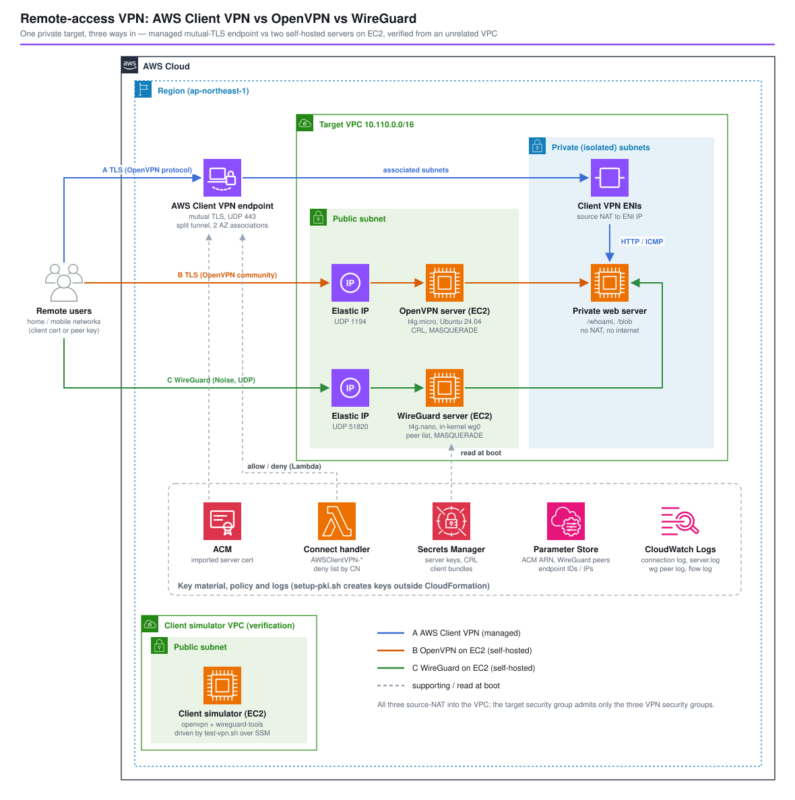

*Read this in other languages:* [](./README.ja.md) [](./README.md)

# Remote-Access VPN: AWS Client VPN vs OpenVPN vs WireGuard on EC2 - AWS CDK Reference Architecture


Remote users who need to reach private resources in a VPC usually end up with one of three things: the managed **AWS Client VPN**, a self-hosted **OpenVPN** server, or a self-hosted **WireGuard** server. Client VPN speaks the OpenVPN protocol, so the first two differ mostly in who runs the server; WireGuard is a different protocol with no certificates and no user identity at all.

This architecture puts all three in front of the same private web server, each in its own stack, and deploy-verifies them from an EC2 instance in an unrelated VPC that plays the remote laptop. The numbers below — deploy time, connect time, latency, throughput, what the target sees, how a revoked user is rejected and what each method logs — come from that deployment in ap-northeast-1.



## 📑 Table of Contents

- [Which one to choose](#-which-one-to-choose)
- [Architecture Overview](#️-architecture-overview)
- [Design Decisions and Best Practices](#-design-decisions-and-best-practices)
- [Verification Results](#-verification-results-deployed-to-ap-northeast-1)
- [Well-Architected Alignment](#️-well-architected-alignment)
- [Cost](#-cost)
- [Security Considerations](#-security-considerations)
- [Prerequisites](#-prerequisites)
- [Deployment](#-deployment)
- [Usage (test-vpn.sh)](#usage-test-vpnsh)
- [Testing Strategy](#-testing-strategy)
- [Customization](#️-customization)
- [Troubleshooting](#-troubleshooting)
- [Cleanup](#-cleanup)
- [References](#-references)

## 🧭 Which one to choose

| | A. AWS Client VPN | B. OpenVPN on EC2 | C. WireGuard on EC2 |
| --- | --- | --- | --- |
| Who runs the server | AWS (ENIs in your subnets, multi-AZ) | You (OS, patches, HA) | You (OS, patches, HA) |
| Protocol | OpenVPN-compatible TLS, UDP/TCP 443 or 1194 | OpenVPN TLS | WireGuard (Noise), UDP |
| User authentication | Certificate, Active Directory (MFA), SAML (IAM Identity Center, Entra ID…), or certificate + one of them | Certificate; LDAP/RADIUS/OIDC through plugins | Public key per device only — no user, no MFA, no SSO |
| Per-user policy | Authorization rules by CIDR × AD/SAML group, connect handler Lambda, device posture (Cedar) | iptables / `client-config-dir` that you write | `AllowedIPs` + iptables that you write |
| Revoking a user | Connect handler deny list, CRL import, or remove from the IdP group | CRL file (must be renewed before it expires) | Remove the peer key |
| Connection log | CloudWatch Logs, managed | `server.log`, you ship it | None; you derive it from handshake age |
| Scale / HA | 7,000 connections per association, up to 126,000 with 5 | One instance per server unless you build more | One instance per server unless you build more |
| Measured here (one client) | 4.2–4.4 s to connect, RTT 4–6 ms, 170–248 Mbit/s | 2.7 s, RTT 0.8–1.2 ms, 272–471 Mbit/s | 3.5 s, RTT 0.8–0.9 ms, 1,674–2,248 Mbit/s (MTU 1420) |
| Monthly cost in this setup (20 users × 8 h × 21 days) | ~$394 | ~$13 | ~$9 |

- **Client VPN** when users must authenticate with the corporate IdP, MFA and group-based access are required, auditors want a connection log, or you need more than a few hundred users without operating anything. The price is a fixed ~$110 per association per month plus $0.05 per user-hour.
- **OpenVPN on EC2** when the same certificate-based model is enough and cost matters more than availability; it is also the bridge to Client VPN, because the same CA and client certificates work against both.
- **WireGuard on EC2** for a small team of engineers or site-to-device links where a key per device is acceptable: the cheapest, fastest and simplest, but identity, revocation records, logs and HA are all yours to build.

## 🏗️ Architecture Overview

### Key Components

| Component | Configuration | Why |
| --- | --- | --- |
| Target VPC | 2 AZs, public + isolated `/24` subnets, **no NAT gateway**, flow logs (ALL) | The target is reachable only through a VPN |
| Private web server | Ubuntu 24.04 t4g.nano in an isolated subnet, Python `/whoami` (returns the source IP it saw) and `/blob?mb=N` | Shows each VPN's source NAT and measures throughput |
| A. Client VPN endpoint | Mutual TLS (server cert in ACM, same CA for clients), UDP 443, split tunnel, 2 AZ associations, 8 h session timeout, login banner, connection log, `authorizeAllUsersToVpcCidr` | The managed baseline |
| A. Connect handler | Lambda `AWSClientVPN-<project>-<env>-connect-handler` (Python 3.14), deny list by certificate CN | Revokes a user without touching the CRL; logs every decision |
| B. OpenVPN server | Ubuntu 24.04 t4g.micro, public subnet, Elastic IP, UDP 1194, `crl-verify`, pushes the VPC route, `MASQUERADE` | Self-hosted equivalent of A with the same certificates |
| C. WireGuard server | Ubuntu 24.04 t4g.nano, public subnet, Elastic IP, UDP 51820, **MTU 1420**, peers from SSM, `MASQUERADE` | Self-hosted, key-based |
| Key material | `setup-pki.sh`: CA, server and client certificates, CRL, WireGuard keys → ACM, Secrets Manager, SSM Parameter Store | Private keys never appear in a CloudFormation template |
| Logs | Client VPN connection log + handler log; CloudWatch agent ships OpenVPN `server.log` and a per-minute WireGuard peer log | Same question ("who connected?") answered three ways |
| Client simulator | Ubuntu 24.04 t4g.micro in a separate VPC (no peering), `openvpn` + `wireguard-tools`, `vpn-test` script | Plays the remote laptop; driven by `test-vpn.sh` over SSM |

### Stacks

| Stack | Contents |
| --- | --- |
| `<project>-<env>-vpn-target` | VPC, flow logs, target web server and its security group |
| `<project>-<env>-vpn-client-vpn` | Client VPN endpoint, associations, authorization rule, connect handler, log groups |
| `<project>-<env>-vpn-openvpn` | `SelfHostedVpnServer` construct with the OpenVPN bootstrap |
| `<project>-<env>-vpn-wireguard` | `SelfHostedVpnServer` construct with the WireGuard bootstrap |
| `<project>-<env>-vpn-client-sim` | Verification harness (disable with `clientSimulator.enabled: false`) |

Each VPN stack depends on the target stack only and adds its own ingress rules to the target security group, so one method can be deployed or destroyed without the others.

## 🎯 Design Decisions and Best Practices

### 1. Keys are created outside CloudFormation

CDK cannot create the ACM certificate Client VPN needs (mutual authentication requires an imported certificate), and server private keys should not be written into a template or a CDK asset. `setup-pki.sh` builds a small CA with `openssl ca` (RSA 2048 — Client VPN accepts only 1024/2048-bit RSA), revokes `client2`, generates WireGuard X25519 keys with `openssl genpkey` (no `wireguard-tools` needed), imports the server certificate into ACM and stores the rest in Secrets Manager and Parameter Store under `/<project>/<env>/vpn/`. The stacks only reference those names (`lib/vpn-names.ts`), and the servers read their keys at boot. Re-running the script re-imports into the same ACM ARN, so the endpoint keeps working.

### 2. One CA for Client VPN and OpenVPN

Client VPN accepts the server certificate ARN as the client root CA when both are issued by the same CA, and OpenVPN uses the same files. A client certificate therefore works against both servers — the migration path from self-hosted OpenVPN to Client VPN (or back) is a profile change on the client.

### 3. Three ways to remove a user

`client2` holds a valid certificate (and a WireGuard key) but must be refused:

- **Client VPN**: the connect handler returns `allow: false` for its CN. It runs after authentication and before the authorization rules, receives the CN, public IP, platform and client version, and its error message reaches the user.
- **OpenVPN**: the certificate is in the CRL. `crl-verify` rejects the TLS handshake. The CRL has a `nextUpdate` date; when it passes, OpenVPN rejects **every** client, so `setup-pki.sh` issues it for 365 days and it must be renewed.
- **WireGuard**: the key is simply not in the peer list (`wireguard/peers` in Parameter Store). There is no revocation record; adding or removing a peer is `wg-render.sh && wg syncconf wg0 <(wg-quick strip wg0)` on the server.

### 4. Source NAT instead of routes

All three hand traffic to the VPC with a VPC address as the source: Client VPN NATs to its ENI in the associated subnet, the self-hosted servers `MASQUERADE` to their own address. The self-hosted servers therefore keep source/destination check on and need no route table entries, and the target security group can admit exactly the three VPN security groups. The trade-off: the target cannot tell users apart by IP — use the VPN's own logs (or Client VPN's Transit Gateway attachment, which preserves client IPs).

### 5. WireGuard MTU pinned to 1420

EC2 ENIs use a 9001-byte MTU and `wg-quick` sets the tunnel MTU to the route MTU minus 80, so both the server and an EC2-based client came up with MTU **8921**. The internet path is 1500 bytes; tunnel packets were fragmented and throughput dropped to 41–81 Mbit/s. With `MTU = 1420` the same test ran at 1,674–2,248 Mbit/s. The server sets it from `wireGuard.mtu`; put `MTU = 1420` in client configs as well.

### 6. Split tunnel everywhere

Only the VPC CIDR goes through the tunnel (Client VPN `splitTunnel`, OpenVPN `push "route ..."`, WireGuard `AllowedIPs`). Users keep their own internet path, and the VPN does not pay data transfer for their web browsing. Full tunnel needs a NAT path out of the VPC and a route for `0.0.0.0/0`.

### 7. Ubuntu, one instance, Elastic IP

`openvpn` and `wireguard-tools` are in Ubuntu's archive but not in Amazon Linux 2023, so every instance uses Canonical's Ubuntu 24.04 arm64 AMI from its SSM public parameter. Each server is a single instance behind an Elastic IP: replacing the instance (any user data change does) keeps the address, and the keys come back from Secrets Manager, so client configurations survive. It is not highly available — an AZ outage drops every session until a new instance runs. For production, run an Auto Scaling group of one per AZ with the EIP re-associated at boot, or two servers with both addresses in the client profile (`remote` lines for OpenVPN; a second peer for WireGuard).

### 8. No SSH

Servers and the client simulator have no SSH port; administration and the tests go through SSM Session Manager / Run Command (`AmazonSSMManagedInstanceCore`). Only the VPN port is open to the internet.

## 🔬 Verification Results (deployed to ap-northeast-1)

Deployed with `drillexercises-dev` on 2026-11-03 (aws-cdk-lib 2.273). Client: Ubuntu 24.04 t4g.micro in another VPC, OpenVPN 2.6.19, reaching the servers' public endpoints over the internet. Download: 100 MiB from `/blob`, three runs.

### 1. Deployment time

| Stack | Time |
| --- | --- |
| Target / client simulator | 2 min 56 s / 2 min 51 s |
| OpenVPN / WireGuard | 3 min 15 s / 3 min 5 s |
| **Client VPN** | **9 min 14 s** — endpoint 76 s, then both subnet associations **7 min 17 s** |

The servers were usable about 2 minutes after their stacks finished (cloud-init installs packages).

### 2. Connect time, latency, throughput

| Method | Connect (process start → first HTTP 200) | Ping RTT avg | HTTP download | Tunnel MTU | Source IP the target saw |
| --- | --- | --- | --- | --- | --- |
| A. Client VPN | 4.2–4.4 s | 4.0–5.9 ms | 170–248 Mbit/s | 1500 | `10.110.3.154` (endpoint ENI) |
| B. OpenVPN | 2.7–2.8 s | 0.8–1.2 ms | 272–471 Mbit/s | 1500 | `10.110.0.32` (server) |
| C. WireGuard, MTU 1420 | 3.5 s | 0.8–0.9 ms | 1,674–2,248 Mbit/s | 1420 | `10.110.0.140` / `.155` after replacement (server) |
| C. WireGuard, wg-quick default | 3.5–3.7 s | 0.8–0.9 ms | 41–81 Mbit/s | 8921 | `10.110.0.140` |

- Client VPN adds a few milliseconds: the client and the endpoint ENI are in the same region, but traffic passes through the managed service rather than directly to an instance. Its throughput per connection was the lowest and the steadiest.
- The self-hosted numbers are burst numbers of small Graviton instances (t4g "up to 5 Gbit/s" with a much lower baseline); sustained traffic for many users needs a larger instance.
- WireGuard's fastest result needed the MTU fix (design decision 5).

### 3. Rejecting `client2`

| Method | What the client saw | Time | Server-side record |
| --- | --- | --- | --- |
| A. Client VPN | `AUTH_FAILED,This device is no longer authorized.` then `openvpn` exits | ~1 s after the TLS handshake | Handler log `{"decision": "deny", "common-name": "client2.vpn.internal", ...}`; `describe-client-vpn-connections` lists the attempt as `terminated` |
| B. OpenVPN | `TLS key negotiation failed to occur within 60 seconds`, retried forever — no reason given | until the client gives up | `VERIFY ERROR: depth=0, error=certificate revoked: CN=client2.vpn.internal` |
| C. WireGuard | No handshake, `0 B received` | until the client gives up | Nothing — unknown keys get no answer and no log line |

### 4. What each method logged

- **Client VPN**: one JSON line per connect-handler decision (CN, public IP, platform, OpenVPN version) within seconds; `describe-client-vpn-connections` with established/end times and client IPs immediately. The **connection log** is batched: connections from 03:04–03:07 arrived in CloudWatch Logs together at 03:30:35 (the stream did not exist until then), as `connection-attempt` `successful` / `failed` with reason `client-connect-failed` for the handler's denial, and `connection-reset` with start/end time and byte counts (332,121,271 egress bytes for one download session). Do not build real-time alerting on it.
- **OpenVPN**: `Peer Connection Initiated` with CN and source address, `certificate revoked` for `client2`, `Inactivity timeout` when a client vanished without notifying.
- **WireGuard**: only what the timer writes — per minute, the peer name, its last endpoint, handshake age and byte counters. After the client left, the endpoint stayed and the handshake age just grew: "connected" can only be inferred (handshake age under ~3 minutes).

### 5. Server replacement

Changing the WireGuard bootstrap replaced the instance (50 s stack update). The Elastic IP stayed `54.249.117.55`, the server key came back from Secrets Manager, and the existing client configuration connected again without change.

### 6. Teardown

`cdk destroy` of all five stacks took 13 min 44 s; the Client VPN stack alone took about 10 minutes (disassociating the subnets), the others about 1 minute each. `setup-pki.sh --delete` then removed the ACM certificate (in use until the endpoint is gone), the secrets and the parameters. Left behind: the log groups of the CDK custom resource that restricts the default security group (`/aws/lambda/<stack>-CustomVpcRestrictDefault-*`), deleted by hand.

## 🏛️ Well-Architected Alignment

| Pillar | How this architecture addresses it |
| --- | --- |
| Operational Excellence | One stack per method; key material scripted (`setup-pki.sh`); `test-vpn.sh status / run / logs` checks readiness, measures, and shows each method's logs; no SSH, everything through SSM |
| Security | Mutual TLS with a private CA; private keys only in Secrets Manager; target reachable only from the three VPN security groups; split tunnel; revocation demonstrated per method; IMDSv2, encrypted volumes, flow logs, connection logs |
| Reliability | Client VPN associated with two AZs; self-hosted servers keep their Elastic IP and keys across replacement (single instance — see design decision 7 for HA) |
| Performance Efficiency | Measured per method; WireGuard MTU fixed to the path MTU; Graviton instances |
| Cost Optimization | Cost per method with the user-hour model below; Client VPN associations are the dominant fixed cost and can be reduced to one in non-production |
| Sustainability | Smallest Graviton instances that carry the test load; split tunnel keeps unrelated traffic off the VPN |

## 💰 Cost

ap-northeast-1, 730 hours/month, Pricing API on 2026-11-03: Client VPN $0.15 per association-hour and $0.05 per connection-hour; t4g.nano $0.0054/h, t4g.micro $0.0108/h; public IPv4 $0.005/h. Usage example: 20 users connected 8 h × 21 days = 3,360 connection-hours.

| Item | A. Client VPN | B. OpenVPN | C. WireGuard |
| --- | --- | --- | --- |
| Endpoint / instance | 2 associations × 0.15 × 730 = **$219.0** | t4g.micro **$7.9** | t4g.nano **$3.9** |
| Per-user charge | 3,360 × 0.05 = **$168.0** | — | — |
| Public IPv4 | 2 ENIs × $3.65 = $7.3 | EIP $3.65 | EIP $3.65 |
| EBS 8 GiB gp3, logs | small | ~$1 | ~$1 |
| **Total (this usage)** | **~$394** | **~$13** | **~$9** |

- Client VPN's fixed part with one association is $109.5/month; each additional always-on user adds ~$36.5/month (730 h × $0.05).
- Data transfer out to the internet is billed the same way for all three; with split tunnel it is only the traffic to the VPC.
- Shared in this pattern: the target (t4g.nano), the connect handler and logs (cents), and the verification client (t4g.micro + IPv4, ~$12/month if left running).
- What the self-hosted rows do not show: the engineering time for patching, HA, log shipping and user lifecycle.

## 🔒 Security Considerations

- **Ingress**: the self-hosted servers open one UDP port to `vpnIngressCidrs` (default `0.0.0.0/0`, because remote users come from unknown networks); every packet is authenticated by the protocol, and WireGuard does not even answer unauthenticated packets. Narrow it if your users have fixed egress IPs.
- **Key material**: created by `setup-pki.sh`, stored in Secrets Manager (server keys, client bundles) and ACM; the servers' roles can read only their own secret. `.pki/` (local copies, including the CA key) is git-ignored — keep the CA key offline in production. Bootstrap scripts disable shell tracing while key material is in variables so it does not reach `cloud-init-output.log`.
- **Client VPN**: mutual TLS only in this pattern; for user identity add SAML (IAM Identity Center) or Active Directory with MFA, and authorization rules per group. The connect handler fails closed: errors, timeouts or invalid responses deny the connection.
- **Target**: isolated subnet, no NAT, security group admits only the three VPN security groups on HTTP and ICMP.
- **Instances**: IMDSv2 required, encrypted gp3 volumes, no SSH, SSM for administration.

CDK Nag suppressions (all in `test/compliance/cdk-nag.test.ts`): EC23 (VPN port open to the internet, by design), EC28/EC29 (no detailed monitoring / termination protection on disposable instances), IAM4 (`AmazonSSMManagedInstanceCore`, `AWSLambdaBasicExecutionRole`), IAM5 (CloudWatch agent log streams; the client simulator's read access under the pattern's prefix), VPC7 (client simulator VPC).

## 📋 Prerequisites

- Node.js 24, AWS CDK CLI, a bootstrapped account
- `openssl` 3, `jq`, AWS CLI v2 (for `setup-pki.sh` and `test-vpn.sh`)

## 🚀 Deployment

```bash
cd infrastructure/workspaces/client-vpn-vs-openvpn-wireguard

# 1. Key material: CA, certificates, CRL, WireGuard keys -> ACM / Secrets Manager / Parameter Store
./setup-pki.sh --project myproject --env dev        # profile defaults to myproject-dev

# 2. Stacks (Client VPN takes ~9 minutes because of the subnet associations)
PROJECT=myproject ENV=dev npm run stage:deploy:all -- --require-approval never

# 3. Wait ~2 minutes for cloud-init, then
./test-vpn.sh --project myproject --env dev status
```

To deploy only some methods, name the stacks, e.g. `npx cdk deploy 'ClientVpnVsOpenvpnWireguardDev/WireGuard' -c project=myproject -c env=dev --profile myproject-dev` (the target stack comes along as a dependency).

### Connecting from a real laptop

- **Client VPN**: `aws ec2 export-client-vpn-client-configuration --client-vpn-endpoint-id <id> --output text > cvpn.ovpn`, append `<cert>` / `<key>` from `.pki/client1.crt` / `.pki/client1.key`, open it with the AWS VPN Client or any OpenVPN client.
- **OpenVPN**: the same certificate with `remote <OpenVpnPublicIp> 1194` (see `vpn-test.sh` for the full profile).
- **WireGuard**: `[Interface] PrivateKey = <.pki/client1.wg.key>`, `Address = 10.122.0.2/32`, `MTU = 1420`; `[Peer] PublicKey = <wireguard/server-public-key>`, `Endpoint = <WireGuardPublicIp>:51820`, `AllowedIPs = 10.110.0.0/16`.

## Usage (test-vpn.sh)

```bash
./test-vpn.sh --project myproject --env dev status   # endpoint/associations, server services, simulator readiness
./test-vpn.sh --project myproject --env dev run      # client1 and client2 against all three; connect time, RTT, throughput, MTU, source IP
./test-vpn.sh --project myproject --env dev run --methods wireguard --clients client1 --mb 50 --runs 1
./test-vpn.sh --project myproject --env dev logs --since 30m   # handler decisions, OpenVPN server.log, WireGuard peer log
```

`run` sends `vpn-test <method> <client> <mb> <runs>` to the client simulator through SSM Run Command. On the instance, `vpn-test wireguard client1 100 3 auto` reproduces the wg-quick default MTU.

## 🧪 Testing Strategy

```bash
npm test -w workspaces/client-vpn-vs-openvpn-wireguard
```

| Suite | Covers |
| --- | --- |
| `test/unit/stage.test.ts` | CIDR/netmask helpers and the user data template renderer; target VPC without NAT, isolated server, IMDSv2/encryption, no own ingress, SSM outputs; Client VPN mutual TLS with the SSM-resolved ACM ARN for both server and client CA, endpoint settings, two associations, one authorization rule, handler name prefix and deny list, endpoint SG egress; per self-hosted server: single UDP port, EIP, source/dest check, target ingress from its own SG, secret access limited to its own secret; OpenVPN route/CRL/secret in user data; WireGuard address, peer parameter and MTU 1420; simulator VPC isolation and export permission; simulator toggle; stack dependencies |
| `test/snapshot/snapshot.test.ts` | Full template and resource counts for each of the five stacks |
| `test/compliance/cdk-nag.test.ts` | AwsSolutions pack on every stack (applied to the Stage — aspects on the App do not reach stages) |

## ⚙️ Customization

| Parameter (`parameters/dev-params.ts`) | Effect |
| --- | --- |
| `targetNetwork.vpcCidr` / `maxAzs` | Target VPC (the routes pushed to clients follow it) |
| `clientVpn.clientCidr` | Client address pool, `/12`–`/22`, cannot be changed after creation |
| `clientVpn.subnetAssociations` | 1 in non-production halves the fixed cost; 2+ for AZ resilience and capacity |
| `clientVpn.transportProtocol` / `port` / `splitTunnel` / `sessionTimeoutHours` / `loginBanner` | Endpoint behavior |
| `clientVpn.deniedCommonNames` | CNs the connect handler rejects |
| `openVpn.*` / `wireGuard.*` | Instance type, port, tunnel CIDR, WireGuard MTU (keep `wireGuard.tunnelCidr` in sync with `WG_TUNNEL_PREFIX` in `setup-pki.sh`) |
| `vpnIngressCidrs` | Who may reach the self-hosted ports |
| `clientSimulator.enabled` | Drop the verification harness |

## 🔧 Troubleshooting

| Symptom | Cause / action |
| --- | --- |
| Client VPN stack fails: parameter `/…/acm/server-cert-arn` not found | Run `setup-pki.sh` before deploying |
| `test-vpn.sh run` fails at once with `send-command failed` | The client simulator is not yet Online in SSM (cloud-init ~2 minutes after the stack) |
| OpenVPN: every client fails with `TLS key negotiation failed` | Server rejects the certificate: check `server.log` for `VERIFY ERROR`. If **all** clients fail, the CRL has expired — rerun `setup-pki.sh` and replace the server |
| Client VPN: `AUTH_FAILED,<message>` | The connect handler denied the CN; check its log group. `AUTH_FAILED` without a message: certificate / CA mismatch |
| WireGuard: connects but slow | Tunnel MTU above the path MTU (`ip link show` shows 8921 on EC2). Set `MTU = 1420` |
| WireGuard: no handshake | Public key not in `wireguard/peers`, wrong server public key, or UDP 51820 blocked; the server logs nothing for unknown keys |
| An AWS CLI command in user data / Run Command writes an empty file | Snap build of AWS CLI v2 under SSM writes nothing to a redirected stdout; pipe it (`aws … | cat > file`) |
| `setup-pki.sh --delete` cannot delete the certificate | It is still used by the Client VPN endpoint; destroy the stacks first |

First step for any symptom: `./test-vpn.sh --project <p> --env <e> status` and `logs`.

## 🧹 Cleanup

```bash
PROJECT=myproject ENV=dev npm run stage:destroy:all
./setup-pki.sh --project myproject --env dev --delete   # ACM certificate, secrets, parameters
rm -rf .pki                                             # local CA and keys

# Log groups of the CDK custom resource that restricts the default security group
aws logs describe-log-groups --log-group-name-prefix /aws/lambda/myproject-dev-vpn- --query 'logGroups[].logGroupName'
```

## 📚 References

- [AWS Client VPN Administrator Guide](https://docs.aws.amazon.com/vpn/latest/clientvpn-admin/what-is.html)
- [Client authentication in AWS Client VPN](https://docs.aws.amazon.com/vpn/latest/clientvpn-admin/client-authentication.html) / [Mutual authentication](https://docs.aws.amazon.com/vpn/latest/clientvpn-admin/mutual.html)
- [Connection authorization (client connect handler)](https://docs.aws.amazon.com/vpn/latest/clientvpn-admin/connection-authorization.html)
- [Client VPN scaling considerations](https://docs.aws.amazon.com/vpn/latest/clientvpn-admin/scaling-considerations.html) / [Quotas](https://docs.aws.amazon.com/vpn/latest/clientvpn-admin/limits.html)
- [AWS Client VPN native Transit Gateway attachment (blog)](https://aws.amazon.com/blogs/networking-and-content-delivery/introducing-aws-client-vpn-native-aws-transit-gateway-attachment/)
- [AWS VPN pricing](https://aws.amazon.com/vpn/pricing/)
- [OpenVPN 2.6 manual](https://openvpn.net/community-resources/reference-manual-for-openvpn-2-6/) / [WireGuard quick start](https://www.wireguard.com/quickstart/)
- Knowledge base: [docs/knowledge/remote-access-vpn.md](../../../docs/knowledge/remote-access-vpn.md)

---

**Level 300** · Part of [AWS CDK Reference Architectures](../../../README.md)
