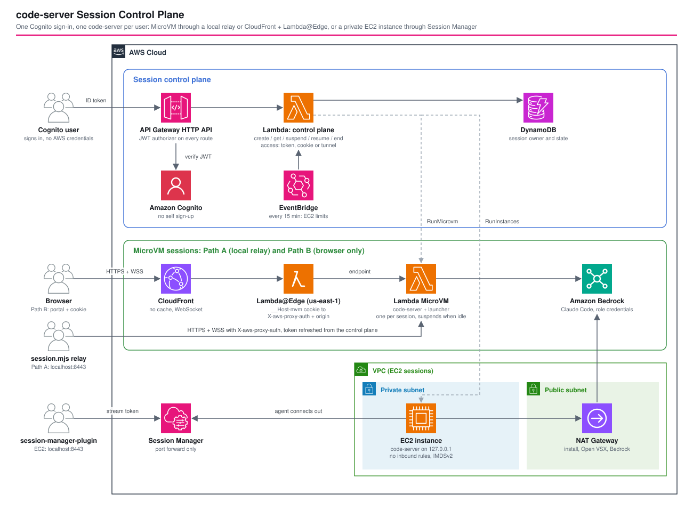

# code-server Session Control Plane — Cognito のログイン1つで、ユーザーごとの code-server を MicroVM または EC2 に起動する

*他の言語で読む(Read this in other languages):* [](./README.ja.md) [](./README.md)


## はじめに

[code-server](https://github.com/coder/code-server)(ブラウザで動く VS Code)を、ユーザーごとにオンデマンドで起動するリファレンス実装です。Amazon Cognito で認証するコントロールプレーンが、[AWS Lambda MicroVM](https://aws.amazon.com/lambda/lambda-microvms/) または EC2 インスタンスを1ユーザー1台で起動します。

[`lambda-microvms-codex-appserver`](../lambda-microvms-codex-appserver/README.ja.md) のコントロールプレーンの考え方を code-server に適用したもので、[`code-server-ec2-vs-lambda-microvms`](../code-server-ec2-vs-lambda-microvms/README.ja.md) で必要だった AWS 認証情報を、利用者の手元から取り除きました。code-server の公式 FAQ と [導入解説記事](https://www.issoh.co.jp/tech/details/18117/)が勧める「1ユーザー1VM」「共有パスワードの代わりに認証基盤で個人を識別」「EC2 は受信ポートを全閉にして Session Manager で接続」を、そのまま構成に反映しています。

このアーキテクチャで確認できること:

- ブラウザからカスタムヘッダーを送れない MicroVM エンドポイントへ届ける2つの方法。ローカルリレー(方式 A)と、CloudFront + Lambda@Edge(方式 B)
- HttpOnly Cookie のトークンを Lambda@Edge で `X-aws-proxy-auth` ヘッダーとオリジンに変換し、状態もシークレットも持たずにセッション単位でルーティングする方法
- AWS 認証情報を持たないユーザーへ、コントロールプレーンが開いた Session Manager のポートフォワードを渡す方法
- 利用者がターミナルを持つ環境で、実行ロールとシークレットをどう設計するか
- 2026-11-05 に実機でエンドツーエンドの検証を実施。実ブラウザでのログインと IDE の表示を含む。見つかって直した不具合は[実機デプロイ検証](#-実機デプロイ検証)にまとめている

## 📑 目次

- [アーキテクチャ概要](#️-アーキテクチャ概要)
- [設計判断とベストプラクティス](#-設計判断とベストプラクティス)
- [コスト最適化](#-コスト最適化)
- [セキュリティ考慮事項](#-セキュリティ考慮事項)
- [前提条件](#-前提条件)
- [デプロイ手順](#-デプロイ手順)
- [使い方](#使い方)
- [テスト戦略](#-テスト戦略)
- [カスタマイズ](#️-カスタマイズ)
- [実機デプロイ検証](#-実機デプロイ検証)
- [トラブルシューティング](#-トラブルシューティング)
- [クリーンアップ](#-クリーンアップ)
- [参考資料](#-参考資料)

## 🏗️ アーキテクチャ概要



3つの接続経路があり、どれも同じコントロールプレーンの背後にあります。

| | 方式 A: ローカルリレー | 方式 B: ブラウザのみ | EC2 版 |
| --- | --- | --- | --- |
| コンピュート | MicroVM | MicroVM | プライベートサブネットの EC2 |
| 利用者の手元に必要なもの | Node.js | ブラウザ | Node.js と `session-manager-plugin` |
| 開く URL | `http://localhost:8443` | `https://<ディストリビューション>/__cp/portal` | `http://localhost:8443` |
| トークンの持ち方 | リレーのプロセス内 | HttpOnly Cookie | Session Manager のストリームトークン |
| IDE の通信経路 | 手元 → MicroVM エンドポイント | CloudFront → Lambda@Edge → MicroVM エンドポイント | 手元 → Session Manager → インスタンス |
| アイドル時 | 15分で自動サスペンド | 15分で自動サスペンド | 自動では止まらない。起動から8時間で停止 |
| 起動時間(実測) | 7〜21秒 | 7〜21秒 | 約100秒(初回セットアップ) |
| 停止後の状態 | サスペンド中は保持、終了すると消える | 同左 | 停止中も EBS に残る、終了すると消える |

### スタック

| スタック | 内容 | 省略方法 |
| --- | --- | --- |
| `Microvm` | MicroVM イメージ、ビルドロール、実行ロール、ロググループ | 必須 |
| `Ec2` | VPC、NAT Gateway、起動テンプレート、インスタンスロール | `params.ec2` を削除 |
| `ControlPlane` | Cognito、HTTP API、Lambda、DynamoDB、EC2 のスイープ | 必須 |
| `BrowserAccess` と `edge-lambda-stack-*` | CloudFront、Lambda@Edge(us-east-1)、CloudFront Functions | `browserAccess: false` |

### 主要コンポーネント

| コンポーネント | 役割 |
| --- | --- |
| HTTP API + Cognito JWT Authorizer | すべてのセッション操作を認可する。`GET /portal` だけはデータを持たない静的ページなので認可なし |
| `create-session` | ユーザーごとの上限を実際の状態で確認し、`RunMicrovm` または `RunInstances` を呼ぶ |
| `get-sessions` / `change-session` | 状態の参照、サスペンド、レジューム、終了。どれも所有者のセッションだけを扱う |
| `access-session` | 入口を渡す唯一のルート。リレー用トークン、ブラウザ用 Cookie、EC2 用ストリームトークンを発行する |
| `sweep-ec2` | 15分ごとに実行し、EC2 に MicroVM 相当の上限(稼働時間、セッション期限)を適用する |
| `portal` | 方式 B のログインとセッション操作の画面 |
| Lambda@Edge `router` | Cookie をオリジンと `X-aws-proxy-auth` に変換する。トークン切れのページ遷移をポータルへ戻す |
| MicroVM 内ランチャー | ライフサイクルフックに応答し、`/run` で code-server を起動し、HTTP と WebSocket をプロキシする |
| `scripts/session.mjs` | Cognito 認証で動くクライアント。リレーとトンネルを含む |
| `scripts/smoke.mjs` | 実際のセッションで経路を検査する運用チェック |

### リクエストの流れ

```text
方式 B(ブラウザのみ)
  ブラウザ ──▶ CloudFront /__cp/* ──▶ HTTP API(ログイン後、Set-Cookie: __Host-mvm=<endpoint>~<JWE>)
  ブラウザ ──▶ CloudFront /*  ──▶ Lambda@Edge (origin-request) ──▶ MicroVM エンドポイント
                                    Cookie → オリジン + X-aws-proxy-auth
                                    X-Forwarded-Host: <ディストリビューション>

方式 A(ローカルリレー)
  session.mjs ──▶ HTTP API: POST /sessions/{id}/access {"type":"relay"} ──▶ { endpoint, token }
  ブラウザ ──▶ localhost:8443 (relay) ──HTTPS + X-aws-proxy-auth──▶ MicroVM エンドポイント

EC2 版
  session.mjs ──▶ HTTP API: POST /sessions/{id}/access {"type":"tunnel"} ──▶ Lambda が ssm:StartSession
  ブラウザ ──▶ localhost:8443 (session-manager-plugin) ──▶ Session Manager ◀── SSM Agent(外向き接続)
                                                                                 └▶ code-server 127.0.0.1:8080
```

## 🎯 設計判断とベストプラクティス

### 1. 利用者がターミナルを持つ前提でロールを設計する

code-server のターミナルからは、実行ロールやインスタンスロールの権限をそのまま使えます。そのためロールは「利用者に渡してよい権限」として設計しました。Bedrock の呼び出しとログの書き込み(EC2 は Session Manager)だけを持ち、DynamoDB やシークレットには触れません。[`lambda-microvms-codex-appserver`](../lambda-microvms-codex-appserver/README.ja.md) の実行ロールが `EventsTable` への書き込みを持つのは利用者がシェルを持たないからで、この違いが設計を分けます。

### 2. 共有パスワードをなくし、`--auth none` にする

code-server のパスワードは1つを全員で共有するので、個人を識別も失効もできません。この構成では、MicroVM はトークンなしのリクエストをプラットフォームが通さず、EC2 は code-server がループバックだけで待ち受けます。どちらもコントロールプレーンを経由しない入口がないので、`--auth none` にして、利用者の識別を Cognito に一本化しました。全セッションで共有するシークレットもなくなります。

### 3. Lambda@Edge は Cookie の形を変えるだけ

Cookie の値は `<エンドポイント>~<JWE>` で、Lambda@Edge はこれをオリジンとヘッダーに移すだけです。DynamoDB を引かず、シークレットも持たず、リクエストごとの遅延も増えません。Cookie を偽造しても、届くのは自分がトークンを持つ MicroVM だけです。任意のホストへの中継を防ぐため、エンドポイントは `*.lambda-microvm.<region>.on.aws` の形式だけを受け付けます。

### 4. code-server のオリジンチェックを残す

`Origin` をエンドポイントに書き換えれば WebSocket は通りますが、code-server の防御を無効にしてしまいます。代わりに、Lambda@Edge とリレーは `X-Forwarded-Host` に閲覧者のホストを渡します。code-server はこれと `Origin` を比較するので、別サイトからの WebSocket は 403 になります。Cookie の `SameSite=Strict` と合わせて二重の防御です。

### 5. `/__cp/*` を同じディストリビューションに置く

Cookie は発行元のドメインに属します。コントロールプレーンを同じドメインの `/__cp/*` で公開すれば、Cookie は CloudFront のドメインに付き、CORS の設定も要りません。GET リクエストの `Authorization` は、キャッシュキーに含めないと CloudFront が転送しません。そのため専用のキャッシュポリシーに入れ、全レスポンスを `no-store` にして、実際には保存されないようにしています。

### 6. EC2 もコントロールプレーンから接続させる

Lambda が `ssm:StartSession` を呼び、ストリーム URL とトークンを所有者に返します。利用者は `session-manager-plugin` を動かすだけで、AWS 認証情報も IAM 権限も要りません。Lambda のポリシーは、タグ付きインスタンスと `AWS-StartPortForwardingSession` ドキュメントに限定しているので、シェルは開けません。

### 7. EC2 にも上限を作る

MicroVM にはアイドルポリシーと最大寿命がありますが、EC2 にはありません。`sweep-ec2` が、起動から `maxRunningHours` を超えたインスタンスを停止し、セッション期限(`ExpiresAt` タグ)を過ぎたものを終了します。アイドルの検知はしないので、使い終わったら自分で停止する必要があります。

### 8. ユーザーごとのセッション数を制限する

サインインしたユーザーは費用のかかるコンピュートを起動できます。`create-session` は `maxActiveSessionsPerOwner`(既定2)を、DynamoDB の記録ではなく実際の状態で確認します。ごく短い間に同時にリクエストすると超える可能性はありますが、費用の暴走を防ぐ用途には十分です。

### 9. Well-Architected Framework との対応

| 柱 | このパターンの対応 |
| --- | --- |
| 運用上の優秀性 | `smoke.mjs` で実際のセッションの経路を検査できる。Lambda、HTTP API、MicroVM ごとのログ |
| セキュリティ | セッションごとの VM 分離。Cognito による個人の識別。所有者単位のアクセス制御。受信ポートなしの EC2。HttpOnly と SameSite=Strict の Cookie。長期キーなし |
| 信頼性 | セッションの状態はコンピュートの実状態から読み直す。接続済みの WebSocket はトークン失効後も維持される。各セッションは単一コンピュートでフェイルオーバーはない |
| パフォーマンス効率 | MicroVM はスナップショットから数秒で起動し、1秒未満でレジューム。どちらも arm64。IDE の通信はコントロールプレーンを通らない |
| コスト最適化 | セッションがなければコンピュートは動かない。MicroVM の自動サスペンド、EC2 のスイープ、ユーザーごとの上限。NAT と CloudFront はパラメータで外せる |
| 持続可能性 | 使っていないセッションのコンピュートを解放する。Graviton と MicroVM を使う |

## 💰 コスト最適化

単価はリージョンごとに異なります。以下は構成を比べるための米国東部(バージニア北部)の定価です。実際の費用を見積もる前に、AWS の料金ページで確認してください。

| 項目 | 費用 | 発生条件 |
| --- | --- | --- |
| MicroVM(arm64、1 vCPU、2 GiB 基準) | 実行1時間で約 $0.126、サスペンド中はスナップショットが 1 GB 月 $0.08 | セッションごと |
| EC2 `t4g.medium` | 1時間 $0.0336、gp3 30 GiB で 月 $2.4 | セッションごと |
| NAT Gateway | 1時間 $0.045(月 約 $32.85)+ 1 GB あたり $0.045 | **`ec2` を有効にすると常時** |
| Lambda@Edge | 100万リクエスト $0.60 + GB 秒 $0.00005001 | 方式 B の全 HTTP リクエスト |
| CloudFront | 個人利用なら無料枠に収まる | 方式 B |
| HTTP API、Lambda、DynamoDB、Cognito | 少人数ならほぼゼロ | 常時 |

セッションを起動しない限り、MicroVM のみの構成(`ec2` と `browserAccess` を外す)の固定費はほぼゼロです。EC2 版を残すと、NAT Gateway の固定費が加わります。

コストの調整先:

- `microvm.maxIdleSeconds`: サスペンドまでの時間。開いたままのタブの通信がアイドルに影響する可能性があります(未検証)
- `microvm.suspendedSeconds`: スナップショットを保存し続ける時間の上限
- `ec2.maxRunningHours`、`ec2.instanceType`、`ec2.volumeSizeGiB`
- `controlPlane.maxActiveSessionsPerOwner`

## 🔒 セキュリティ考慮事項

### 実装済み

- セッションごとの VM 分離、ユーザー単位のコンピュート
- すべてのセッション操作に Cognito JWT を要求。セルフサインアップは無効
- 他のユーザーのセッションは常に 404
- MicroVM トークンは1つの MicroVM の1ポートに限定、有効期間は最大60分
- Cookie は `__Host-` プレフィックス、`Secure`、`HttpOnly`、`SameSite=Strict`
- Lambda@Edge はエンドポイントの形式を検証し、Cookie を code-server へ転送しない
- EC2: プライベートサブネット、インバウンドルールなし、IMDSv2 必須、暗号化ボリューム、code-server はループバックのみ
- EC2 の操作と Session Manager はタグ付きインスタンスに限定、ドキュメントはポートフォワードのみ
- ポータルは CSP(nonce)を設定し、ID トークンをストレージに保存しない
- Bedrock の権限は設定した2つのモデルに限定

### 残るリスク

- **Cookie の中のトークン**: 方式 B では JWE トークンがブラウザにあります。スクリプトからは読めませんが、端末自体が侵害されれば有効期間内は使われます。
- **`--auth none`**: 方式 A と EC2 版では、`localhost:8443` に同じ端末のほかのプロセスが接続できます。共有端末では使わないでください。
- **Bedrock の費用**: 利用者はターミナルからモデルを直接呼べます。Bedrock の費用はユーザーごとに制限していません。
- **アウトバウンド通信**: MicroVM も EC2 もインターネットに自由に出られます。外部へのデータ持ち出しを制限するなら、[`claude-managed-agents-lambda-microvms`](../claude-managed-agents-lambda-microvms/README.ja.md) の Network Firewall パターンを参照してください。

### 意図的に範囲外としているもの(環境に応じて追加)

- CloudFront と HTTP API の AWS WAF
- Cognito の MFA と Plus 機能プラン
- カスタムドメインと証明書(デフォルト証明書では最小 TLS バージョンを指定できない)
- CloudFront のアクセスログと VPC フローログ
- 永続ワークスペース(下記「カスタマイズ」を参照)

### CDK Nag

`test/compliance/cdk-nag.test.ts` が、4つのスタックに AwsSolutions パックを適用します。抑制にはそれぞれ理由を付けています。

## 📋 前提条件

**デプロイする人**

- Node.js 20 以上と、リポジトリの依存関係(`infrastructure/` で `npm ci`)
- 対象リージョンで Lambda MicroVMs が有効なこと: `aws lambda-microvms list-managed-microvm-images`
- 対象リージョン**と us-east-1** での CDK ブートストラップ(方式 B を使う場合)
- `bedrock` に設定するモデルのアクセス(`aws bedrock-runtime converse` で確認)

**使う人**

- 方式 A: Node.js 20 以上
- 方式 B: ブラウザ
- EC2 版: Node.js 20 以上と [`session-manager-plugin`](https://docs.aws.amazon.com/systems-manager/latest/userguide/session-manager-working-with-install-plugin.html)

## 🚀 デプロイ手順

```sh
cd infrastructure/workspaces/code-server-session-control-plane

# Lambda@Edge のため、リージョンを明示する必要がある
export CDK_DEFAULT_REGION=ap-northeast-1 CDK_DEFAULT_ACCOUNT=<account>
PROJECT=<project> ENV=dev npx cdk deploy '**' --require-approval never --profile <profile>

# ユーザーを作る(UserPoolId はスタックの出力)
aws cognito-idp admin-create-user --user-pool-id <UserPoolId> --username you@example.com --message-action SUPPRESS
aws cognito-idp admin-set-user-password --user-pool-id <UserPoolId> --username you@example.com \
  --password '<強力なパスワード>' --permanent
```

## 使い方

### 方式 B: ブラウザのみ

スタックの出力 `PortalUrl` を開き、サインインして **Start a new session** を押します。MicroVM が起動すると IDE に切り替わります。

トークンの有効期間は60分です。接続済みの IDE は使い続けられますが、60分を過ぎて再読み込みするとポータルへ戻るので、もう一度サインインして **Open** を押します。セッションと開いているファイルはそのままです。

### 方式 A と EC2 版: `session.mjs`

```sh
cd infrastructure/workspaces/code-server-session-control-plane/scripts

export CS_API_URL=<ApiUrl> CS_CLIENT_ID=<UserPoolClientId>
export CS_USERNAME=you@example.com CS_PASSWORD='...'

node session.mjs start                  # MicroVM
node session.mjs start --compute ec2    # EC2
node session.mjs connect                # 表示された http://localhost:8443 を開く

node session.mjs status
node session.mjs suspend
node session.mjs resume
node session.mjs stop
```

リレーは残り5分になる前にトークンを更新するので、作業中はそのターミナルを開いたままにしてください。EC2 の初回は code-server のインストールに約100秒かかります。

### Claude Code

Claude Code パネルを開くか、ターミナルで `claude` を実行します。Amazon Bedrock と `parameters/dev-params.ts` のモデルを使います。

## 🧪 テスト戦略

```sh
npm run test:unit -w workspaces/code-server-session-control-plane        # リソースと Lambda@Edge のロジック
npm run test:snapshot -w workspaces/code-server-session-control-plane    # テンプレート全体とリソース数
npm run test:compliance -w workspaces/code-server-session-control-plane  # cdk-nag AwsSolutions パック
```

`cdk deploy` だけでは、ブラウザから IDE に届くことは証明できません。`scripts/smoke.mjs` が実際のセッションを起動して経路を検査し、終了させます。

```sh
node scripts/smoke.mjs relay
CS_DOMAIN=<DistributionDomainName> node scripts/smoke.mjs browser
node scripts/smoke.mjs tunnel
```

## ⚙️ カスタマイズ

### 使う経路だけをデプロイする

```typescript
const devParams: EnvParams = {
  microvm: { baseImageArn: '...', baseImageVersion: '1' },
  // ec2 を書かなければ VPC と NAT Gateway を作らない
  browserAccess: false, // CloudFront と Lambda@Edge を作らない
};
```

### Claude Code を無効にする、またはモデルを変える

```typescript
bedrock: {
  enabled: false,
  modelId: 'jp.anthropic.claude-sonnet-4-6',
  smallFastModelId: 'jp.anthropic.claude-haiku-4-5-20251001-v1:0',
},
```

### 作業内容を残す

MicroVM は終了するとファイルが消え、寿命はサスペンド中も含めて最大8時間です。EC2 もセッション期限で終了すると消えます。Git への push を基本とし、自動で残したいときは MicroVM の `/terminate` フックや EC2 のシャットダウン処理に S3 への同期を追加してください。その場合は、実行ロールに `ownerId` 単位で絞った S3 権限が必要です。

## ✅ 実機デプロイ検証

2026-11-05 に開発用アカウントの ap-northeast-1 と us-east-1 へデプロイし、外部から確認しました。検証後にすべて削除しています。

| 確認項目 | 結果 |
| --- | --- |
| スタックの作成 | `Ec2` 約3分、`Microvm` 約5分(イメージビルドを含む)、`ControlPlane` 約2分、`BrowserAccess` 約4分 |
| MicroVM の起動から `RUNNING` | 7〜21秒(6回) |
| **実ブラウザ(方式 B)** | ポータルでサインイン、セッション開始から IDE の表示まで14秒。ターミナルと Claude Code 拡張が動作 |
| 方式 B の Cookie | `HttpOnly`、`Secure`、`SameSite=Strict`。`document.cookie` からは見えない。約1 KB で上限に余裕がある |
| 方式 B の WebSocket | Cookie あり 101。別オリジン 403。Cookie なしはポータルへの 302 |
| 方式 A | ヘルスチェック、ワークベンチ、WebSocket が 200、200、101。別オリジン 403 |
| EC2 版 | 同じ検査が 200、200、101、別オリジン 403。AWS 認証情報なしで接続 |
| EC2 の構成 | パブリック IP なし、`IMDSv2 required`、code-server は `127.0.0.1:8080` のみ |
| EC2 の所要時間 | SSM オンライン33秒、code-server 起動102秒、再開後 `RUNNING` まで7秒 |
| EC2 の停止と再開 | プロジェクトのファイルが残り、code-server も自動で再起動 |
| Claude Code → Bedrock | MicroVM、EC2 とも `BEDROCK_OK` |
| 所有者の分離 | 別のユーザーからの GET、access、DELETE はすべて 404 |
| セッションの上限 | 3つ目は 409 |
| サスペンド後の最初のリクエスト | CloudFront 経由で0.7秒、200。状態は `RUNNING` に戻った |
| 終了した MicroVM へのページ遷移(無効なトークン) | ポータルへの 302 と Cookie の削除 |
| スイープ | 期限前は何もせず、`ExpiresAt` を過去にすると終了 |

**トークンの失効(1分のトークンで計測)**

| 経過 | 新しいリクエスト | 接続済みの WebSocket |
| --- | --- | --- |
| 119秒まで | 200 | 維持 |
| 142秒 | `403 x-aws-proxy-error: UNAUTHORIZED` | 維持(ping に応答) |

指定した時間ぴったりには失効せず、約1分の猶予がありました。接続済みの WebSocket は失効の影響を受けません。

実機で見つかり、修正した不具合:

1. **エンドポイントのドメインは `lambda-microvm`(単数形)。** サービス名から `lambda-microvms` と推測した検証パターンが全リクエストを拒否しました。実際の形式は `<id>.lambda-microvm.<region>.on.aws` です。
2. **プレースホルダーのオリジンの `originPath` が MicroVM へ漏れた。** ドメインを差し替えても、オリジンの `path`(API のステージ)は残ります。すべての HTTP が 404 になる一方、code-server の WebSocket はパスを問わず 101 を返すので、WebSocket だけ成功するという紛らわしい症状でした。`request.origin.custom.path` を空にしました。
3. **`ec2:CreateTags` にボリュームも必要。** スタックのタグが起動テンプレートのタグ指定に伝播するので、`RunInstances` がボリュームにもタグを付けます。インスタンスだけを許可すると `UnauthorizedOperation` になります。
4. **`session-manager-plugin` がクライアントより長く生きる。** クライアントを止めてもプラグインが残り、ポートを占有しました。シグナルを転送しています。

確認できていないこと: 実際の60分トークンの失効、開いたままのタブでのアイドル自動サスペンド、`maxRunningHours` による停止(期限切れの終了は確認済み)、方式 A と EC2 版の実ブラウザでの操作(HTTP と WebSocket の検査のみ)、複数ユーザーの同時利用。

## 🔧 トラブルシューティング

まず `scripts/smoke.mjs` を実行してください。どの段階で失敗するかが分かります。

### WebSocket は 101 なのに、HTTP がすべて 404 になる

Lambda@Edge のオリジンパスを確認します。code-server の WebSocket はパスを問わず 101 を返すので、パスの誤りが WebSocket の検査では見つかりません。

### Cookie があるのに、ポータルへ戻され続ける

Lambda@Edge の `ENDPOINT_PATTERN` が実際のエンドポイントと一致しているか確認します。Cookie の値の `~` より前がエンドポイントです。

### IDE の一部が動かなくなり、`403 UNAUTHORIZED` が出ている

トークンが失効しています。ページを再読み込みするとポータルへ戻るので、もう一度サインインして **Open** を押します。方式 A ではリレーが更新できているか、`CS_PASSWORD` が正しいかを確認します。

### `POST /sessions` が 500 を返す(EC2)

`CreateSessionFunction` のログを確認します。`UnauthorizedOperation` がリソース名を示します。`CreateTags` のときは、タグが付くリソース(インスタンス、ボリューム、ネットワークインターフェイス)がすべて許可されているか確認します。

### `Connection to destination port failed, check SSM Agent logs`

ポートフォワードはつながっていますが、code-server がまだ起動していません。初回は UserData が終わるまで約100秒かかります。進行状況は `/var/log/cloud-init-output.log` で分かります。

### `POST /sessions` が 409 を返す

ユーザーごとの上限です。`session.mjs list` で確認し、不要なセッションを `stop` します。

### 検査スクリプトでページ遷移の動作が再現しない

Node.js の `fetch` は `sec-fetch-mode` を `cors` に上書きします。ページ遷移を試すときは、`curl -H 'Sec-Fetch-Mode: navigate'` か実ブラウザを使ってください。

### Claude Code がサインインを求める、または Bedrock が拒否する

`bedrock.smokeCheck: true` でデプロイすると、MicroVM のログストリームに `[bedrock-check]` の行が出ます。`AccessDeniedException` なら、`aws bedrock-runtime converse` で応答するモデルを `bedrock.modelId` に設定します。

## 🧹 クリーンアップ

スタックを削除しても、起動中のセッションは終了しません。先にすべて終了させてください。EC2 のインスタンスが残っていると VPC を削除できません。

```sh
node scripts/session.mjs list
node scripts/session.mjs stop --session <id>

cd infrastructure/workspaces/code-server-session-control-plane
PROJECT=<project> ENV=dev npx cdk destroy '**' --force --profile <profile>
```

Lambda@Edge のレプリカの削除には時間がかかるので、`edge-lambda-stack-*` は最初の削除で失敗することがあります。時間をおいて、もう一度実行してください(検証では数十分後に成功)。CloudFront のディストリビューションを消した後なら、課金は発生しません。

## 📚 参考資料

### AWS ドキュメント

- [MicroVM の実行と利用(ライフサイクルフック、認証、WebSocket)](https://docs.aws.amazon.com/lambda/latest/dg/microvms-launching.html)
- [Lambda@Edge のオリジンの変更と制限](https://docs.aws.amazon.com/AmazonCloudFront/latest/DeveloperGuide/edge-function-restrictions-all.html)
- [CloudFront で WebSocket を使う](https://docs.aws.amazon.com/AmazonCloudFront/latest/DeveloperGuide/distribution-working-with.websockets.html)
- [Session Manager プラグインのインストール](https://docs.aws.amazon.com/systems-manager/latest/userguide/session-manager-working-with-install-plugin.html)
- [AWS Lambda の料金](https://aws.amazon.com/lambda/pricing/)

### code-server

- [code-server](https://github.com/coder/code-server)
- [code-server の導入・認証・HTTPS 公開の解説(株式会社一創)](https://www.issoh.co.jp/tech/details/18117/)

### 関連アーキテクチャ

- [`code-server-ec2-vs-lambda-microvms`](../code-server-ec2-vs-lambda-microvms/README.ja.md): 1台の code-server を EC2 と MicroVM で動かし比べる。CloudFront 経由の常時稼働 EC2 はこちら
- [`lambda-microvms-codex-appserver`](../lambda-microvms-codex-appserver/README.ja.md): このコントロールプレーンの元になった Codex 版
- [`claude-managed-agents-lambda-microvms`](../claude-managed-agents-lambda-microvms/README.ja.md): MicroVM のアウトバウンド通信をドメインで制限する

## 📄 ライセンス

このプロジェクトは Apache License, Version 2.0 のもとで公開されています。詳細は [LICENSE](../../../LICENSE) を参照してください。

## 👥 コントリビューション

コントリビューションを歓迎します。[コントリビューションガイド](../../../docs/contribution/CONTRIBUTING.md)を参照してください。

## 🏆 このリファレンスアーキテクチャについて

このリファレンスアーキテクチャは、認証基盤で個人を識別しながらブラウザ IDE をユーザーごとに起動する方法と、トークン認証付きのエンドポイントをブラウザにつなぐ2つの方法を示します。

**対象レベル**: 300(上級)

---

**注意**: これはリファレンス実装です。本番環境へデプロイする前に、要件と組織のポリシーに合わせて必ず見直してください。
