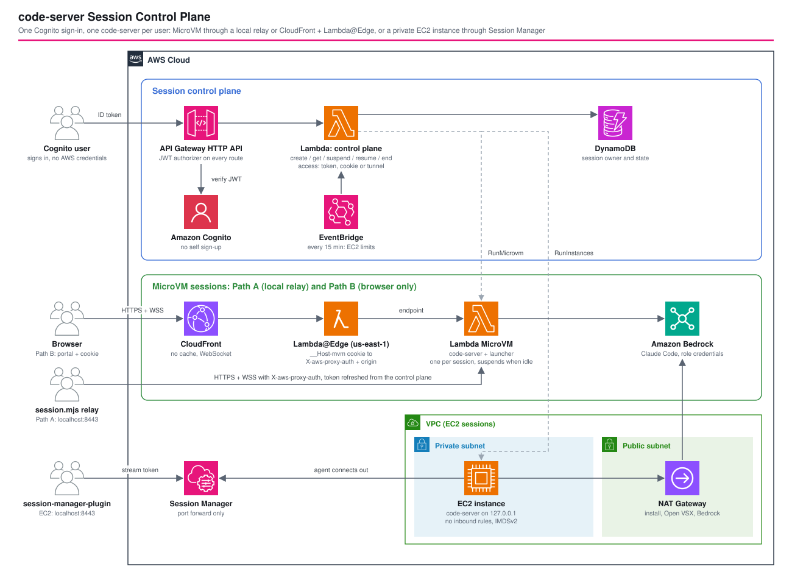

# code-server Session Control Plane — One Cognito Sign-In, One code-server per User, on a MicroVM or EC2

*Read this in other languages:* [](./README.ja.md) [](./README.md)


## Introduction

A reference implementation that starts [code-server](https://github.com/coder/code-server) (VS Code in the browser) on demand, one per user. A control plane authenticated with Amazon Cognito launches an [AWS Lambda MicroVM](https://aws.amazon.com/lambda/lambda-microvms/) or an EC2 instance for each user.

It applies the control plane from [`lambda-microvms-codex-appserver`](../lambda-microvms-codex-appserver/README.md) to code-server, and removes the need for AWS credentials on the user's machine that [`code-server-ec2-vs-lambda-microvms`](../code-server-ec2-vs-lambda-microvms/README.md) has. Three recommendations from code-server's own FAQ and [this introductory article](https://www.issoh.co.jp/tech/details/18117/) (Japanese) shape the design: one VM per user, identify people through an identity provider instead of a shared password, and on EC2 keep all inbound ports closed and connect through Session Manager.

What this architecture demonstrates:

- Two ways to reach a MicroVM endpoint from a browser that cannot send custom headers: a local relay (Path A) and CloudFront + Lambda@Edge (Path B)
- Turning a token in an HttpOnly cookie into the `X-aws-proxy-auth` header and origin with Lambda@Edge, routing per session with no state and no secret
- Handing a user without AWS credentials a Session Manager port forward that the control plane opened
- How to design execution roles and secrets when the user has a terminal
- `git clone` and `git push` to several named CodeCommit repositories with role credentials
- A closed network with no route out: sending to outside sites, other accounts' AWS resources and through DNS is blocked, while CodeCommit, Bedrock, npm and pip keep working
- Saving and restoring workspaces with a shared role, without letting users read each other's
- MFA, immediate user revocation, alarms and an audit log
- A NAT instance to keep verification cheap, switchable with a NAT Gateway by parameter
- End-to-end verification on real AWS on 2026-11-05, including sign-in and the IDE in a real browser. The defects it found are listed under [Deployment Verification](#-deployment-verification)

## 📑 Table of Contents

- [Architecture Overview](#️-architecture-overview)
- [Design Decisions and Best Practices](#-design-decisions-and-best-practices)
- [Cost Optimization](#-cost-optimization)
- [Security Considerations](#-security-considerations)
- [Prerequisites](#-prerequisites)
- [Deployment](#-deployment)
- [Usage](#usage)
- [Testing Strategy](#-testing-strategy)
- [Customization](#️-customization)
- [Deployment Verification](#-deployment-verification)
- [Troubleshooting](#-troubleshooting)
- [Cleanup](#-cleanup)
- [References](#-references)

## 🏗️ Architecture Overview



There are three ways in, all behind the same control plane.

| | Path A: local relay | Path B: browser only | EC2 |
| --- | --- | --- | --- |
| Compute | MicroVM | MicroVM | EC2 in a private subnet |
| Needed on the user's machine | Node.js | A browser | Node.js and `session-manager-plugin` |
| URL to open | `http://localhost:8443` | `https://<distribution>/__cp/portal` | `http://localhost:8443` |
| Where the token lives | Inside the relay process | HttpOnly cookie | Session Manager stream token |
| IDE traffic | Machine → MicroVM endpoint | CloudFront → Lambda@Edge → MicroVM endpoint | Machine → Session Manager → instance |
| When idle | Suspends after 15 minutes | Suspends after 15 minutes | Keeps running; stopped 8 hours after start |
| Start time (measured) | 7 to 21 seconds | 7 to 21 seconds | About 100 seconds (first-boot setup) |
| State after stopping | Kept while suspended, gone on termination | Same | Kept on EBS while stopped, gone on termination |

### Stacks

| Stack | Contents | How to omit |
| --- | --- | --- |
| `Microvm` | MicroVM image, build role, execution role, log group | Required |
| `PrivateNetwork` | Closed VPC, VPC endpoints, DNS Firewall, CodeArtifact, network connector | Set `microvm.egress` to `internet` |
| `Ec2` | VPC, NAT Gateway or NAT instance, launch template, instance role | Remove `params.ec2`. Cannot be combined with the closed network |
| `CodeCommit` | Repositories owned by this application; deleted with the stack | Leave `managedRepositoryNames` empty |
| `ControlPlane` | Cognito, HTTP API, Lambda, DynamoDB, S3 (workspaces), alarms, EC2 sweeper | Required |
| `BrowserAccess` and `edge-lambda-stack-*` | CloudFront, Lambda@Edge (us-east-1), CloudFront Functions | `browserAccess: false` |

### Key Components

| Component | Role |
| --- | --- |
| HTTP API + Cognito JWT authorizer | Authorizes every session operation. Only `GET /portal`, a static page holding no data, is open |
| `create-session` | Checks the per-user limit against live state, then calls `RunMicrovm` or `RunInstances` |
| `get-sessions` / `change-session` | State, suspend, resume, end. Only ever acts on the caller's own sessions |
| `access-session` | The one route that hands out a way in: a relay token, a browser cookie, or an EC2 stream token |
| `sweep-ec2` | Runs every 15 minutes and gives EC2 the bounds a MicroVM already has (running time, session deadline) |
| `workspace-url` | Checks a session's token and returns a presigned URL that reaches only that owner's archive |
| `revoke-user` | Called by operators. Disables the user, signs them out and ends all their sessions |
| `portal` | Sign-in (including MFA enrollment and codes) and session screen for Path B |
| Lambda@Edge `router` | Turns the cookie into the origin and `X-aws-proxy-auth`; sends expired page loads back to the portal |
| In-VM launcher | Answers lifecycle hooks, starts code-server from `/run`, proxies HTTP and WebSocket |
| `scripts/session.mjs` | Client that authenticates with Cognito; includes the relay and the tunnel |
| `scripts/smoke.mjs` | Operational check that exercises a path with a real session |

### Request Flow

```text
Path B (browser only)
  Browser ──▶ CloudFront /__cp/* ──▶ HTTP API (after sign-in: Set-Cookie: __Host-mvm=<endpoint>~<JWE>)
  Browser ──▶ CloudFront /*  ──▶ Lambda@Edge (origin-request) ──▶ MicroVM endpoint
                                   cookie → origin + X-aws-proxy-auth
                                   X-Forwarded-Host: <distribution>

Path A (local relay)
  session.mjs ──▶ HTTP API: POST /sessions/{id}/access {"type":"relay"} ──▶ { endpoint, token }
  Browser ──▶ localhost:8443 (relay) ──HTTPS + X-aws-proxy-auth──▶ MicroVM endpoint

EC2
  session.mjs ──▶ HTTP API: POST /sessions/{id}/access {"type":"tunnel"} ──▶ Lambda calls ssm:StartSession
  Browser ──▶ localhost:8443 (session-manager-plugin) ──▶ Session Manager ◀── SSM Agent (outbound)
                                                                                └▶ code-server 127.0.0.1:8080
```

## 🎯 Design Decisions and Best Practices

### 1. Design roles assuming the user has a terminal

The code-server terminal can use the execution or instance role directly, so each role is designed as "permissions it is fine to give the user". They hold Bedrock invocation and log writes (plus Session Manager on EC2) and cannot touch DynamoDB or secrets. The execution role in [`lambda-microvms-codex-appserver`](../lambda-microvms-codex-appserver/README.md) can write to `EventsTable` because its users have no shell; that difference drives the design.

### 2. Remove the shared password: `--auth none`

A code-server password is shared by everyone, so nobody can be identified or revoked individually. Here, the platform admits no request to a MicroVM without a token, and on EC2 code-server listens on loopback only. Neither has a path that avoids the control plane, so `--auth none` leaves Cognito as the single identity and removes the secret shared across sessions.

### 3. Lambda@Edge only changes the shape of the cookie

The cookie value is `<endpoint>~<JWE>`, and the function moves it into the origin and a header. It reads no table, holds no secret and adds no per-request lookup. A forged cookie reaches only MicroVMs the caller already holds a token for. To prevent relaying to arbitrary hosts, only the `*.lambda-microvm.<region>.on.aws` form is accepted.

### 4. Keep code-server's origin check

Rewriting `Origin` to the endpoint would pass the WebSocket but disable code-server's defense. Instead, Lambda@Edge and the relay send the viewer's host in `X-Forwarded-Host`. code-server compares that with `Origin`, so a WebSocket from another site gets 403. Together with `SameSite=Strict` on the cookie, this is two layers.

### 5. Serve `/__cp/*` from the same distribution

A cookie belongs to the domain that set it. Publishing the control plane at `/__cp/*` on the same domain places the cookie on the CloudFront domain and needs no CORS. CloudFront forwards `Authorization` on GET only when it is in the cache key, so a dedicated cache policy includes it, and every response is `no-store` so nothing is actually kept.

### 6. Connect to EC2 through the control plane too

Lambda calls `ssm:StartSession` and returns the stream URL and token to the owner. The user only runs `session-manager-plugin`, with no AWS credentials or IAM permissions. The Lambda policy allows tagged instances and the `AWS-StartPortForwardingSession` document only, so it cannot open a shell.

### 7. Give EC2 limits too

A MicroVM has an idle policy and a maximum lifetime; EC2 has neither. `sweep-ec2` stops instances past `maxRunningHours` and terminates those past the session deadline (`ExpiresAt` tag). It does not detect idleness, so stop an instance yourself when you finish.

### 8. Limit sessions per user

A signed-in user can start compute that costs money. `create-session` checks `maxActiveSessionsPerOwner` (default 2) against live state rather than DynamoDB records. Requests within a very short window could exceed it, which is acceptable for guarding against runaway cost.

### 9. Reach CodeCommit with role credentials, and set the author from Cognito

The Git credential helper is scoped to `git-codecommit.*.amazonaws.com`, so credentials for other Git hosts are untouched. The role allows only `GitPull` and `GitPush` on the repositories in `codeCommit`. The role is shared by all sessions, so **every user reaches every listed repository with the same rights**. The commit author is set to the Cognito address automatically, but users can change it, so it does not prove identity.

### 10. Remove the route to the internet

Network Firewall with a domain allow list was considered, but the closed network is the default. Any allowed domain (GitHub, npm) is also a way out, and with no route there is no such decision to make. It also costs less: about $7 per endpoint per month, against $280 or more for a firewall.

Removing the route alone leaves other means, closed as follows.

| Way to send data out | Control | Verified result |
| --- | --- | --- |
| Outside sites | No route, DNS Firewall | Names do not resolve; direct IP times out |
| S3 in an attacker's account | S3 gateway endpoint policy allows this account's resources only | `AccessDenied` |
| An attacker's own credentials | Interface endpoint policies allow this account's principals only | Set by policy |
| Encoding in DNS queries | DNS Firewall answers NXDOMAIN for anything but AWS names | Names do not resolve |
| Another Region | Security group allows only the endpoints and same-Region S3 | Times out |
| Publishing a package | The mirror grants read only | Nothing published |
| Browser download | `--disable-file-downloads`, `--disable-file-uploads` | Startup confirmed (on-screen behavior not confirmed) |

Only the image build uses `INTERNET_EGRESS`; running MicroVMs get the closed connector. Claude Code has `CLAUDE_CODE_DISABLE_NONESSENTIAL_TRAFFIC` set, stopping traffic other than Bedrock.

**What this does not prevent:** copying from the screen or terminal, or photographing it. It is not a complete defense against a legitimate user deliberately taking code out. It stops accidental sending, and sending by malicious packages and scripts.

### 11. Save workspaces without giving the role S3 access

The role is shared by everyone and usable from the terminal, so S3 access on it would let users read each other's workspaces. Instead, the execution role may only call the `workspace-url` function, which checks a per-session secret token and returns a 15-minute presigned URL reaching only that owner's archive. The HTTP API is out of reach from the closed network, so Lambda is invoked directly through a VPC endpoint.

Saving runs every 5 minutes when something changed, and at suspend and termination. A session whose restore failed stops saving, so an empty workspace cannot replace a saved one. Archives are versioned, recoverable for 14 days by default. `node_modules` and similar are excluded.

### 12. Disabling a Cognito user is not enough to revoke them

A disabled user keeps running sessions, issued MicroVM tokens (up to 60 minutes) and ID tokens. `revoke-user` also ends the sessions. The routes that start sessions or give access ask Cognito whether the user is enabled on every call, and ID tokens last 15 minutes.

### 13. Well-Architected Framework Alignment

| Pillar | How this pattern addresses it |
| --- | --- |
| Operational Excellence | `smoke.mjs` exercises a path with a real session. Logs per Lambda, HTTP API and MicroVM |
| Security | VM isolation per session. Individual identity through Cognito. Owner-scoped access. EC2 with no inbound ports. HttpOnly, SameSite=Strict cookie. No long-term keys |
| Reliability | Session state is re-read from the compute. Open WebSockets survive token expiry. Each session is one compute with no failover |
| Performance Efficiency | MicroVMs start in seconds from a snapshot and resume in under a second. arm64 throughout. IDE traffic bypasses the control plane |
| Cost Optimization | No compute without a session. MicroVM auto-suspend, EC2 sweep, per-user limit. NAT and CloudFront are optional |
| Sustainability | Releases compute for unused sessions. Uses Graviton and MicroVMs |

## 💰 Cost Optimization

Unit prices vary by Region. These US East (N. Virginia) list prices are for comparing the shapes; check the AWS pricing pages before estimating a real workload.

| Item | Cost | When it applies |
| --- | --- | --- |
| MicroVM (arm64, 1 vCPU and 2 GiB basis) | About $0.126 per running hour; snapshots $0.08 per GB-month while suspended | Per session |
| EC2 `t4g.medium` | $0.0336 per hour; 30 GiB gp3 $2.4 per month | Per session |
| NAT Gateway (`natType: 'gateway'`) | $0.045 per hour (about $32.85 per month) + $0.045 per GB | **Always, when `ec2` is enabled** |
| NAT instance (`natType: 'instance'`) | `t4g.micro` $0.0084 per hour (about $6.1 per month) + public IPv4 about $3.65 per month | **Always, when `ec2` is enabled** |
| CodeCommit | Within the free tier for up to 5 active users | When repositories are used |
| VPC endpoints (closed) | $0.01 per hour each (7 in one AZ, about $51 per month) + $0.01 per GB | **Always, when closed** |
| DNS Firewall | $0.60 per million queries + a small amount by domain count | Always, when closed |
| CodeArtifact | $0.05 per GB-month + $0.05 per million requests | Package installs when closed |
| S3 (workspaces) | $0.023 per GB-month | By amount saved |
| Lambda@Edge | $0.60 per million requests + $0.00005001 per GB-second | Every Path B HTTP request |
| CloudFront | Within the free tier for personal use | Path B |
| HTTP API, Lambda, DynamoDB, Cognito | Close to zero for a small team | Always |

With no sessions running, a MicroVM-only deployment (`ec2` and `browserAccess` removed) has almost no fixed cost. Keeping EC2 adds a fixed NAT cost. A NAT instance saves over $20 per month in a verification environment.

**Estimate for 10 people (closed, MicroVM only):** with 8 running hours a day on 20 days a month, MicroVMs cost about $200 and endpoints and other fixed items about $55. Bedrock token charges are extra.

What to tune:

- `microvm.maxIdleSeconds`: time until suspend. Traffic from a tab left open may count as activity (not verified)
- `microvm.suspendedSeconds`: how long a snapshot is kept
- `ec2.maxRunningHours`, `ec2.instanceType`, `ec2.volumeSizeGiB`
- `controlPlane.maxActiveSessionsPerOwner`
- `operations.dailyBedrockTokenLimit`, `operations.monthlyBudgetUsd`, `operations.alarmEmail`

## 🔒 Security Considerations

### Implemented

- VM isolation per session, compute per user
- A Cognito JWT on every session operation; self sign-up disabled
- Another user's session is always 404
- CodeCommit access limited to `GitPull` and `GitPush` on the listed repositories
- MicroVM tokens limited to one MicroVM and one port, for at most 60 minutes
- Cookie with the `__Host-` prefix, `Secure`, `HttpOnly`, `SameSite=Strict`
- Lambda@Edge validates the endpoint form and does not forward the cookie to code-server
- EC2: private subnet, no inbound rules, IMDSv2 required, encrypted volume, code-server on loopback only
- EC2 actions and Session Manager limited to tagged instances; port forwarding document only
- Portal with a nonce-based CSP; the ID token is never written to storage
- Bedrock access limited to the two configured models

### Remaining risks

- **Token in a cookie**: on Path B the JWE token is in the browser. Scripts cannot read it, but a compromised machine can use it until it expires.
- **`--auth none`**: on Path A and EC2, other processes on the same machine can connect to `localhost:8443`. Do not use them on a shared machine.
- **Bedrock spend**: users can call models directly from the terminal, and there is no per-user limit on Bedrock cost.
- **Outbound traffic in `internet` mode and on EC2**: sessions can reach the internet freely. Use the closed network, or see the Network Firewall pattern in [`claude-managed-agents-lambda-microvms`](../claude-managed-agents-lambda-microvms/README.md).
- **Audit granularity**: the role is shared, so CloudTrail and Bedrock logs cannot tell users apart. Session starts and access are recorded with the user in the Lambda logs (kept for 1 year). Bedrock invocation logging is an account-wide setting that these stacks leave alone; enable it with `aws bedrock put-model-invocation-logging-configuration` if needed.
- **MicroVM endpoint**: a token works from anywhere. No platform feature to limit source IPs has been confirmed.

### Intentionally out of scope (add per environment)

- AWS WAF on CloudFront and the HTTP API
- The Cognito Plus feature plan and SSO federation
- A custom domain and certificate (the default certificate cannot set a minimum TLS version)
- CloudFront access logs and VPC Flow Logs
- Workspace saving on EC2 (EBS survives a stop but goes at the session deadline)

### CDK Nag

`test/compliance/cdk-nag.test.ts` applies the AwsSolutions pack to the four stacks. Each suppression carries its reason.

## 📋 Prerequisites

**To deploy**

- Node.js 20 or later and the repository dependencies (`npm ci` in `infrastructure/`)
- Lambda MicroVMs enabled in the target Region: `aws lambda-microvms list-managed-microvm-images`
- CDK bootstrap in the target Region **and us-east-1** (for Path B)
- Access to the models set in `bedrock` (check with `aws bedrock-runtime converse`)

**To use**

- Path A: Node.js 20 or later
- Path B: a browser
- EC2: Node.js 20 or later and [`session-manager-plugin`](https://docs.aws.amazon.com/systems-manager/latest/userguide/session-manager-working-with-install-plugin.html)

## 🚀 Deployment

```sh
cd infrastructure/workspaces/code-server-session-control-plane

# Lambda@Edge requires an explicit Region
export CDK_DEFAULT_REGION=ap-northeast-1 CDK_DEFAULT_ACCOUNT=<account>
PROJECT=<project> ENV=dev npx cdk deploy '**' --require-approval never --profile <profile>

# Create a user (UserPoolId is a stack output)
aws cognito-idp admin-create-user --user-pool-id <UserPoolId> --username you@example.com --message-action SUPPRESS
aws cognito-idp admin-set-user-password --user-pool-id <UserPoolId> --username you@example.com \
  --password '<strong password>' --permanent
```

## Usage

### Path B: browser only

Open the `PortalUrl` stack output, sign in and choose **Start a new session**. The page switches to the IDE when the MicroVM is up.

The token lasts 60 minutes. A connected IDE keeps working, but a reload after that returns to the portal; sign in again and choose **Open**. The session and your open files are unchanged.

### Path A and EC2: `session.mjs`

```sh
cd infrastructure/workspaces/code-server-session-control-plane/scripts

export CS_API_URL=<ApiUrl> CS_CLIENT_ID=<UserPoolClientId>
export CS_USERNAME=you@example.com CS_PASSWORD='...'

node session.mjs start                  # MicroVM
node session.mjs start --compute ec2    # EC2
node session.mjs connect                # open the printed http://localhost:8443

node session.mjs status
node session.mjs suspend
node session.mjs resume
node session.mjs stop
```

The relay renews its token 5 minutes before expiry, so keep that terminal open while working. The first EC2 boot takes about 100 seconds to install code-server.

### CodeCommit

Run ordinary Git commands in the code-server terminal, with no password or key. In a new browser, first choose **Trust Folder & Continue** in VS Code.

```sh
git clone https://git-codecommit.<region>.amazonaws.com/v1/repos/<repository>
cd <repository>
git add . && git commit -m "..."
git push origin HEAD:main
```

### MFA and managing users

With `requireMfa` on, the portal asks for an authenticator app at the next sign-in. Add the displayed key to the app and enter its code. On the CLI, one code keeps a refresh token working for 12 hours (`~/.code-server-sessions-auth.json`, mode 600).

To revoke a user, run this. It disables them, signs them out and ends all their sessions.

```sh
aws lambda invoke --function-name <RevokeUserFunctionName> \
  --cli-binary-format raw-in-base64-out --payload '{"username":"user@example.com"}' /tmp/revoke.json
```

### Packages in the closed network

npm and pip point at the CodeArtifact mirror automatically at start. Other tools and registries do not work.

### Extensions in the closed network

A closed session cannot reach Open VSX, so installing from the screen fails (`getaddrinfo ENOTFOUND open-vsx.org`). There are two ways instead.

**For everyone:** list them in `microvm.extensions`. They are installed at build time and available in every session. A change builds a new image, effective for new sessions. The build fails if a listed extension cannot be installed.

```typescript
microvm: {
  // ...
  extensions: ['dbaeumer.vscode-eslint', 'esbenp.prettier-vscode'], // publisher.name from Open VSX
},
```

**To try one yourself:** put a reviewed `.vsix` in a CodeCommit repository and install it in the session. Browser upload is off, so it goes through the repository. It lands outside `~/project`, so **it is gone when the session ends**; install it again in a new session.

```sh
git clone https://git-codecommit.<region>.amazonaws.com/v1/repos/<repository>
/opt/code-server/bin/code-server --install-extension <repository>/.vsix/<name>.vsix
```

Reload the page afterward.

An extension runs arbitrary code in the session. In the closed network it cannot send anything out, but it can reach the allowed repositories and Bedrock, so treat the list as something to review. In AWS Toolkit, operations on services with no VPC endpoint fail.

### Claude Code

Open the Claude Code panel or run `claude` in the terminal. It uses Amazon Bedrock and the models in `parameters/dev-params.ts`.

## 🧪 Testing Strategy

```sh
npm run test:unit -w workspaces/code-server-session-control-plane        # resources and Lambda@Edge logic
npm run test:snapshot -w workspaces/code-server-session-control-plane    # full templates and resource counts
npm run test:compliance -w workspaces/code-server-session-control-plane  # cdk-nag AwsSolutions pack
```

`cdk deploy` cannot prove that a browser reaches the IDE. `scripts/smoke.mjs` starts a real session, exercises a path and ends the session.

```sh
node scripts/smoke.mjs relay
CS_DOMAIN=<DistributionDomainName> node scripts/smoke.mjs browser
node scripts/smoke.mjs tunnel
```

## ⚙️ Customization

### Deploy only the paths you use

```typescript
const devParams: EnvParams = {
  microvm: { baseImageArn: '...', baseImageVersion: '1' },
  // Without ec2, no VPC or NAT Gateway is created
  browserAccess: false, // no CloudFront or Lambda@Edge
};
```

### Choose CodeCommit repositories

```typescript
codeCommit: {
  repositoryNames: ['team-app', 'team-infra'],   // existing; only access is granted
  managedRepositoryNames: ['sandbox'],           // created by the stacks and deleted with them
},
```

Repositories must be in the deployment's account and Region. Repositories in `managedRepositoryNames` are deleted with their contents when the stack is deleted (when `isAutoDeleteObject` is set). List anything you want to keep in `repositoryNames`.

### Switch the NAT

```typescript
ec2: {
  natType: 'instance',          // default is 'gateway'
  natInstanceType: 't4g.micro', // the default; use an arm64 size
},
```

A NAT instance is cheaper, but it is a single point of failure that you patch yourself. Use it for verification and `gateway` for shared environments. `t4g.nano` does not work (see the defect below). Changing the size later does not rerun UserData, so go back through `gateway` to rebuild it.

### Disable Claude Code or change the model

```typescript
bedrock: {
  enabled: false,
  modelId: 'jp.anthropic.claude-sonnet-4-6',
  smallFastModelId: 'jp.anthropic.claude-haiku-4-5-20251001-v1:0',
},
```

### Switch the network configuration

`microvm.egress` turns the closed network on or off for MicroVMs. Only EC2 sessions use NAT, selected with `ec2.natType`.

| Configuration | `microvm.egress` | `ec2` | MicroVM outbound | EC2 outbound |
|---|---|---|---|---|
| Closed | `'private'` | None | VPC endpoints and the read-only mirror only | - |
| Internet | `'internet'` | None | AWS-managed `INTERNET_EGRESS` | - |
| EC2 + NAT instance | `'internet'` | `{ natType: 'instance' }` | `INTERNET_EGRESS` | NAT instance |
| EC2 + NAT Gateway | `'internet'` | `{ natType: 'gateway' }` | `INTERNET_EGRESS` | NAT Gateway |
| Closed + EC2 | `'private'` | Set | Not allowed (error at synthesis) | Not allowed (error at synthesis) |

`egress` defaults to `'internet'` and `natType` defaults to `'gateway'`.

```typescript
// Closed
microvm: { baseImageArn: '...', baseImageVersion: '1', egress: 'private' },

// Internet (no NAT)
microvm: { baseImageArn: '...', baseImageVersion: '1', egress: 'internet' },

// EC2 + NAT instance
microvm: { baseImageArn: '...', baseImageVersion: '1', egress: 'internet' },
ec2: { natType: 'instance' },
```

Setting `egress: 'private'` together with `ec2` is an error at synthesis, because EC2 setup needs the internet and the result would not be closed. Closed EC2 needs an AMI with everything baked in.

With `'internet'`, sessions can reach anything and file transfer in the browser is not blocked. If code must not leave your organization, use `'private'`.

Switching from `'internet'` to `'private'` by stack update has been verified. The reverse direction has not, so confirm that sessions work after deploying it.

### Keep your work

A MicroVM's `~/project` and VS Code settings are saved automatically and restored in the next session. Saving runs every 5 minutes, so the latest changes can be lost; push to Git as well. If one user opens two sessions, the later save wins (earlier versions can be recovered from S3 versioning). EC2 is not covered.

## ✅ Deployment Verification

Deployed to a development account in ap-northeast-1 and us-east-1 on 2026-11-05, checked from outside, and deleted afterward.

| Check | Result |
| --- | --- |
| Stack creation | `Ec2` about 3 minutes, `Microvm` about 5 (including the image build), `ControlPlane` about 2, `BrowserAccess` about 4 |
| MicroVM start to `RUNNING` | 7 to 21 seconds (6 runs) |
| **Real browser (Path B)** | Sign-in at the portal; 14 seconds from starting a session to the IDE. Terminal and Claude Code extension work |
| Path B cookie | `HttpOnly`, `Secure`, `SameSite=Strict`. Not visible to `document.cookie`. About 1 KB, well under the limit |
| Path B WebSocket | With cookie 101. Other origin 403. No cookie 302 to the portal |
| Path A | Health, workbench, WebSocket: 200, 200, 101. Other origin 403 |
| EC2 | The same checks: 200, 200, 101, other origin 403. Connected with no AWS credentials |
| EC2 layout | No public IP, `IMDSv2 required`, code-server on `127.0.0.1:8080` only |
| EC2 timing | SSM online 33 seconds, code-server up 102 seconds, `RUNNING` 7 seconds after a restart |
| EC2 stop and start | Project files kept; code-server restarts by itself |
| Claude Code → Bedrock | `BEDROCK_OK` on both MicroVM and EC2 |
| Owner isolation | GET, access and DELETE from another user are all 404 |
| Session limit | The third is 409 |
| First request after suspend | 0.7 seconds through CloudFront, 200; state back to `RUNNING` |
| Page load to a terminated MicroVM (invalid token) | 302 to the portal and the cookie cleared |
| Sweep | No action before the deadline; terminates when `ExpiresAt` is in the past |

**Closed network, saving, revocation, MFA**

| Check | Result |
| --- | --- |
| Start when closed | `RUNNING` within 5 seconds, IDE in 9 to 17 seconds |
| Outside sites (example.com, github.com, npmjs, anthropic) | Names do not resolve |
| Direct IP (1.1.1.1) | Times out |
| S3 in another account | `AccessDenied` in the same Region, times out in another |
| CodeCommit, Bedrock when closed | Push succeeds, `BEDROCK_OK` |
| npm, pip when closed | `left-pad`, `six` installed from the mirror |
| `npm publish` | Nothing published to the mirror |
| Save and restore | Ending a session and starting a new one brought back files and `.git` |
| From another user | Another user's files are not visible |
| S3 directly from the terminal | `AccessDenied` |
| Wrong token | Refused by `workspace-url` |
| Revoking a user | No new sign-in; an issued ID token gets 403 on start and access; sessions end; renewal fails |
| MFA | Enrollment and sign-in work; wrong codes refused; a password alone gets no tokens |
| Path A, closed with MFA | All checks pass |
| `microvm.extensions` (8) | All installed; 567 MB of extensions, 3.5 GB of the 7.8 GB disk used; 31 seconds to the IDE on a new image's first run |
| Ordinary install when closed | Fails with `getaddrinfo ENOTFOUND open-vsx.org` |
| VSIX through CodeCommit | Clone and install succeed; shown in the list |

**CodeCommit and NAT switching**

| Check | Result |
| --- | --- |
| MicroVM terminal (real browser) | `git clone` and `git push` succeed; push took 2 seconds |
| EC2 (through a `t4g.micro` NAT instance) | `git clone`, `git push` and Bedrock succeed; code-server up in 100 to 170 seconds |
| Commit author | `verify@example.com`, `verify` (the Cognito address) |
| A repository not listed | Refused with `fatal: unable to access` |
| `natType` switching | `instance` → `gateway` → `instance` by stack update; the update to `gateway` took 185 seconds |

**Token expiry (measured with a 1-minute token)**

| Elapsed | New requests | Open WebSocket |
| --- | --- | --- |
| Up to 119 seconds | 200 | Stays open |
| 142 seconds | `403 x-aws-proxy-error: UNAUTHORIZED` | Stays open (answers ping) |

A token does not expire exactly on time; there was about a minute of grace. An open WebSocket is unaffected by expiry.

Defects found on real AWS and fixed:

1. **The endpoint domain is `lambda-microvm` (singular).** A validation pattern inferred from the service name as `lambda-microvms` rejected every request. The real form is `<id>.lambda-microvm.<region>.on.aws`.
2. **The placeholder origin's `originPath` leaked to the MicroVM.** Replacing the domain leaves the origin `path` (the API stage) in place. Every HTTP request got 404 while code-server's WebSocket answered 101 on any path, a confusing symptom where only the WebSocket succeeded. `request.origin.custom.path` is now cleared.
3. **`ec2:CreateTags` is also needed on the volume.** Stack tags propagate into the launch template's tag specifications, so `RunInstances` tags the volume too. Allowing only the instance gives `UnauthorizedOperation`.
4. **`session-manager-plugin` outlived the client.** After stopping the client the plugin stayed and held the port. Signals are now forwarded.

5. **A `t4g.nano` NAT instance does not work as a NAT.** On 512 MiB, the boot-time `yum install iptables-services` is `Killed` and `iptables` is never installed. The stack succeeds and routes look healthy, but private subnets cannot get out and EC2 never registers with Session Manager. The default is now `t4g.micro`.

6. **code-server missed its start wait in the closed network.** Running two AWS CLI processes at once on a 1 vCPU MicroVM pushed it past the 20-second wait, `/run` returned 500 and the MicroVM ended. Package setup now runs after code-server, and `/validate` runs code-server and the AWS CLI so they are prefetched; the IDE now appears in 9 to 17 seconds. The `/run` timeout is capped at 60 seconds.
7. **Removing the EC2 stack gave 500 to users with an EC2 session on record.** The permission to ask EC2 about that record was gone, so listing and starting sessions failed with `UnauthorizedOperation`. A record now reads as terminated when EC2 is not deployed.

Not confirmed: what each extension itself does, Git from the VS Code Source Control panel, the on-screen effect of disabling downloads, actual alarm and budget notifications, expiry of a real 60-minute token, idle auto-suspend with a tab left open, stopping by `maxRunningHours` (termination at the deadline is confirmed), Path A and EC2 in a real browser (HTTP and WebSocket checks only), several users at once.

## 🔧 Troubleshooting

Run `scripts/smoke.mjs` first; it shows which stage fails.

### The WebSocket gets 101 but all HTTP is 404

Check the origin path in Lambda@Edge. code-server's WebSocket answers 101 on any path, so a WebSocket check will not reveal a wrong path.

### The portal keeps coming back even with a cookie

Check that `ENDPOINT_PATTERN` in Lambda@Edge matches the real endpoint: the part of the cookie value before `~`.

### Parts of the IDE stop working and `403 UNAUTHORIZED` appears

The token expired. Reload to return to the portal, sign in again and choose **Open**. On Path A, check that the relay can renew and that `CS_PASSWORD` is correct.

### `POST /sessions` returns 500 (EC2)

Read the `CreateSessionFunction` log. `UnauthorizedOperation` names the resource. For `CreateTags`, check that every tagged resource (instance, volume, network interface) is allowed.

### `Connection to destination port failed, check SSM Agent logs`

The port forward is up but code-server has not started yet. The first boot takes about 100 seconds for UserData. See `/var/log/cloud-init-output.log` for progress.

### `POST /sessions` returns 409

The per-user limit. Check with `session.mjs list` and `stop` what you do not need.

### A check script does not reproduce page-load behavior

Node.js `fetch` overwrites `sec-fetch-mode` with `cors`. To test a page load, use `curl -H 'Sec-Fetch-Mode: navigate'` or a real browser.

### EC2 does not register with Session Manager (NAT instance)

Check the NAT instance console output (`aws ec2 get-console-output`) for `Killed` or `iptables: command not found`. Either means the NAT setup ran out of memory. Set `natInstanceType` to `t4g.micro` or larger and rebuild the instance.

### `git clone` fails with `unable to access`

Check that the repository is in the `codeCommit` parameters. CodeCommit settings apply to sessions started after the update; end and restart older sessions.

### `Your software token has already been used once`

Right after MFA enrollment or a sign-in, a code from the same time window cannot be reused. Wait about a minute and enter the next one.

### `POST /sessions` fails with `ServiceQuotaExceededException`

This is the MicroVM memory quota (`Max allocated ARM_64 MicroVM memory`). An account at the default of 8 GB allows 4 concurrent 2 GiB sessions. For 10 people, request 20 GB or more in Service Quotas. The `CapacityErrors` alarm detects it.

### `WORKSPACE_NOT_RESTORED.txt` appears in the project

The saved workspace could not be restored, and saving is off for that session to avoid overwriting it. End the session and start a new one. The `[workspace]` lines in the MicroVM log give the cause.

### Claude Code asks you to sign in, or Bedrock refuses

Deploy with `bedrock.smokeCheck: true` to get a `[bedrock-check]` line in the MicroVM log stream. For `AccessDeniedException`, set `bedrock.modelId` to a model that answers `aws bedrock-runtime converse`.

## 🧹 Cleanup

Deleting the stacks does not end running sessions. End them first; a remaining EC2 instance blocks VPC deletion. With `isAutoDeleteObject` set, saved workspaces and `managedRepositoryNames` repositories are deleted too.

```sh
node scripts/session.mjs list
node scripts/session.mjs stop --session <id>

cd infrastructure/workspaces/code-server-session-control-plane
PROJECT=<project> ENV=dev npx cdk destroy '**' --force --profile <profile>
```

Lambda@Edge replicas take time to delete, so `edge-lambda-stack-*` can fail on the first attempt. Run it again after a while (it succeeded some tens of minutes later in verification). Nothing is billed once the CloudFront distribution is gone.

## 📚 References

### AWS Documentation

- [Running and using MicroVMs (lifecycle hooks, authentication, WebSocket)](https://docs.aws.amazon.com/lambda/latest/dg/microvms-launching.html)
- [Restrictions on edge functions](https://docs.aws.amazon.com/AmazonCloudFront/latest/DeveloperGuide/edge-function-restrictions-all.html)
- [Use WebSockets with CloudFront distributions](https://docs.aws.amazon.com/AmazonCloudFront/latest/DeveloperGuide/distribution-working-with.websockets.html)
- [Install the Session Manager plugin](https://docs.aws.amazon.com/systems-manager/latest/userguide/session-manager-working-with-install-plugin.html)
- [AWS Lambda pricing](https://aws.amazon.com/lambda/pricing/)

### code-server

- [code-server](https://github.com/coder/code-server)
- [Introduction to code-server installation, authentication and HTTPS (Japanese, Issoh)](https://www.issoh.co.jp/tech/details/18117/)

### Related Architectures

- [`code-server-ec2-vs-lambda-microvms`](../code-server-ec2-vs-lambda-microvms/README.md): compares one code-server on EC2 and on a MicroVM. Always-on EC2 behind CloudFront lives there
- [`lambda-microvms-codex-appserver`](../lambda-microvms-codex-appserver/README.md): the Codex control plane this one is based on
- [`claude-managed-agents-lambda-microvms`](../claude-managed-agents-lambda-microvms/README.md): restricts MicroVM outbound traffic by domain

## 📄 License

This project is licensed under the Apache License, Version 2.0. See the [LICENSE](../../../LICENSE) file for details.

## 👥 Contributing

Contributions are welcome. See the [Contributing Guide](../../../docs/contribution/CONTRIBUTING.md).

## 🏆 About This Reference Architecture

This reference architecture shows how to start a browser IDE per user with individual identity from an identity provider, and two ways to connect a token-authenticated endpoint to a browser.

**Target Level**: 300 (Advanced)

---

**Note**: This is a reference implementation. Review and customize it for your requirements and organizational policies before deploying to production.
