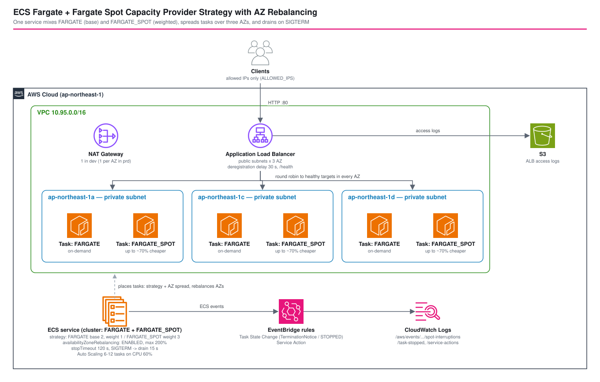

*Read this in other languages:* [](./README.ja.md) [](./README.md)

# ECS キャパシティプロバイダー戦略: FARGATE の base + FARGATE_SPOT の weight と AZ 再配置 - AWS CDK リファレンスアーキテクチャ


Fargate Spot は同じタスクを空きキャパシティで最大 70% 安く動かせます。ただし AWS は 2 分前の予告でキャパシティを回収でき、Spot のキャパシティが尽きても **Fargate はオンデマンドで代替しません**。キャパシティプロバイダー戦略を使うと、1 つのサービスで両方を使い分けられます。`base` の数だけ必ず `FARGATE` で動かし、残りの多くを `weight` で `FARGATE_SPOT` に回します。

このアーキテクチャは、そのサービスを CDK で構築します。3 つの AZ に分散させ、**AZ 再配置（AZ rebalancing）を明示的に有効化**し、Spot の予告時間内に SIGTERM でドレインし、Spot 中断を EventBridge で記録します。ap-northeast-1 に実際にデプロイして、次の 4 点を確認しました。AZ × キャパシティプロバイダーごとの配置、負荷をかけたままのタスク停止でリクエスト失敗ゼロ、AZ 再配置の実際の既定値、AZ 障害を模擬した後に AZ のバランスが戻ること。



## 📑 目次

- [アーキテクチャ概要](#️-アーキテクチャ概要)
- [設計判断とベストプラクティス](#-設計判断とベストプラクティス)
- [検証結果](#-検証結果ap-northeast-1-にデプロイ)
- [Well-Architected との対応](#️-well-architected-との対応)
- [コスト](#-コスト)
- [セキュリティ](#-セキュリティ)
- [前提条件](#-前提条件)
- [デプロイ](#-デプロイ)
- [使い方 (test-spot.sh)](#使い方-test-spotsh)
- [テスト戦略](#-テスト戦略)
- [カスタマイズ](#️-カスタマイズ)
- [トラブルシューティング](#-トラブルシューティング)
- [クリーンアップ](#-クリーンアップ)
- [参考資料](#-参考資料)

## 🏗️ アーキテクチャ概要

### 主要コンポーネント

| コンポーネント | 構成 | 理由 |
| --- | --- | --- |
| VPC | 3 AZ、パブリック + プライベートの `/24` サブネット、NAT ゲートウェイ 1 台（dev）、フローログ（REJECT） | 3 AZ あればスケジューラーと再配置が 6 タスクを 2/2/2 に分散できる |
| ECS クラスター | `enableFargateCapacityProviders`、Container Insights（enhanced） | `FARGATE` と `FARGATE_SPOT` を登録し、サービスの戦略で指定できるようにする |
| ECS サービス | 戦略 `FARGATE base 2, weight 1` + `FARGATE_SPOT weight 3`、希望数 6 | 2 タスクはオンデマンドを保証し、残り 4 を 1:3 で分ける → FARGATE 3 + FARGATE_SPOT 3 |
| AZ 再配置 | `availabilityZoneRebalancing: ENABLED`、`maxHealthyPercent: 200` | 回復した AZ にタスクを戻す。停止の前に起動するため 100% を超える余地が必要 |
| タスク定義 | x86_64、0.25 vCPU / 0.5 GB、`stopTimeout: 120`、ルートファイルシステム読み取り専用 | Fargate Spot は ARM64 に非対応。120 秒は Spot 予告の長さ |
| アプリケーション | `src/app.py`（Python 標準ライブラリのみ） | タスク ID と AZ を返す。SIGTERM を受けると unhealthy を返し、15 秒処理を続けてから終了 |
| ALB | 3 AZ のパブリックサブネット、ポート 80 は `ALLOWED_IPS` のみ、アクセスログを S3 へ、登録解除の遅延 30 秒、`/health` | 登録解除が 2 分の Spot 予告内に十分収まる |
| Auto Scaling | CPU 60% のターゲット追跡、6〜12 タスク | スケールアウトも同じ戦略（base → weight）に従う |
| EventBridge → CloudWatch Logs | `spot-interruptions`（停止コード `TerminationNotice`）、`task-stopped`、`service-actions` | 中断・再配置・配置失敗を後から数えられる |
| `test-spot.sh` | `status` / `traffic` / `drain` / `rebalance` / `events` | 戦略と再配置が実際に何をしたかを表示する |

### スタック

`<project>-<env>-ecs-fargate-spot` の 1 スタックを 3 つの Construct で構成します。

- `lib/constructs/web-alb.ts`: セキュリティグループ、アクセスログ用バケット、ALB、HTTP リスナー
- `lib/constructs/mixed-capacity-service.ts`: パラメーター検証、タスク定義、戦略つきサービス、ターゲットグループ、スケーリング
- `lib/constructs/task-event-recorder.ts`: EventBridge ルール 3 本とそのロググループ

## 🎯 設計判断とベストプラクティス

### 1. `base` は FARGATE、`weight` は FARGATE_SPOT 寄り

```typescript
capacityProviderStrategies: [
  { capacityProvider: 'FARGATE', base: 2, weight: 1 },
  { capacityProvider: 'FARGATE_SPOT', weight: 3 },
],
```

`base` が最初に配置され、`base` を持てるのは 1 つのプロバイダーだけです。残りは weight で分けるので、6 タスクなら FARGATE は 2（base）+ 4 × 1/4 = 3、FARGATE_SPOT は 4 × 3/4 = 3 になります。9 にスケールしたときは FARGATE 4 + FARGATE_SPOT 5 でした（weight で分ける 7 タスクが 1.75 / 5.25 になり、2 / 5 に丸められた）。`splitByStrategy()` がこの分け方を計算し、プロバイダーごとのタスク数が AZ 数の倍数でないときは synth 時に警告します。ECS はプロバイダーごとに別々に分散する（「the spread behavior is independent for each capacity provider」）ので、そうした数では両方のプロバイダーを AZ ごとに均等にできないためです。

base は Spot のキャパシティが無くなったときにサービスが維持する下限です。ECS 開発者ガイドにも「Fargate doesn't replace Spot capacity with on-demand capacity」とあります。平均ではなく、必ずさばく必要がある最小トラフィックに合わせて決めます。

| 環境 | 戦略の例 | 理由 |
| --- | --- | --- |
| dev / test | `FARGATE_SPOT weight 1`（base なし） | 中断を許容でき、割引を最大化 |
| stg | `FARGATE base 1` + `FARGATE_SPOT weight 3` | 本番に近い構成を安く |
| prd | `FARGATE base N` + `FARGATE weight 1` + `FARGATE_SPOT weight 1〜3` | `N` で最小負荷をカバーし、weight でピークのうち中断されてよい割合を決める |

#### 2 AZ を保つ最小構成

プロバイダーごとに別々に分散されるため、`FARGATE 1 + FARGATE_SPOT 1` は 2 タスクが同じ AZ に置かれ得ます。その場合もどちらのプロバイダーも偏りとは判定されません。費用は 0.25 vCPU / 0.5 GB、ap-northeast-1、Spot 70% 引きでの目安です。

| タスク | 平常時 | Spot が枯渇したとき | 月額 |
| --- | --- | --- | --- |
| `FARGATE_SPOT` × 2 | 2 AZ（Spot 2 つが分散） | 0 タスク | 約 $6.7 |
| `FARGATE` 1 + `FARGATE_SPOT` 1 | 保証なし（同じ AZ もあり得る） | 1 タスク・1 AZ | 約 $14.6 |
| `FARGATE` 1 + `FARGATE_SPOT` 2 | 2 AZ 以上（Spot だけで 2 AZ） | 1 タスク・1 AZ | 約 $18.0 |
| `FARGATE` 2 | 2 AZ | 2 AZ | 約 $22.5 |

- dev: `FARGATE_SPOT` × 2 で、Spot がある限り AZ 冗長
- 「平常時は 2 AZ、Spot 枯渇でも 0 にならない」の最安: `FARGATE base 1` + `FARGATE_SPOT`、希望数 3
- 「Spot が無くても 2 AZ」: `FARGATE base 2`

#### まず Spot でスケールし、N タスクごとにオンデマンドを足す

ECS で実測（希望数 3 → 14 を 1 ずつ、`FARGATE base 1, weight 1` + `FARGATE_SPOT weight k`）:

| 希望数 | 3 | 4 | 5 | 6 | 7 | 8〜11 | 12 | 13 | 14 |
| --- | --- | --- | --- | --- | --- | --- | --- | --- | --- |
| `1:6` オンデマンド / Spot | 1/2 | 1/3 | **2**/3 | 2/4 | 2/5 | 2/6〜9 | **3**/9 | 3/10 | 3/11 |
| `1:11` オンデマンド / Spot | 1/2 | 1/3 | 1/4 | 1/5 | **2**/5 | 2/6〜9 | 2/10 | 2/11 | 2/12 |
| `1:3` オンデマンド / Spot | **2**/1 | 2/2 | 2/3 | 2/4 | | | | | |

配分は `オンデマンド = base + round((希望数 − base) / (k + 1))` で、端数がちょうど半分のときは `FARGATE` 側に寄ります（`splitByStrategy()` は実測 24 点すべてを再現）。`base B`、`1:k` なら次のとおりです。

- 最初にオンデマンドが増えるのは `希望数 = B + ceil((k + 1) / 2)`、以降は `k + 1` タスクごとに 1 つ
- `1+2 → 1+3 → 2+3`（3 → 4 → 5 タスク）は `1:6`。`1:3` だと 3 タスクの時点でオンデマンドが 2 になる
- 規模が大きくなると Spot の割合は `k / (k + 1)` に近づく（1:6 で約 86%、1:11 で約 92%）

weight は比例配分なので、「20 タスクまでは Spot だけ、その先はオンデマンド」のような閾値は表現できません。閾値が必要なら、`FARGATE weight 0`（オンデマンドは `base` で固定し、スケールはすべて Spot）にしてパラメーターで `base` を上げるか、オンデマンド用のサービスを別に立てます。

戦略は `parameters/<env>-params.ts` にあり、環境ごとにコードを変えずに配分を選べます。`validateServiceParams()` は synth の時点で次を拒否します: 重複したプロバイダー、2 つのプロバイダーへの base、正の weight が無い、`stopTimeout > 120`、`drainSeconds >= stopTimeout`、120 秒以上の登録解除の遅延、`maxHealthyPercent <= 100` での AZ 再配置、スケーリング範囲外の希望数。

### 2. AZ 再配置は明示的に設定する

AZ 再配置（2024 年 11 月）は、ほかの AZ よりタスクが少ない AZ（AZ 障害の後など）にタスクを戻す機能です。再配置のガイドには「2025 年 9 月 5 日以降、対象となるすべてのサービスで AZ 再配置を有効にする」（AZ 分散が先頭、または配置戦略なし）とあり、API リファレンスも作成時に未指定なら `ENABLED` としています。一方、サービス定義パラメーターのページは今も `DISABLED` と書いています。パラメーターを付けずに `CreateService` を呼んで実測しました（検証 2）。

- 新規サービス → `ENABLED`
- `maximumPercent: 100` の新規サービス → **エラーなしで `DISABLED`**（再配置は停止の前に起動が必要なため）
- パラメーターなしの `UpdateService` は現在の値を維持する。既定値が `DISABLED` だった時期に作られたサービスは `DISABLED` のまま

CDK は未指定のときプロパティを出力しないため、`cdk deploy` の結果は作成時点のサービス側の既定値次第です。このアーキテクチャは `ENABLED` を設定し、`maxHealthyPercent > 100` を検証します。再配置を無効にしてしまう `attribute:ecs.availability-zone` の配置制約と Classic Load Balancer も使いません。

設計の残りは、実測した 2 つの制約で決めています（検証 4）。再配置はサービスが定常状態になってから約 **15 分** 後に始まります。また、戦略を混ぜると再配置は **キャパシティプロバイダーごと** に働くので、それぞれは均等な 2 つのプロバイダーの合計が 4/2/3 になっても直されません。だから 3 AZ で 6 = 3 + 3 に分け、プロバイダーごとのタスク数が AZ 数の倍数でないときは synth 時に警告しています。

### 3. 2 分の Spot 予告内にドレインする

Spot 中断ではタスクに SIGTERM が送られ、停止コード `TerminationNotice` の `ECS Task State Change` イベントが出ます。`stopTimeout`（最大 120 秒）の後に SIGKILL です。時間の予算は次のとおりです。

```
登録解除の遅延 (30 s) + アプリのドレイン (15 s)  <  stopTimeout (120 s) = Spot 予告 (120 s)
```

アプリは SIGTERM を受けると `/health` を 503 にし、処理中や遅れて届いたリクエストに `DRAIN_SECONDS` の間応答してから終了コード 0 で終わります。ALB の既定の登録解除の遅延（300 秒）は予告より長いので 30 秒にしています。

### 4. 中断に反応するだけでなく記録する

EventBridge ルール 3 本が `/aws/events/<prefix>/` 配下の CloudWatch Logs に書き込みます。

| ロググループ | パターン | わかること |
| --- | --- | --- |
| `spot-interruptions` | `ECS Task State Change`、`stopCode: TerminationNotice` | Spot がどのくらいの頻度で、どの AZ で回収されたか |
| `task-stopped` | `lastStatus: STOPPED` | すべてのタスクが止まった理由。例: `Availability-zone rebalancing initiated by (deployment ...)`、`Scaling activity initiated by ...`、EC2 エラーつきの `TaskFailedToStart` |
| `service-actions` | `ECS Service Action` | `SERVICE_TASK_PLACEMENT_FAILURE` / `SERVICE_TASK_CONFIGURATION_FAILURE` などの配置失敗 |

### 5. x86_64 のみ

Fargate Spot は ARM64 のタスクを動かせないので、タスク定義は `X86_64` に固定しています。オンデマンド部分だけ Graviton にしたい場合はサービスを分けます（戦略はサービス単位で、タスク定義は両方のプロバイダーで共通）。

### 6. タスクはプライベート、外向き通信は NAT

タスクにパブリック IP は無く、ポート 8080 は ALB のセキュリティグループからのみ受け付けます。dev では NAT ゲートウェイ 1 台経由で公開の Python イメージを取得します。本番では AZ ごとに NAT ゲートウェイを置くか（1 台だと NAT のある AZ の障害で正常な AZ も外に出られなくなる）、VPC エンドポイントとプライベート ECR のイメージを使います。

## 🔬 検証結果（ap-northeast-1 にデプロイ）

2026-10-28 に `drillexercises-dev` アカウントへ `cdk deploy` でデプロイしました（aws-cdk-lib 2.273.0）。検証後にスタックは削除しています。

### 1. 戦略と AZ による配置

初回デプロイ（279 秒）後の `./test-spot.sh status`:

```
AZ               FARGATE  FARGATE_SPOT  total
ap-northeast-1a  1        1             2
ap-northeast-1c  1        1             2
ap-northeast-1d  1        1             2
total            3        3             6
```

base/weight の計算どおり（3 + 3）で、AZ 分散はプロバイダーごとにも効いていました。各 AZ にそれぞれ 1 タスクずつです。`test-spot.sh traffic` で 60 リクエストを送ると、AZ ごとに 21 / 19 / 20、タスクごとに 9〜11 の応答でした。

### 2. AZ 再配置の実際の既定値

このクラスターで `--availability-zone-rebalancing` を付けずに `aws ecs create-service` を実行した結果です。

| サービス | 結果 |
| --- | --- |
| 起動タイプ `FARGATE` | `ENABLED` |
| 戦略 `FARGATE_SPOT weight 1` | `ENABLED` |
| 起動タイプ `FARGATE`、`maximumPercent=100` | `DISABLED`（エラーなし） |
| 1 つ目に対してパラメーターなしの `update-service` | `ENABLED` のまま |

### 3. 負荷をかけたままのタスク停止

`./test-spot.sh drain` で、毎秒約 4 リクエストを送りながら FARGATE_SPOT のタスクを `StopTask` で止めました。

| 経過 | イベント |
| --- | --- |
| +0.7 秒 | タスク `DEACTIVATING`（ターゲットはまだ healthy） |
| +8.1 秒 | ターゲット `draining` |
| +38.1 秒 | ターゲット削除（登録解除の遅延 30 秒） |
| +54.1 秒 | タスク `STOPPING` |
| +54.9 秒 | アプリが **SIGTERM** を記録 |
| +69.9 秒 | アプリ終了（ドレイン 15 秒） |
| +104.8 秒 | タスク `STOPPED` |
| — | **553 リクエストすべて HTTP 200** |

スケジューラーが起こす停止（StopTask、スケールイン、デプロイ、再配置）では、ECS はターゲットの登録を解除し、登録解除の遅延を待って **から** SIGTERM を送ります。Spot 中断では 2 分の予告と同時に SIGTERM が届くので、その場合にリクエストを守るのはアプリ側のドレインです。Spot 中断は任意に起こせないため、この経路は再現していません。

### 4. AZ 障害と再配置

1c のプライベートサブネットの空き IP をすべて一時 ENI（セカンダリ IP 49 個ずつ、`/24` で 5 つ）で埋めて、AZ 障害を模擬しました。

**その AZ のタスクを止めても、AZ は空かない。** 止めたタスクは、登録解除の遅延と `stopTimeout` の間 IP を持ったままです。置き換えタスク（200% なのですぐ起動）は約 9 秒おきに 1c へ 18 回起動を試みて失敗し（`TaskFailedToStart: ... InsufficientFreeAddressesInSubnet`）、最後は古いタスクが返した IP を取って 1c に戻りました。

**スケールアウトは避けて置かれる。** 1c が満杯のまま 6 → 9 にすると、新しいタスクは 52〜71 秒で 1a と 1d に置かれました（2 回）。

```
AZ               FARGATE  FARGATE_SPOT  total
ap-northeast-1a  2        2             4
ap-northeast-1c  1        1             2
ap-northeast-1d  1        2             3
```

**4/2/3 は再配置されない。** IP を解放してから 30 分間、何も動きませんでした（2 回）。ECS はキャパシティプロバイダーごとに別々に分散させます。合計は偏っていても、プロバイダーごとには範囲内です（FARGATE 4 → 2/1/1、SPOT 5 → 2/1/2）。

**スケールインで生じた偏りは再配置される。** 9 から 6 に戻すと、合計が最も多い AZ（1a）のタスクが止められ、1a=1 / 1c=2 / 1d=3、SPOT は 0/1/2 になりました（4/2/3 から始めた 2 回とも同じ結果。3/2/4 から始まった 3 回目は、スケールインでそのまま 2/2/2 になった）。サービスイベントは次のとおりです。

| 時刻 (UTC) | サービスイベント |
| --- | --- |
| 14:24:19 | `has reached a steady state.` |
| 14:39:26 | `is not AZ balanced with 1 tasks in ap-northeast-1a, 2 tasks in ap-northeast-1c, 3 tasks in ap-northeast-1d. AZ Rebalancing in progress.` |
| 14:39:26 | `has started 1 tasks in ap-northeast-1a to AZ Rebalance`（FARGATE_SPOT） |
| 14:40:43 | `has stopped 1 running tasks`（1d の FARGATE_SPOT。新タスクが healthy になってから） |
| 14:40:52 | `is AZ balanced with 2 tasks in ap-northeast-1a, 2 tasks in ap-northeast-1c, 2 tasks in ap-northeast-1d.` |

2 回目は、定常状態から開始まで 15 分 27 秒、完了まで 88 秒でした（1 回目は 15 分 07 秒と 86 秒）。**AZ 再配置はすぐには始まりません。障害の後、15 分ほどは偏ったままになると見込んでおきます。**

**対照実験: 新規サービスも満杯の AZ を避けない。** 1c が満杯の間に作った起動タイプ `FARGATE` のサービス（戦略なし）は、20 分間 6 タスク中 4（2 + 2）のままでした。スケジューラーは他の AZ に置かず、間隔を広げながら（10 秒 → 約 5 分）1c を再試行し、IP の解放から 183 秒後に配置しました。

設計への反映:

- プロバイダーごとのタスク数を AZ 数の倍数にする（3 AZ で 6 = 3 + 3）。そうでないと、AZ 再配置が有効でも AZ ごとの合計が偏ったままになり得ます。スタックは synth 時に警告します（`fgspot:uneven-az-split`）
- 残りの AZ で 15 分ほど動き続けられるように、base と AZ あたりのキャパシティを見積もる
- どのサブネットにも空き IP を残す。満杯のサブネットは避けられず、再試行され続ける

### 5. 削除

最初の `cdk destroy` は失敗しました。サービスが関連付けに依存していなかったため、CloudFormation が `AWS::ECS::ClusterCapacityProviderAssociations` をサービスと並行して削除し、`The specified capacity provider is in use and cannot be removed` になりました。`MixedCapacityService` に `service.node.addDependency(cluster)` を追加し（ユニットテストあり）、改めてデプロイ（298 秒）と削除（310 秒）が 1 回で完了することを確認しました。ECS が作る Container Insights のロググループ `/aws/ecs/containerinsights/<cluster>/performance` は残るので手動で削除します。

## 🏛️ Well-Architected との対応

| 柱 | このアーキテクチャでの対応 |
| --- | --- |
| 運用上の優秀性 | 戦略を環境ごとにパラメーターで管理、synth 時の検証、`test-spot.sh` で配置・ドレイン・再配置を確認、EventBridge で中断・停止・配置失敗を記録 |
| セキュリティ | ALB は `ALLOWED_IPS` のみ、タスクはプライベートサブネットで ALB のグループからのみ到達可能、ルートファイルシステム読み取り専用、ALB で不正ヘッダーを破棄、アクセスログ、拒否通信のフローログ |
| 信頼性 | オンデマンドの `base` が Spot 不足に耐える、3 AZ に分散し障害後に再配置、Spot 予告内の SIGTERM ドレイン、ロールバックつきデプロイサーキットブレーカー |
| パフォーマンス効率 | 6〜12 タスクのターゲット追跡スケーリング、スケールアウトにも戦略を適用 |
| コスト最適化 | 6 タスク中 3 つを Fargate Spot にして、全部オンデマンドよりコンピュートが約 35% 安い（dev）、dev は NAT ゲートウェイ 1 台 |
| 持続可能性 | Spot は本来遊んでいるキャパシティを使う、小さいタスクサイズ |

## 💰 コスト

ap-northeast-1、730 時間/月。Fargate オンデマンドの定価は vCPU 時間あたり $0.05056、GB 時間あたり $0.00553（Pricing API、2026-10-28）。Fargate Spot の価格は需給で変わるため、表は公表されている「最大 70%」の割引で計算しています。

| 項目 | 計算 | 月額 (USD) |
| --- | --- | --- |
| Fargate オンデマンド × 3 | 3 × (0.25 × 0.05056 + 0.5 × 0.00553) × 730 | 約 33.7 |
| Fargate Spot × 3 | 3 × 0.015405 × 0.3 × 730 | 約 10.1 |
| ALB | $0.0243/h × 730 + 約 1 LCU | 約 23.6 |
| NAT ゲートウェイ | $0.062/h × 730 + データ | 約 45.3 |
| パブリック IPv4（3 AZ の ALB + NAT） | 4 × $0.005/h × 730 | 約 14.6 |
| CloudWatch Logs、Container Insights（enhanced）、S3 | 少量 | 約 5 |
| **合計（dev）** | | **約 132** |

同じ 6 タスクでのコンピュート費の比較:

| 戦略 | 月額コンピュート (USD) | 全部オンデマンド比 |
| --- | --- | --- |
| すべて `FARGATE` | 67.5 | — |
| `FARGATE base 2 w1` + `FARGATE_SPOT w3`（このスタック） | 43.9 | −35% |
| `FARGATE base 2` + base を超えた分は `FARGATE_SPOT w1` のみ | 35.1 | −48% |
| すべて `FARGATE_SPOT` | 20.2 | −70% |

base を固定したままサービスが大きくなるほど節約率は上がります。20 タスクで `base 2` なら、20 タスク中 16.5 が Spot です（−58%）。

本番: AZ ごとの NAT ゲートウェイ（+$90）または VPC エンドポイント、最小負荷をまかなえる base。

## 🔒 セキュリティ

- **入口**: ALB のセキュリティグループはポート 80 を `ALLOWED_IPS`（既定はデプロイしたマシンの IP）にのみ開放。本番では ACM の HTTPS と AWS WAF を追加する
- **タスク**: パブリック IP なし、ポート 8080 には ALB のセキュリティグループからのみ到達可能、ルートファイルシステム読み取り専用、イメージは Amazon ECR Public の公式 Python イメージ
- **IAM**: 実行ロールはイメージの取得と自分のロググループへの書き込みのみ。タスクは AWS API を呼ばないのでタスクロールなし
- **ログ**: ALB アクセスログ（S3、SSE-S3、TLS 必須のバケットポリシー、30 日のライフサイクル）、拒否通信のフローログ、アプリとイベントのログ（dev は 7 日保持）
- **Spot 中断の記録**に含まれるのはタスク ARN と AZ のみ

CDK Nag の抑制（すべて `test/compliance/cdk-nag.test.ts`）: IAM4 と L1（CDK 提供のカスタムリソースハンドラー）、IAM5（実行ロールのログストリームのワイルドカード）、S1（アクセスログ用バケット自身）、ECS2（環境変数はポートとドレイン秒数のみ）。

## 📋 前提条件

- Node.js 24、AWS CDK CLI、ブートストラップ済みのアカウント
- `test-spot.sh` 用に AWS CLI v2、`jq`、`curl`

## 🚀 デプロイ

```bash
cd infrastructure/workspaces/ecs-fargate-spot-capacity-provider

# ALB に許可するクライアント IP（既定はこのマシンのグローバル IP）
export ALLOWED_IPS=203.0.113.10

PROJECT=myproject ENV=dev npm run stage:deploy:all -- --require-approval never
```

初回デプロイは約 5 分です。

## 使い方 (test-spot.sh)

```bash
./test-spot.sh --project myproject --env dev status     # 戦略、AZ 再配置、AZ × プロバイダーごとのタスク
./test-spot.sh --project myproject --env dev traffic    # ALB 経由の AZ・タスクごとの応答数
./test-spot.sh --project myproject --env dev drain      # 負荷をかけたまま Spot タスクを 1 つ止め、ターゲット/SIGTERM/エラーを追跡
./test-spot.sh --project myproject --env dev rebalance  # AZ 障害を模擬して再配置の時間を計測
./test-spot.sh --project myproject --env dev events     # 記録された停止、Spot 中断、サービスアクション
```

`rebalance`（約 20 分）は、1 つの AZ のプライベートサブネットの空き IP をすべて一時 ENI で埋め、サービスを 3 つスケールアウトし、IP を解放してからスケールインし、すべてのキャパシティプロバイダーが均等になるまで待ちます。各段階で AZ × プロバイダーの表を出します。終了時（Ctrl-C でも）に希望数とスケーリングの最小値を元に戻し、ENI を削除します。

## 🧪 テスト戦略

```bash
npm test -w workspaces/ecs-fargate-spot-capacity-provider
```

| スイート | 内容 |
| --- | --- |
| `test/unit/stack.test.ts` | 3 AZ の VPC とフローログ、クラスターのキャパシティプロバイダーと Container Insights、戦略（全 Spot の変種も）・サービスがキャパシティプロバイダー関連付けに依存・起動タイプなし、`AvailabilityZoneRebalancing`（`DISABLED` の変種も）・100/200%・サーキットブレーカー・プライベートサブネット、`StopTimeout 120`・`DRAIN_SECONDS`・登録解除の遅延と `/health`・x86_64・読み取り専用ルート、スケーリング、ALB の受信（IPv4/IPv6）・ALB からのみのタスク受信・アクセスログ、EventBridge ルールとロググループ、`validateServiceParams` の全ルール、`splitByStrategy` と `fgspot:uneven-az-split` 警告 |
| `test/snapshot/snapshot.test.ts` | テンプレート全体とリソース数 |
| `test/compliance/cdk-nag.test.ts` | AwsSolutions パック（抑制理由を明記） |

## ⚙️ カスタマイズ

| パラメーター（`parameters/dev-params.ts`） | 効果 |
| --- | --- |
| `service.capacityProviderStrategies` | プロバイダーごとの base と weight |
| `service.desiredCount` / `autoScaling.*` | タスク数 / スケーリング範囲と CPU 目標 |
| `service.availabilityZoneRebalancing` | `ENABLED` / `DISABLED` |
| `service.minHealthyPercent` / `maxHealthyPercent` | デプロイと再配置の余地（再配置を使うなら max は 100 より大きく） |
| `service.stopTimeoutSeconds` / `drainSeconds` / `deregistrationDelaySeconds` | SIGTERM から SIGKILL までの時間、アプリのドレイン、ALB のドレイン |
| `service.cpu` / `memoryLimitMiB` | タスクサイズ（x86_64） |
| `network.maxAzs` / `natGateways` | AZ 数 / NAT ゲートウェイ数 |
| `containerImage` | Python 3 が入った任意のイメージ（アプリは `python -c` で渡す） |

## 🔧 トラブルシューティング

| 症状 | 原因 / 対処 |
| --- | --- |
| RUNNING が希望数より少ない、Spot タスクが `PROVISIONING` のまま / サービスイベントに "unable to place a task" | Spot のキャパシティ不足。Fargate はオンデマンドで代替せず、base は動き続ける。`test-spot.sh events`（サービスアクション）を確認し、base を増やすか `FARGATE` の weight を検討 |
| 設定していないのに `describe-services` が `availabilityZoneRebalancing: DISABLED` | 既定値が `DISABLED` だった時期に作られたサービスか、`maximumPercent` が 100。`maxHealthyPercent > 100` にして `ENABLED` を明示する |
| AZ が回復してもタスクが偏ったまま | 再配置は定常状態の約 15 分後に始まる。サービスイベントの `is not AZ balanced` を待つ。来ない場合: プロバイダーごとには均等になっている（検証 4 と `fgspot:uneven-az-split` 警告）、再配置が無効、`attribute:ecs.availability-zone` の配置制約、または先頭が AZ 分散でない配置戦略 |
| `TaskFailedToStart: InsufficientFreeAddressesInSubnet` | その AZ のサブネットに空き IP が無い。置き換えタスクや新規サービスは、ほかの AZ に移らずその AZ への再試行を間隔を空けながら（最大約 5 分おき）続ける（検証 4）。IP を空けるか、サブネットを大きくする |
| デプロイやスケールイン中の 5xx | 登録解除の遅延がドレインより長い、またはアプリが SIGTERM で即終了している |
| `cdk deploy` が `stopTimeoutSeconds must be 120 or less`（などの検証メッセージ）で失敗 | `validateServiceParams()` がパラメーターを拒否した。メッセージにルールが書かれている |
| `cdk destroy` が `ClusterCapacityProviderAssociations` で `The specified capacity provider is in use` により失敗 | 戦略を使うサービスが関連付けに依存していない。`service.node.addDependency(cluster)` を追加する。すでに `DELETE_FAILED` のスタックは、サービスが消えた後にもう一度削除する |

どの症状でも、まず `./test-spot.sh --project <p> --env <e> status` と `events` を実行します。

## 🧹 クリーンアップ

```bash
PROJECT=myproject ENV=dev npm run stage:destroy:all

# ECS が作る Container Insights のロググループ（スタック外）
aws logs delete-log-group --log-group-name /aws/ecs/containerinsights/myproject-dev-fgspot/performance
```

## 📚 参考資料

- [Amazon ECS clusters for Fargate（キャパシティプロバイダー、Spot 中断通知）](https://docs.aws.amazon.com/AmazonECS/latest/developerguide/fargate-capacity-providers.html)
- [Balancing an Amazon ECS service across Availability Zones](https://docs.aws.amazon.com/AmazonECS/latest/developerguide/service-rebalancing.html)
- [AWS::ECS::Service AvailabilityZoneRebalancing](https://docs.aws.amazon.com/AWSCloudFormation/latest/TemplateReference/aws-resource-ecs-service.html)
- [Deep dive into Fargate Spot to run your ECS Tasks for up to 70% less（AWS Compute Blog）](https://aws.amazon.com/blogs/compute/deep-dive-into-fargate-spot-to-run-your-ecs-tasks-for-up-to-70-less/)
- [Graceful shutdowns with ECS（AWS Containers Blog）](https://aws.amazon.com/blogs/containers/graceful-shutdowns-with-ecs/)
- [How do I use Fargate Spot capacity providers for Amazon ECS?（re:Post）](https://repost.aws/knowledge-center/ecs-fargate-spot-capacity-provider)
- ナレッジベース: [docs/knowledge/ecs-fargate-spot-capacity-provider.md](../../../docs/knowledge/ecs-fargate-spot-capacity-provider.md)

---

**Level 300** · [AWS CDK Reference Architectures](../../../README.ja.md) の一部
