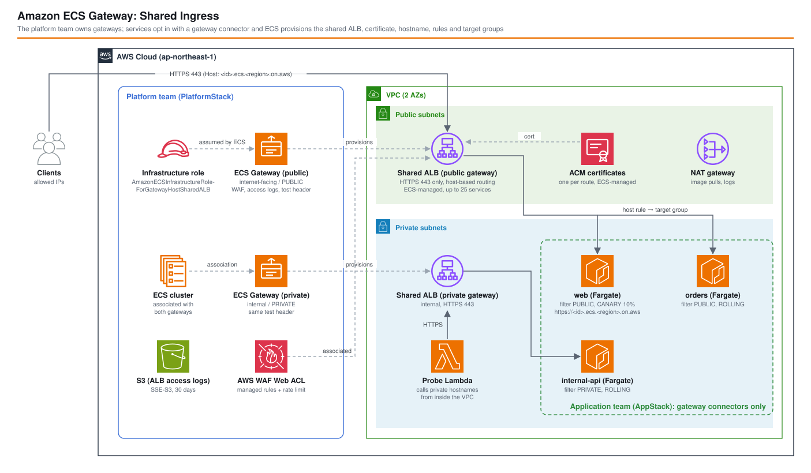

*他の言語で読む:* [](./README.ja.md) [](./README.md)

# Amazon ECS Gateway: プラットフォームチームが所有する共有イングレス - AWS CDK リファレンスアーキテクチャ


[Amazon ECS Gateway](https://aws.amazon.com/jp/blogs/news/introducing-amazon-ecs-gateway-a-fully-managed-ingress-solution-for-ecs-services/) はアカウントレベルのイングレスリソースです。プラットフォームチームがゲートウェイ（スキーム、サブネット、WAF、アクセスログ、desync モード、テストトラフィック用ヘッダー）を作成してクラスターに関連付けます。アプリケーションチームはサービスに **ゲートウェイコネクター** を追加するだけです。共有 Application Load Balancer、サービスごとの ACM 証明書、`https://<id>.ecs.<region>.on.aws` のホスト名、リスナールール、ターゲットグループ、ALB からの通信だけを許可するセキュリティグループは ECS が作成します。

このアーキテクチャでは両者を CDK で構築し、ap-northeast-1 で実機検証しました。1 つのクラスターにインターネット向けと内部向けのゲートウェイを関連付け、公開サービス 2 つで 1 台の ALB を共有し、内部専用サービスを 1 つ置き、ゲートウェイのテストヘッダーで CANARY デプロイを確認しています。

## 📑 目次

- [アーキテクチャ概要](#️-アーキテクチャ概要)
- [誰が何を決めるか](#-誰が何を決めるか)
- [設計判断とベストプラクティス](#-設計判断とベストプラクティス)
- [検証結果](#-検証結果ap-northeast-1-にデプロイ)
- [Well-Architected との対応](#️-well-architected-との対応)
- [コスト](#-コスト)
- [セキュリティ上の考慮事項](#-セキュリティ上の考慮事項)
- [前提条件](#-前提条件)
- [デプロイ](#-デプロイ)
- [テスト戦略](#-テスト戦略)
- [カスタマイズ](#️-カスタマイズ)
- [トラブルシューティング](#-トラブルシューティング)
- [クリーンアップ](#-クリーンアップ)
- [参考資料](#-参考資料)

## 🏗️ アーキテクチャ概要



### 主要コンポーネント

| コンポーネント | 担当 | 役割 |
| --- | --- | --- |
| `AWS::ECS::Gateway` × 2（`HostSharedAlb`） | プラットフォーム | `internet-facing`（アクセスタイプ PUBLIC。WAF、ALB アクセスログ、独自のインバウンド SG 付き）と `internal`（PRIVATE） |
| `AWS::ECS::GatewayClusterAssociations` × 2 | プラットフォーム | 両ゲートウェイをクラスターのサービスから使えるようにする。関連付けだけではトラフィックは流れない |
| インフラストラクチャロール | プラットフォーム | `ecs.amazonaws.com` が引き受ける。`AmazonECSInfrastructureRoleForGatewayHostSharedALB` を付与（ELB/EC2 の書き込み操作は `AmazonECSManaged=true` タグ付きリソースに限定） |
| AWS WAF Web ACL（REGIONAL） | プラットフォーム | Common Rule Set、Known Bad Inputs、レート制限。公開ゲートウェイのすべての ALB に ECS が関連付ける |
| S3 バケット | プラットフォーム | ALB アクセスログ（SSE-S3、30 日）。ゲートウェイ上の全サービスで 1 つのバケットを使い、レコード内のホスト名で区別する |
| Fargate サービス `web`、`orders` | アプリ | コネクターのフィルターは `PUBLIC`。ホストベースルーティングで 1 台の ALB を共有。`web` は CANARY 10% |
| Fargate サービス `internal-api` | アプリ | コネクターのフィルターは `PRIVATE`。内部 ALB 経由でのみ到達可能 |
| プローブ Lambda（VPC 内） | アプリ | `test-gateway.sh` から、内部ホスト名を VPC 内で呼び出す |
| `test-gateway.sh` | — | `status` / `probe` / `canary` の動作確認 |

### スタック

| スタック | 内容 |
| --- | --- |
| `<project>-<env>-ecs-gateway-platform` | VPC（2 AZ、パブリック + プライベート、NAT 1 台）、クラスター（Container Insights）、インフラストラクチャロール、WAF、ログバケット、インバウンド SG、ゲートウェイ 2 つ、関連付け 2 つ |
| `<project>-<env>-ecs-gateway-app` | タスク定義と Fargate サービス 3 組（ゲートウェイコネクター付き）、プローブ Lambda |

アプリスタックはプラットフォームスタックに依存します。ACTIVE な関連付けがないとコネクターは拒否されます。また削除時はサービスを先に消す必要があります。関連付けは、クラスター上のゲートウェイルートがすべて消えるまで `DISASSOCIATING` のままだからです。

## 👥 誰が何を決めるか

アプリスタックには、ロードバランサー、リスナー、ターゲットグループ、証明書、DNS レコード、セキュリティグループのルールが一切ありません。イングレスの定義はこれだけです。

```typescript
// lib/constructs/gateway-connected-service.ts
cfnService.addPropertyOverride('GatewayConnectors', [{
  PortName: 'web',                                   // タスク定義の名前付きポート
  Filters: { AccessTypes: ['PRIVATE'] },             // どのゲートウェイに接続してよいか
  HealthCheck: { HealthCheckPath: '/', HealthCheckIntervalSeconds: 10, Matcher: { HttpCode: '200' } },
}]);
```

サービスが引き継ぐ設定は、すべてプラットフォームスタックで決めます。

```typescript
// lib/constructs/ecs-gateway.ts（aws-cdk-lib にはまだゲートウェイの L1 がない）
new cdk.CfnResource(this, 'Resource', {
  type: 'AWS::ECS::Gateway',
  properties: {
    GatewayName: 'drillexercises-dev-ecsgw-public',
    InfrastructureRoleArn: infrastructureRole.roleArn,
    DeletionProtection: false,      // 既定は true で、ALB にも伝播する
    PropagateTags: 'NONE',          // 設計判断 3 を参照
    Configuration: { HostSharedAlb: {
      Scheme: 'internet-facing',
      NetworkConfiguration: { Subnets: [...publicSubnetIds], IpAddressType: 'ipv4', InboundSecurityGroup: sgId },
      WebACLArn: webAcl.attrArn,
      AccessLogs: { Destination: { S3: { Bucket: bucket.bucketName, Prefix: 'gateway-public' } } },
      HttpDesync: 'defensive',
      MaxAlbCount: 2,
      TestTrafficRules: { Header: { Name: 'x-test-traffic', Values: ['canary'] } },
    } },
  },
});
```

| 関心事 | 決める人 | 場所 |
| --- | --- | --- |
| インターネット向けか内部向けか、サブネット / AZ、IP タイプ | プラットフォーム | ゲートウェイ（作成後は変更不可） |
| WAF、アクセスログ、desync モード、許可 CIDR、ALB 上限 | プラットフォーム | ゲートウェイ（変更可、全 ALB に反映） |
| 段階的デプロイのテストトラフィック用ヘッダー | プラットフォーム | ゲートウェイ（`TestTrafficRules`） |
| どのクラスターがゲートウェイを使えるか | プラットフォーム | クラスターとの関連付け |
| ポート、ヘルスチェック、PUBLIC/PRIVATE の受け入れ | アプリ | ゲートウェイコネクター |
| デプロイ戦略（ROLLING / BLUE_GREEN / CANARY / LINEAR） | アプリ | サービス |

アプリケーションチームは、HTTPS エンドポイントを得るのに `iam:PassRole` も `elasticloadbalancing:*` も必要ありません。

## 🎯 設計判断とベストプラクティス

### 1. ゲートウェイを 2 つ用意し、アクセスタイプで振り分ける

コネクターはゲートウェイを名前で指定しません。サービスは、クラスターに関連付けられたゲートウェイのうち、アクセスタイプのフィルターに一致し、同じ VPC にあり、サービスが動くすべての AZ をカバーするもの **すべて** に接続します。この設計はそこから 2 つの影響を受けています。

- `internal-api` は `PRIVATE` でフィルターしています。フィルターがなければインターネット向けゲートウェイにも公開ホスト名が作られます。さらに、あとから公開ゲートウェイがクラスターに関連付けられると、次のデプロイで公開されてしまいます。ドキュメントでも注意喚起されている点で、公開してはいけないサービスはそれを明示する必要があります。
- 両ゲートウェイは、サービスのサブネットと同じ 2 AZ を使います（インターネット向けはパブリックサブネット、内部向けはプライベートサブネット）。AZ が 1 つでも欠けたゲートウェイは、何も言われずに対象外になります。

### 2. CDK の L1 がない CloudFormation リソース

aws-cdk-lib 2.274.0（執筆時点の最新）には `CfnGateway` も、`CfnService` の `gatewayConnectors` もありません。ゲートウェイと関連付けは `CfnResource`、コネクターは `addPropertyOverride('GatewayConnectors', ...)` で書いています。CDK に同梱の cfn-lint スキーマもこれらを知らないため、`cdk synth` で `F3006 Unknown resource type` と `F3002 'GatewayConnectors' was unexpected` が出ます。対象のリソースに限定して `Validations.of(resource).acknowledge(...)` で承認しています。

### 3. `PropagateTags: NONE`（既定の `GATEWAY` は CloudFormation で作ったゲートウェイで失敗する）

CloudFormation で作ったゲートウェイには、`aws:cloudformation:stack-name`、`stack-id`、`logical-id` のタグが付きます。既定の `PropagateTags: GATEWAY` のままだと、ECS はこれらのタグを作成するインフラにもコピーします。ALB は作成されましたが、`acm:RequestCertificate` がすべて `InvalidTagException: Invalid Tag Key: "aws:cloudformation:logical-id". AWS internal tags cannot be changed with this API` で失敗しました。ゲートウェイルートは `CREATE_IN_PROGRESS` のまま止まり（サービスのタスクは 0 のまま）、ECS は 10〜30 秒ごとに再試行し続けました。

あとからゲートウェイを `NONE` に変更しても、作成中のルートは直りませんでした。再試行のたびに古いタグを送り続けたため、サービスを削除して作り直す必要がありました。最初から `NONE` にしておけば、リクエストには `AmazonECSManaged=true` だけが付き、ルートは約 3.5 分で `ACTIVE` になります。

トレードオフ: プロジェクトのタグは ALB に付きません。ただし ECS は各 ALB に `aws:ecs:gateway-arn` タグを付けます。ドキュメントがアラームやダッシュボードでのリソース選択に推奨しているのは、このタグです。

### 4. 共有 ALB はプラットフォームのインバウンド SG で絞る

既定では、ECS が 443 番を全開放するセキュリティグループを作ります。`InboundSecurityGroup` を指定すると、ECS はその SG を ALB に付けて、インバウンドルールの管理をやめます。ALB は共有なので、これはゲートウェイ上の全サービスに効きます。プラットフォームチームが握りたい制御として、まさにこれが適しています（dev ではデプロイしたマシンの IP だけを許可）。この SG にエグレスルールは不要です。タスクへのエグレスは ECS 側の ALB 用 SG が持っています。

### 5. ゲートウェイのテストヘッダーを使う CANARY

`web` は `CANARY`（10%、5 分）とベイク時間 1 分を使います。ゲートウェイの `TestTrafficRules` のヘッダー（`x-test-traffic: canary`）は、ゲートウェイ配下の全サービスで共通です。所有するのはプラットフォームで、アプリケーションチームはヘッダーを知っていれば足ります。`ROLLING` のサービスではヘルスチェック設定を変更できない（変更するとターゲットグループの置き換えになる）ため、コネクターを最初に作るときに設定しています。

### 6. タスクはプライベート、エグレスは NAT

タスクはパブリック IP なしでプライベートサブネットに置きます。内部ゲートウェイもプライベートサブネットを使います。dev ではイメージ取得とログ送信に NAT ゲートウェイ 1 台を使います。本番では AZ ごとに 1 台（または VPC エンドポイント）にしてください。

## 🔬 検証結果（ap-northeast-1 にデプロイ）

2026-10-23 に `drillexercises-dev` で実施。AWS CLI 2.38.3、aws-cdk-lib 2.273.0。各 1 回の計測です。

### 1. プロビジョニングの所要時間

| 手順 | 時間 |
| --- | --- |
| `AWS::ECS::Gateway` の作成（CloudFormation） | 各 32〜33 秒。この時点で ALB はまだない（`currentAlbCount` 0） |
| `AWS::ECS::GatewayClusterAssociations` の作成 | 3〜9 秒 |
| 最初のサービス作成 → ALB の `CreateLoadBalancer` 呼び出し | 約 10 秒 |
| サービス作成 → ゲートウェイルート `ACTIVE` | 約 3.5 分（ルートごとの証明書の ACM DNS 検証を含む） |
| CloudFormation の `AWS::ECS::Service` 完了（ROLLING） | 4 分 22 秒 |
| CloudFormation の `AWS::ECS::Service` 完了（CANARY、初回デプロイ） | 5 分 52 秒 |

### 2. ECS が作ったもの

| 項目 | 観測結果 |
| --- | --- |
| ALB | ゲートウェイごとに 1 台。公開側は 2 ルート（`web`、`orders`）、内部側は 1 ルート |
| ホスト名 | `https://dr-<32 桁の 16 進>.ecs.ap-northeast-1.on.aws`。ルートごとにランダム |
| リスナー | HTTPS 443 のみ、`ELBSecurityPolicy-TLS13-1-2-Ext1-PQ-2025-09`、デフォルトアクションは固定 404 |
| ルートごとのリスナールール | 2 つ: `host-header`（本番）と `host-header` + `x-test-traffic: canary`（テスト） |
| 証明書 | ルートごとに ACM 証明書 1 つ（`AMAZON_ISSUED`、EC-prime256v1、発行者 Amazon ECDSA 256 M01） |
| ターゲットグループ | HTTP:80、ターゲットタイプ `ip`、ヘルスチェックはコネクターの設定、登録解除の遅延 **300 秒**（コネクターからは変更不可） |
| ALB 属性 | アクセスログ有効、`desync_mitigation_mode=defensive`、`deletion_protection=false`、`drop_invalid_header_fields=false` |
| セキュリティグループ | ALB: ECS 管理の SG（インバウンドなし、サービス用 SG への 80 番エグレス）+ プラットフォームのインバウンド SG。タスク: サービスに指定した SG に加えて、**ECS 管理のサービス専用 SG**（ALB の SG からの 80 番のみ許可）。この SG は ENI には付いているが、サービスのネットワーク設定には表示されない |

### 3. 動作

| 確認内容 | 結果 |
| --- | --- |
| 公開ホスト名へインターネット（許可 IP）からアクセス | `web`、`orders`: HTTP 200。`Host` はルートのホスト名 |
| 共有公開 ALB に未知の `Host` でアクセス | HTTP 404（リスナーのデフォルト） |
| HTTP（`http://<host>`） | 応答なし（80 番のリスナーがない） |
| 内部ホスト名をインターネットから | パブリック DNS で **プライベート IP**（10.94.x.x）に解決され、接続できない |
| 内部ホスト名を VPC 内のプローブ Lambda から | `internal-api` から HTTP 200 |
| WAF: `User-Agent: ${jndi:ldap://...}` / `?file=../../etc/passwd` | 403 / 403 |
| ALB アクセスログ | 5 分以内に `gateway-public/AWSLogs/<account>/elasticloadbalancing/...` に配信 |

### 4. CANARY デプロイとテストヘッダー

`./test-gateway.sh ... canary` は `web` の新しいデプロイを強制的に開始し、15 秒ごとに URL をサンプリングします。ヘッダーありとなしで 10 リクエストずつ送り、応答したタスクが旧か新かを数えます。

| 経過（目安） | フェーズ | ヘッダーなし（旧/新） | `x-test-traffic: canary` あり（旧/新） |
| --- | --- | --- | --- |
| 0〜90 秒 | 新タスク起動中 | 10/0 | 10/0 |
| 107 秒 | 新リビジョンが healthy、テストルールが切り替わる | 10/0 | **0/10** |
| 136〜429 秒（19 回） | カナリア 10% を 5 分 | **171/19（新 10.0%）** | 毎回 0/10 |
| 446〜582 秒 | 本番切り替え後、ベイク時間 + 登録解除 | 0/10 | 0/10 |
| 599 秒 | `COMPLETED` | 0/10 | 0/10 |

- テストヘッダー付きのリクエストは、新リビジョンが healthy になった時点からカナリア期間中ずっと新リビジョンに届きました。ヘッダーなしは 90/10 に分かれました。
- ECS 上のデプロイ時間は 15:10:57〜15:20:05（9 分 8 秒）です。内訳はタスク起動が約 1.5 分、カナリア 5 分、ベイク 1 分で、残りは固定 300 秒の登録解除の遅延による旧ターゲットのドレインです。
- デプロイ中でなければ、テストルールも本番のターゲットグループに転送するため、ヘッダーは何の効果も持ちません。

### 5. 削除

`stage:destroy:all` で両スタックの削除に 21 分 49 秒かかりました。ECS が作ったもの（ゲートウェイ、ALB、ターゲットグループ、ACM 証明書、`AmazonECSManaged` の SG）は何も残りませんでした。

| 手順 | 時間 |
| --- | --- |
| `AWS::ECS::Service` の削除（`internal-api`、`orders` / `web`） | 7 分 57 秒 / 7 分 5 秒（登録解除の 300 秒のドレイン） |
| VPC Lambda（プローブ）の削除 | 約 20 分（Hyperplane ENI の解放。最も長い手順） |
| プラットフォームスタック（関連付け、ゲートウェイ、VPC） | 約 1 分 |

Container Insights のロググループ `/aws/ecs/containerinsights/<cluster>/performance` はスタックではなく ECS が作るため、削除後も残ります。手動で削除してください。

## 🏛️ Well-Architected との対応

| 柱 | このアーキテクチャでの対応 |
| --- | --- |
| 運用上の優秀性 | イングレスの標準を 1 か所（ゲートウェイ）に集約。`test-gateway.sh status/probe/canary` でルート、ALB、段階的デプロイを確認。ALB アクセスログと Container Insights |
| セキュリティ | ゲートウェイ経由で公開 ALB すべてに WAF。TLS 1.3 ポリシーの HTTPS 専用リスナー。許可 CIDR はプラットフォームが管理。タスクには ALB の SG からしか届かない。内部サービスは `PRIVATE` でフィルター。アプリチームに ELB や PassRole の権限は不要 |
| 信頼性 | ゲートウェイとサービスで同じ 2 AZ をカバー。ロールバック付きのデプロイサーキットブレーカー。テストヘッダーとベイク時間付きの CANARY |
| パフォーマンス効率 | ARM64 の Fargate タスク。ALB 1 台あたり最大 25 サービス、ゲートウェイあたり `MaxAlbCount` 台 |
| コスト最適化 | サービスごとではなく 25 サービスごとに ALB 1 台。最後のルートが消えると ECS が ALB を削除 |
| 持続可能性 | アイドルなロードバランサーを減らす。Graviton のタスク |

## 💰 コスト

ap-northeast-1、オンデマンドの定価、月 730 時間、低トラフィックの想定です。ECS Gateway 自体は無料です。

| 項目 | 計算 | 月額（USD） |
| --- | --- | --- |
| ALB × 2（公開 + 内部） | 2 × $0.0243/時 × 730 | 約 35.5 |
| ALB LCU | 低トラフィック、各約 1 LCU | 約 11.7 |
| パブリック IPv4（公開 ALB 2 AZ + NAT） | 3 × $0.005/時 × 730 | 約 11.0 |
| NAT ゲートウェイ | $0.062/時 × 730 + データ処理 | 約 45.3 |
| Fargate ARM64 0.25 vCPU / 0.5 GB × 4 タスク | 4 × (0.25 × $0.04045 + 0.5 × $0.00442) × 730 | 約 36.0 |
| WAF | Web ACL $5 + ルール 3 × $1 + $0.60/100 万リクエスト | 約 8.0 |
| ACM パブリック証明書 | ALB で利用 | 0 |
| CloudWatch Logs、Container Insights、S3 ログ、Lambda | 少額 | 約 3 |
| **合計（dev）** | | **約 150** |

ゲートウェイの効果はサービス数が増えるほど大きくなります。公開サービスが 20 個なら、ALB は 20 台（約 $355 + LCU）ではなく 1 台（約 $17.7 + LCU）で済みます。ALB 1 台あたりの上限は 25 サービスで、超えると `MaxAlbCount` まで ECS が ALB を追加します。

本番では、AZ ごとに NAT ゲートウェイ（または ECR/Logs/S3 の VPC エンドポイント）、サービスごとに 2 タスク以上、より大きな `MaxAlbCount` を使ってください。

## 🔒 セキュリティ上の考慮事項

- **既定のインバウンドは全開放**: `InboundSecurityGroup` がない場合、ECS 管理の SG は `0.0.0.0/0` からの 443 番を許可します。WAF は効きますが、意図して決めてください。
- **アクセスタイプのフィルター**: 非公開にすべきサービスは必ず `PRIVATE` でフィルターします（設計判断 1）。
- **内部ホスト名はパブリック DNS 名**で、プライベート IP に解決されます。名前はランダムですが、秘密ではありません。
- **`drop_invalid_header_fields` は false** で、ゲートウェイの設定項目にもありません。ALB を直接変更するのは ECS が追跡しない帯域外の変更です（`AmazonECSManaged` リソースは変更しないこと）。
- **削除保護**は既定で true で、ALB にも伝播します。このスタックは `cdk destroy` のために `false` にしています。本番では `true` を維持してください。
- **IAM**: インフラストラクチャロールは AWS 管理ポリシーを使います。書き込み操作は `aws:ResourceTag/AmazonECSManaged=true` を条件にしています。`iam:PassRole` が必要なのはプラットフォームのパイプラインだけです。

CDK Nag の抑制（すべて `test/compliance/cdk-nag.test.ts`）: IAM4（AWS 管理ポリシー: ゲートウェイのインフラストラクチャロール、Lambda の基本/VPC ロール）、IAM5（実行ロールのログストリームのワイルドカード）、S1（アクセスログ用バケット自身）、ECS2（環境変数はサービス名とバージョンラベルのみ）。

## 📋 前提条件

- AWS CLI **2.38 以降**（`aws ecs create-gateway` などのコマンド。古い CLI には `test-gateway.sh` が使うコマンドがありません）
- Node.js 24、AWS CDK CLI、ブートストラップ済みのアカウント
- `test-gateway.sh` 用に `jq`、`curl`、`dig`

## 🚀 デプロイ

```bash
cd infrastructure/workspaces/ecs-gateway-shared-ingress

# 公開ゲートウェイで許可するクライアント IP（既定はこのマシンのグローバル IP）
export ALLOWED_IPS=203.0.113.10

PROJECT=myproject ENV=dev npm run stage:deploy:all -- --require-approval never
```

初回デプロイは約 10 分です（プラットフォーム約 3 分、アプリ約 6 分）。

## 使い方（test-gateway.sh）

```bash
./test-gateway.sh --project myproject --env dev status   # ゲートウェイ、関連付け、ルート、ALB
./test-gateway.sh --project myproject --env dev probe    # 全ルートを呼び出す（内部ルートはプローブ Lambda 経由）
./test-gateway.sh --project myproject --env dev canary   # web の CANARY デプロイを開始してサンプリング
```

## 🧪 テスト戦略

```bash
npm test -w workspaces/ecs-gateway-shared-ingress
```

| スイート | 対象 |
| --- | --- |
| `test/unit/platform-stack.test.ts` | ゲートウェイ 2 つのスキームとサブネット、`DeletionProtection: false`、`PropagateTags: NONE`、WAF/ログ/インバウンド SG は公開ゲートウェイだけ、関連付け、インフラストラクチャロールと依存関係、WAF ルール、ログバケットのポリシー |
| `test/unit/app-stack.test.ts` | サービスごとに名前付きポートのコネクター 1 つ、`PUBLIC`/`PRIVATE` のフィルターとフィルターなしのケース、ヘルスチェック、ELB リソースがないこと、awsvpc + 名前付きポート、CANARY/ROLLING の設定、プライベート配置、タスク SG にインバウンドルールがないこと、プローブ関数 |
| `test/snapshot/snapshot.test.ts` | 両スタックのテンプレート全体とリソース数 |
| `test/compliance/cdk-nag.test.ts` | 抑制理由を明記した AwsSolutions パック |

## ⚙️ カスタマイズ

| パラメーター（`parameters/dev-params.ts`） | 効果 |
| --- | --- |
| `platform.publicGateway.restrictIngressToAllowedIps` | `false` にすると、ECS が 0.0.0.0/0:443 のルールを管理する |
| `platform.publicGateway.accessLogs` / `wafRateLimit` | アクセスログ用バケット / WAF のレート制限値 |
| `platform.*Gateway.maxAlbCount` / `httpDesync` | ALB の上限（1 台 25 サービス）/ desync モード |
| `platform.*Gateway.ipAddressType` | `ipv4`、`dualstack`、`dualstack-without-public-ipv4`（変更不可） |
| `platform.testTrafficHeader` | デプロイ中に新リビジョンへ届くヘッダー |
| `app.services[]` | 名前、`accessTypes`、タスク数、`ROLLING` / `BLUE_GREEN` / `CANARY` とその時間 |
| `app.version` | 各サービスが返す値。変更すると全サービスがデプロイされる |

ゲートウェイの変更不可な設定（名前、スキーム、サブネット、IP タイプ、ポート、プロトコル）を変えると、CloudFormation による置き換えになります。コネクターはゲートウェイを名前で指定しないため、こうした変更は「新しいゲートウェイを作って関連付け、サービスを再デプロイし、古いゲートウェイを外す」という手順で計画してください。

## 🔧 トラブルシューティング

| 症状 | 原因 / 対処 |
| --- | --- |
| ルートが `CREATE_IN_PROGRESS` のままで、タスクが起動しない | CloudTrail で `ECSGateway` による `RequestCertificate` のエラーを探す。`aws:cloudformation:*` で `InvalidTagException` なら `PropagateTags: NONE` にして、サービスを削除して作り直す |
| サービスの作成が拒否される | クラスターに `ACTIVE` な関連付けがない、またはアクセスタイプ / VPC / AZ に一致するゲートウェイがない |
| ルートは `ACTIVE` だが 503 | ターゲットが unhealthy。`describe-service-revisions` で得たターゲットグループに `aws elbv2 describe-target-health` |
| ROLLING のサービスでヘルスチェックの変更が失敗する | `Target group properties cannot be changed with ROLLING deployment strategy`。BLUE_GREEN/CANARY にするか、作り直す |
| 手元の PC から内部 URL がタイムアウトする | 想定どおり（プライベート IP に解決される）。`test-gateway.sh probe` を使う |
| `test-gateway.sh` でゲートウェイのコマンドがない | AWS CLI を 2.38 以降に更新 |

どの症状でも、まず `./test-gateway.sh --project <p> --env <e> status` を実行してください。

## 🧹 クリーンアップ

```bash
PROJECT=myproject ENV=dev npm run stage:destroy:all
```

先にアプリスタック（サービス → ルート → ALB）、次にプラットフォームスタックが削除されます。

## 📚 参考資料

- [Amazon ECS Gateway の紹介（AWS ブログ）](https://aws.amazon.com/jp/blogs/news/introducing-amazon-ecs-gateway-a-fully-managed-ingress-solution-for-ecs-services/) / [英語版](https://aws.amazon.com/blogs/containers/introducing-amazon-ecs-gateway-a-fully-managed-ingress-solution-for-ecs-services/)
- [Create and manage an Amazon ECS Gateway](https://docs.aws.amazon.com/AmazonECS/latest/developerguide/gateway-managing.html)
- [Connect Amazon ECS services to a gateway](https://docs.aws.amazon.com/AmazonECS/latest/developerguide/gateway-connect-service.html)
- [Monitor a gateway](https://docs.aws.amazon.com/AmazonECS/latest/developerguide/gateway-monitoring.html)
- [AWS::ECS::Gateway](https://docs.aws.amazon.com/AWSCloudFormation/latest/TemplateReference/aws-resource-ecs-gateway.html) / [AWS::ECS::GatewayClusterAssociations](https://docs.aws.amazon.com/AWSCloudFormation/latest/TemplateReference/aws-resource-ecs-gatewayclusterassociations.html) / [AWS::ECS::Service GatewayConnector](https://docs.aws.amazon.com/AWSCloudFormation/latest/TemplateReference/aws-properties-ecs-service-gatewayconnector.html)
- [AmazonECSInfrastructureRoleForGatewayHostSharedALB](https://docs.aws.amazon.com/aws-managed-policy/latest/reference/AmazonECSInfrastructureRoleForGatewayHostSharedALB.html)
- ナレッジベース: [docs/knowledge/ecs-gateway.md](../../../docs/knowledge/ecs-gateway.md)

---

**Level 300** · [AWS CDK Reference Architectures](../../../README.ja.md) の一部
