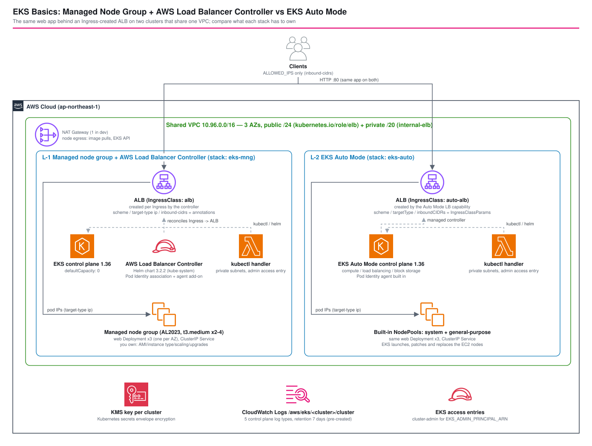

*Read this in other languages:* [](./README.ja.md) [](./README.md)

# EKS Basics: Managed Node Group + AWS Load Balancer Controller vs EKS Auto Mode - AWS CDK Reference Architecture


A first EKS cluster raises two questions before any application code: who runs the nodes, and who turns an `Ingress` into a load balancer. The classic answer is a **managed node group** plus a self-installed **AWS Load Balancer Controller** (Helm chart, IAM role, webhook). **EKS Auto Mode** moves both into the cluster itself: EKS launches, patches and removes the EC2 nodes and runs the load balancer controller as a managed capability.

This architecture deploys the same web application behind an Ingress-created ALB on both kinds of cluster, in one shared VPC, with `aws-eks-v2` (L1-based `AWS::EKS::Cluster`). The managed node group cluster authenticates its controller with **EKS Pod Identity** instead of IRSA. Both were deploy-verified in ap-northeast-1: what each stack has to own, how many nodes the same three pods cost, what happens on scale-out and scale-in, a rolling restart under traffic, and the gotchas hit on the way.



## 📑 Table of Contents

- [Architecture Overview](#️-architecture-overview)
- [Design Decisions and Best Practices](#-design-decisions-and-best-practices)
- [Verification Results](#-verification-results-deployed-to-ap-northeast-1)
- [Well-Architected Alignment](#️-well-architected-alignment)
- [Cost](#-cost)
- [Security Considerations](#-security-considerations)
- [Prerequisites](#-prerequisites)
- [Deployment](#-deployment)
- [Testing Strategy](#-testing-strategy)
- [Customization](#️-customization)
- [Troubleshooting](#-troubleshooting)
- [Cleanup](#-cleanup)
- [References](#-references)

## 🏗️ Architecture Overview

### Key Components

| Component | Managed node group (L-1, `eks-mng`) | Auto Mode (L-2, `eks-auto`) |
| --- | --- | --- |
| Capacity setting | `defaultCapacityType: NODEGROUP`, `defaultCapacity: 0` + one explicit node group | `defaultCapacityType: AUTOMODE`, `compute.nodePools: ['system', 'general-purpose']` |
| Nodes | AL2023, `t3.medium`, min 2 / desired 2 / max 4, 20 GiB | Bottlerocket, instance type chosen per pod (measured: `c5a.large`, `c6a.large`) |
| Load balancer controller | AWS Load Balancer Controller v3.2.2 (Helm), 2 replicas in `kube-system` | Built-in (`eks.amazonaws.com/alb`), runs outside the cluster |
| Controller credentials | **EKS Pod Identity** (association + `eks-pod-identity-agent` add-on) | Cluster IAM role (`AmazonEKSLoadBalancingPolicy`) |
| IngressClass | `alb`, installed by the chart | `auto-alb` + `IngressClassParams` (`eks.amazonaws.com/v1`), declared by the stack |
| ALB settings | Ingress annotations (`scheme`, `target-type`, `inbound-cidrs`) | `IngressClassParams` (`scheme`, `targetType`, `inboundCIDRs`) |
| Networking / DNS / kube-proxy | Self-managed VPC CNI, CoreDNS, kube-proxy (bootstrap copies) | Managed by EKS, no pods in `kube-system` |

Shared by both clusters (`lib/constructs/cluster-defaults.ts`):

| Setting | Value | Why |
| --- | --- | --- |
| Kubernetes version | 1.36 | Newest version in aws-cdk-lib 2.273 (`KubectlV36Layer`) |
| Subnets | Private subnets in 3 AZs (`/20`), public `/24` | Pods take VPC IPs; ALB subnets are discovered by the `kubernetes.io/role/elb` tag |
| API endpoint | Public restricted to the deploying client `/32` + private | kubectl from a laptop without a bastion; nodes and the kubectl handler use the private endpoint |
| Secrets | Envelope encryption with a KMS key (rotation on) | Kubernetes Secrets are encrypted with a customer managed key |
| Control plane logs | All 5 types, log group **pre-created** with 7-day retention | EKS would otherwise create `/aws/eks/<cluster>/cluster` with no expiry and outside the stack |
| kubectl handler | Lambda with `KubectlV36Layer` in the private subnets | Applies manifests and Helm charts during `cdk deploy` |
| Admin access | Access entry with `AmazonEKSClusterAdminPolicy` for `EKS_ADMIN_PRINCIPAL_ARN` | The CloudFormation execution role creates the cluster; a human needs an explicit entry |

The application (`src/app.py`, Python standard library, `python:3.13-alpine`) is identical on both: 3 replicas, `topologySpreadConstraints` on `topology.kubernetes.io/zone` (`DoNotSchedule`), a readiness probe on `/health`, a 10-second drain on SIGTERM, non-root and a read-only root filesystem. It answers with the cluster mode, pod, node and AZ.

### Stacks

| Stack | Contents | Resources |
| --- | --- | --- |
| `<project>-<env>-eks-network` | VPC (3 AZs, 1 NAT gateway), subnet role tags, REJECT flow log | 36 |
| `<project>-<env>-eks-mng` | Cluster, node group, Pod Identity association + agent add-on, controller Helm release, application | 29 |
| `<project>-<env>-eks-auto` | Auto Mode cluster, IngressClass + IngressClassParams, application | 23 |

`managedNodeGroup.enabled` / `autoMode.enabled` in `parameters/` switch each cluster stack off.

## 🎯 Design Decisions and Best Practices

### 1. `aws-eks-v2`, not `aws-eks`

`aws-eks-v2` creates the cluster as a native `AWS::EKS::Cluster` instead of the custom resource of `aws-eks`, and the kubectl handler is optional. It defaults to Auto Mode, so the managed node group cluster sets `defaultCapacityType: NODEGROUP` explicitly. `defaultCapacity: 0` keeps the node group out of the cluster construct, so its AMI type, size and scaling range are visible in the stack:

```typescript
this.cluster = new eks.Cluster(this, 'Cluster', {
  ...defaults.clusterProps,
  defaultCapacityType: eks.DefaultCapacityType.NODEGROUP,
  defaultCapacity: 0,
});
this.nodeGroup = this.cluster.addNodegroupCapacity('Workers', {
  amiType: eks.NodegroupAmiType.AL2023_X86_64_STANDARD,
  instanceTypes: [new ec2.InstanceType('t3.medium')],
  minSize: 2, desiredSize: 2, maxSize: 4,
});
```

The Auto Mode cluster is the same call with `AUTOMODE` and `compute.nodePools`.

### 2. The controller with Pod Identity instead of the built-in `albController`

`eks.Cluster`'s `albController` option installs the controller with **IRSA**: an IAM OIDC provider and a role whose trust policy names the cluster's issuer. `AlbControllerPodIdentity` (`lib/constructs/alb-controller-pod-identity.ts`) does the same with Pod Identity:

- `eks.ServiceAccount` with `identityType: POD_IDENTITY` creates a role trusted by `pods.eks.amazonaws.com` (`sts:AssumeRole`, `sts:TagSession`), an `AWS::EKS::PodIdentityAssociation` and the `eks-pod-identity-agent` add-on. No OIDC provider is created (the unit test checks this).
- The role gets the upstream controller policy for v3.2.2, copied from aws-cdk-lib into `src/` so the policy and the chart version change together.
- `eks.HelmChart` installs `aws-load-balancer-controller` with `serviceAccount.create: false` and `wait: true`.

Two dependencies are added by hand: the agent add-on and the chart wait for the node group (both need nodes to become ready), and the application depends on the controller. The second one matters twice: on deploy, the controller's admission webhook must answer before the Service and Ingress are applied; on destroy, the controller must still be running while the Ingress is deleted, or the ALB is left behind.

### 3. Auto Mode reads ALB settings from IngressClassParams

Auto Mode ignores annotations on the IngressClass; cluster-wide ALB settings go into an `IngressClassParams` of `eks.amazonaws.com/v1` (the open-source controller uses `elbv2.k8s.aws/v1beta1` with different field names). The stack declares both objects and points the Ingress at them:

```typescript
{ apiVersion: 'eks.amazonaws.com/v1', kind: 'IngressClassParams', metadata: { name: 'auto-alb' },
  spec: { scheme: 'internet-facing', targetType: 'ip', inboundCIDRs: allowedCidrs } },
{ apiVersion: 'networking.k8s.io/v1', kind: 'IngressClass', metadata: { name: 'auto-alb' },
  spec: { controller: 'eks.amazonaws.com/alb',
          parameters: { apiGroup: 'eks.amazonaws.com', kind: 'IngressClassParams', name: 'auto-alb' } } },
```

Per-Ingress annotations that both controllers understand (`healthcheck-path`, `target-group-attributes`) stay on the Ingress in `WebApp`.

### 4. One workload construct, the ALB hostname as a stack output

`WebApp` (`lib/constructs/web-app.ts`) is the only place that defines the Namespace, Deployment, Service and Ingress; the stacks pass the IngressClass name and the annotations that differ. `KubernetesObjectValue` reads `.status.loadBalancer.ingress[0].hostname` back from the Ingress, so `AlbUrl` is a normal CloudFormation output.

### 5. Manifests are created in the construct's own scope

`cluster.addManifest()` and `cluster.addHelmChart()` create their resources **under the cluster**, so `webApp.node.addDependency(controller)` would not reach them. The constructs create `eks.KubernetesManifest` / `eks.HelmChart` / `eks.ServiceAccount` with `this` as scope, and construct-level dependencies become `DependsOn` on every resource inside.

### 6. Pre-created control plane log group

With logging enabled, EKS writes to `/aws/eks/<cluster>/cluster` and creates the group itself (retention: never expire) if it does not exist. `ClusterDefaults` creates it in the stack with 7-day retention and `RemovalPolicy.DESTROY`, and the cluster depends on it.

### 7. Same VPC, separate stacks

Both clusters share one VPC so the comparison isolates compute and load balancing. Separate stacks keep each cluster independently deployable and removable (and halve the cost when only one is needed).

## 🔬 Verification Results (deployed to ap-northeast-1)

Deployed on 2026-10-29 with aws-cdk-lib 2.273.0, Kubernetes 1.36, profile `drillexercises-dev`. Single runs.

### 1. Deployment time

| Step | Managed node group | Auto Mode |
| --- | --- | --- |
| `AWS::EKS::Cluster` | 9 min 05 s | 10 min 06 s |
| Node group | 1 min 20 s | — |
| Pod Identity association + agent add-on | 24 s | — |
| Gap until the first manifest was applied | 2 min 20 s after the node group | 3 min 40 s after the cluster |
| Controller Helm release (`wait: true`) | 28 s after the service account | — |
| Workload, Ingress, ALB hostname | 21 s | 22 s |
| **Stack total** (`cdk deploy`) | **866 s** | **902 s** |
| First HTTP 200 from the ALB after the stack completed | ~80 s | ~50 s |

The hostname is available a few seconds after the Ingress is applied, while the ALB is still `provisioning`; the first 200 comes 1–2 minutes later.

### 2. What runs in the cluster

| | Managed node group | Auto Mode |
| --- | --- | --- |
| Nodes right after the stack | 2 × `t3.medium` (1a, 1d), AL2023 | **3** × `c5a.large` / `c5a.large` / `c6a.large` (1a, 1c, 1d), Bottlerocket |
| Nodes with no workload | 2 (node group minimum) | 0 (before the application was applied) |
| `kube-system` pods | VPC CNI, kube-proxy, CoreDNS, Pod Identity agent, controller ×2 | none (`kubectl get pods -A` was empty before the application) |
| `aws eks list-addons` | `eks-pod-identity-agent` | (empty) |
| Pod placement | 1a: 1, 1d: 2 | 1a: 1, 1c: 1, 1d: 1 |

The same Deployment produced different node counts. Topology spread only counts zones that already have a node: the node group placed its two nodes in 1a and 1d, so the spread was 1/2 and the third AZ stayed unused. Auto Mode provisions nodes for pending pods, and `DoNotSchedule` across zones made it launch **one node per AZ for three 100m pods**. Use `ScheduleAnyway` (or fewer replicas than AZs) if node count matters more than strict spread.

The controller pod's environment shows Pod Identity, not IRSA: `AWS_CONTAINER_CREDENTIALS_FULL_URI=http://169.254.170.23/v1/credentials` and `AWS_CONTAINER_AUTHORIZATION_TOKEN_FILE=/var/run/secrets/pods.eks.amazonaws.com/serviceaccount/eks-pod-identity-token` (no `AWS_ROLE_ARN` / `AWS_WEB_IDENTITY_TOKEN_FILE`).

The pod's `ZONE` variable, read through the Downward API from `metadata.labels['topology.kubernetes.io/zone']`, was filled on both clusters: Kubernetes 1.36 copies the node's topology labels onto the pod.

### 3. The ALBs the two controllers create

| | Managed node group | Auto Mode |
| --- | --- | --- |
| Name | `k8s-web-web-<hash>` | `k8s-web-web-<hash>` |
| Frontend SG | `k8s-web-web-<hash>`: port 80 from the client `/32` only | same |
| Backend SG | `k8s-traffic-<cluster>-<hash>` (shared by all ALBs of the cluster) | same pattern |
| Target type / health check / deregistration | `ip`, `/health`, 15 s | `ip`, `/health`, 15 s |
| Tags on the ALB | `elbv2.k8s.aws/cluster`, `ingress.k8s.aws/stack`, `ingress.k8s.aws/resource` | `eks:eks-cluster-name`, `ingress.eks.amazonaws.com/stack`, `ingress.eks.amazonaws.com/resource` |

The result is the same; the source of the settings and the ownership tags differ (relevant when migrating an ALB from one controller to the other).

### 4. Rolling restart under traffic

`kubectl rollout restart deploy/web` on both clusters while each ALB received ~6 requests/s:

| | Requests | Non-200 | `rollout status` |
| --- | --- | --- | --- |
| Managed node group | 892 | 0 | 17.7 s |
| Auto Mode | 858 | 0 | 5.4 s |

The readiness probe plus 10 s of serving after SIGTERM (`/health` returns 503) and the 15 s deregistration delay are enough without pod readiness gates.

### 5. Scale-out to 30 replicas

| | After 5 minutes |
| --- | --- |
| Managed node group | 23 Running, **7 Pending forever**: `1 Too many pods, 1 node(s) didn't match pod topology spread constraints`. `t3.medium` allows 17 pods per node; the node group stayed at 2 nodes although `maxSize` is 4 (no Cluster Autoscaler or Karpenter is installed). |
| Auto Mode | 30 Running within 15 s on the existing 3 nodes (no new node was needed). |

`maxSize` on a managed node group is only an upper bound for something that scales it; adding that something (Cluster Autoscaler or Karpenter, series L-3) is the next operational task on the node group path.

### 6. Scale-in to 1 replica

Auto Mode's `general-purpose` NodePool has `consolidationPolicy: WhenEmptyOrUnderutilized`, `consolidateAfter: 30s`, budget `10%`. After scaling to 1 replica, it terminated the two empty nodes at **+65 s and +91 s** (`Disrupting NodeClaim: Empty`, one at a time) and ran on 1 node from +130 s. The managed node group kept its 2 nodes.

### 7. Teardown

`cdk destroy '**'` removed the stacks one after another in 49.5 minutes: managed node group 23 min, Auto Mode 25 min, network 1.3 min. On both cluster stacks the Ingress went first (35 s; the controller deleted the ALB and its `k8s-*` security groups) and the controller chart after it. The long waits were the node group (8.5 min) and the **VPC-attached kubectl handler Lambda (10 min on one stack, 19 min on the other)** while its network interfaces were released. Afterwards no stack, cluster, `k8s-*` ALB, EC2 instance, `/aws/eks/...` log group or the VPC remained.

### 8. Gotchas found during deployment

- **Access entry with an IAM Identity Center role**: the role ARN without its path (`arn:aws:iam::<acct>:role/AWSReservedSSO_...`) is rejected with `The specified principalArn is invalid: invalid principal`, and the whole stack rolls back after the cluster was created (~9 minutes lost per cluster). Use the ARN returned by `aws iam get-role`, including `aws-reserved/sso.amazonaws.com/<region>/`. Removing the path is the rule for the legacy `aws-auth` ConfigMap only.
- **cdk-nag on a Stage**: `Aspects.of(app).add(new AwsSolutionsChecks())` does not reach stacks inside a `cdk.Stage`; the compliance test passed with zero checks. The test attaches the pack to the stage and asserts that suppressed findings were actually logged.

## 🏛️ Well-Architected Alignment

| Pillar | Managed node group | Auto Mode |
| --- | --- | --- |
| Operational Excellence | You patch the AMI, upgrade the node group, VPC CNI, kube-proxy, CoreDNS and the controller | EKS patches nodes (Bottlerocket) and runs networking, DNS and load balancing; both clusters log all control plane log types with retention |
| Security | Pod Identity scoped to one service account; private nodes; client-restricted ALB and API endpoint; KMS for Secrets | Same, with fewer components in the cluster to keep current |
| Reliability | 3 AZs available, but the node group placed nodes in 2 AZs; no node autoscaling | One node per AZ for a zone spread; replaced and consolidated automatically |
| Performance Efficiency | Fixed instance type, pod limit per node (17 on `t3.medium`) | Instance type chosen from pod requests |
| Cost Optimization | No management fee; pay for idle node group capacity | Management fee per instance (~12% of the EC2 price); empty nodes removed in ~1–2 minutes |
| Sustainability | Idle capacity stays on | Capacity follows the workload |

## 💰 Cost

ap-northeast-1, 730 hours/month, on-demand list prices from the Pricing API (2026-10-29): EKS cluster $0.10/h, `t3.medium` $0.0544/h, `c5a.large` $0.096/h + Auto Mode management $0.01152/h, `c6a.large` $0.0963/h + $0.01156/h.

| Item | Managed node group | Auto Mode (as measured: 3 nodes) |
| --- | --- | --- |
| EKS control plane | 73.0 | 73.0 |
| EC2 | 2 × 0.0544 × 730 = 79.4 | (0.096 × 2 + 0.0963) × 730 = 210.5 |
| Auto Mode management | — | (0.01152 × 2 + 0.01156) × 730 = 25.3 |
| ALB ($0.0243/h + ~1 LCU) | ~24 | ~24 |
| EBS, CloudWatch Logs, KMS | ~6 | ~6 |
| **Per cluster (USD/month)** | **~182** | **~339** |

Shared: NAT gateway ~45, public IPv4 (NAT + 2 ALBs × 3 AZs) ~26. **Both clusters together in dev: ~590 USD/month (~0.81 USD/hour)**; delete them after use.

The Auto Mode figure is the price of the strict zone spread on `large` instances, not of Auto Mode itself: with 1 replica it ran on one node (~$78/month of EC2 + fee). The management fee is a fixed ~12% on top of the instance price. The managed node group is cheaper here because two small nodes were enough and nothing scaled them — which is also why 7 pods stayed Pending.

Production: one NAT gateway per AZ or VPC endpoints, more than two nodes or Karpenter for the node group, and HTTPS on the ALB.

## 🔒 Security Considerations

- **API endpoint**: public access limited to `ALLOWED_IPS` (`/32`), private access on; the kubectl handler runs in the private subnets.
- **Cluster access**: API authentication mode with access entries; cluster-admin is granted only to `EKS_ADMIN_PRINCIPAL_ARN` and to the kubectl handler role.
- **Controller IAM**: Pod Identity binds the role to `kube-system/aws-load-balancer-controller` only; the upstream policy scopes mutating Elastic Load Balancing and EC2 actions with `elbv2.k8s.aws/cluster` tag conditions. Auto Mode uses the cluster role's `AmazonEKSLoadBalancingPolicy` instead.
- **Ingress**: ALB security groups allow port 80 from `ALLOWED_IPS` only (annotation `inbound-cidrs` / `IngressClassParams.inboundCIDRs`). Add HTTPS (ACM) and AWS WAF for production.
- **Pods**: non-root, read-only root filesystem, all capabilities dropped, `RuntimeDefault` seccomp; nodes in private subnets.
- **Data**: Kubernetes Secrets encrypted with a rotated KMS key; control plane logs (including audit) for 7 days in dev.

CDK Nag (`test/compliance/cdk-nag.test.ts`, pack attached to the Stage): IAM4 (EKS-required managed policies on cluster/node roles, Lambda managed policies on the kubectl handler), IAM5 (upstream controller policy; provider framework invoking its handler versions), L1 (kubectl handler runtime chosen by aws-cdk-lib). The network stack has no findings.

## 📋 Prerequisites

- Node.js 24, AWS CDK CLI, a bootstrapped account
- AWS CLI v2 and `kubectl` 1.36 for the checks below

## 🚀 Deployment

```bash
cd infrastructure/workspaces/eks-managed-node-group-vs-auto-mode

# Client IPs allowed on the ALBs and the public API endpoint (defaults to this machine's global IP)
export ALLOWED_IPS=203.0.113.10
# IAM role that gets cluster-admin: the full ARN, including the aws-reserved/... path for SSO roles
export EKS_ADMIN_PRINCIPAL_ARN=$(aws iam get-role --role-name <role-name> --query Role.Arn --output text)

PROJECT=myproject ENV=dev npm run stage:deploy:all -- --require-approval never --concurrency 2
```

The two cluster stacks deploy in parallel after the network stack (~15 minutes). Then:

```bash
for c in mng auto; do
  aws eks update-kubeconfig --name myproject-dev-eks-$c --alias $c
done
kubectl --context auto get nodes -L topology.kubernetes.io/zone,node.kubernetes.io/instance-type,karpenter.sh/nodepool
kubectl --context mng -n kube-system get deploy aws-load-balancer-controller

curl -s "$(aws cloudformation describe-stacks --stack-name myproject-dev-eks-mng \
  --query "Stacks[0].Outputs[?OutputKey=='AlbUrl'].OutputValue" --output text)"
# {"cluster": "managed-node-group", "pod": "web-...", "node": "ip-10-96-...", "az": "ap-northeast-1a", ...}
```

## 🧪 Testing Strategy

```bash
npm test                 # all
npm run test:unit        # 34 unit tests
npm run test:snapshot    # template + resource counts per stack
npm run test:compliance  # cdk-nag on the Stage
```

- **Unit** (`test/unit/stage.test.ts`): stack switches; subnet role tags; common cluster settings for both (version, endpoint CIDRs, KMS, logging + pre-created log group dependency, access entries, kubectl handler in the VPC, the parsed Deployment and Ingress manifests); managed node group (explicit node group, no `ComputeConfig`, Pod Identity trust and no OIDC provider, agent add-on after the node group, Helm values, policy statement count = upstream, workload depends on the chart); Auto Mode (compute + storage + load balancing enabled together, no node group/Helm/association/add-on, IngressClassParams shape).
- **Snapshot**: per stack, with asset hashes masked.
- **Compliance**: AwsSolutions pack on the Stage, plus a guard that it actually ran.

## ⚙️ Customization

| Parameter | Effect |
| --- | --- |
| `managedNodeGroup.enabled` / `autoMode.enabled` | Deploy one cluster only |
| `kubernetesVersion` | Must match `KubectlV36Layer` in `cluster-defaults.ts` |
| `managedNodeGroup.nodeGroup` | Instance types, min/desired/max, disk size |
| `managedNodeGroup.albControllerChartVersion` | Also add `src/alb-controller-iam-policy-v<version>.json` |
| `autoMode.nodePools` | `system`, `general-purpose` or `[]` (bring your own NodePools) |
| `webApp.replicas` / requests | Changes the Auto Mode node count (see verification 2) |
| `network` | CIDR, AZ count, NAT gateways |

## 🔧 Troubleshooting

| Symptom | Cause / action |
| --- | --- |
| `AWS::EKS::AccessEntry` fails with `The specified principalArn is invalid: invalid principal` | ARN without the role path; pass the ARN from `aws iam get-role` (verification 8) |
| `kubectl`: `the server has asked for the client to provide credentials` | No access entry for your principal; set `EKS_ADMIN_PRINCIPAL_ARN` and redeploy |
| `cdk destroy` sits for 10–20 minutes on `KubectlProviderHandler` | The VPC-attached Lambda waits for its network interfaces to be released; it finishes on its own (verification 7) |
| `kubectl` times out | Your IP is not in `ALLOWED_IPS` (public endpoint CIDR) |
| Applying the Service or Ingress fails with a `failed calling webhook` error | The controller's admission webhook was not ready yet; keep `webApp.node.addDependency(albController)` and `wait: true` on the chart |
| Pods `Pending` with `Too many pods` on the node group | Pod limit per instance type (17 on `t3.medium`); larger instances, more nodes, or a node autoscaler |
| Auto Mode starts more nodes than expected | Zone spread with `DoNotSchedule` needs one node per AZ; check `kubectl get nodeclaims` |
| Ingress has no address | Controller logs (`kubectl -n kube-system logs deploy/aws-load-balancer-controller`) or, on Auto Mode, `kubectl describe ingress`; check the subnet tags |
| `cdk destroy` leaves an ALB or `k8s-*` security groups and the VPC deletion fails | The controller was removed before the Ingress; delete the ALB and the `k8s-*` groups, then destroy again |

## 🧹 Cleanup

```bash
PROJECT=myproject ENV=dev npm run stage:destroy:all
```

The cluster stacks delete the Ingress first (the ALB and its `k8s-*` security groups are removed by the controller), then the cluster; the network stack goes last. Allow about 50 minutes for both clusters (verification 7).

## 📚 References

- [aws-eks-v2 module (AWS CDK)](https://docs.aws.amazon.com/cdk/api/v2/docs/aws-cdk-lib.aws_eks_v2-readme.html)
- [Create an IngressClass to configure an Application Load Balancer (EKS Auto Mode)](https://docs.aws.amazon.com/eks/latest/userguide/auto-configure-alb.html)
- [Route internet traffic with AWS Load Balancer Controller](https://docs.aws.amazon.com/eks/latest/userguide/aws-load-balancer-controller.html)
- [Learn how EKS Pod Identity grants pods access to AWS services](https://docs.aws.amazon.com/eks/latest/userguide/pod-identities.html)
- [Grant IAM users access to Kubernetes with EKS access entries](https://docs.aws.amazon.com/eks/latest/userguide/access-entries.html)
- [Amazon EKS pricing](https://aws.amazon.com/eks/pricing/)
- Knowledge base: [docs/knowledge/eks-managed-node-group-vs-auto-mode.md](../../../docs/knowledge/eks-managed-node-group-vs-auto-mode.md)

---

**Level 300** · Part of [AWS CDK Reference Architectures](../../../README.md)
