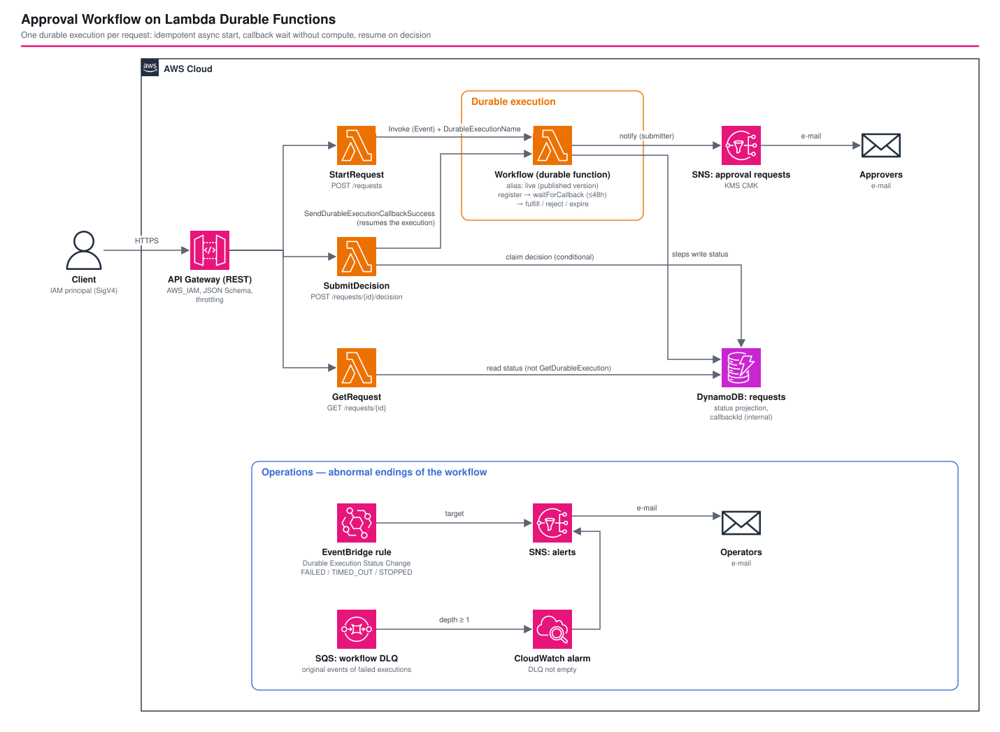

# Approval Workflow on Lambda Durable Functions - AWS CDK Reference Architecture

[](./README.ja.md)
[](./README.md)


A human-in-the-loop business flow (submit → notify approvers → **wait up to 48 hours** → fulfill / reject / expire) implemented as **one Lambda durable function**. While it waits, the function is suspended and no compute is billed. When the decision API calls `SendDurableExecutionCallbackSuccess`, the function resumes from its checkpoints (replay).

The workflow is plain sequential TypeScript, with no Step Functions state machine. In exchange, the durable-specific rules (determinism, qualified ARNs, version pinning, idempotency) must be followed in both code and infrastructure. This workspace shows how.

An optional **demo web UI** (Cognito managed login + CloudFront/S3) lets two people play requester and approver in a browser. It calls the same IAM-authorized API with SigV4, so the API's authorization model does not change.

> **Status: deploy-verified on 2026-10-21** (ap-northeast-1, `aws-cdk-lib` 2.273.0). See [Deploy verification results](#-deploy-verification-results).

## 📑 Table of Contents

- [Architecture Overview](#️-architecture-overview)
- [How durable functions work (the parts that matter here)](#-how-durable-functions-work-the-parts-that-matter-here)
- [Design Decisions and Best Practices](#-design-decisions-and-best-practices)
- [Comparison with Step Functions](#-comparison-with-step-functions)
- [Cost](#-cost)
- [Security Considerations](#-security-considerations)
- [Prerequisites](#-prerequisites)
- [Deployment](#-deployment)
- [Usage](#usage)
- [Demo web UI](#️-demo-web-ui)
- [Testing Strategy](#-testing-strategy)
- [Operations](#-operations)
- [Deploy verification results](#-deploy-verification-results)
- [Cleanup](#-cleanup)
- [References](#-references)

## 🏗️ Architecture Overview



```text
Client (SigV4 / IAM)          Browser (demo UI, optional)
  │                             ├─ CloudFront (OAC) ─▶ S3: index.html / app.js / config.json
  │                             ├─ Cognito user pool (managed login, code + PKCE) ─▶ ID token
  │                             └─ Cognito identity pool ─▶ temporary credentials of the group's IAM role
  ▼                             ▼ (SigV4, CORS for the UI origin only)
API Gateway (REST, AWS_IAM, JSON Schema validation, throttling)
  ├─ POST /requests                 → StartRequest ──Invoke(Event, DurableExecutionName)──▶ Workflow:live (durable)
  ├─ POST /requests/{id}/decision   → SubmitDecision ──SendDurableExecutionCallbackSuccess──▶ (waiting execution resumes)
  ├─ GET  /requests/{id}            → GetRequest ──▶ DynamoDB (status projection)
  └─ GET  /requests?status=…        → ListRequests ──▶ DynamoDB GSI status-createdAt (approvers' work list)

Workflow (durable function, alias: live)
  register-request ─▶ wait-for-approval (callback, up to 48h, no compute) ─┬─ approved ─▶ fulfill-request ─▶ mark-completed
        │                    │ submitter: store callbackId / notify via SNS ├─ rejected ─▶ mark-rejected
        ▼                    ▼                                              └─ timeout  ─▶ mark-expired
     DynamoDB             SNS (approval requests, KMS)

Ops: EventBridge "Durable Execution Status Change" (FAILED / TIMED_OUT / STOPPED) ─▶ SNS (alerts)
     DLQ (SQS) ─▶ CloudWatch alarm ─▶ SNS (alerts)
```

### Components

| Component | Role |
|---|---|
| `WorkflowFunction` (durable) | The approval flow. `DurableConfig`: 7-day execution timeout, 14-day history retention. 60 s per invocation |
| `live` alias | Every new execution starts on this alias (a published version) |
| `StartRequest` | Accepts a request and starts an execution **asynchronously** with a `DurableExecutionName` |
| `SubmitDecision` | Accepts approve / reject and completes the callback |
| `GetRequest` | Returns status from DynamoDB; never calls `GetDurableExecution` |
| `ListRequests` | Approvers' work list: the newest 50 requests in one status, from the `status-createdAt-index` GSI |
| DynamoDB `requests` | Status projection and the only place the `callbackId` is stored |
| SNS (approvals / alerts) | Encrypted with a customer managed KMS key |
| SQS DLQ | Original events of failed executions |
| EventBridge rule | Alerts on abnormal endings of this function only |
| Demo web UI (`DemoWebUi` construct, optional) | Cognito user pool (groups `requesters` / `approvers`) + identity pool, one IAM role per group, CloudFront + private S3 for the SPA |

## 🔁 How durable functions work (the parts that matter here)

- **Checkpoint and replay**: the result of each `context.step()` is checkpointed. On resume the handler **runs again from the top**, and completed steps return their stored result instead of running again.
- **Waiting**: `waitForCallback()` creates a callback ID, runs the submitter and suspends. It resumes when `SendDurableExecutionCallbackSuccess` arrives or the timeout fires.
- **Time limits**: each invocation is still capped at 15 minutes, and the whole execution can run up to `executionTimeout` (max 366 days). **Synchronous invokes and event source mappings cap the entire execution at 15 minutes**, which is why this stack starts executions asynchronously.
- **Version pinning**: an execution stays on the version it started on. Moving the alias affects only new executions.

## 🎯 Design Decisions and Best Practices

### 1. Asynchronous invoke + `DurableExecutionName` for idempotent starts

`StartRequest` invokes with `InvocationType: 'Event'` and `DurableExecutionName: approval-<requestId>`. A retry with the same name and payload returns the existing execution.

**A different payload is not rejected by an asynchronous invoke** (observed during deploy verification). `Invoke` still returns 202 and the existing execution ARN, even after that execution has finished. The new event then fails in the background with `DurableExecutionAlreadyExists. An execution with this name already exists with different payload.` and lands in the DLQ, which also trips the DLQ alarm. `DurableExecutionAlreadyStartedException` is not raised for `Event` invokes. `StartRequest` therefore reads the status projection first: if the request ID already exists with a different title, amount or requester, it returns HTTP 409 without invoking. A mismatched retry that arrives before the first step has written the item still reaches the DLQ; that window is about one second.

- Clients may set the request ID with an `Idempotency-Key` header: 1-55 characters of `[A-Za-z0-9_-]`, which is the 64-character execution-name limit minus the `approval-` prefix.
- **No timestamps in the payload.** The idempotency check compares payloads, so a retry must produce identical bytes.

> The TypeScript sample of the intermediary-function pattern in the AWS docs only puts `executionName` in the payload and never sets the `DurableExecutionName` parameter, so copying it as is does not give idempotent starts.

### 2. Production executions go through the `live` alias, and old versions are retained

- Executions started on `$LATEST` **replay on new code** if you deploy while they wait. Added or renamed steps then no longer match the checkpoints.
- `currentVersionOptions.removalPolicy: RETAIN` keeps old `AWS::Lambda::Version` resources on deploy. Deleting a version breaks the executions waiting on it.
- The trade-off is that versions accumulate, so delete versions with no running executions as an operational task (see [Operations](#-operations)).

### 3. Everything non-deterministic runs inside steps

Clock, randomness and I/O run only inside a `step` or the callback submitter. `parseDecision()` is a pure function of the checkpointed callback result, so it can sit outside a step. **Step names are part of the checkpoint contract**: never rename a step in a version that still has running executions.

### 4. Steps are written for at-least-once execution

The default step semantics are at-least-once per retry: an interruption can make a step run again. Every DynamoDB write is therefore conditional or idempotent:

| Operation | Technique |
|---|---|
| Register | `attribute_not_exists(requestId)` |
| Wait for approval | `status IN (SUBMITTED, WAITING_APPROVAL)` |
| Fulfill | deterministic ID + `if_not_exists` |
| Claim decision | `status = WAITING_APPROVAL AND callbackId = :cb` (only one caller wins) |

For non-idempotent side effects such as charging a card, use `StepSemantics.AtMostOncePerRetry` with no retries, and create the idempotency key **in its own step** (see the code comment).

### 5. Status reads do not use `GetDurableExecution`

`GetDurableExecution` allows **30 requests per second** per Region. User-facing status polling would hit that quickly, so steps project the status into DynamoDB and the API reads from there.

### 6. The callback ID never leaves the backend

Approvers decide by request ID. The callback ID is stored only in DynamoDB, stripped from GET responses and left out of the SNS message. Requesters cannot approve their own requests (HTTP 403, separation of duties).

The caller identity is the IAM principal ARN, **except for Cognito identity pool credentials**, where it is the Cognito identity ID. Every identity pool session of one role has the same ARN (`assumed-role/<role>/CognitoIdentityCredentials`, observed), so comparing ARNs would treat all users of a role as one person.

### 7. Failure detection uses both EventBridge and the DLQ

Lambda does not retry a failed durable execution that was started asynchronously.

- EventBridge `Durable Execution Status Change` alerts immediately on `FAILED` / `TIMED_OUT` / `STOPPED`. The `functionArn` prefix is `<function-arn>:`; the trailing colon keeps it from matching a different function such as `<name>-v2`.
- The DLQ keeps the **original event**, which the EventBridge event does not contain, so use it for reprocessing.
- Durable functions do not support Lambda destinations, so a DLQ is used.

### 8. `@aws-sdk/client-lambda` is bundled

`StartRequest` and `SubmitDecision` use `bundleAwsSDK: true`. It is unverified whether the runtime-provided SDK supports `DurableExecutionName` and the callback APIs. The durable execution SDK is also bundled and pinned to a major version (`^2.7.1`), as the AWS docs recommend.

### 9. The demo UI keeps IAM authorization instead of adding a Cognito authorizer

The browser exchanges its Cognito ID token for temporary IAM credentials through an identity pool and signs requests with SigV4. The API and its handlers stay exactly as they are for IAM clients.

- **Role per group**: the identity pool maps `cognito:preferred_role` from the token (ambiguous role resolution: Deny). The `requesters` role may call `POST /requests` and `GET /requests/*`; the `approvers` role may call `GET /requests`, `GET /requests/*` and `POST /requests/*/decision`. A requester who tries to decide gets **403 from API Gateway before any code runs**; the handler's own check still covers a user in both groups.
- **CORS only for the UI origin**: OPTIONS methods (unauthenticated mock integrations), `DEFAULT_4XX` / `DEFAULT_5XX` gateway responses, and an `Access-Control-Allow-Origin` header from the handlers. Without the gateway responses, an IAM denial reaches the browser as an opaque network error.
- **No secrets in the browser**: public app client with authorization code + PKCE, tokens in `sessionStorage`, a CSP that allows connections only to the API, Cognito Identity and the Cognito domain.
- **Least privilege for listing**: requesters cannot list requests. The UI keeps the IDs a requester created in `localStorage` and polls `GET /requests/{id}`.
- `demoWebUi.enabled: false` removes every UI, Cognito and CORS resource; unit tests assert this.

## 🔀 Comparison with Step Functions

| Aspect | This stack (durable functions) | Step Functions (e.g. [`fis-arch-f-stepfunctions-saga`](../fis-arch-f-stepfunctions-saga/)) |
|---|---|---|
| Flow definition | Sequential TypeScript | ASL / CDK state machine |
| Waiting for approval | `waitForCallback` (no compute while waiting) | `.waitForTaskToken` |
| AWS service integration | SDK calls wrapped in steps | 220+ native integrations |
| Visualization | Execution history API / console | Execution graph |
| Main pitfalls | Determinism, version pinning, step-name compatibility | Per-transition pricing, ASL expressiveness |

Durable functions fit when workflow and business logic live together in Lambda. Step Functions fits flows that orchestrate many AWS services or that non-engineers need to review. This is a summary of the AWS documentation's comparison.

## 💰 Cost

Durable functions add charges for **durable operations, data written and data retained** on top of regular Lambda pricing. Rates below are read from the example on the AWS pricing page (us-east-1), checked 2026-10-21.

| Item | us-east-1 | ap-northeast-1 |
|---|---|---|
| Durable operations | $8.00 per million | not verified |
| Data written | $0.25 per GB | not verified |
| Data retained | $0.15 per GB-month | not verified |

**Rough estimate** (10,000 requests per month):

- Operations per execution are the start plus each step. `waitForCallback` uses a child context, a callback and a submitter step internally, so it may count as several operations (not verified). Assuming 7 operations per execution: 70,000 × $8 / 1M ≈ **$0.56**.
- Every checkpoint is under 1 KB, so written and retained data are negligible.
- Compute is 2-3 short invocations per execution (including replays). The 48-hour wait is not billed.
- After deploying, measure the real values with the `DurableExecutionOperations` and `DurableExecutionStorageWrittenBytes` metrics.

The KMS key (monthly key fee), API Gateway, DynamoDB on-demand and SNS add their usual charges.

The demo UI adds CloudFront and S3 (a few small files), the Cognito user pool on the **Essentials** plan (billed per monthly active user, see [Cognito pricing](https://aws.amazon.com/cognito/pricing/); not quantified here) and a BucketDeployment Lambda that runs only during deployments. The identity pool itself has no charge.

## 🔒 Security Considerations

### Implemented

- All API methods use `AWS_IAM` authorization, JSON Schema validation, stage throttling and access logging.
- Only `lambda:SendDurableExecutionCallbackSuccess` is granted, on `<function-arn>:*`. Callbacks are authorized against the durable execution ARN (`<function-arn>:<version>/durable-execution/...`), which an unqualified function ARN never matches.
- API handlers get no `StopDurableExecution` / `GetDurableExecutionHistory`.
- SNS uses a rotating customer managed KMS key and SQS uses SSE-SQS; both enforce TLS.
- The callback ID is never returned by the API or included in notifications. Requesters cannot approve their own requests.
- Demo UI: admin-created users only (no self sign-up), 12-character password policy, public PKCE client, identity pool without guest access, per-group IAM roles trusted only for `authenticated` identities of this identity pool, private S3 bucket behind CloudFront OAC, HTTPS redirect, CSP / HSTS / X-Frame-Options headers.

### Intentionally out of scope (add per environment)

- WAF (regional web ACL). Add it before exposing the API publicly.
- Production end-user authentication. The demo UI's user pool has no MFA and no threat protection (Plus plan), and the distribution uses the default `*.cloudfront.net` certificate. Add MFA, a custom domain with an ACM certificate and a CloudFront WAF web ACL before real use.
- Custom checkpoint encryption (custom serdes) and CMK encryption of durable execution data.

### CDK Nag

`test/compliance/cdk-nag.test.ts` runs AwsSolutions. Every suppression is narrowed with `appliesTo` and carries a reason: three AWS managed policies, the `:*` callback resource, KMS `GenerateDataKey*`, the status GSI (`index/*`), COG4 and APIG3. The demo UI adds resource-level suppressions for COG2 / COG8 (MFA, Plus plan), S1, CFR1-4, the `{requestId}` wildcard in the execute-api ARNs, and the BucketDeployment function that aws-cdk-lib generates.

## 📋 Prerequisites

- An AWS account in a Region where durable functions are available, bootstrapped for CDK. The default is `ap-northeast-1`; check availability before deploying.
- AWS CLI v2 with a `${PROJECT}-${ENV}` profile
- Node.js 22+, `aws-cdk-lib` 2.273.0+ (`durableConfig`)
- No Docker needed (local esbuild bundling)
- curl 7.75+ (`--aws-sigv4`) and `jq` for calling the API
- `parameters/dev-params.ts`: `workflow.approvalTimeoutMinutes` (default `48 * 60`) and `demoWebUi.enabled` (default `true`). The Cognito domain prefix defaults to `<project>-<env>-ldf-<account>`; it must be unique per Region and must not contain `aws`, `amazon` or `cognito` (set `demoWebUi.cognitoDomainPrefix` otherwise)

## 🚀 Deployment

```bash
cd infrastructure
npm install

export PROJECT=myproject
export ENV=dev

npm run bootstrap -w workspaces/lambda-durable-functions-approval   # first time only
npm run diff -w workspaces/lambda-durable-functions-approval
npm run stage:deploy:all -w workspaces/lambda-durable-functions-approval
```

To receive approval requests or alerts by e-mail, set `approverEmails` / `alertEmails` in `parameters/dev-params.ts` and confirm the subscription e-mails.

Outputs: `ApiUrl`, `WorkflowFunctionName`, `WorkflowAliasArn`, `RequestsTableName`, `WorkflowDlqUrl`, and with the demo UI `DemoWebUrl` and `DemoUserPoolId`.

> When the status GSI is added to an existing table, CloudFormation reported `UPDATE_COMPLETE` about eight minutes before the index became `ACTIVE`. Until then `GET /requests` fails with `Cannot read from backfilling global secondary index` (HTTP 502).

## Usage

```bash
API="<ApiUrl output>"   # e.g. https://xxxx.execute-api.ap-northeast-1.amazonaws.com/dev/
eval "$(aws configure export-credentials --profile ${PROJECT}-${ENV} --format env)"
SIGV4=(--aws-sigv4 "aws:amz:ap-northeast-1:execute-api" --user "${AWS_ACCESS_KEY_ID}:${AWS_SECRET_ACCESS_KEY}" -H "x-amz-security-token: ${AWS_SESSION_TOKEN}")

# 1. Submit (a retry with the same Idempotency-Key and body attaches to the same execution)
curl -s "${SIGV4[@]}" -X POST "${API}requests" \
  -H 'Content-Type: application/json' -H 'Idempotency-Key: req-0001' \
  -d '{"title":"New laptop","amount":1200}' | jq

# 2. Status (WAITING_APPROVAL after a few seconds)
curl -s "${SIGV4[@]}" "${API}requests/req-0001" | jq

# 3. Approve (use a different IAM principal from the requester; the same one gets 403)
curl -s "${SIGV4[@]}" -X POST "${API}requests/req-0001/decision" \
  -H 'Content-Type: application/json' -d '{"approved":true,"comment":"OK"}' | jq

# 4. Execution internals (for operators; 15-30 rps API limits, do not call from the app)
aws lambda list-durable-executions-by-function --function-name "<WorkflowFunctionName>" --statuses RUNNING --profile ${PROJECT}-${ENV}
```

## 🖥️ Demo web UI

```bash
# One requester and one approver. Random passwords are printed once; no e-mail is sent.
./scripts/create-demo-users.sh <DemoUserPoolId> requester@example.com approver@example.com \
  --profile ${PROJECT}-${ENV} --region ap-northeast-1
```

Open `DemoWebUrl` in two browsers (or a normal and a private window) and sign in as each user.

| Requester | Approver |
|---|---|
| Submit a title and an amount (optionally an `Idempotency-Key`). Watch the request move through `Submitted → Waiting for approval → Decision received → Completed`. "Try to approve it myself" shows the 403 from API Gateway. | The work list shows `WAITING_APPROVAL` requests. Approve or reject with a comment; a second decision returns 409. The results list shows completed, rejected and expired requests. |

While a request waits, the durable function is suspended and nothing is billed for compute. To see the `EXPIRED` branch, set `workflow.approvalTimeoutMinutes` to `2` and redeploy.

## 🧪 Testing Strategy

| Kind | File | What it covers |
|---|---|---|
| Workflow | `test/unit/approval-workflow.test.ts` | Runs the real orchestration code locally with `LocalDurableTestRunner` from `@aws/durable-execution-sdk-js-testing`: approve, reject, callback failure sent by an external system, step retry, no re-execution of completed steps on replay, malformed decision |
| Stack | `test/unit/lambda-durable-functions-approval-stack.test.ts` | `DurableConfig`, retained versions, alias, IAM scope, EventBridge pattern, status GSI, and more |
| Demo UI | `test/unit/demo-web-ui.test.ts` | Admin-only user pool, PKCE client, token role mapping with Deny, group roles and their execute-api scope, OAC, CSP, CORS (preflight, gateway responses, handler headers), and nothing created when disabled |
| Snapshot | `test/snapshot/` | Full template and resource counts |
| Compliance | `test/compliance/cdk-nag.test.ts` | AwsSolutions |

**Limitation**: the `LocalDurableTestRunner` in testing SDK 1.3.x never fires callback timeouts, so the EXPIRED branch is tested with a stub context that returns `CallbackTimeoutError`. The deploy verification confirmed the branch on AWS: with a 2-minute timeout the request became `EXPIRED` exactly 2 minutes after it started waiting.

```bash
cd infrastructure/workspaces/lambda-durable-functions-approval
npx jest
```

## 🛠️ Operations

- **Deploy**: moving the alias to a new version affects only new executions. Running ones finish on their own version.
- **Cleaning up old versions**: delete a version only after `ListDurableExecutionsByFunction` shows no RUNNING executions on it. Retained versions consume the code storage quota.
- **Reprocessing**: inspect the original event in the DLQ, fix the cause, then resubmit. A `DurableExecutionName` cannot start a new execution while the old one is retained, so use a new request ID.
- **Deleting the function**: CloudFormation waits up to 1 hour for running durable executions before timing out (per the `aws-cdk-lib` README). Stop executions first.
- **Stopped executions**: `StopDurableExecution` ends the execution without running any step, so the DynamoDB item keeps its last status (for example `WAITING_APPROVAL`) and still shows up in the approvers' list. Deciding it returns 409. Update or delete the item when you stop an execution by hand.
- **DLQ messages with `ErrorCode` 400**: an event rejected as `DurableExecutionAlreadyExists ... different payload` is a reused request ID with a different body, not a failed workflow. Delete it after checking.

## ✅ Deploy verification results

Verified on 2026-10-21 in ap-northeast-1 with two IAM principals and with the two demo users (identity pool credentials).

| Check | Result |
|---|---|
| Unsigned request | 403 `Missing Authentication Token` |
| Body validation (negative amount, extra property) | 400 from the API Gateway model |
| Submit → `WAITING_APPROVAL` | within about 1 s; execution history: `register-request`, `wait-for-approval` (callback + submitter step), then `InvocationCompleted` (suspended) |
| Retry with the same key and body | 202, same execution ARN, nothing in the DLQ |
| Retry with the same key and a different body | before the fix: 202 + existing ARN, event in the DLQ with `DurableExecutionAlreadyExists ... different payload`; after the fix: 409 |
| Requester approves own request | IAM principals: 403 from the handler. Demo users: 403 from API Gateway (role has no permission) |
| Approve / reject | 202 → `COMPLETED` (with `fulfillmentId`) / `REJECTED` within about 3 s |
| Second decision | 409 |
| Approval timeout (2 minutes) | `EXPIRED` 2 minutes after the wait started |
| `StopDurableExecution` on a waiting execution | `STOPPED`; EventBridge rule matched once and published to the alert topic; the original event reached the DLQ. The DynamoDB item stays `WAITING_APPROVAL` (see Operations) |
| Identity pool credentials | ARN is `assumed-role/<group role>/CognitoIdentityCredentials` for every user; the API records `cognito-identity:<identity id>` instead |
| CORS | preflight 204 with the UI origin; 2xx, 4xx (including IAM denials) and 5xx responses carry `Access-Control-Allow-Origin` |
| CloudFront | 200 with CSP, HSTS and `X-Frame-Options: DENY` |

Not covered from the command line: the managed login page itself (it renders with JavaScript, so it cannot be driven with curl). The token, identity pool and API path after sign-in was verified with tokens issued for the same app client.

## 🧹 Cleanup

```bash
# Waiting executions block function deletion; stop them first
aws lambda list-durable-executions-by-function --function-name "<WorkflowFunctionName>" --statuses RUNNING --profile ${PROJECT}-${ENV}
aws lambda stop-durable-execution --durable-execution-arn "<arn>" --profile ${PROJECT}-${ENV}

npm run stage:destroy:all -w workspaces/lambda-durable-functions-approval
```

`AWS::Lambda::Version` resources with `removalPolicy: RETAIN` do not outlive the function: in the deploy verification, `cdk destroy` deleted the function and its three published versions, and nothing with the `<project>-<env>-ldf` prefix remained (Lambda, DynamoDB, Cognito, CloudFront, SQS, SNS, log groups, IAM roles).

## 📚 References

### AWS documentation (checked 2026-10-21)

- [Lambda durable functions](https://docs.aws.amazon.com/lambda/latest/dg/durable-functions.html)
- [Invoking Lambda durable functions](https://docs.aws.amazon.com/lambda/latest/dg/durable-invoking.html) / [Event source mappings with durable functions](https://docs.aws.amazon.com/lambda/latest/dg/durable-invoking-esm.html)
- [Idempotency](https://docs.aws.amazon.com/lambda/latest/dg/durable-execution-idempotency.html) / [Security and permissions](https://docs.aws.amazon.com/lambda/latest/dg/durable-security.html)
- [Best practices](https://docs.aws.amazon.com/lambda/latest/dg/durable-best-practices.html) / [Monitoring](https://docs.aws.amazon.com/lambda/latest/dg/durable-monitoring.html)
- [Durable functions or Step Functions](https://docs.aws.amazon.com/lambda/latest/dg/durable-step-functions.html)
- [Lambda quotas — Durable functions](https://docs.aws.amazon.com/lambda/latest/dg/gettingstarted-limits.html#durable-functions-quotas)
- [AWS Durable Execution SDK Developer Guide](https://docs.aws.amazon.com/durable-execution/)
- [AWS Lambda pricing](https://aws.amazon.com/lambda/pricing/)

### Related architectures

- [fis-arch-f-stepfunctions-saga](../fis-arch-f-stepfunctions-saga/) — multi-step flow with compensation on Step Functions
- [apigw-single-purpose-lambda](../apigw-single-purpose-lambda/) — the basic API Gateway + one-Lambda-per-route shape
- [eventbridge-custom-bus](../eventbridge-custom-bus/) — EventBridge routing

## 📄 License

See [LICENSE](../../LICENSE).

## 🏆 About This Reference Architecture

**Target level**: 300 (Intermediate)
