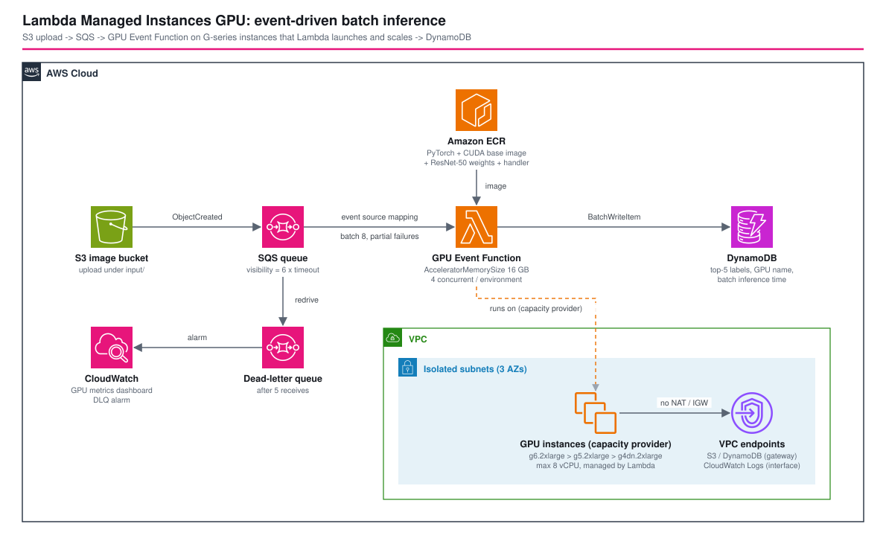

# Lambda Managed Instances の GPU で動かすバッチ推論 - AWS CDK リファレンスアーキテクチャ

[](./README.ja.md)
[](./README.md)


**AWS Lambda Managed Instances の GPU インスタンス**（2026-11-18 発表）で画像分類を行う、イベント駆動のパターンです。S3 にアップロードされた画像は SQS を経由して、コンテナイメージの Event Function に渡されます。この関数は G 系インスタンス上で PyTorch を実行します。インスタンスの起動、GPU ドライバーの導入、実行環境の配置、スケーリングは Lambda が受け持ちます。関数のコードは通常の `handler(event, context)` です。

このパターンで扱う内容:

- CPU 版の Managed Instances との違い: **GPU 専用の capacity provider**、`AcceleratorConfig.AcceleratorMemorySize`、コンテナイメージのみ対応
- aws-cdk-lib 2.276/2.277 に足りない部分の補い方: `AcceleratorConfig` プロパティがない、L2 の `maxVCpuCount` の下限が 12（CloudFormation は 2）、L2 に GPU のスケーリング指標がない
- NAT ゲートウェイもインターネットゲートウェイも置かない VPC から、VPC エンドポイント経由で S3、DynamoDB、CloudWatch Logs に接続する構成
- SQS のバッチを 1 回の GPU バッチとして推論し、失敗したメッセージだけを報告する方法

## 📑 目次

- [アーキテクチャ概要](#️-アーキテクチャ概要)
- [Lambda Managed Instances の GPU 関数の仕組み](#-lambda-managed-instances-の-gpu-関数の仕組み)
- [設計判断とベストプラクティス](#-設計判断とベストプラクティス)
- [Well-Architected との対応](#️-well-architected-との対応)
- [コスト最適化](#-コスト最適化)
- [セキュリティ](#-セキュリティ)
- [前提条件](#-前提条件)
- [デプロイ手順](#-デプロイ手順)
- [使い方](#使い方)
- [テスト戦略](#-テスト戦略)
- [カスタマイズ](#️-カスタマイズ)
- [トラブルシューティング](#-トラブルシューティング)
- [クリーンアップ](#-クリーンアップ)
- [参考資料](#-参考資料)

## 🏗️ アーキテクチャ概要



### 主要コンポーネント

| コンポーネント | 役割 |
|---------------|------|
| **S3 画像バケット** | `input/` 配下にオブジェクトが作成されると、`ObjectCreated` 通知を SQS に送ります。`input/` のオブジェクトは 7 日で失効します。 |
| **SQS キュー + DLQ** | アップロードをバッファします。可視性タイムアウトは関数タイムアウトの 6 倍です。5 回受信されたメッセージは DLQ に移り、CloudWatch アラームが発報します。 |
| **GPU capacity provider**（`AWS::Lambda::CapacityProvider`） | 3 つの分離サブネットで、x86_64 の `g6.2xlarge`、`g5.2xlarge`、`g4dn.2xlarge` だけを許可します。`MaxVCpuCount: 8` で G インスタンスのクォータ（8 vCPU）に収めます。 |
| **GPU Event Function** | `public.ecr.aws/lambda/deep-learning-containers/pytorch:cuda`（PyTorch 2.14、CUDA 13.0、Python 3.13）を元に、ResNet-50 の重みを組み込んだコンテナイメージです。`AcceleratorMemorySize: 16`、ホストメモリ 8 GB、実行環境あたり同時 4 呼び出し。 |
| **SQS イベントソースマッピング** | バッチサイズ 8、バッチウィンドウ 5 秒、`ReportBatchItemFailures`。 |
| **DynamoDB 結果テーブル** | 画像ごとに 1 アイテム。上位 5 ラベル、GPU 名、バッチサイズ、バッチの推論時間、ワーカーの PID を保存します。TTL 7 日、PITR 有効。 |
| **VPC エンドポイント** | S3 と DynamoDB のゲートウェイエンドポイント、CloudWatch Logs のインターフェイスエンドポイント。NAT ゲートウェイとインターネットゲートウェイはありません。 |
| **CloudWatch ダッシュボード** | capacity provider の GPU メトリクス（`GPUUtilization`、`GPUMemoryUtilization`、`GPUAllocated`、`GPUAvailable`）、キューの滞留、関数の呼び出し数・エラー・スロットル、DLQ アラーム。 |
| **`test-inference.sh`** | 動作確認スクリプトです。capacity provider、関数、起動したインスタンスを表示し、画像をアップロードして結果を待ち、DLQ を確認します。 |

### 処理の流れ

1. クライアントが `s3://<bucket>/input/...` に画像をアップロードします。
2. S3 が `ObjectCreated` イベントを SQS に送ります。
3. イベントソースマッピングが SQS をポーリングし、最大 8 件のメッセージで関数を呼び出します。
4. 関数はバッチ内の画像をすべて S3 から読み、1 つのテンソルにまとめて GPU で 1 回だけ推論します。
5. 結果を `BatchWriteItem` で DynamoDB に書きます。読めなかった画像のメッセージは `batchItemFailures` で返すので、再試行されるのはそのメッセージだけです。

## 🔬 Lambda Managed Instances の GPU 関数の仕組み

Lambda Managed Instances（LMI）は、利用者のアカウントと VPC にある EC2 インスタンス上で Event Function を実行します。インスタンスは Lambda が管理します。利用者は使ってよいインスタンスタイプを決め、Lambda がインスタンスの起動とパッチ適用、実行環境の配置、スケーリングを行います。GPU 対応で、G 系のインスタンスタイプと、関数側の 3 つの設定が加わりました。

| | LMI の CPU 関数 | LMI の GPU 関数（このパターン） |
|---|---|---|
| インスタンスタイプ | C/M/R 系（x86_64 または arm64） | G4dn、G5、G6、Gr6、G6e、G6f、Gr6f（x86_64 のみ。`g4dn.metal` は対象外） |
| capacity provider | CPU 系のタイプを混在できる | **GPU 系のみ。** GPU と非 GPU のタイプは 1 つの capacity provider に混在できない |
| パッケージ形式 | zip またはコンテナイメージ | **コンテナイメージのみ**（最大 32 GB） |
| GPU の選び方 | — | `AcceleratorConfig.AcceleratorMemorySize`: 3、6、12、16、24、48 GB（GPU メモリの最小値） |
| ホストメモリ | — | 2,048〜32,768 MB |
| 実行環境あたりの同時実行数 | ランタイムによる | 既定 4、最大 48。Python では 1 枠ごとにワーカープロセスが分かれ、それぞれが GPU 上にモデルの複製を持つ |
| 最小実行環境数（既定） | 3 | 1 |
| スケーリングの指標 | CPU 使用率、同時実行数 | **GPU 使用率**（既定の目標 40%）、CPU 使用率、同時実行数 |
| 実行環境あたりの GPU | — | 1 基 |

インスタンスの選び方: Lambda は `AllowedInstanceTypes` の中から、`AcceleratorMemorySize` を満たす最小の GPU を持つ最新世代を最初に使います。EC2 が `InsufficientCapacityException` を返すと、次の世代に切り替えます。インスタンスの対象を open にした On-Demand Capacity Reservation は自動で使われます。

ライフサイクル: `PublishToLatestPublished: true` で `$LATEST.PUBLISHED` が発行されます。Lambda は `MinExecutionEnvironments` の数だけ実行環境を起動し、そのときに GPU インスタンスが立ち上がります。修飾子なしの呼び出しは、イベントソースマッピングからのものも含めて `$LATEST.PUBLISHED` に届きます。`MinExecutionEnvironments: 0` にするとゼロまでスケールインします。その後の最初の呼び出しは、インスタンスの起動中（数分）はスロットル（429）になり、SQS は可視性タイムアウトの後にメッセージを再試行します。

## 🎯 設計判断とベストプラクティス

### 1. GPU 専用の capacity provider を用意し、新しい世代から使う

```typescript
// parameters/dev-params.ts
capacity: {
  allowedInstanceTypes: ['g6.2xlarge', 'g5.2xlarge', 'g4dn.2xlarge'], // L4 24 GB, A10G 24 GB, T4 16 GB
  maxVCpuCount: 8,
},
gpuFunction: { acceleratorMemorySizeGiB: 16, /* ... */ },
```

- **3 ファミリーを並べる理由:** 1 つの AZ では GPU の空きが足りないことがよくあります。同じサイズで 3 世代を許可しておけば、デプロイを失敗させずに Lambda が別の世代に切り替えられます。`AcceleratorMemorySize: 16` なら `g4dn`（T4、16 GB）も候補に残ります。24 にすると G5 と G6 だけになります。
- **サイズを 2xlarge にそろえる理由:** 3 つとも 8 vCPU、32 GiB なので、どのファミリーが選ばれても `MaxVCpuCount: 8` は「最大 1 台」を意味します。実行環境のホストメモリと vCPU も、どのタイプにも収まります。
- **トレードオフ:** 東京リージョンでは `g4dn.2xlarge` が最も安い（$1.015/h、`g6.2xlarge` は $1.418/h）ものの、Lambda は新しい世代を優先します。世代よりコストを優先するなら、`g4dn.*` だけを許可します。
- **`GpuCapacityProvider` コンストラクト**は、インスタンスファミリー（GPU 系のみ、`g4dn.metal` 以外）と vCPU の範囲を synth の前に検証します。

### 2. aws-cdk-lib がまだ扱っていない設定はエスケープハッチで書く

aws-cdk-lib 2.277.0（2026-11-13）は GPU 対応の発表より前のリリースです。CloudFormation レジストリのスキーマには、3 つの設定がすでにあります。

| 足りない部分 | このパターンでの対処 |
|-------------|---------------------|
| `CfnFunction` に `acceleratorConfig` がない | `addPropertyOverride('AcceleratorConfig', { AcceleratorMemorySize: 16 })`。これがないと関数は CPU 関数として配置され、GPU が見えません。 |
| aws-cdk-lib 同梱のスキーマ（`@aws-cdk/core:validateAgainstDefaultRules`）が `AcceleratorConfig` を `F3002 Additional properties are not allowed` で弾く | `Validations.of(cfnFunction).acknowledge({ id: 'CloudFormation-Validate::F3002', ... })` を、そのリソースに限って設定 |
| L2 の `CapacityProvider` が 12 未満の `maxVCpuCount` を弾く（CloudFormation の下限は 2） | L2 には `maxVCpuCount` を渡さず、`CapacityProviderScalingConfig.MaxVCpuCount` を `addPropertyOverride` で書く |
| `TargetTrackingScalingPolicy` に `cpuUtilization()` しかない | `targetGpuUtilization` を指定したときは、同じオーバーライドで `ScalingMode: Manual` と `LambdaCapacityProviderAverageGPUUtilization` を書く |

それ以外は L2 をそのまま使います。オペレーターロール（`AWSLambdaManagedEC2ResourceOperator`）、`addFunction()`（capacity provider の設定、`PublishToLatestPublished`、`FunctionScalingConfig`）、タグの伝播です。aws-cdk-lib にプロパティが追加されたら、2 つのコンストラクトだけを直せば済みます。

### 3. モデルはイメージに組み込み、インターネットへの経路は持たない

ベースイメージは `TORCH_HOME=/tmp/torch` を設定しているので、何もしなければ torchvision は実行時に重みをダウンロードします。capacity provider のサブネットにはインターネットへの経路がないため、Dockerfile で `TORCH_HOME=/opt/torch` に変え、ビルド時に ResNet-50 をダウンロードしておきます。

```dockerfile
FROM public.ecr.aws/lambda/deep-learning-containers/pytorch:cuda@sha256:b952...
ENV TORCH_HOME=/opt/torch
RUN python -c "from torchvision.models import resnet50, ResNet50_Weights; resnet50(weights=ResNet50_Weights.IMAGENET1K_V2)"
```

- **digest で固定:** `cuda` タグは更新されます。digest で固定すれば、再ビルドしても同じイメージになります。
- **大きなモデル:** 重みがおおむね 1 GB を超えるなら、イメージに組み込むより、S3 ゲートウェイエンドポイント経由で S3 からストリームするほうが適しています（ベースイメージに `s3torchconnector` が入っています）。

### 4. SQS の 1 バッチを GPU の 1 バッチにする

GPU のスループットはバッチサイズとともに上がり、呼び出しごとのオーバーヘッドは変わりません。ハンドラーは最大 8 枚の画像を 1 つのテンソルにまとめ、1 回の推論で処理します。`ReportBatchItemFailures` があるので、読めないオブジェクトが 1 つあってもバッチ全体は再試行されません。ハンドラーは初期化中に CUDA カーネルをウォームアップするので、最初の呼び出しでその分の時間はかかりません。

### 5. 同時実行数 4 = ワーカー 4 つ = モデルの複製 4 つ

`PerExecutionEnvironmentMaxConcurrency: 4`（GPU の既定値）にしています。Python では 1 枠ごとにワーカープロセスが分かれ、それぞれが GPU 上に ResNet-50 の複製（約 100 MB）を持ちます。4 つでも 16 GB に十分収まります。GPU メモリの大半を使うモデルなら、同時実行数を下げるか、モデルサーバーのプロセスを 1 つ立ててローカルで転送する方式にします。

### 6. エンドポイントだけを持つ分離 VPC

| 通信 | 経路 |
|------|------|
| `s3:GetObject`（画像） | S3 ゲートウェイエンドポイント（無料） |
| `dynamodb:BatchWriteItem` | DynamoDB ゲートウェイエンドポイント（無料） |
| 関数と capacity provider のログ | CloudWatch Logs インターフェイスエンドポイント（3 AZ） |
| SQS のポーリング、イメージの取得 | Lambda サービス側で行われ、VPC からは通信しない |

NAT ゲートウェイは、東京リージョンで 1 AZ あたり $0.062/h にデータ処理料金が加わるため、インターフェイスエンドポイントより高くつきます。また、このワークロードには不要なインターネットへの出口ができてしまいます。

### 7. dev は実行環境を 1 つ常駐させ、アイドル時はゼロまで縮退できるようにする

`minExecutionEnvironments: 1` では GPU インスタンスが 1 台起動したままになり、アップロードは数秒で処理されます。`0` にするとキューが空の間は GPU の料金がかかりません。その代わり、次のアップロードで数分のコールドスタートが発生し、その間は SQS の再試行で吸収します。夜間バッチのような使い方なら、EventBridge Scheduler のユニバーサルターゲット（`lambda:putFunctionScalingConfig`）で 0 と 1 を時刻で切り替えられます。

## 🏛️ Well-Architected との対応

| 柱 | 実装 |
|----|------|
| **運用上の優秀性** | すべての設定を型付きの `EnvParams` で管理し、コンストラクトで検証。capacity provider の GPU メトリクスを CloudWatch ダッシュボードに表示。JSON 形式の構造化ログ（`init` / `batch` イベント）。`test-inference.sh` による動作確認。イメージを digest で固定。 |
| **セキュリティ** | インターネットへの経路なし（分離サブネットと VPC エンドポイントのみ）。関数ロールは `input/*` の `s3:GetObject*` と 1 テーブルへの書き込みだけ。S3、SQS、DynamoDB を暗号化。バケットとキューで TLS を必須化。S3 アクセスログ。VPC フローログ（拒否された通信）。オペレーターロールはサービス用の AWS 管理ポリシー。 |
| **信頼性** | 3 AZ と 3 世代のインスタンスで GPU の確保先を広げる。SQS でバッファし、DLQ とアラームを設定。バッチの部分的な失敗に対応。DynamoDB の PITR。初期化タイムアウトにモデルのロード時間を含める。 |
| **パフォーマンス効率** | GPU でまとめて推論。初期化中の CUDA ウォームアップ。重みをイメージに組み込み、実行時にダウンロードしない。GPU 使用率によるスケーリング。実行環境あたりの同時実行。 |
| **コスト最適化** | `MaxVCpuCount` で台数の上限を設定。`minExecutionEnvironments: 0` でゼロまで縮退。NAT ではなくゲートウェイエンドポイント。EC2 部分には Savings Plans と リザーブドインスタンスが適用される。DynamoDB はオンデマンド。入力とログはライフサイクルで削除。 |
| **持続可能性** | 処理があるときだけインスタンスを動かす（ゼロまで縮退）。新しい世代の GPU を優先（電力あたりの性能が高い）。アイドルの実行環境を増やさず、バッチで GPU を使い切る。 |

## 💰 コスト最適化

### 単価（ap-northeast-1、AWS Price List API、2026-11）

| 項目 | 価格 |
|------|------|
| `g6.2xlarge` オンデマンド（8 vCPU、32 GiB、L4 24 GB） | $1.4178/h |
| `g5.2xlarge` オンデマンド（8 vCPU、32 GiB、A10G 24 GB） | $1.7578/h |
| `g4dn.2xlarge` オンデマンド（8 vCPU、32 GiB、T4 16 GB） | $1.0150/h |
| LMI 管理手数料 | オンデマンド料金の 9.75%（`g6.2xlarge`: $0.1382/h、`g5.2xlarge`: $0.1714/h、`g4dn.2xlarge`: $0.0990/h） |
| LMI リクエスト | 100 万件あたり $0.20 |
| VPC インターフェイスエンドポイント | 1 AZ あたり $0.014/h + $0.01/GB |

計算式: `インスタンス時間 x オンデマンド料金 x 1.0975 + リクエスト数 x $0.0000002 + エンドポイント + 小さなサービス`。LMI の関数には実行時間（GB 秒）の課金はありません。

### 月額の見積もり

#### 常時起動（`minExecutionEnvironments: 1`、730 時間、`g6.2xlarge`）

| 項目 | 計算 | 月額 |
|------|------|------|
| GPU インスタンス + 管理手数料 | 730 h x $1.4178 x 1.0975 | $1,135.91 |
| CloudWatch Logs インターフェイスエンドポイント | 3 AZ x 730 h x $0.014 | $30.66 |
| リクエスト | 100 万回 x $0.20/100 万 | $0.20 |
| CloudWatch ダッシュボード、アラーム | | $3.10 |
| S3、SQS、DynamoDB、ログ | 少量の利用 | < $2 |
| **合計** | | **約 $1,172** |

`g4dn.2xlarge` の場合、インスタンスの行は 730 h x $1.015 x 1.0975 = $813.18（合計 約 $849）です。

#### ゼロまで縮退（`minExecutionEnvironments: 0`、GPU の稼働は 1 日 2 時間程度）

| 項目 | 計算 | 月額 |
|------|------|------|
| GPU インスタンス + 管理手数料 | 60 h x $1.4178 x 1.0975 | $93.36 |
| インターフェイスエンドポイント、ダッシュボードなど | 上と同じ | 約 $36 |
| **合計** | | **約 $129** |

### コストを下げる手段

- **ゼロまで縮退させる**のが最も効果があります。最後の実行環境がなくなってから Lambda がインスタンスを終了するまで（通常は数分）、インスタンスの料金はかかり続けます。
- レイテンシーが重要でなければ、**安いファミリーだけを許可する**（例: `g4dn.*`）。そうしないと Lambda は新しい世代を選びます。
- EC2 部分には **Savings Plans とリザーブドインスタンス**が適用されます（管理手数料の率は変わりません）。
- **CloudWatch Logs インターフェイスエンドポイント**（月 $30.66）は、関数のログを失ってもよい場合に限って外せます。dev ではエンドポイントを 1 AZ にすると $10.22 になります。

## 🔒 セキュリティ

### 実装済みの対策

- **ネットワーク:** インスタンスは NAT ゲートウェイもインターネットゲートウェイもない分離サブネットで動きます。セキュリティグループにインバウンドルールはありません。拒否された通信は VPC フローログに記録します。
- **IAM:** 関数ロールが読めるのは画像バケットの `input/*` だけ、書き込めるのは結果テーブルだけです。ほかにログ用の `AWSLambdaBasicExecutionRole` を持ちます。capacity provider のオペレーターロールは `lambda.amazonaws.com` を信頼し、`AWSLambdaManagedEC2ResourceOperator` だけを持ちます。
- **暗号化:** S3（SSE-S3）、SQS（SSE-SQS）、DynamoDB（AWS 所有キー）、管理対象インスタンスの EBS（AWS 管理キー。カスタマー管理キーにするなら capacity provider に `kmsKey` を指定）。
- **通信:** バケットと 2 つのキューで `enforceSSL`。
- **サプライチェーン:** ベースイメージは Lambda が提供するイメージで、digest で固定しています。
- **監査:** S3 サーバーアクセスログを別のバケットに保存（90 日で削除）。

### 運用上の注意

- デプロイには、通常の Lambda の権限に加えて、capacity provider の ARN に対する `lambda:PassCapacityProvider` が必要です。CDK の CloudFormation 実行ロールには含まれますが、権限を絞ったパイプラインのロールには含まれていないことがあります。
- Lambda はサービスリンクロール `AWSServiceRoleForLambda` を使ってインスタンスを管理します。
- インスタンスは利用者のアカウントにあり、`ec2 describe-instances` で見えますが、ログインや変更はできません。

### CDK Nag

`test/compliance/cdk-nag.test.ts` で、2 つのスケーリングモードについて `AwsSolutionsChecks` を実行します。抑制している項目と理由（理由はテストにも記載）:

| ルール | リソース | 理由 |
|--------|---------|------|
| IAM4 | capacity provider のオペレーターロール | `AWSLambdaManagedEC2ResourceOperator` はサービスが求める AWS 管理ポリシー |
| IAM4 | 関数ロール、S3 通知ハンドラー | `AWSLambdaBasicExecutionRole`（ログのみ） |
| IAM5 | 関数のポリシー | `grants.read(fn, 'input/*')` による読み取りで、1 バケットの 1 プレフィックスに限定 |
| CdkNagValidationFailure（EC23） | Logs エンドポイントのセキュリティグループ | ルールが VPC CIDR のトークンを評価できない。インバウンドは VPC CIDR からの HTTPS のみ |

## 📋 前提条件

- 対象リージョンの EC2 クォータ **「Running On-Demand G and VT instances」（L-DB2E81BA）が 8 vCPU 以上**あること。既定値は **0** で、引き上げるまで capacity provider はインスタンスを起動できません。承認には数時間から数日かかることがあるので、先に申請しておきます。

  ```bash
  aws service-quotas get-service-quota --service-code ec2 --quota-code L-DB2E81BA --region ap-northeast-1
  aws service-quotas request-service-quota-increase --service-code ec2 --quota-code L-DB2E81BA --desired-value 8 --region ap-northeast-1
  ```

- Lambda Managed Instances と、許可する G 系のタイプの両方が使えるリージョン（ここでは ap-northeast-1）
- `${PROJECT}-${ENV}` という名前のプロファイルを設定した AWS CLI v2。`aws lambda get-capacity-provider` には新しい CLI が必要です（2.38 で確認）
- `linux/amd64` でビルドできる Docker（イメージは展開後 約 9.5 GB、圧縮後 約 5 GB。最初の `cdk deploy` で CDK のアセット用リポジトリにアップロードされます）
- Node.js 22 以上、`aws-cdk-lib` 2.276.0 以上（L2 の `CapacityProvider`）
- `test-inference.sh` 用の `jq`、`curl`

## 🚀 デプロイ手順

```bash
cd infrastructure
npm install

export PROJECT=myproject
export ENV=dev

npm run bootstrap -w workspaces/lambda-managed-instances-gpu   # アカウント・リージョンごとに初回のみ
npm run diff -w workspaces/lambda-managed-instances-gpu
npm run stage:deploy:all -w workspaces/lambda-managed-instances-gpu
```

関数リソースは `$LATEST.PUBLISHED` がアクティブになるまで完了しません。この中に、最初の GPU インスタンスの起動とイメージの取得が含まれます。

出力: `BucketName`、`InputPrefix`、`ResultTableName`、`QueueUrl`、`DeadLetterQueueUrl`、`FunctionName`、`CapacityProviderName`、`DashboardName`。

## 使い方

```bash
# 画像をアップロードして結果を待つ（--image を省略するとサンプル画像をダウンロードする）
./test-inference.sh --project myproject --env dev
./test-inference.sh --project myproject --env dev --count 32 --cleanup
./test-inference.sh --project myproject --env dev --image ./cat.jpg --image ./car.png

# 手動で確認する
aws s3 cp ./cat.jpg s3://<BucketName>/input/cat.jpg
aws dynamodb get-item --table-name <ResultTableName> --key '{"objectKey":{"S":"input/cat.jpg"}}'

# Lambda が起動したインスタンスを確認する
aws lambda get-capacity-provider --capacity-provider-name <CapacityProviderName>
aws ec2 describe-instances --filters Name=tag:Project,Values=myproject Name=instance-state-name,Values=running \
  --query 'Reservations[].Instances[].[InstanceId,InstanceType,Placement.AvailabilityZone]' --output table
```

## 🧪 テスト戦略

```
test/
├── compliance/cdk-nag.test.ts              # AwsSolutions パック。Auto と Manual（GPU）の両方
├── helpers/stack.ts                        # cdk.json のフィーチャーフラグ付きでスタックを生成
├── parameters/test-params.ts               # Environment.TEST 用の固定パラメータ
├── snapshot/snapshot.test.ts               # テンプレートとリソース数のスナップショット
└── unit/
    ├── lambda-managed-instances-gpu-stack.test.ts  # capacity provider、AcceleratorConfig、ESM、VPC、監視
    └── validation.test.ts                          # コンストラクトのパラメータ検証
```

```bash
npm test -w workspaces/lambda-managed-instances-gpu                # 41 テスト
npm run test:snapshot:update -w workspaces/lambda-managed-instances-gpu
```

テストのヘルパーは `cdk.json` のフィーチャーフラグを読み込むので、`validateAgainstDefaultRules` や S3 アクセスログの動作が実際の synth と一致します。テストでは Docker イメージをビルドしません。

ハンドラーは GPU がなくても確認できます（CPU で動きます）。ルートファイルシステムを読み取り専用にして、イメージをローカルで動かします。

```bash
docker build --platform linux/amd64 -t lmi-gpu-inference:local src/inference
docker run --rm --read-only --tmpfs /tmp -e TABLE_NAME=t --entrypoint python lmi-gpu-inference:local -c "import handler; print(handler.DEVICE, handler.INIT_MS)"
```

## ⚙️ カスタマイズ

### 大きなモデル

`acceleratorMemorySizeGiB` を 24（`g4dn` は対象外になる）か 48（`g6e.*` を許可する）に上げます。`memorySizeMiB` も上げ、Lambda が予約する分を引いても許可したインスタンスのホストメモリに収まることを確認します。大きな重みはイメージに組み込まず、S3 からストリームします。

### GPU 使用率でスケールする

```typescript
capacity: { allowedInstanceTypes: [...], maxVCpuCount: 32, targetGpuUtilization: 60 },
gpuFunction: { ..., minExecutionEnvironments: 0, maxExecutionEnvironments: 4 },
```

`MaxVCpuCount` と G インスタンスのクォータは、`maxExecutionEnvironments` 台分を満たす必要があります。

### vLLM で LLM を推論する

イメージに `public.ecr.aws/lambda/deep-learning-containers/vllm:cuda` を使います。ハンドラーは不要で、`MODEL_ID` を読みます（既定は `Qwen/Qwen2.5-0.5B-Instruct`）。モデルの取得には、重みを S3 に置いてゲートウェイエンドポイント経由で読むか、NAT ゲートウェイが必要です。

### SOCI でコールドスタートを短くする

LMI のコンテナ関数は、SOCI インデックス（マニフェスト v2）でイメージを遅延読み込みできます。SOCI インデックス付きでイメージをビルドし、関数は SOCI のタグを指す必要があります。`DockerImageAsset` は SOCI インデックスを作らないので、別のビルド手順になります。

## 🔧 トラブルシューティング

### `cdk deploy` が関数で待たされ、容量不足やクォータのエラーで失敗する

G インスタンスの vCPU クォータは既定で 0 です。`L-DB2E81BA` を確認してください（前提条件を参照）。`maxVCpuCount` が、許可したインスタンス 1 台の vCPU 数以上であることも確認します。

### `cdk synth` が `F3002 Additional properties are not allowed ('AcceleratorConfig' was unexpected)` で失敗する

aws-cdk-lib に同梱のスキーマが GPU 対応より古いためです。`GpuInferenceFunction` は自分のリソースについて acknowledge しています。オーバーライドをほかへ写すときは、acknowledge も一緒に写します。

### `maxVCpuCount must be between 12 and 15000`

L2 の `CapacityProvider` の検証です。L2 に `maxVCpuCount` を渡さず、オーバーライドで書く `GpuCapacityProvider` 経由で設定します。

### `CreateFunction` が accelerator memory に関する `InvalidParameterValueException` で失敗する

許可したインスタンスタイプに、`AcceleratorMemorySize` GB 以上の GPU を持つものがありません。たとえば 24 を指定して `g4dn.*` だけを許可した場合です。

### 結果に `"device": "cpu"` が入る

関数に `AcceleratorConfig` がなく、CPU の実行環境で動いています。`aws lambda get-function-configuration --query AcceleratorConfig` で確認します。

### ゼロまで縮退した後、メッセージがキューに残る

最初の数分は想定どおりの動作です。インスタンスの起動中は呼び出しがスロットルされ、SQS は可視性タイムアウト（関数タイムアウトの 6 倍）の後に再試行します。DLQ に入ってしまう場合は、`maxReceiveCount` を上げるか、`minExecutionEnvironments: 1` のままにします。

### 関数のログが出ない

CloudWatch Logs インターフェイスエンドポイントがないか、そのセキュリティグループが VPC CIDR からの HTTPS を許可していません。

## 🧹 クリーンアップ

```bash
npm run stage:destroy:all -w workspaces/lambda-managed-instances-gpu
```

関数と capacity provider を削除すると、Lambda がインスタンスを終了します。プロジェクトのタグが付いた G 系インスタンスが残っていないことを確認します。

```bash
aws ec2 describe-instances --filters Name=tag:Project,Values=myproject Name=instance-state-name,Values=pending,running \
  --query 'Reservations[].Instances[].InstanceId'
```

CDK のアセット用リポジトリには 5 GB のイメージが残ります。不要なら `cdk-*-container-assets-*` から古いイメージを削除します。

## 📚 参考資料

- [What's New: AWS Lambda adds support for GPU instances on Lambda Managed Instances](https://aws.amazon.com/about-aws/whats-new/2026/11/aws-lambda-gpu-managed-instances/)
- [Lambda Managed Instances: GPU functions](https://docs.aws.amazon.com/lambda/latest/dg/lambda-managed-instances-gpu.html)
- [GPU base images](https://docs.aws.amazon.com/lambda/latest/dg/lambda-managed-instances-gpu-base-images.html)
- [GPU scaling](https://docs.aws.amazon.com/lambda/latest/dg/lambda-managed-instances-gpu-scaling.html)
- [GPU monitoring](https://docs.aws.amazon.com/lambda/latest/dg/lambda-managed-instances-gpu-monitoring.html)
- [Capacity providers](https://docs.aws.amazon.com/lambda/latest/dg/lambda-managed-instances-capacity-providers.html)
- [Networking for Lambda Managed Instances](https://docs.aws.amazon.com/lambda/latest/dg/lambda-managed-instances-networking.html)
- [SOCI lazy loading](https://docs.aws.amazon.com/lambda/latest/dg/lambda-managed-instances-seekable-oci.html)
- [AWS Lambda pricing](https://aws.amazon.com/lambda/pricing/)

---

**レベル**: 300 | **サービス**: Lambda Managed Instances（GPU）、Amazon EC2 G 系、Amazon S3、Amazon SQS、Amazon DynamoDB、Amazon VPC、Amazon CloudWatch
