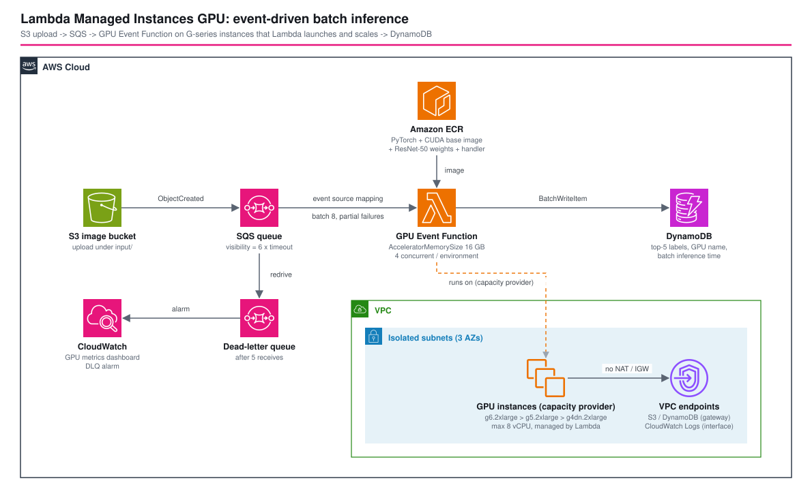

# GPU Batch Inference on Lambda Managed Instances - AWS CDK Reference Architecture

[](./README.ja.md)
[](./README.md)


Event-driven image classification on **GPU instances of AWS Lambda Managed Instances** (GPU support announced 2026-11-18). An image uploaded to S3 goes through SQS to a container-image Event Function that runs PyTorch on a G-series instance. Lambda launches the instances, installs the GPU driver, places execution environments on them and scales them. The function code is an ordinary `handler(event, context)`.

What this pattern shows:

- How a GPU function differs from a CPU Managed Instances function: a **GPU-only capacity provider**, `AcceleratorConfig.AcceleratorMemorySize`, and container images only
- How to fill the gaps in aws-cdk-lib 2.276/2.277: no `AcceleratorConfig` property, a `maxVCpuCount` minimum of 12 in the L2 (CloudFormation accepts 2), and no GPU scaling metric in the L2
- An isolated VPC (no NAT gateway, no internet gateway) that reaches S3, DynamoDB and CloudWatch Logs through VPC endpoints
- Batching an SQS batch into one GPU batch and reporting partial failures

## 📑 Table of Contents

- [Architecture Overview](#️-architecture-overview)
- [How GPU Functions on Lambda Managed Instances Work](#-how-gpu-functions-on-lambda-managed-instances-work)
- [Design Decisions & Best Practices](#-design-decisions--best-practices)
- [Well-Architected Alignment](#️-well-architected-alignment)
- [Cost Optimization](#-cost-optimization)
- [Security Considerations](#-security-considerations)
- [Prerequisites](#-prerequisites)
- [Deployment Guide](#-deployment-guide)
- [Usage](#usage)
- [Testing Strategy](#-testing-strategy)
- [Customization](#️-customization)
- [Troubleshooting](#-troubleshooting)
- [Clean-up](#-clean-up)
- [References](#-references)

## 🏗️ Architecture Overview



### Key Components

| Component | Role |
|-----------|------|
| **S3 image bucket** | Objects created under `input/` send an `ObjectCreated` notification to SQS. `input/` objects expire after 7 days. |
| **SQS queue + DLQ** | Buffers uploads. Visibility timeout is 6x the function timeout. After 5 receives a message moves to the DLQ, and a CloudWatch alarm fires. |
| **GPU capacity provider** (`AWS::Lambda::CapacityProvider`) | Allows only `g6.2xlarge`, `g5.2xlarge`, `g4dn.2xlarge` on x86_64 in three isolated subnets. `MaxVCpuCount: 8` keeps it within an 8 vCPU G-instance quota. |
| **GPU Event Function** | Container image built from `public.ecr.aws/lambda/deep-learning-containers/pytorch:cuda` (PyTorch 2.14, CUDA 13.0, Python 3.13) with ResNet-50 weights baked in. `AcceleratorMemorySize: 16`, 8 GB host memory, 4 concurrent invocations per execution environment. |
| **SQS event source mapping** | Batch size 8, 5 s batching window, `ReportBatchItemFailures`. |
| **DynamoDB result table** | One item per image: top-5 labels, GPU name, batch size, batch inference time, worker PID. TTL 7 days, PITR on. |
| **VPC endpoints** | S3 and DynamoDB gateway endpoints, CloudWatch Logs interface endpoint. No NAT gateway, no internet gateway. |
| **CloudWatch dashboard** | Capacity provider GPU metrics (`GPUUtilization`, `GPUMemoryUtilization`, `GPUAllocated`, `GPUAvailable`), queue backlog, function invocations/errors/throttles, DLQ alarm. |
| **`test-inference.sh`** | Operational check: shows the capacity provider, the function and the launched instances, uploads images, waits for results and checks the DLQ. |

### Processing flow

1. A client uploads an image to `s3://<bucket>/input/...`.
2. S3 sends an `ObjectCreated` event to SQS.
3. The event source mapping polls SQS and invokes the function with up to 8 messages.
4. The function loads all images of the batch from S3, stacks them into one tensor and runs a single forward pass on the GPU.
5. Results go to DynamoDB with `BatchWriteItem`. Messages whose image could not be read are returned in `batchItemFailures`, so only they are retried.

## 🔬 How GPU Functions on Lambda Managed Instances Work

Lambda Managed Instances (LMI) runs an Event Function on EC2 instances in your account and VPC, which Lambda manages. You decide which instance types are allowed. Lambda launches and patches the instances, places execution environments on them and scales them. GPU support adds G-series instance types and three function settings.

| | CPU function on LMI | GPU function on LMI (this pattern) |
|---|---|---|
| Instance types | C/M/R families (x86_64 or arm64) | G4dn, G5, G6, Gr6, G6e, G6f, Gr6f (x86_64 only; not `g4dn.metal`) |
| Capacity provider | Can mix CPU types | **GPU types only.** A capacity provider cannot mix GPU and non-GPU types |
| Package type | zip or container image | **Container image only** (up to 32 GB) |
| GPU selection | — | `AcceleratorConfig.AcceleratorMemorySize`: 3, 6, 12, 16, 24, 48 GB (minimum GPU memory) |
| Host memory | — | 2,048–32,768 MB |
| Concurrency per environment | Runtime dependent | Default 4, max 48. In Python each slot is a worker process with its own model copy on the GPU |
| Minimum execution environments (default) | 3 | 1 |
| Scaling signals | CPU utilization, concurrency | **GPU utilization** (default target 40%), CPU utilization, concurrency |
| GPUs per environment | — | One |

Instance selection: within `AllowedInstanceTypes`, Lambda starts with the latest generation that has the smallest GPU meeting `AcceleratorMemorySize`. When EC2 returns `InsufficientCapacityException`, it falls back to the next generation. On-Demand Capacity Reservations with open instance eligibility are used automatically.

Lifecycle: `PublishToLatestPublished: true` publishes `$LATEST.PUBLISHED`. Lambda then starts `MinExecutionEnvironments` environments, which launches GPU instances. Unqualified invocations, including those from the event source mapping, go to `$LATEST.PUBLISHED`. With `MinExecutionEnvironments: 0` the function scales to zero. The first invocation after that is throttled (429) while an instance starts, which takes several minutes. SQS retries the message after the visibility timeout.

## 🎯 Design Decisions & Best Practices

### 1. A dedicated GPU capacity provider, newest generation first

```typescript
// parameters/dev-params.ts
capacity: {
  allowedInstanceTypes: ['g6.2xlarge', 'g5.2xlarge', 'g4dn.2xlarge'], // L4 24 GB, A10G 24 GB, T4 16 GB
  maxVCpuCount: 8,
},
gpuFunction: { acceleratorMemorySizeGiB: 16, /* ... */ },
```

- **Why three families:** GPU capacity in one AZ is often short. Listing three generations of the same size lets Lambda fall back without failing the deployment. `AcceleratorMemorySize: 16` keeps `g4dn` (16 GB T4) eligible. With 24, only G5 and G6 would remain.
- **Why the same size (2xlarge):** All three have 8 vCPU and 32 GiB, so `MaxVCpuCount: 8` means "at most one instance" whichever family is chosen. The host memory and vCPU of the execution environment fit on any of them.
- **Trade-off:** `g4dn.2xlarge` is the cheapest ($1.015/h vs $1.418/h for `g6.2xlarge` in Tokyo), but Lambda prefers the newest generation. To prefer cost over generation, allow only `g4dn.*`.
- **`GpuCapacityProvider` construct** validates the instance families (GPU only, no `g4dn.metal`) and the vCPU range before synthesis.

### 2. Escape hatches for what aws-cdk-lib does not model yet

aws-cdk-lib 2.277.0 (2026-11-13) predates the GPU launch. The CloudFormation registry schema already has all three settings.

| Gap | Fix in this pattern |
|-----|---------------------|
| `CfnFunction` has no `acceleratorConfig` | `addPropertyOverride('AcceleratorConfig', { AcceleratorMemorySize: 16 })`. Without it the function is placed as a CPU function and finds no GPU. |
| The schema bundled with aws-cdk-lib (`@aws-cdk/core:validateAgainstDefaultRules`) rejects `AcceleratorConfig` with `F3002 Additional properties are not allowed` | `Validations.of(cfnFunction).acknowledge({ id: 'CloudFormation-Validate::F3002', ... })`, scoped to that resource only |
| L2 `CapacityProvider` rejects `maxVCpuCount` < 12 (CloudFormation minimum is 2) | Leave `maxVCpuCount` unset in the L2 and write `CapacityProviderScalingConfig.MaxVCpuCount` with `addPropertyOverride` |
| `TargetTrackingScalingPolicy` has only `cpuUtilization()` | Write `ScalingMode: Manual` + `LambdaCapacityProviderAverageGPUUtilization` with the same override when `targetGpuUtilization` is set |

The L2 is still used for the rest: the operator role (`AWSLambdaManagedEC2ResourceOperator`), `addFunction()` (capacity provider config, `PublishToLatestPublished`, `FunctionScalingConfig`) and tag propagation. When aws-cdk-lib adds the properties, only the two constructs change.

### 3. Bake the model into the image; no internet egress

The base image sets `TORCH_HOME=/tmp/torch`, so torchvision downloads weights at runtime by default. The capacity provider subnets have no route to the internet, so the Dockerfile sets `TORCH_HOME=/opt/torch` and downloads ResNet-50 during the build.

```dockerfile
FROM public.ecr.aws/lambda/deep-learning-containers/pytorch:cuda@sha256:b952...
ENV TORCH_HOME=/opt/torch
RUN python -c "from torchvision.models import resnet50, ResNet50_Weights; resnet50(weights=ResNet50_Weights.IMAGENET1K_V2)"
```

- **Pinned by digest:** the `cuda` tag moves. A digest keeps rebuilds reproducible.
- **Larger models:** weights larger than about 1 GB are better streamed from S3 (`s3torchconnector` is in the base image) through the S3 gateway endpoint than baked into the image.

### 4. One SQS batch = one GPU batch

GPU throughput grows with batch size, while the per-invocation overhead stays the same. The handler stacks up to 8 images into one tensor and runs one forward pass. `ReportBatchItemFailures` keeps a single unreadable object from making the whole batch retry. The handler warms up the CUDA kernels during init, so the first real invocation does not pay for them.

### 5. Concurrency: 4 workers, 4 model copies

`PerExecutionEnvironmentMaxConcurrency: 4` (the GPU default). In Python each slot is a separate worker process with its own copy of ResNet-50 on the GPU (about 100 MB each), so 4 copies fit easily in 16 GB. For a model that takes most of the GPU memory, lower the concurrency or run one model server process and forward requests to it locally.

### 6. Isolated VPC with endpoints

| Traffic | Path |
|---------|------|
| `s3:GetObject` (images) | S3 gateway endpoint (no charge) |
| `dynamodb:BatchWriteItem` | DynamoDB gateway endpoint (no charge) |
| Function and capacity provider logs | CloudWatch Logs interface endpoint (3 AZs) |
| SQS polling, image pull | Done by the Lambda service, not from the VPC |

A NAT gateway would cost more than the interface endpoint ($0.062/h per AZ plus data processing in Tokyo) and would open egress to the internet that this workload does not need.

### 7. Keep one environment warm in dev; scale to zero when idle

`minExecutionEnvironments: 1` keeps one GPU instance running, so an upload is processed within seconds. Setting it to `0` stops the GPU charge when the queue is empty. The trade-off is a cold start of several minutes on the next upload, which SQS absorbs by retrying the message. For a nightly batch, an EventBridge Scheduler universal target (`lambda:putFunctionScalingConfig`) can switch between 0 and 1 on a schedule.

## 🏛️ Well-Architected Alignment

| Pillar | Implementation |
|--------|---------------|
| **Operational Excellence** | All settings in typed `EnvParams` with construct-level validation; CloudWatch dashboard of capacity provider GPU metrics; structured JSON logs (`init` / `batch` events); `test-inference.sh` operational check; image pinned by digest. |
| **Security** | No internet egress (isolated subnets, VPC endpoints only); function role limited to `s3:GetObject*` on `input/*` and write access to one table; SSE on S3/SQS/DynamoDB; TLS-only bucket and queue policies; S3 access logs; VPC flow logs (rejected traffic); operator role uses the AWS managed policy for the service. |
| **Reliability** | Three AZs and three instance generations widen the GPU capacity pool; SQS buffering with DLQ and alarm; partial batch failures; DynamoDB PITR; init timeout covers model load. |
| **Performance Efficiency** | Batched GPU inference; CUDA warm-up in init; weights in the image (no runtime download); GPU-utilization-based scaling; per-environment concurrency. |
| **Cost Optimization** | `MaxVCpuCount` caps the fleet; `minExecutionEnvironments: 0` for scale-to-zero; gateway endpoints instead of NAT; Savings Plans / Reserved Instances apply to the EC2 part; on-demand DynamoDB; lifecycle expiry on inputs and logs. |
| **Sustainability** | Instances run only while there is work (scale to zero); newer GPU generations first (better performance per watt); batching keeps the GPU busy instead of running many idle environments. |

## 💰 Cost Optimization

### Unit prices (ap-northeast-1, AWS Price List API, 2026-11)

| Item | Price |
|------|-------|
| `g6.2xlarge` On-Demand (8 vCPU, 32 GiB, L4 24 GB) | $1.4178/h |
| `g5.2xlarge` On-Demand (8 vCPU, 32 GiB, A10G 24 GB) | $1.7578/h |
| `g4dn.2xlarge` On-Demand (8 vCPU, 32 GiB, T4 16 GB) | $1.0150/h |
| LMI management fee | 9.75% of the On-Demand price (`g6.2xlarge`: $0.1382/h, `g5.2xlarge`: $0.1714/h, `g4dn.2xlarge`: $0.0990/h) |
| LMI requests | $0.20 per million |
| VPC interface endpoint | $0.014/h per AZ + $0.01/GB |

Formula: `instance hours x On-Demand price x 1.0975 + requests x $0.0000002 + endpoints + small services`. There is no duration (GB-second) charge for LMI functions.

### Estimated Monthly Costs

#### Always on (`minExecutionEnvironments: 1`, 730 h, `g6.2xlarge`)

| Item | Calculation | Monthly |
|------|-------------|---------|
| GPU instance + management fee | 730 h x $1.4178 x 1.0975 | $1,135.91 |
| CloudWatch Logs interface endpoint | 3 AZ x 730 h x $0.014 | $30.66 |
| Requests | 1M invocations x $0.20/M | $0.20 |
| CloudWatch dashboard, alarm | | $3.10 |
| S3, SQS, DynamoDB, logs | light usage | < $2 |
| **Total** | | **≈ $1,172** |

On `g4dn.2xlarge` the instance line is 730 h x $1.015 x 1.0975 = $813.18 (total ≈ $849).

#### Scale to zero (`minExecutionEnvironments: 0`, about 2 h of GPU time per day)

| Item | Calculation | Monthly |
|------|-------------|---------|
| GPU instance + management fee | 60 h x $1.4178 x 1.0975 | $93.36 |
| Interface endpoint, dashboard, others | as above | ≈ $36 |
| **Total** | | **≈ $129** |

### Cost levers

- **Scale to zero** is the largest lever. Instances keep billing until Lambda terminates them, which usually takes a few minutes after the last environment goes away.
- **Allow only the cheaper family** (for example `g4dn.*`) when latency is not critical. Lambda otherwise picks the newest generation.
- **Savings Plans / Reserved Instances** apply to the EC2 part (the management fee does not change).
- **Remove the CloudWatch Logs interface endpoint** ($30.66/month) only if you accept losing function logs. Use one AZ for the endpoint in dev to cut it to $10.22.

## 🔒 Security Considerations

### Implemented

- **Network:** instances run in isolated subnets with no NAT gateway or internet gateway. The security group has no inbound rules. VPC flow logs record rejected traffic.
- **IAM:** the function role can read only `input/*` of the image bucket and write only to the result table, plus `AWSLambdaBasicExecutionRole` for logs. The capacity provider operator role trusts `lambda.amazonaws.com` and has only `AWSLambdaManagedEC2ResourceOperator`.
- **Encryption:** S3 (SSE-S3), SQS (SSE-SQS), DynamoDB (AWS owned key), EBS of the managed instances (AWS managed key; set `kmsKey` on the capacity provider for a customer managed key).
- **Transport:** `enforceSSL` on the bucket and both queues.
- **Supply chain:** the base image is the Lambda-provided image, pinned by digest.
- **Audit:** S3 server access logs to a separate bucket (90-day expiry).

### Operational notes

- Deploying needs `lambda:PassCapacityProvider` on the capacity provider ARN in addition to the usual Lambda permissions. The CDK CloudFormation execution role has it; a restricted pipeline role may not.
- Lambda uses the service-linked role `AWSServiceRoleForLambda` to manage the instances.
- The instances are in your account and appear in `ec2 describe-instances`, but you cannot log in to them or change them.

### CDK Nag

`AwsSolutionsChecks` runs in `test/compliance/cdk-nag.test.ts` for both scaling modes. Suppressions, each with a reason in the test:

| Rule | Resource | Reason |
|------|----------|--------|
| IAM4 | Capacity provider operator role | `AWSLambdaManagedEC2ResourceOperator` is the AWS managed policy the service requires |
| IAM4 | Function role, S3 notification handler | `AWSLambdaBasicExecutionRole` (logs only) |
| IAM5 | Function policy | `grants.read(fn, 'input/*')` read actions scoped to one bucket and prefix |
| CdkNagValidationFailure (EC23) | Logs endpoint security group | The rule cannot evaluate the VPC CIDR token; ingress is HTTPS from the VPC CIDR only |

## 📋 Prerequisites

- **EC2 quota "Running On-Demand G and VT instances" (L-DB2E81BA) of at least 8 vCPU** in the target Region. The default is **0**, and the capacity provider cannot launch anything until it is raised. Request it in advance; approval can take hours to days.

  ```bash
  aws service-quotas get-service-quota --service-code ec2 --quota-code L-DB2E81BA --region ap-northeast-1
  aws service-quotas request-service-quota-increase --service-code ec2 --quota-code L-DB2E81BA --desired-value 8 --region ap-northeast-1
  ```

- A Region where both Lambda Managed Instances and the allowed G-series types are available (ap-northeast-1 is used here)
- AWS CLI v2 with a profile named `${PROJECT}-${ENV}`; `aws lambda get-capacity-provider` requires a recent CLI (2.38 was used)
- Docker with `linux/amd64` builds (the image is about 9.5 GB uncompressed and 5 GB compressed; the first `cdk deploy` uploads it to the CDK asset repository)
- Node.js 22+, `aws-cdk-lib` ≥ 2.276.0 (L2 `CapacityProvider`)
- `jq`, `curl` for `test-inference.sh`

## 🚀 Deployment Guide

```bash
cd infrastructure
npm install

export PROJECT=myproject
export ENV=dev

npm run bootstrap -w workspaces/lambda-managed-instances-gpu   # first time per account/region
npm run diff -w workspaces/lambda-managed-instances-gpu
npm run stage:deploy:all -w workspaces/lambda-managed-instances-gpu
```

The function resource completes only after `$LATEST.PUBLISHED` is active, which includes launching the first GPU instance and pulling the image.

Outputs: `BucketName`, `InputPrefix`, `ResultTableName`, `QueueUrl`, `DeadLetterQueueUrl`, `FunctionName`, `CapacityProviderName`, `DashboardName`.

## Usage

```bash
# Upload images and wait for the results (sample image is downloaded when --image is omitted)
./test-inference.sh --project myproject --env dev
./test-inference.sh --project myproject --env dev --count 32 --cleanup
./test-inference.sh --project myproject --env dev --image ./cat.jpg --image ./car.png

# Manual
aws s3 cp ./cat.jpg s3://<BucketName>/input/cat.jpg
aws dynamodb get-item --table-name <ResultTableName> --key '{"objectKey":{"S":"input/cat.jpg"}}'

# Which instances did Lambda launch?
aws lambda get-capacity-provider --capacity-provider-name <CapacityProviderName>
aws ec2 describe-instances --filters Name=tag:Project,Values=myproject Name=instance-state-name,Values=running \
  --query 'Reservations[].Instances[].[InstanceId,InstanceType,Placement.AvailabilityZone]' --output table
```

## 🧪 Testing Strategy

```
test/
├── compliance/cdk-nag.test.ts              # AwsSolutions pack, Auto and Manual GPU scaling
├── helpers/stack.ts                        # builds the stack with the cdk.json feature flags
├── parameters/test-params.ts               # deterministic Environment.TEST params
├── snapshot/snapshot.test.ts               # template + resource-count snapshots
└── unit/
    ├── lambda-managed-instances-gpu-stack.test.ts  # capacity provider, AcceleratorConfig, ESM, VPC, observability
    └── validation.test.ts                          # construct-level parameter validation
```

```bash
npm test -w workspaces/lambda-managed-instances-gpu                # 41 tests
npm run test:snapshot:update -w workspaces/lambda-managed-instances-gpu
```

The test helper loads the `cdk.json` feature flags, so `validateAgainstDefaultRules` and the S3 access log behavior match a real synth. Docker images are not built in tests.

The handler can be checked without a GPU (it falls back to CPU) by running the image locally with a read-only root file system:

```bash
docker build --platform linux/amd64 -t lmi-gpu-inference:local src/inference
docker run --rm --read-only --tmpfs /tmp -e TABLE_NAME=t --entrypoint python lmi-gpu-inference:local -c "import handler; print(handler.DEVICE, handler.INIT_MS)"
```

## ⚙️ Customization

### Bigger models

Raise `acceleratorMemorySizeGiB` to 24 (drops `g4dn`) or 48 (allow `g6e.*`). Raise `memorySizeMiB`, and make sure the allowed instance has enough host memory after Lambda's reservation. Stream large weights from S3 instead of baking them in.

### Scale with GPU utilization

```typescript
capacity: { allowedInstanceTypes: [...], maxVCpuCount: 32, targetGpuUtilization: 60 },
gpuFunction: { ..., minExecutionEnvironments: 0, maxExecutionEnvironments: 4 },
```

`MaxVCpuCount` and the G-instance quota must cover `maxExecutionEnvironments` instances.

### LLM inference with vLLM

Use `public.ecr.aws/lambda/deep-learning-containers/vllm:cuda` as the image. It needs no handler and reads `MODEL_ID` (default `Qwen/Qwen2.5-0.5B-Instruct`). The model download then needs either an S3 copy of the weights through the gateway endpoint or a NAT gateway.

### Faster cold starts with SOCI

LMI container functions can lazy-load images with a SOCI index (manifest v2). The image must be built with a SOCI index and the function must point at the SOCI tag. `DockerImageAsset` does not create SOCI indexes, so this is a separate build step.

## 🔧 Troubleshooting

### `cdk deploy` waits on the function, then fails with insufficient capacity or a quota error

The G-instance vCPU quota is 0 by default. Check `L-DB2E81BA` (see Prerequisites). Also check that `maxVCpuCount` is at least the vCPU count of one allowed instance.

### `cdk synth` fails with `F3002 Additional properties are not allowed ('AcceleratorConfig' was unexpected)`

The schema bundled with aws-cdk-lib predates GPU support. `GpuInferenceFunction` acknowledges this for its own resource; if you copy the override elsewhere, copy the acknowledgement too.

### `maxVCpuCount must be between 12 and 15000`

That is the L2 `CapacityProvider` validation. Do not pass `maxVCpuCount` to the L2; set it through `GpuCapacityProvider`, which writes it with an override.

### `InvalidParameterValueException` on `CreateFunction` about accelerator memory

No allowed instance type has a GPU with at least `AcceleratorMemorySize` GB. For example, 24 with only `g4dn.*` allowed.

### Results contain `"device": "cpu"`

`AcceleratorConfig` is missing from the function, so it runs on a CPU environment. Check `aws lambda get-function-configuration --query AcceleratorConfig`.

### Messages stay in the queue after scaling to zero

Expected for the first minutes: invocations are throttled while an instance starts, and SQS retries after the visibility timeout (6x the function timeout). If messages end up in the DLQ, raise `maxReceiveCount` or keep `minExecutionEnvironments: 1`.

### The function logs nothing

The CloudWatch Logs interface endpoint is missing or its security group does not allow HTTPS from the VPC CIDR.

## 🧹 Clean-up

```bash
npm run stage:destroy:all -w workspaces/lambda-managed-instances-gpu
```

Lambda terminates the instances when the function and the capacity provider are deleted. Check that no G-series instance with the project tags remains:

```bash
aws ec2 describe-instances --filters Name=tag:Project,Values=myproject Name=instance-state-name,Values=pending,running \
  --query 'Reservations[].Instances[].InstanceId'
```

The CDK asset repository keeps the 5 GB image; delete old images from `cdk-*-container-assets-*` if you do not need them.

## 📚 References

- [What's New: AWS Lambda adds support for GPU instances on Lambda Managed Instances](https://aws.amazon.com/about-aws/whats-new/2026/11/aws-lambda-gpu-managed-instances/)
- [Lambda Managed Instances: GPU functions](https://docs.aws.amazon.com/lambda/latest/dg/lambda-managed-instances-gpu.html)
- [GPU base images](https://docs.aws.amazon.com/lambda/latest/dg/lambda-managed-instances-gpu-base-images.html)
- [GPU scaling](https://docs.aws.amazon.com/lambda/latest/dg/lambda-managed-instances-gpu-scaling.html)
- [GPU monitoring](https://docs.aws.amazon.com/lambda/latest/dg/lambda-managed-instances-gpu-monitoring.html)
- [Capacity providers](https://docs.aws.amazon.com/lambda/latest/dg/lambda-managed-instances-capacity-providers.html)
- [Networking for Lambda Managed Instances](https://docs.aws.amazon.com/lambda/latest/dg/lambda-managed-instances-networking.html)
- [SOCI lazy loading](https://docs.aws.amazon.com/lambda/latest/dg/lambda-managed-instances-seekable-oci.html)
- [AWS Lambda pricing](https://aws.amazon.com/lambda/pricing/)

---

**Level**: 300 | **Services**: Lambda Managed Instances (GPU), Amazon EC2 G-series, Amazon S3, Amazon SQS, Amazon DynamoDB, Amazon VPC, Amazon CloudWatch
