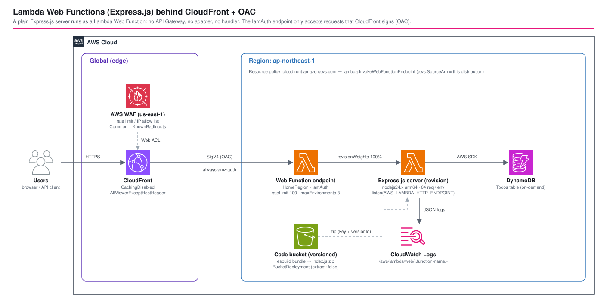
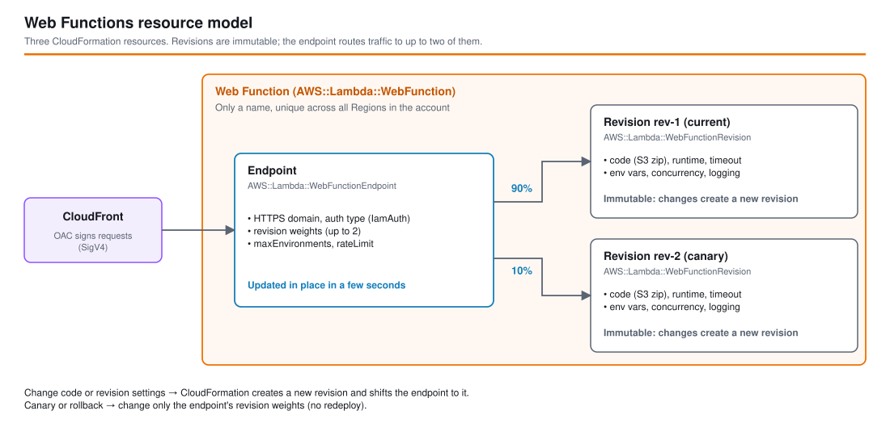
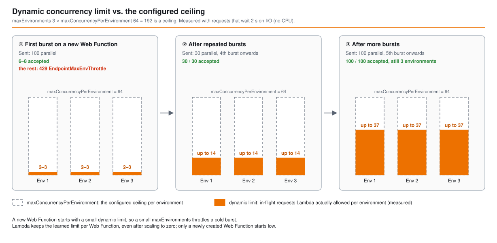

# Lambda Web Functions (Express.js) + CloudFront OAC - AWS CDK リファレンスアーキテクチャ

[](./README.ja.md)
[](./README.md)


`apigw-*` 比較シリーズと同じ Todos REST API を、**AWS Lambda Web Functions(2026-10-12 GA)上で動くふつうの Express.js HTTP サーバー**で提供します。API Gateway も Lambda Web Adapter レイヤーも `handler(event)` もありません。サーバーは `AWS_LAMBDA_HTTP_ENDPOINT` のアドレスで `app.listen()` するだけで、HTTPS エンドポイント・スケーリング(ゼロまで)・1 環境での多重実行は Lambda が提供します。

エンドポイントは `IamAuth` とし、CloudFront が **オリジンアクセスコントロール(OAC)** ですべてのオリジンリクエストに署名します。このディストリビューションを経由しないリクエストはエンドポイントのドメインで拒否されます。Web Function のエンドポイント自体には WAF がないため、AWS WAF は CloudFront に付けます。

**同じ API** を実装して Lambda の統合スタイルを比較する 4 つ目のワークスペースです。

| ワークスペース | 入口 | 関数 | ルーティング | 一言で言うと |
|-----------|-----------|-----------|---------|------------------|
| [`apigw-single-purpose-lambda`](../apigw-single-purpose-lambda/) | API Gateway | ルートごとに 1 つ | API Gateway | 最大の分離：ルートごとに専用の関数・ロール・権限。 |
| [`apigw-lambdalith`](../apigw-lambdalith/) | API Gateway | 1 つ | Hono(プロセス内) | 1 関数・1 デプロイ単位・フレームワークによるルーティング。 |
| [`apigw-lambda-web-adapter`](../apigw-lambda-web-adapter/) | API Gateway | 1 つ | Express(プロセス内) | Lambda Web Adapter レイヤーの背後で動く標準的な Express サーバー。 |
| **`lambda-web-functions-express`**(本書) | **CloudFront + Web Function エンドポイント** | **Web Function 1 つ** | **Express(プロセス内)** | **同じ Express アプリをアダプターも API Gateway もなしで。1 環境が多数のリクエストを同時に処理。** |

## 📑 目次

- [アーキテクチャ概要](#️-アーキテクチャ概要)
- [Lambda Web Functions の仕組み](#-lambda-web-functions-の仕組み)
- [設計判断とベストプラクティス](#-設計判断とベストプラクティス)
- [パターン比較](#-パターン比較)
- [検証結果(ap-northeast-1 に実機デプロイ)](#-検証結果ap-northeast-1-に実機デプロイ)
- [Well-Architected との対応](#️-well-architected-との対応)
- [コスト最適化](#-コスト最適化)
- [セキュリティに関する考慮事項](#-セキュリティに関する考慮事項)
- [前提条件](#-前提条件)
- [デプロイ手順](#-デプロイ手順)
- [使い方](#使い方)
- [テスト戦略](#-テスト戦略)
- [カスタマイズ](#️-カスタマイズ)
- [トラブルシューティング](#-トラブルシューティング)
- [クリーンアップ](#-クリーンアップ)
- [参考資料](#-参考資料)

## 🏗️ アーキテクチャ概要



### 主要コンポーネント

- **AWS Lambda Web Function**(`AWS::Lambda::WebFunction` / `WebFunctionRevision` / `WebFunctionEndpoint`)。関数は名前だけの入れ物で、**リビジョン**がコード + 設定(`nodejs24.x`・arm64・タイムアウト 30 秒・`maxConcurrencyPerEnvironment` 64・環境変数・ログ設定)の不変スナップショット、**エンドポイント**(`HomeRegion`・`IamAuth`)がリビジョンへトラフィックを 100% 振り分け、スケール上限(dev では `maxEnvironments` 3・`rateLimit` 100 RPS)を持ちます。
- **Express アプリ(`src/`)**。`apigw-lambda-web-adapter` と同じルートに、これまで API Gateway が担えた入力検証・`helmet` によるセキュリティヘッダー・JSON のエラーハンドリングを加えたものです。`src/index.ts` は `AWS_LAMBDA_HTTP_ENDPOINT` に bind するだけです。`/debug/*` の診断ルート(同時実行・CPU・SSE・レスポンス後の処理)は `enableDebugRoutes` が true のときだけマウントします。
- **コード用バケット**(S3、バージョニング、SSE-S3、TLS 必須)。`BucketDeployment`(`extract: false`)が esbuild のバンドル(zip 内の `index.js`)をコンテンツハッシュ付きのキーでコピーし、リビジョンは `key` + `versionId` を固定参照します。バケットポリシーは、このアカウントの `web-function/<name>/*` に限って `lambda.amazonaws.com` の読み取りを許可します。
- **Amazon CloudFront**。**オリジンアクセスコントロール**(`lambda`・`always-amz-auth`・`sigv4`)、`CachingDisabled`、`AllViewerExceptHostHeader`。Web Function の `AWS::Lambda::ResourcePolicy` で、`cloudfront.amazonaws.com` がこのエンドポイントに限って `lambda:InvokeWebFunctionEndpoint` を呼べるよう許可し、`aws:SourceArn` をこのディストリビューションに限定します。
- **AWS WAF**(`us-east-1` の別スタック、CLOUDFRONT スコープ)。IP 単位のレートベースルール、`AWSManagedRulesCommonRuleSet`、`AWSManagedRulesKnownBadInputsRuleSet`、IP 許可リスト(`ALLOWED_IPS`、未指定ならデプロイ元のグローバル IP)。
- **Amazon DynamoDB**(`TodosTable`)。オンデマンド、SSE、PITR。実行ロールにはこのテーブルだけ `grantReadWriteData` します。
- **ログ**。`/aws/lambda/web/<関数名>` と、リージョンごとの `.local` の対を、どちらも保持期間 1 週間で事前作成します。後者を作らないと、サービスが初回に保持期間なしで `.local` を作り、`cdk destroy` 後も残ります(検証済み)。実行ロールが書き込めるのはこの 2 つだけです。
- **VPC egress(任意)**(`vpcEgress.enabled`、既定はオフ)。分離された VPC(NAT なし、DynamoDB のゲートウェイエンドポイントのみ)と、リビジョンが参照する `AWS::Lambda::NetworkConnector`(`VPC_EGRESS`、`WebFunction`)。検証済み:オンにすると、アプリは DynamoDB には届き、インターネットには出られません。

### スタック

| スタック | リージョン | 内容 |
|-------|--------|----------|
| `<project>-<env>-lambda-web-functions-express-waf` | us-east-1 | WAF Web ACL + IP セット |
| `<project>-<env>-lambda-web-functions-express` | ap-northeast-1 | それ以外すべて(Web Function、バケット、CloudFront、DynamoDB、ログ) |

## 🔌 Lambda Web Functions の仕組み

```
                 ┌──────────────── 実行環境 (2 vCPU / 2 GB, arm64) ─────────────────────────────┐
HTTPS リクエスト ─► │ Lambda が動的な同時実行数に余裕のある環境へリクエストを振り分ける               │
(エンドポイント)    │   └─► node index.js ──listen(AWS_LAMBDA_HTTP_ENDPOINT = 0.0.0.0:3000)──►      │
                 │        1 プロセスの Express が最大 N リクエストを同時に処理                       │
                 └────────────────────────────────────────────────────────────────────────────────┘
```

| | Event Functions(+ Web Adapter) | **Web Functions** |
|---|---|---|
| プログラミングモデル | `handler(event)`、またはイベントを HTTP に変換するアダプター | **ポートで listen するふつうの HTTP サーバー** |
| 1 環境あたりのリクエスト | 一度に 1 つ | **同時に複数**(動的上限、上限値 1〜128) |
| 入口 | API Gateway / ALB / 関数 URL | **組み込みの HTTPS エンドポイント**(`ApplicationManaged` か `IamAuth`) |
| コンピュート課金 | 実時間の GB 秒 | **アクティブ CPU(vCPU 秒)+ 消費メモリ(GB 秒)+ リクエスト** |
| パッケージ | zip またはコンテナイメージ、レイヤー | **zip のみ、レイヤーなし**、Node.js(`nodejs24.x`)arm64 |
| スケール制御 | 予約/プロビジョンド同時実行 | エンドポイントの **`maxEnvironments`、`rateLimit`** |
| イベントソース(SQS、Streams…) | あり | **なし**(HTTP 専用) |

3 つのリソースは 3 つのライフサイクルに対応します。

- **Web Function**:名前(アカウント内の**全リージョン**で一意)。
- **リビジョン**:不変。コード・ランタイム・タイムアウト・環境変数・同時実行数・ログ設定を変えると新しいリビジョンになり、CloudFormation は置き換えます。
- **エンドポイント**:可変。認証タイプ・リビジョンの重み(カナリア用に最大 2 つ)・`maxEnvironments`・`rateLimit` は数秒でその場更新されます。

CloudFront が各リクエストに署名してエンドポイントへ送り、エンドポイントは重みに応じて最大 2 つの不変なリビジョンへ振り分けます。カナリアやロールバックは重みを変えるだけで、デプロイし直す必要はありません。



## 🎯 設計判断とベストプラクティス

### 1. 公開エンドポイントではなく `IamAuth` + CloudFront OAC

`ApplicationManaged` のエンドポイントは、CloudFront を前に置いても自身のドメインで公開されたままで、Lambda はリソースポリシーも評価しません。`IamAuth` にすると、CloudFront が各オリジンリクエストに署名し(Web Function オリジンで使える署名動作は `always-amz-auth` のみ)、ビューアーの `Authorization` ヘッダーはそのまま渡され、リソースポリシーで呼び出し元をこのディストリビューションに限定できます。検証:エンドポイントのドメインへ直接送った署名なしリクエストは **403** になりました。

このオリジンでは CloudFront の設定が 2 つ必須です。`AllViewerExceptHostHeader`(ビューアーの `Host` を転送するとエンドポイントが 404 を返す)と、アプリがビューアーの `Authorization` ヘッダーを読むならキャッシュポリシーへの追加です。

### 2. 生成された L1 を 1 つの Construct で包む

`aws-cdk-lib` 2.273.0 で `CfnWebFunction`、`CfnWebFunctionRevision`、`CfnWebFunctionEndpoint` が生成されています(L2 はまだありません)。[`lib/constructs/web-function.ts`](lib/constructs/web-function.ts) はこれらをバケット・ロール・ロググループとまとめ、次の罠をコードに織り込んでいます。

- リビジョンとエンドポイントは関数を**素の名前**で参照します(ARN を渡すと後でエンドポイントの `DomainName` が読めなくなる)。名前では CloudFormation の参照関係ができないため `addResourceDependency` が必要です。
- `BucketDeployment.objectKeys` は **`destinationKeyPrefix` を含まない相対キー**です。プレフィックスを付け直さないと `CreateWebFunctionRevision` が *"The specified S3 object does not exist"* で失敗します(初回デプロイで遭遇)。
- この aws-cdk-lib に同梱の cfn-lint スキーマは新しいリソースタイプを知らず `F3006 Unknown resource type` を出すため、`Validations.of(this).acknowledge(...)` で承認しています。

### 3. esbuild で `index.js` 1 ファイルにバンドル

ランタイムは zip 直下の `index.js` を読み込みます。esbuild で Express・`helmet`・AWS SDK を CommonJS の 1 ファイル(2.5 MB)にまとめるので、成果物に `node_modules` も `package.json`(`"type": "module"`)も不要で、ネイティブアドオンがないため arm64 互換も自然に満たします。実測のコールドスタート:**合計 445〜520 ms、CPU 335 ms、約 170 MB**(`platform.initReport`)。

### 4. API Gateway の責務をアプリへ移す

API Gateway がない分、入力検証・CORS・セキュリティヘッダー・クライアント単位のスロットリングはアプリの仕事です。本リファレンスは `src/utils/validation.ts` でボディを検証し、不正な JSON には JSON の 400 を返し、`helmet` でセキュリティヘッダーを付け、IP 単位の制限は WAF のレートベースルールに任せます(エンドポイントの `rateLimit` はエンドポイント全体の値で、クライアント単位ではありません)。

### 5. スレッドセーフ:モジュールの状態は共有される

1 プロセスが多数のリクエストを同時に処理します。モジュールレベルの変数は処理中のすべてのリクエストで共有されるため、置いてよいのは不変の設定と SDK クライアントだけです。`/debug` ルートはこれを可視化するため、環境単位のカウンター(`inFlight`、`maxInFlight`)を意図的に持たせています。

### 6. 環境ごとにスケール上限を設定(`maxEnvironments`、`rateLimit`)

`maxEnvironments` はコストと下流への負荷を、`rateLimit` はリクエストレートを制限します(0 = キルスイッチで 503 `Platform.EndpointDisabled`)。どちらもエンドポイントの設定でその場更新です。`maxEnvironments` と環境ごとの*動的*同時実行上限の関係は検証結果を参照してください。小さい値だとコールド状態のバーストがスロットリングされます。

### 7. VPC egress はリビジョンの設定(L1 はスキーマより遅れている)

リビジョンには、**バージョン付き**のコネクター ARN(`attrLatestVersionArn`)を渡します。実際の CloudFormation スキーマには `ServiceConfig.EgressNetworkConnectorArn` がありますが、aws-cdk-lib 2.273.0 で生成された `CfnWebFunctionRevision` にはこのプロパティがありません。そのため [`web-function.ts`](lib/constructs/web-function.ts) では `addPropertyOverride` で設定しています。CloudFormation はこれを受け付け、リビジョンは `...:network-connector:<id>:1` に紐づいて作成されました。同梱の cfn-lint は `GetAtt LatestVersionArn`(E9004。`validateAgainstDefaultRules` ではエラー)と `AssociatedComputeResourceTypes: WebFunction`(W3030。`MicroVm` しか知らない)も拒否するため、両方を Construct で承認しています。コネクターの作成には約 4 分かかります。追加しても削除しても、リビジョンはエラーなく置き換わりました。

## 🔀 パターン比較

| 観点 | Single-Purpose Lambda | Lambdalith (Hono) | Lambda Web Adapter | **Web Functions(本書)** |
|--------|----------------------|-------------------|-------------------|--------------------------|
| 入口 | API Gateway REST | API Gateway REST | API Gateway REST | **CloudFront → Web Function エンドポイント** |
| Lambda 固有のコード | ルートごとのハンドラー | `hono/aws-lambda` のエントリー | アダプターレイヤー + `run.sh` | **なし(指定アドレスで `listen()`)** |
| 1 環境あたりのリクエスト | 1 | 1 | 1 | **複数(動的、本書では上限 64)** |
| コンピュート課金 | 実時間 GB 秒 | 実時間 GB 秒 | 実時間 GB 秒 | **アクティブ vCPU 秒 + 消費 GB 秒** |
| レスポンスストリーミング | REST: 不可 | REST: 不可 | REST: 不可 | **ネイティブ(CloudFront 経由の SSE を検証済み)** |
| レスポンス後の処理 | 不可(凍結) | 不可 | 不可 | **可能(検証済み)** |
| カナリア / ブルーグリーン | エイリアス + CodeDeploy | エイリアス + CodeDeploy | エイリアス + CodeDeploy | **エンドポイントの `revisionWeights`(2 リビジョン)** |
| 入力検証 / API キー / 使用量プラン | API Gateway | API Gateway | API Gateway | **アプリ / WAF(使用量プランなし)** |
| Provisioned Concurrency / SnapStart | あり | あり | あり | **なし** |
| ランタイム / パッケージ | 任意 / zip かイメージ | 任意 / zip かイメージ | 任意 / zip かイメージ + レイヤー | **Node.js 24 / zip、arm64** |
| 向いている用途 | ルート単位の分離 | 小〜中規模 API | Web アプリを Event Functions へ移植 | **I/O 待ちが多い Node.js API、SSR、ストリーミング** |

使用量プランと API キー、Cognito / Lambda オーソライザー、リクエスト/レスポンスのマッピング、mTLS、WebSocket API が必要なら API Gateway を残します(Event Function の前に置くか、Web Function のエンドポイントを HTTP 統合先にする)。

## 🔬 検証結果(ap-northeast-1 に実機デプロイ)

2026-10-15 に [`test-api.sh`](test-api.sh) と、日本国内の 1 クライアントからのアドホックな負荷(CloudFront の NRT エッジ経由)で計測しました。各 1 回の計測なので、ベンチマークではなく桁の目安として扱ってください。

### 機能確認(`./test-api.sh`)

| 確認内容 | 結果 |
|-------|--------|
| CloudFront 経由の `GET /health` | 200。`lambda-web-request-id` と `lambda-web-logstream`(`[rev-xxxxx]` を含む)ヘッダー、`helmet` のヘッダーあり |
| CRUD の一連の操作 | 201 / 200 / 200 / 200 / 204、削除後の取得・更新は 404 |
| 入力検証 | title なし・`completed` が真偽値でない・不正な JSON → 400、存在しないルート → 404 |
| エンドポイントのドメインへの署名なしリクエスト | **403**(`You are not authorized to access this endpoint`) |
| CloudFront 経由の SSE(10 イベント、500 ms 間隔) | 最初のイベントが **223 ms** で到着、5.65 秒でストリーム終了。バッファリングされない |
| レスポンス後の処理(`res.json` の後の `setTimeout`) | 完了してログに出力され、**元のリクエストの `requestId` が付いたまま** |

### スケーリングとスロットリング

| シナリオ | 観察結果 |
|----------|-------------|
| I/O 待ち(2 秒)の 100 並列、`maxEnvironments` 3、コールド | **受け付けたのは 6〜8 件、92〜94 件は 429 `Platform.EndpointMaxEnvThrottle`**。新しい環境の動的上限は同時 2〜3 件程度で、`maxConcurrencyPerEnvironment` 64 よりずっと低かった |
| `maxEnvironments` 3 のまま 30 並列 → 100 並列を繰り返す | 動的上限が上がっていった。30 並列は 4 回目から全件成功(1 環境あたり同時 14)、**100 並列は 5 回目から全件成功(1 環境あたり同時 37、環境は 3 つのまま)** |
| `maxEnvironments` を解除して 300 並列 | 環境 5〜6、1 環境あたり最大同時 49。**429 `Platform.EndpointRequestThrottle`**(rateLimit 100)と、**`lambda-web-error-type` なしの 503**(ドキュメントにある負荷制限。バックオフで再試行) |
| CPU バウンド(500 ms のビジーループ)を 10 並列 | **8 環境に分散**し、レイテンシは約 0.62 秒を維持(CPU が埋まった環境を避けてルーティング)。30 並列では一部が直列化(最大 1.7 秒) |
| `rateLimit: 0` | 約 3 秒で 503 `Platform.EndpointDisabled`、約 2 秒で復旧 |
| アイドル時の縮退 | 負荷停止から約 1 分で 9 → 3 環境。最後の環境は最後のリクエストの約 6 分後に `SIGTERM` を受けた(ゼロまで縮退) |
| 約 22 分アイドル後の最初のリクエスト | CloudFront 経由で **0.89 秒**(`platform.initReport` 430 ms)、次のリクエストは 0.086 秒 |
| 開始時の上限は一定ではない | 温まったエンドポイントで CloudFormation がリビジョンを切り替えた直後は、30 並列を **1 環境(同時 30)** で処理。新規作成したエンドポイントでは、30 並列が 2 回続けて 8 件成功 / 22 件 429 |

設定した `maxConcurrencyPerEnvironment`(64)はあくまで上限です。各環境が実際に受け付ける動的上限は 2〜3 から始まり、バーストを繰り返すと上がっていきます。一度上がった上限は、ゼロまで縮退した後も維持されます。



**ポイント:**`maxEnvironments` × `maxConcurrencyPerEnvironment` は上限であって、コールド状態のバーストで得られる処理能力ではありません。クライアントがバースト的にアクセスするなら、`maxEnvironments` を未設定(または大きめ)にするか、クライアントに 429/503 のバックオフ再試行を実装します。

### 課金のシグナル

2 秒の I/O 待ちテストが大半を占める 5 分間の `AWS/Lambda/Web` メトリクス:**`EnvironmentCPUTime` 4.6 秒に対して `EnvironmentActiveTime` 361.7 秒(約 1.3%)**、`EnvironmentMaxMemoryUsage` 165〜210 MB。I/O 待ちで消費するのはメモリ秒で、vCPU 秒ではありません。

### Lambda Web Adapter 版との比較(同じアカウント、同じクライアント)

[`apigw-lambda-web-adapter`](../apigw-lambda-web-adapter/)(API Gateway REST → Event Function、256 MB arm64)を並べてデプロイし、両方の DynamoDB に 20 件を入れて、クローズドループの負荷ツール(助走 10 秒、計測 30 秒)で計測しました。クライアントからのエンドツーエンドの値で、本パターンは CloudFront 経由、もう一方は API Gateway へ直接です。

| シナリオ | Web Functions(本書) | Lambda Web Adapter |
|----------|---------------------|--------------------|
| `/health`、同時 2(どちらもスロットリングなし) | p50 **20.7 ms** / p99 32.2 ms、92 rps | p50 38.0 ms / p99 80.8 ms、51 rps |
| `/todos`(DynamoDB スキャン)、同時 2 | p50 **33.9 ms** / p99 50.8 ms、58 rps | p50 47.9 ms / p99 144.4 ms、38 rps |
| `/health`、同時 8 | **422 rps**、すべて 200、3 環境 | 200 が 90 rps + **500 が 5,292 件** |
| `/todos`、同時 8 | **233 rps**、すべて 200、4 環境 | 200 が 92 rps + **500 が 3,484 件** |
| `/todos`、同時 50(上限を外し `rateLimit` 1000) | 789〜823 rps、29 環境、429 `EndpointRequestThrottle` と一部 503 | — |

LWA 側の 500 は、Lambda のスロットリングに対する API Gateway の応答です。このアカウントの **Event Functions の上限は同時実行 10**(同期呼び出しは毎秒約 100)で、**Web Functions は別のクォータ**(`GetWebAccountSettings` で `maxTotalArmVCpus` 200、`maxTotalRateLimit` 10,000 RPS)です。計測期間のリクエストあたりのコンピュートは、Web Functions が CPU 2.5 ms、Event Function が課金対象の実行時間 15.6 ms でした。100 万リクエストあたりでは、Web Function が約 **$0.45**(リクエスト + CPU + メモリ。同時 50 の試験後にアイドルで残った 29 環境分を含む)、Event Function は **$0.25 に API Gateway の $4.25 が加わります**。差は API Gateway をなくしたことによるもので、コンピュートが安いからではありません。

### 新しい関数へのバーストと、クライアント再試行の効果(2026-10-29、各 3 試行)

試行ごとに新しい Web Function を作り(学習した上限はゼロまで縮退しても残るため)、2 秒待ちの 100 並列を `maxEnvironments` 3、`rateLimit` 100 で繰り返し送りました。署名付きリクエストでエンドポイントを直接呼んでいます。手順と生データは [`scripts/measure/`](scripts/measure/) にあります。

| 関数の作成からの経過 | 約 0 秒 | 約 11 秒 | 約 21 秒 | 約 31 秒 | 約 40 秒 |
|---|---|---|---|---|---|
| 再試行なし:100 件中の 200(1 環境あたり同時) | 6(2) | 6(2) | 24(8〜10) | 60(20〜21) | 計測なし |
| 再試行あり:100 件中の 200(1 環境あたり同時) | 16〜17(2) | 50〜56(8) | 90〜95(20) | 95〜99(30〜31) | 100(33〜36) |

- 開始時の動的上限は、新しい 7 関数すべてで **1 環境あたり同時 2** でした。
- 指数バックオフ + フルジッター(最大 6 回)で、8 バーストの合計成功は 200〜218/800 から 657〜661/800 になりました。代わりに最初のバーストでは試行が **5.7 倍**(100 件に 570 回)になり、その一部が `rateLimit` による 429 `EndpointRequestThrottle` になりました。`rateLimit` は再試行分も見込んで決めます。
- 10 分アイドル(`EndpointActiveEnvironments` のデータ点なし)の後のバーストは 30/100 で、開始時の 6/100 には戻りませんでした。

### その他の確認結果

| 確認内容 | 結果 |
|-------|--------|
| `timeoutSeconds` を超える SSE(1 秒間隔で 40 イベント、タイムアウト 30 秒) | **30 イベントで途中終了し、HTTP 200 のまま正常にストリームが終わった**(curl の終了コード 0)。クライアントには区別できない。`timeoutSeconds`(と CloudFront の `readTimeout`)を最長のストリームより長くし、ストリームの最後に `event: done` を送ってクライアントで欠落を検知する(途切れ 4/4、正常終了 4/4 を判別。[`sse-check.mjs`](scripts/measure/sse-check.mjs)) |
| ログ到着までの遅延(`ingestionTime − timestamp`) | `.local` は 2.8〜9.0 秒、本体のロググループは 7.1〜15.4 秒 |
| `server.close()` による `SIGTERM` 処理 | `platform.spinDownReport` が **25〜60 ms で success** |
| アカウントのクォータ(`GetWebAccountSettings`) | `maxTotalArmVCpus` 200、`maxTotalRateLimit` 10,000。ドキュメントの既定値(2,000 / 100,000)より低い。負荷試験の前に確認する |
| VPC egress を有効化 | コネクター作成 4 分 14 秒。ゲートウェイエンドポイント経由の CRUD は成功、`/debug/egress` によるインターネットへのアクセスは**タイムアウト** |
| VPC egress を削除(毎秒 5 リクエストのプローブ中に再デプロイ) | 61 秒、**プローブ 590 件すべて 200**、インターネットに再び届く |
| `cdk destroy` の後 | 削除された関数より長く生き残った環境が約 2.5 分後に `platform.invokeSummary` を出し、複製されたログが **`/aws/lambda/web/<name>` を保持期間なしで作り直した**(クリーンアップ参照) |

### デプロイ

| 操作 | 時間 / 結果 |
|-----------|---------------|
| メインスタックの初回デプロイ(CloudFront 含む) | 169 秒 |
| `cdk deploy` でのコード変更(新リビジョン → エンドポイント切替 → 旧リビジョン削除) | 合計 76 秒(リビジョン 5 秒、エンドポイント 4 秒)。**プローブ 790 件すべて 200**、約 4 秒かけて段階的に切り替わった |
| API でのカナリア:新リビジョンが Active になるまで | 5.5 秒。90/10 の重み付けは 2.9 秒で反映、**サンプル 233 件中 22 件(9.4%)** がカナリアで処理、100% へのロールバックは 3.5 秒 |
| VPC egress ありの初回デプロイ | 458 秒(コネクター 4 分 14 秒) |

## 🏛️ Well-Architected との対応

| 柱 | 実装 |
|--------|---------------|
| **運用上の優秀性** | 1 成果物・デプロイごとに 1 リビジョン。ローカルと Lambda で同じコードパス(`npm start`)。`requestId` 付きの構造化プラットフォームログ。`AWS/Lambda/Web` メトリクス。`test-api.sh` による運用確認。エンドポイントの重みによるカナリア/ロールバック。 |
| **セキュリティ** | `IamAuth` エンドポイントに到達できるのは CloudFront OAC 経由のみ(リソースポリシーを `aws:SourceArn` で限定)。WAF(マネージドルール、IP 単位のレート制限、IP 許可リスト)。`helmet` のヘッダー。アプリでの入力検証。最小権限ロール(1 テーブル、自身のロググループ)。TLS 必須・バージョニング有効のコードバケット。リビジョンの環境変数にシークレットを置かない。 |
| **信頼性** | マネージドなマルチ AZ エンドポイント。不変リビジョンと重み付け切替、即時ロールバック。エラーゼロのコードデプロイを検証済み。DynamoDB PITR。429/503 の再試行方針を明記。 |
| **パフォーマンス効率** | I/O バウンドの処理は 1 環境で多数を同時処理。CPU を考慮したルーティング。ネイティブのストリーミング。arm64。2.5 MB の単一バンドル(初期化約 0.5 秒)。 |
| **コスト最適化** | アクティブ CPU と消費メモリへの課金。ゼロまでスケール。`maxEnvironments` / `rateLimit` による上限。オンデマンドの DynamoDB。API Gateway のリクエスト課金なし。 |
| **持続可能性** | Graviton。同じ I/O バウンドのトラフィックをより少ない環境で処理。ゼロまでスケール。 |

## 💰 コスト最適化

### 単価(ap-northeast-1、AWS Price List API より、2026-10)

| 項目 | 単価 |
|------|-------|
| Web Functions リクエスト | $0.30 / 100 万 |
| Web Functions アクティブ CPU(arm64) | $0.0000322421 / vCPU 秒 |
| Web Functions メモリ(arm64) | $0.0000042688 / GB 秒 |
| *比較用:Event Functions(arm64)* | $0.20 / 100 万リクエスト、$0.0000133334 / GB 秒 |
| *比較用:API Gateway REST / HTTP API* | $4.25 / 100 万(最初の 3.33 億)/ $1.29 / 100 万(最初の 3 億) |

### 月額コスト試算

前提:リクエストあたりのアクティブ CPU は平均 5 ms(上記の実測に合わせた値)、1 環境の消費メモリは約 200 MB、無料利用枠は含めない。

#### 軽量利用(月 約 10 万リクエスト)
```
Web Functions リクエスト:  100,000 x $0.30 / 1M                        = $0.03
Web Functions CPU:        100,000 x 5 ms = 500 vCPU 秒                  = $0.02
Web Functions メモリ:      約 50 環境時間 x 0.2 GB = 36,000 GB 秒        = $0.15
CloudFront(日本):        HTTPS 100,000 リクエスト                       ≈ $0.12
AWS WAF:                  Web ACL 1 + ルール 4 + リクエスト               ≈ $9.06
DynamoDB オンデマンド / CloudWatch Logs                                  ≈ $0.12
-----------------------------------------------------------------------------
合計:                                                                   約 $9.5/月(WAF なしなら約 $0.44)
```

#### 中規模利用(月 約 500 万リクエスト)
```
Web Functions リクエスト:  5,000,000 x $0.30 / 1M                      = $1.50
Web Functions CPU:        5,000,000 x 5 ms = 25,000 vCPU 秒             = $0.81
Web Functions メモリ:      1 環境が常時稼働: 518,400 GB 秒               = $2.21
CloudFront(日本):        HTTPS 5,000,000 リクエスト + 転送 約 5 GB       ≈ $6.57
AWS WAF:                  Web ACL 1 + ルール 4 + 500 万リクエスト          ≈ $12.00
DynamoDB オンデマンド:     約 1,500 万 RRU/WRU                           ≈ $5.00
CloudWatch Logs:          約 2 GB                                       ≈ $1.50
-----------------------------------------------------------------------------
合計:                                                                   約 $29.6/月
```

同じ 500 万リクエストで、コンピュート + 入口の部分は本パターンが **約 $4.5**、`apigw-lambda-web-adapter` は **約 $23**(REST API $21.25 + Lambda $1.80、WAF なし)です。本パターンで大きいのは WAF と CloudFront で、これは L7 の保護と OAC による閉域化の対価です。

*([AWS 料金見積りツール](https://calculator.aws/)で確認してください。メモリは各環境の存続期間全体、つまりリクエスト間のアイドル時間も含めて課金されます。1 環境を 1 か月温め続けると、メモリだけで約 $2.2/月です。)*

### 本パターン特有のコスト上の注意

1. **I/O バウンドが最も得をする。** DynamoDB や他の API を待つ時間はメモリ秒を消費しますが vCPU 秒はほとんど消費せず、そうしたリクエストが 1 環境を共有します。
2. **CPU バウンドではこの利点が消える。** CPU の使用は vCPU 秒で課金され、Node は 1 プロセスで 2 vCPU のうち 1 つしか使いません。CPU の重い処理が続くなら Lambda Managed Instances と比較してください。
3. **`maxEnvironments` はコストの上限**ですが、小さすぎるとコールド状態のバーストがスロットリングされます(検証結果参照)。

## 🔒 セキュリティに関する考慮事項

### 実装済み

- `IamAuth` エンドポイント + CloudFront OAC(`always-amz-auth`)+ このディストリビューション(`aws:SourceArn`)とこのエンドポイント ARN に限定した `AWS::Lambda::ResourcePolicy`。直接アクセスは 403。
- CloudFront の AWS WAF:IP 単位のレートベースルール、コアルールセット、既知の不正入力、IP 許可リスト(既定はブロック)。
- `helmet` によるセキュリティヘッダー、JSON ボディ上限 64 KB、アプリでのスキーマ検証、500 のボディは汎用文言。
- 実行ロール:1 テーブルへの DynamoDB 読み書き、`logs:*` は `/aws/lambda/web/<name>` と `.local` のみ。
- コードバケット:バージョニング、SSE-S3、パブリックアクセスブロック、TLS 必須、Lambda の読み取りはこのアカウントの `web-function/<name>/*` のみ。
- デバッグルートは `dev` 以外で無効(`enableDebugRoutes`)。

### 意図的に対象外(環境ごとに追加)

- **認証/認可**:エンドポイントが信頼するのは CloudFront であり、エンドユーザーではありません。Express で JWT/セッションを検証する(`Authorization` をキャッシュポリシーに追加して転送)か、API Gateway のオーソライザーを前段に残します。
- **シークレット**:`get-web-function-revision` は読み取り権限を持つ誰にでも環境変数を平文で返します(検証済み)。シークレットは Secrets Manager / Parameter Store に置き、実行時に取得します。
- リビジョン(`kmsKeyArn`)とロググループの**カスタマーマネージド KMS**。
- カスタムドメイン + ACM 証明書、CloudFront アクセスログ、地域制限。

### CDK Nag

両スタックとも `AwsSolutionsChecks` を通過します。抑制(`test/compliance/cdk-nag.test.ts`)は、CDK が管理するカスタムリソースのハンドラー(IAM4、L1)、ログストリーム / DynamoDB インデックスのワイルドカード(IAM5)、コードバケットのアクセスログ(S1)、CloudFront のログ・地域制限・既定証明書での TLS(CFR1/3/4)です。

## 📋 前提条件

- Lambda Web Functions が使えるリージョンの AWS アカウント(提供開始時点で us-east-1、us-east-2、us-west-2、ap-northeast-1、eu-west-1)。そのリージョン**と us-east-1**(WAF スタック)で CDK ブートストラップ済み
- `${PROJECT}-${ENV}` という名前のプロファイルを設定した AWS CLI v2。`aws lambda-web` のサブコマンドには GA の API を含む CLI が必要です(2.37.12 は `get-web-account-settings` しか持たない)。boto3 1.43 以降でも操作でき、パラメーター名が camelCase(`functionName`)な点に注意
- 負荷試験の前にアカウントのクォータを確認する:`GetWebAccountSettings`(`maxTotalArmVCpus`、`maxTotalRateLimit`)。vCPU のクォータは、そのアカウント・リージョンのすべての Web Function で共有される
- Node.js 22 以降、`aws-cdk-lib` 2.273.0 以降(生成された `CfnWebFunction*`)
- `test-api.sh` 用に `curl` と `jq`
- Docker は**不要**(ローカルの esbuild でバンドル)

## 🚀 デプロイ手順

```bash
cd infrastructure
npm install

export PROJECT=myproject
export ENV=dev
# 任意:WAF の許可リスト(既定はこのマシンのグローバル IPv4)
export ALLOWED_IPS=203.0.113.10

npm run bootstrap -w workspaces/lambda-web-functions-express          # 初回のみ、アカウント/リージョンごと
cdk bootstrap aws://<account-id>/us-east-1 --profile ${PROJECT}-${ENV}  # WAF スタックのリージョン
npm run diff -w workspaces/lambda-web-functions-express
npm run stage:deploy:all -w workspaces/lambda-web-functions-express
```

出力:`DistributionUrl`、`EndpointDomainName`、`WebFunctionName`、`EndpointName`、`RevisionId`、`LogGroupName`、`TodosTableName`。

## 使い方

```bash
URL="<DistributionUrl の出力>"

curl -s "$URL/health"                                                    # {"status":"ok"}
curl -s -X POST "$URL/todos" -H 'content-type: application/json' -d '{"title":"buy milk"}' | jq .
curl -s "$URL/todos" | jq .
curl -s -X PUT "$URL/todos/<todoId>" -H 'content-type: application/json' -d '{"title":"buy oat milk","completed":true}' | jq .
curl -s -i -X DELETE "$URL/todos/<todoId>"

# ストリーミングと多重実行(dev のみ)
curl -N "$URL/debug/stream?count=5&intervalMs=500"
curl -s "$URL/debug/env" | jq .

# 運用確認の一式
./test-api.sh --project myproject --env dev
./test-api.sh --project myproject --env dev --only concurrency --parallel 30
./test-api.sh --project myproject --env dev --throttle
```

### 同じサーバーをローカルで動かす

```bash
TABLE_NAME=<table> ENABLE_DEBUG_ROUTES=true npm start -w workspaces/lambda-web-functions-express   # http://localhost:8080
```

## 🧪 テスト戦略

```
test/
├── compliance/cdk-nag.test.ts                 # 両スタックへの AwsSolutions パック
├── helpers/stack.ts                           # バンドルを省略してスタックを構築
├── parameters/test-params.ts                  # 決定的な Environment.TEST のパラメーター
├── snapshot/snapshot.test.ts                  # テンプレート + リソース数のスナップショット(メイン + WAF)
└── unit/
    ├── lambda-web-functions-express-stack.test.ts   # Web Function / バケット / OAC / リソースポリシー / WAF のアサーション
    └── app.test.ts                                  # Express アプリをプロセス内でテスト(supertest、DynamoDB はモック)
```

```bash
npm test -w workspaces/lambda-web-functions-express                 # 54 テスト
npm run test:snapshot:update -w workspaces/lambda-web-functions-express
```

`test-api.sh` はデプロイ後の確認用です(npm には組み込んでいません)。同時実行の確認では、429 は警告として表示し(コールド状態では想定どおり)、それ以外のエラーだけを失敗とします。

## ⚙️ カスタマイズ

### 環境ごとのスケール調整

`parameters/<env>-params.ts` → `webFunction`:

```typescript
webFunction: {
  maxConcurrencyPerEnvironment: 64,  // リビジョンの設定 → 新リビジョン
  timeoutSeconds: 30,                // リビジョンの設定 → 新リビジョン
  maxEnvironments: 3,                // エンドポイントの設定 → その場更新
  rateLimit: 100,                    // エンドポイントの設定 → その場更新(0 = キルスイッチ)
  enableDebugRoutes: true,
},
```

### 新しいリビジョンのカナリア

本リファレンスの CloudFormation は新リビジョンへ 100% 切り替えます。カナリアにするには、エンドポイントに 2 つの `revisionWeights`(例:90/10)を設定し、メトリクスを確認してから 100% にします。レスポンスヘッダー `lambda-web-logstream` に `[rev-xxxxx]` が含まれるので、振り分けを観測できます。

### VPC 経由でプライベートリソース(RDS、ElastiCache)へ接続

`parameters/<env>-params.ts` で `vpcEgress: { enabled: true, maxAzs: 2 }` にします。[`WebFunctionVpcEgress`](lib/constructs/web-function-vpc-egress.ts) が DynamoDB ゲートウェイエンドポイント付きの分離 VPC とネットワークコネクターを作り、リビジョンはインターネットに出られなくなります。ほかのサービスにはインターフェイスエンドポイントか NAT ゲートウェイを足し、RDS / ElastiCache は同じ VPC に置いて、コネクターのセキュリティグループからの通信を許可します。エンドポイントは `HomeRegion` のままにする必要があります。

### WAF の IP 単位のレート制限

`wafRateLimitPerIp`(60 秒あたりの IP ごとのリクエスト数)。dev では、上の比較を許可リストの 1 IP から実行できるよう 100,000 にしています。10,000 のときは、負荷試験が約 25 秒で 403 になりました。実際のクライアントに合う値にしてください(テスト用パラメーターは 1,000)。

### マルチリージョン

`MultiRegion` エンドポイントは 1 つのホスト名を複数リージョンから提供します(レイテンシーベースのルーティング)。状態は環境の外に置き、グローバルホスト名には `sigv4a` の OAC を使います。ネットワークコネクターとは併用できません。

## 🔧 トラブルシューティング

### `CreateWebFunctionRevision`: "The specified S3 object does not exist"

キーまたは `versionId` に一致するオブジェクトがありません。`BucketDeployment` の `objectKeys` は `destinationKeyPrefix` を含みません。バケットポリシーが `lambda.amazonaws.com` に、末尾が `/*` の `aws:SourceArn` で許可しているかも確認します。

### CloudFront がすべてのパスで 404 を返す

ビューアーの `Host` ヘッダーが転送されています。`AllViewerExceptHostHeader`(または `Host` を含まないポリシー)を使います。

### バースト時に 429 `Platform.EndpointMaxEnvThrottle` が多発する

環境ごとの動的上限がまだ低いうちに `maxEnvironments` に達しています。`maxEnvironments` を上げるか解除する、段階的に負荷を上げる、またはバックオフで再試行します。`Platform.EndpointRequestThrottle` は `rateLimit` によるものです。

### `lambda-web-error-type` なしの 503

急激なバーストでサービスが負荷を制限しています。指数バックオフ + ジッターで再試行します。`Platform.EndpointDisabled` は `rateLimit` が 0 であることを示します。

### `aws lambda-web ...`: "Found invalid choice"

インストール済みの AWS CLI が GA の API より古いです。CLI を更新するか、boto3 1.43 以降(パラメーターは camelCase)を使います。

### `cdk synth` で `F3006 Unknown resource type 'AWS::Lambda::WebFunction'`

同梱の cfn-lint スキーマがこのタイプより古いだけで、CloudFormation は受け付けます。本ワークスペースは Construct 内でこのルールを承認しています。

### `cdk destroy` 後に `/aws/lambda/web/<name>.local` が残る

サービスが初回に `.local` を作ります(保持期間なし)。本ワークスペースはスタックで宣言しています。既存のデプロイに後から追加する場合は、先に `aws logs delete-log-group` で一度削除しないと "already exists" で作成に失敗します。

### 長い SSE が HTTP 200 のまま途中で終わる

`timeoutSeconds` に達してリクエストが途中で終了しても、レスポンスは正常に終わったように見えます。`timeoutSeconds` と CloudFront オリジンの `readTimeout` を上げるか、クライアントが確認できる終了イベントを明示的に送ります。

### 負荷試験で CloudFront が 403 を返す

WAF の IP 単位のレートベースルール(`wafRateLimitPerIp`)でブロックされています。60 秒間のウィンドウで上限を下回れば戻ります。

### Event Function 側の比較対象が負荷時に 500 を返す

Lambda がスロットリングすると API Gateway は 500 を返します。新しいアカウントでは Event Functions の同時実行上限が 10 のことがあります(`aws lambda get-account-settings`)。Web Functions は別のクォータです。

### ログが `/aws/lambda/<name>` にない

Web Functions のログは `/aws/lambda/web/<name>`(と `<name>.local`)に出ます。`aws lambda list-functions` にも Web Functions は表示されません。

## 🧹 クリーンアップ

```bash
npm run stage:destroy:all -w workspaces/lambda-web-functions-express
```

`dev` ではテーブル、コードバケット(自動削除)、2 つのロググループが削除されます。CloudFormation 外で作ったリビジョン(手動のカナリアなど)は、先に削除してください。

実行環境は、関数を削除した後も数分間残ることがあります。検証した 3 回の削除のうち 1 回で、スタック削除の約 3 分後に複製された `platform.invokeSummary` が **`/aws/lambda/web/<name>` を保持期間なしで作り直しました**。約 10 分後にもう一度確認し、残っていれば削除します。

```bash
aws logs describe-log-groups --log-group-name-prefix /aws/lambda/web/<project>-<env>-lwf-todos
aws logs delete-log-group --log-group-name /aws/lambda/web/<project>-<env>-lwf-todos
```

## 📚 参考資料

### AWS ドキュメント
- [AWS Lambda Web Functions — Developer Guide](https://docs.aws.amazon.com/lambda/latest/dg/web-functions.html)
- [Scaling behavior for Lambda Web Functions](https://docs.aws.amazon.com/lambda/latest/dg/web-functions-scaling.html)
- [Lambda Web Function endpoint access control](https://docs.aws.amazon.com/lambda/latest/dg/web-functions-endpoint-access-control.html)
- [Restrict access to an AWS Lambda Web Function origin(CloudFront)](https://docs.aws.amazon.com/AmazonCloudFront/latest/DeveloperGuide/private-content-restricting-access-to-lambda-web.html)
- [AWS::Lambda::WebFunction](https://docs.aws.amazon.com/AWSCloudFormation/latest/TemplateReference/aws-resource-lambda-webfunction.md) / [WebFunctionRevision](https://docs.aws.amazon.com/AWSCloudFormation/latest/TemplateReference/aws-resource-lambda-webfunctionrevision.md) / [WebFunctionEndpoint](https://docs.aws.amazon.com/AWSCloudFormation/latest/TemplateReference/aws-resource-lambda-webfunctionendpoint.md)
- [What's New: AWS Lambda announces Lambda Web Functions](https://aws.amazon.com/about-aws/whats-new/2026/10/aws-lambda-web-functions/)

### 関連アーキテクチャ
- [apigw-lambda-web-adapter](../apigw-lambda-web-adapter/) — 同じ Express アプリを API Gateway の背後の Event Functions で
- [apigw-lambdalith](../apigw-lambdalith/) / [apigw-single-purpose-lambda](../apigw-single-purpose-lambda/) — 残り 2 つの統合スタイル
- [lambda-microvms-codex-appserver](../lambda-microvms-codex-appserver/) — Lambda の 3 つ目の形態(MicroVMs)
- [cloudfront-vpc-origin](../cloudfront-vpc-origin/) — ここで使った CloudFront + WAF のパターン

## 📄 ライセンス

このプロジェクトは MIT ライセンスの下で公開されています。詳細は [LICENSE](../../LICENSE) を参照してください。

## 👥 コントリビューション

コントリビューションを歓迎します。詳細は [CONTRIBUTING.md](../../CONTRIBUTING.md) を参照してください。

## 🏆 このリファレンスアーキテクチャについて

**対象レベル**: 300(中級)

---

**注意**: これはリファレンス実装です。本番環境にデプロイする前に、認証、シークレット、KMS、スケール上限、カスタムドメインを見直し、カスタマイズしてください。
