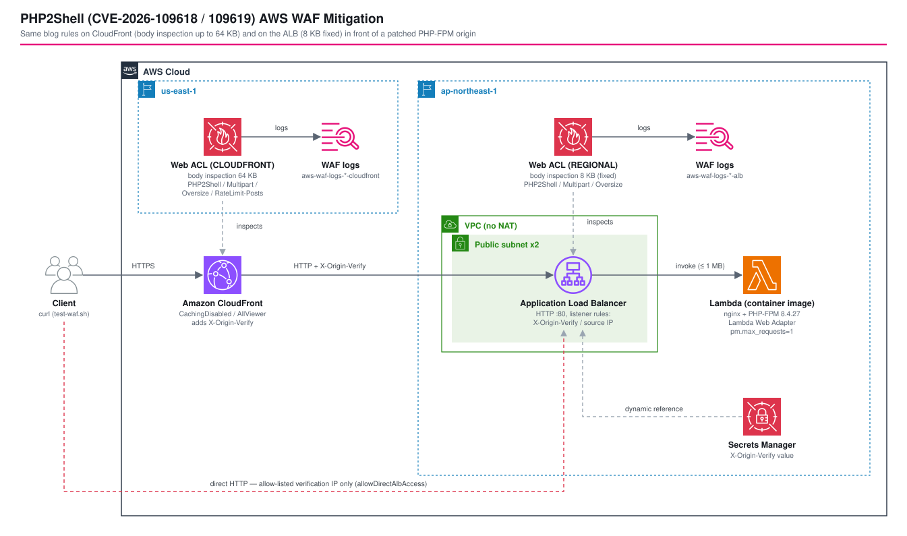

# Verifying the AWS WAF Mitigations for PHP2Shell (CVE-2026-109618 / CVE-2026-109619) on CloudFront and ALB - AWS CDK Reference Architecture

[](./README.ja.md)
[](./README.md)


For **PHP2Shell** (CVE-2026-109618 / CVE-2026-109619, CVSS v4.0 9.2, unauthenticated RCE, disclosed 2026-10-21), the AWS Security Blog published **four AWS WAF custom rules**. This pattern applies them to **both CloudFront (body inspection 16–64 KB) and an ALB (fixed 8 KB)** and measures, on real deployments, how differently they behave.

The origin is a **patched PHP 8.4.27** (PHP-FPM + nginx) running as a Lambda container image behind the Lambda Web Adapter, with the blog's server-side mitigations baked into `php.ini` and the FPM pool. **No vulnerable version is deployed and no exploit is sent.** Every test request is a harmless one that matches (or deliberately misses) a rule condition.

> [!IMPORTANT]
> AWS WAF is a mitigation, not a fix. Upgrading to PHP 8.2.35 / 8.3.36 / 8.4.27 / 8.5.12 or later is the only complete remediation ([PHP security advisory](https://www.php.net/archive/2026.php#2026-10-21-5), [CERT-EU Security Advisory 2026-018](https://cert.europa.eu/publications/security-advisories/2026-018/), AWS Security Bulletin 2026-143-AWS).

## 📑 Table of Contents

- [Architecture Overview](#️-architecture-overview)
- [PHP2Shell and the WAF Rules](#-php2shell-and-the-waf-rules)
- [Design Decisions and Best Practices](#-design-decisions-and-best-practices)
- [Verification Results](#-verification-results-deployed-to-ap-northeast-1--us-east-1)
- [Well-Architected Alignment](#️-well-architected-alignment)
- [Cost](#-cost)
- [Security Considerations](#-security-considerations)
- [Prerequisites](#-prerequisites)
- [Deployment](#-deployment)
- [Usage (test-waf.sh)](#-usage-test-wafsh)
- [Testing Strategy](#-testing-strategy)
- [Customization](#️-customization)
- [Troubleshooting](#-troubleshooting)
- [Cleanup](#-cleanup)
- [References](#-references)

## 🏗️ Architecture Overview



### Key Components

- **Web ACL (CLOUDFRONT, separate us-east-1 stack)**. The blog's four rules (`PHP2Shell` / `Block-Multipart-FormData` / `Block-Oversize-Body` / `RateLimit-Posts`) plus an IP allowlist for the verification client (default action BLOCK). `AssociationConfig` raises the body inspection limit to `KB_64`.
- **Web ACL (REGIONAL, associated with the ALB)**. The same rules without `RateLimit-Posts` (the ALB only sees CloudFront edge IPs). Its body inspection limit is fixed at 8 KB.
- **Headers that tell which WAF and which rule acted**. BLOCK returns `403` with `x-php2shell-blocked-by: <cloudfront|alb>:<rule>`; COUNT inserts `x-amzn-waf-php2shell-<layer>-<rule>: counted` into the request sent to the origin, which the PHP app echoes back as `wafHeaders`. `curl` alone tells which layer and which rule acted.
- **CloudFront**. `CachingDisabled` + `AllViewer`, all methods. Adds an `X-Origin-Verify` header to origin requests (value generated by Secrets Manager, resolved through a dynamic reference).
- **ALB**. Two public subnets, no NAT. The security group admits the CloudFront origin-facing managed prefix list and, during verification only, the client /32. The listener's default action is 403; it forwards to Lambda only when `X-Origin-Verify` matches or the source IP is the verification client.
- **Lambda (container image, x86_64, 1024 MB)**. `php:8.4.27-fpm-alpine3.24` + nginx + Lambda Web Adapter 1.0.1. All runtime paths point to `/tmp` so it runs on a read-only file system as a non-root user.
- **WAF logs**. Both Web ACLs log to `aws-waf-logs-*` CloudWatch Logs groups (the CloudFront one in us-east-1). `requestBodySizeInspectedByWAF` and `oversizeFields` show how much of the body was inspected.

### Stacks

| Stack | Region | Contents |
|-------|--------|----------|
| `<project>-<env>-waf-php2shell-mitigation-waf` | us-east-1 | CloudFront Web ACL, IP set, WAF logs |
| `<project>-<env>-waf-php2shell-mitigation` | ap-northeast-1 | VPC, ALB + Web ACL, Lambda, Secrets Manager, CloudFront, WAF logs |

## 🧩 PHP2Shell and the WAF Rules

| CVE | What it is | Confirmed triggers | Mitigation in this pattern |
|-----|------------|--------------------|----------------------------|
| CVE-2026-109619 | A request reuses stale global state left by an earlier request on the same worker | `PHP_SESSION_UPLOAD_PROGRESS` (session upload progress) | WAF: `PHP2Shell` rule / PHP: `session.upload_progress.enabled=0`, `pm.max_requests=1` |
| CVE-2026-109618 | Memory corruption when PHP runs out of memory during request processing | Large `multipart/form-data` bodies, `fatal_error_backtraces` (8.5) | WAF: `Block-Oversize-Body` / `Block-Multipart-FormData` / PHP: `memory_limit=-1` (capped by Lambda memory), `post_max_size=8M` |

| Rule | Priority | Condition | Default in this pattern |
|------|----------|-----------|-------------------------|
| `PHP2Shell` | 0 | POST and `PHPSESSID` (exact cookie key, or in the body) and `PHP_SESSION_UPLOAD_PROGRESS` in the body | BLOCK on both layers |
| `Block-Multipart-FormData` | 1 | `content-type` contains `multipart/form-data` (after LOWERCASE) | COUNT on both layers (cannot BLOCK when the app takes uploads) |
| `Block-Oversize-Body` | 3 | Body > threshold, `OversizeHandling: MATCH` | CloudFront: **BLOCK above 65,536 bytes** / ALB: COUNT above 8,192 bytes |
| `RateLimit-Posts` | 4 | More than 100 POSTs per IP in 60 seconds | CloudFront only, COUNT |

Not addressable by WAF (per the blog): part-header memory amplification, `fatal_error_backtraces`, INI diagnostics.

## 🎯 Design Decisions and Best Practices

### 1. Patched PHP at the origin; only the WAF decision is under test

The WAF decision does not depend on the PHP version behind it. There is no need to put a vulnerable PHP on the internet, so the origin runs 8.4.27 and the tests use harmless strings that merely satisfy the rule conditions. The origin is an echo that reports whether a request actually reached PHP-FPM and which COUNT rules left a trace.

### 2. Raise the CloudFront inspection limit to 64 KB and align the oversize threshold

The `PHP2Shell` rule only looks at the body up to the inspection limit (`OversizeHandling: CONTINUE`); a string placed past the limit goes through. The blog's `Block-Oversize-Body` (BLOCK above 8 KB) closes that gap but also stops legitimate 8–64 KB bodies. On CloudFront, **raising the limit to 64 KB and setting the oversize threshold to 65,536 bytes** leaves no uninspected part while letting legitimate requests up to 64 KB through (result 4b).

### 3. Behind CloudFront, the ALB Web ACL is a second net

Requests coming through CloudFront are evaluated again by the ALB Web ACL. An 8 KB oversize rule in BLOCK on the ALB stops legitimate requests that CloudFront inspected up to 64 KB and allowed (result 4a), so this pattern keeps the ALB oversize rule in COUNT. The ALB's own 8 KB gap is handled by closing direct access (next item).

### 4. Close direct access to the origin (ALB)

A direct path to the ALB bypasses CloudFront's 64 KB inspection. This pattern closes it in two steps:

- **Security group**: port 80 only from the `com.amazonaws.global.cloudfront.origin-facing` prefix list (`ec2.PrefixList.fromLookup`).
- **Listener rule**: the prefix list is shared by every CloudFront distribution, so only requests carrying the matching `X-Origin-Verify` header are forwarded (default action 403).

With the verification switch `verification.allowDirectAlbAccess` set to `false`, a direct `curl` times out (result 5). In production, a CloudFront VPC origin (internal ALB) is stronger still (see [`cloudfront-vpc-origin`](../cloudfront-vpc-origin/)).

### 5. Rate limiting on CloudFront only

The ALB Web ACL sees CloudFront edge addresses as the source IP, so a per-IP rate limit there would lump many clients together. `X-Forwarded-For` is an option, but its first value can be forged by the client, so the rate rule lives only on CloudFront, where the real client IP is visible.

### 6. Pin PHP-side mitigations in php.ini and the FPM pool

As the blog recommends, the settings are baked into the image instead of per-request overrides (`.htaccess` / `PHP_VALUE`). With `pm.max_requests=1` the FPM worker is replaced after every request even on Lambda (`workerPid` from `/info` changes each time).

### 7. Lambda container + Lambda Web Adapter

This gives a real PHP-FPM origin without an always-on ECS service, and it can be an ALB target, so the CloudFront → ALB → PHP shape is preserved. (PHP cannot run on Lambda Web Functions, which accept Node.js zip packages only.)

## 🔬 Verification Results (deployed to ap-northeast-1 / us-east-1)

Measured on 2026-10-22 with [`test-waf.sh`](test-waf.sh), one request per case. `cf` is through CloudFront, `alb` is direct to the ALB. `counted` lists the COUNT headers that reached the origin.

### 1. Rule conditions (the Classmethod ALB test, reproduced on both layers)

| Request | cf | alb |
|---------|----|-----|
| POST, cookie `PHPSESSID` + body `PHP_SESSION_UPLOAD_PROGRESS` | 403 `cloudfront:PHP2Shell` | 403 `alb:PHP2Shell` |
| POST, both strings in the body | 403 | 403 |
| POST, cookies `a=1; PHPSESSID=x` + PROGRESS in the body | 403 | 403 |
| POST, PROGRESS only / cookie only | 200 | 200 |
| PUT, both strings in the body | 200 | 200 |
| multipart PROGRESS field + cookie | 403 | 403 |
| **Lowercase cookie key `phpsessid`** | **200** | **200** |
| **Lowercase body `php_session_upload_progress`** | **200** | **200** |
| JSON / text/plain body containing both strings (false positive) | 403 | 403 |
| Normal file upload / `Multipart/Form-Data` | 200, `multipart` counted | 200, `multipart` counted |

String matches use `TextTransformation: NONE` and are case-sensitive, so only PHP's default names (`PHPSESSID`, `PHP_SESSION_UPLOAD_PROGRESS`) are covered. **Apps that change `session.name` or `session.upload_progress.name` must use those names in the rule.**

### 2. String position vs inspection limit (cookie `PHPSESSID`, PROGRESS ends at byte N)

| N | ALB direct | CloudFront `KB_16` | CloudFront `KB_64` |
|---|-----------|--------------------|--------------------|
| 8,192 | 403 | 403 | 403 |
| 8,193 | **200** | 403 | 403 |
| 16,384 | 200 | 403 | 403 |
| 16,385 | 200 | **200** | 403 |
| 32,769 / 65,536 | 200 | 200 | 403 |
| 65,537 / 100,000 | 200 | 200 | **200** |

(Oversize rule in COUNT.) The boundaries are exactly 8,192 / 16,384 / 65,536 bytes. WAF logs agree: `requestBodySizeInspectedByWAF` is `8192` on the ALB and `65536` on CloudFront `KB_64`, and larger bodies are logged with `oversizeFields: ["REQUEST_BODY"]`.

### 3. Oversize rule in BLOCK (threshold 8,192, both layers)

Regardless of string position, anything from 8,193 bytes is 403: `alb:Oversize` when direct, and through CloudFront `cloudfront:PHP2Shell` up to 64 KB and `cloudfront:Oversize` beyond. The cost: **a legitimate ~19 KB JSON POST without any rule string is also 403**.

### 4. Different thresholds per layer

| Setting | Legitimate 19 KB JSON (cf) | PROGRESS at byte 65,537 (cf) | PROGRESS at byte 8,193 (alb direct) |
|---------|---------------------------|------------------------------|------------------------------------|
| 4a: CF oversize 65,536 BLOCK / ALB 8,192 **BLOCK** | **403 `alb:Oversize`** (CloudFront allowed it, the ALB stopped it) | 403 `cloudfront:Oversize` | 403 `alb:Oversize` |
| 4b: CF oversize 65,536 BLOCK / ALB 8,192 **COUNT** (this pattern's default) | **200** | 403 `cloudfront:Oversize` | **200** (gap on the direct path) |

With 4b, no part of a request through CloudFront escapes inspection, and legitimate requests up to 64 KB pass. The only remaining gap is the direct path to the ALB, closed in 5.

### 5. Closing direct access to the ALB (`allowDirectAlbAccess: false`)

| Check | Result |
|-------|--------|
| Direct `curl` to the ALB | Connection timeout (security group) |
| `/info` through CloudFront | 200 (PHP 8.4.27, `session.upload_progress.enabled=0`) |
| Through CloudFront, PROGRESS at 20 KB | 403 `cloudfront:PHP2Shell` |

### 6. Other observations

| Check | Result |
|-------|--------|
| Headers inserted by COUNT rules of the CloudFront Web ACL | Reach the origin through the ALB (`x-amzn-waf-php2shell-cloudfront-*`) |
| BLOCK custom response header | Returned with its own name (`x-php2shell-blocked-by`, no `x-amzn-waf-` prefix) |
| `RateLimit-Posts` (100 / 60 s, COUNT) with POSTs at ~2.4 req/s | **First match on request #138, 57 s after the start** — not exactly at the threshold |
| 1,048,576-byte body (ALB direct) | 200 (reaches Lambda) |
| 1,100,000-byte body (ALB direct) | **413** (ALB → Lambda 1 MB limit), with no record in the ALB WAF log |
| WCU (Web ACL capacity) | CloudFront 50 / ALB 45 (`AWSManagedRulesCommonRuleSet` alone is 700) |
| Lambda container cold start | First `Init Duration` 3.2 s, next 0.2 s; max memory used ~48 MB |
| `pm.max_requests=1` | The FPM worker is replaced after every request (`workerPid` changes) |

## 🏛️ Well-Architected Alignment

| Pillar | How |
|--------|-----|
| Operational Excellence | Rule actions and thresholds are per-layer `EnvParams`, so the COUNT-first-then-BLOCK rollout is reproducible; `test-waf.sh` prints the decisions as a table |
| Security | Defense in depth: two WAF layers + origin lockdown (prefix list + shared-secret header) + PHP-side mitigations; WAF logs record every decision |
| Reliability | The Lambda origin is AZ-independent, the ALB spans 2 AZs; WAF rules can be rolled out from COUNT |
| Performance Efficiency | Small WCU (45–50); WAF adds little to an uncached dynamic origin |
| Cost Optimization | No always-on compute (Lambda origin), no NAT, a few custom rules instead of managed rule groups |
| Sustainability | Everything is removed by `cdk destroy`; an idle Lambda consumes nothing |

## 💰 Cost

Rough monthly estimate for 24/7 operation in Tokyo + us-east-1 with light traffic:

| Item | Price | Monthly |
|------|-------|---------|
| ALB | $0.0243/hour + LCU | ~$18 |
| AWS WAF Web ACL × 2 | $5 per Web ACL | $10 |
| AWS WAF rules (CloudFront 5, ALB 3) | $1 per rule | $8 |
| AWS WAF requests | $0.60 per million (CloudFront traffic is billed by both Web ACLs) | $1.20 per million requests |
| Larger body inspection (`KB_64`) | $0.30 per million requests per extra 16 KB, only for requests with bodies above 16 KB | up to $0.90 per million such requests |
| Lambda / CloudFront / Secrets Manager / CloudWatch Logs | Pay per use | a few dollars or less |

A verification run (deploy, measure, destroy within a few hours) costs less than $1. Adding managed rule groups (e.g. `AWSManagedRulesCommonRuleSet`) adds $1 per group per month and their WCU.

## 🔒 Security Considerations

- **WAF is not the fix.** Upgrading PHP comes first. PHP 8.1 and older get no official release; the PHP project published minimal source backports for 7.4 / 8.0 / 8.1, and some distributions and LTS vendors ship backported packages. Otherwise, restrict or cut off access until migrated (PHP advisory, CERT-EU 2026-018).
- **String matches are case-sensitive.** Apps that change `session.name` or `session.upload_progress.name` must use those names in the rule (result 1).
- **Always close direct access to the origin.** CloudFront's 64 KB inspection is bypassed by going straight to the ALB. `allowDirectAlbAccess` exists for verification only.
- **CloudFront → ALB is HTTP** because the verification stack has no domain or certificate. Use an HTTPS listener (ACM) or a CloudFront VPC origin in production. The `X-Origin-Verify` value is visible in plain text in the CloudFront configuration; rotate it (redeploying the stack generates a new value).
- **False positives.** The `PHP2Shell` rule ignores the body type, so JSON or text/plain containing both strings is blocked; `Block-Multipart-FormData` in BLOCK breaks uploads.
- **IAM.** The origin function calls no AWS API and only has `AWSLambdaBasicExecutionRole` (log writes). CDK Nag suppressions and their reasons are in [`test/compliance/cdk-nag.test.ts`](test/compliance/cdk-nag.test.ts).

## 📋 Prerequisites

- AWS CLI v2, Node.js 24, Docker (builds the container image; an x86_64 host is assumed)
- CDK bootstrapped in both `ap-northeast-1` and `us-east-1`
- `curl`, `jq` and `python3` for `test-waf.sh`

## 🚀 Deployment

```bash
cd infrastructure
npm install

# Verification client IP (defaults to the deploying machine's global IP)
export ALLOWED_IPS=203.0.113.10

PROJECT=myproject ENV=dev npm run stage:deploy:all -w workspaces/waf-php2shell-mitigation
```

> [!NOTE]
> `bin/` prefers `process.env.ENV` over `-c env=`. If your shell has a different `ENV`, synth fails with `No parameters found for environment`.

## Usage (test-waf.sh)

```bash
cd infrastructure/workspaces/waf-php2shell-mitigation

# conditions / false-positive / offset / limits
./test-waf.sh --project myproject --env dev

# One suite at a time
./test-waf.sh --project myproject --env dev --suite offset
./test-waf.sh --project myproject --env dev --suite ratelimit --rate-requests 250
```

Sample output:

```
| case                                         | path | http | blocked-by                 | counted |
| PROGRESS ends at byte 65537                  | cf   | 403  | cloudfront:Oversize        | - |
| PROGRESS ends at byte 65537                  | alb  | 200  | -                          | alb-oversize |
```

To reproduce results 2–5, change `waf.cloudFront` / `waf.alb` (actions, `oversizeBodyBytes`, `bodyInspectionLimit`) and `verification.allowDirectAlbAccess` in [`parameters/dev-params.ts`](parameters/dev-params.ts) and redeploy. WAF-only changes deploy in about 15 seconds per stack.

## 🧪 Testing Strategy

```bash
npm test -w workspaces/waf-php2shell-mitigation
```

| Type | File | Covers |
|------|------|--------|
| Unit | `test/unit/php2shell-web-acl.test.ts` | Rule order, the `PHP2Shell` AND/OR structure, cookie key match, `OversizeHandling`, the headers BLOCK / COUNT add, `KB_64`, IP allowlist, log destination |
| Unit | `test/unit/waf-php2shell-mitigation-stack.test.ts` | ALB Web ACL (REGIONAL, no rate rule), SG prefix list, listener rules (header / source IP), the closed-direct-access variant, Lambda image, CloudFront settings |
| Snapshot | `test/snapshot/snapshot.test.ts` | Full templates and resource counts of both stacks |
| Compliance | `test/compliance/cdk-nag.test.ts` | `AwsSolutionsChecks` on both stacks (each suppression has a reason) |

## ⚙️ Customization

| Parameter | Default | Description |
|-----------|---------|-------------|
| `waf.cloudFront.ruleActions` | PHP2Shell and Oversize BLOCK, others COUNT | `BLOCK` / `COUNT` per rule |
| `waf.cloudFront.oversizeBodyBytes` | 65536 | Oversize threshold; align it with the inspection limit |
| `waf.cloudFront.bodyInspectionLimit` | `KB_64` | `KB_16` / `KB_32` / `KB_48` / `KB_64` |
| `waf.cloudFront.rateLimitPostsPerIp` | 100 | POSTs per IP per 60 seconds |
| `waf.alb.ruleActions` | PHP2Shell BLOCK, others COUNT | ALB actions |
| `waf.alb.oversizeBodyBytes` | 8192 | ALB oversize threshold |
| `origin.memorySize` | 1024 | Lambda memory; with `memory_limit=-1` this is PHP's real ceiling |
| `verification.allowDirectAlbAccess` | true (dev) | Let the verification client reach the ALB directly; false in production |

## 🔧 Troubleshooting

| Symptom | Cause and fix |
|---------|---------------|
| First thing to check | Run `./test-waf.sh --suite conditions` to see which layer and rule react |
| `No parameters found for environment: local` | The shell's `ENV` wins; prefix the command with `ENV=dev` |
| Everything through CloudFront is 403 (no `blocked-by`) | Not on the IP allowlist (default action BLOCK); check `ALLOWED_IPS` and redeploy |
| Direct ALB access times out | `allowDirectAlbAccess: false`, or your source IP differs from `ALLOWED_IPS` |
| Direct ALB access returns 403 `Direct access denied` | The listener default action; your source IP does not match the listener rule |
| Bodies above 1 MB return 413 | ALB → Lambda payload limit, not a WAF decision |
| Results unchanged right after a deploy | WAF changes can take tens of seconds to apply; wait ~20 s and rerun |

## 🧹 Cleanup

```bash
PROJECT=myproject ENV=dev npm run stage:destroy:all -w workspaces/waf-php2shell-mitigation
```

Log groups use `RemovalPolicy.DESTROY`; the secret is scheduled for deletion (recovery window). Pushed container images stay in the CDK shared asset repository.

## 📚 References

- [Using AWS WAF to apply mitigations for PHP2Shell RCE vulnerabilities (AWS Security Blog)](https://aws.amazon.com/blogs/security/using-aws-waf-to-apply-mitigations-for-php2shell-rce-vulnerabilities-cve-2026-109618-and-cve-2026-109619/)
- [AWS Security Bulletin 2026-143-AWS](https://aws.amazon.com/security/security-bulletins/2026-143-aws/)
- [PHP security advisory: Critical remote code execution vulnerabilities, update now (2026-10-21)](https://www.php.net/archive/2026.php#2026-10-21-5)
- [CERT-EU Security Advisory 2026-018: Critical Vulnerabilities in PHP](https://cert.europa.eu/publications/security-advisories/2026-018/)
- [NCSC-NL php2shell operational information](https://github.com/NCSC-NL/php2shell)
- [Amazon Threat Intelligence identifies PHP2Shell exploitation prior to public disclosure in MadPot](https://aws.amazon.com/blogs/security/amazon-threat-intelligence-identifies-php2shell-exploitation-prior-to-public-disclosure-in-madpot/)
- [Classmethod: Trying the AWS WAF rules from the AWS Security Bulletin and Security Blog](https://dev.classmethod.jp/en/articles/aws-security-bulletin-php2shell-waf-rules/)
- [AWS WAF: Considerations for managing body inspection](https://docs.aws.amazon.com/waf/latest/developerguide/web-acl-setting-body-inspection-limit.html)
- [AWS WAF pricing](https://aws.amazon.com/waf/pricing/)
- [Lambda functions as targets of an Application Load Balancer](https://docs.aws.amazon.com/elasticloadbalancing/latest/application/lambda-functions.html)
- [AWS Lambda Web Adapter](https://github.com/awslabs/aws-lambda-web-adapter)
