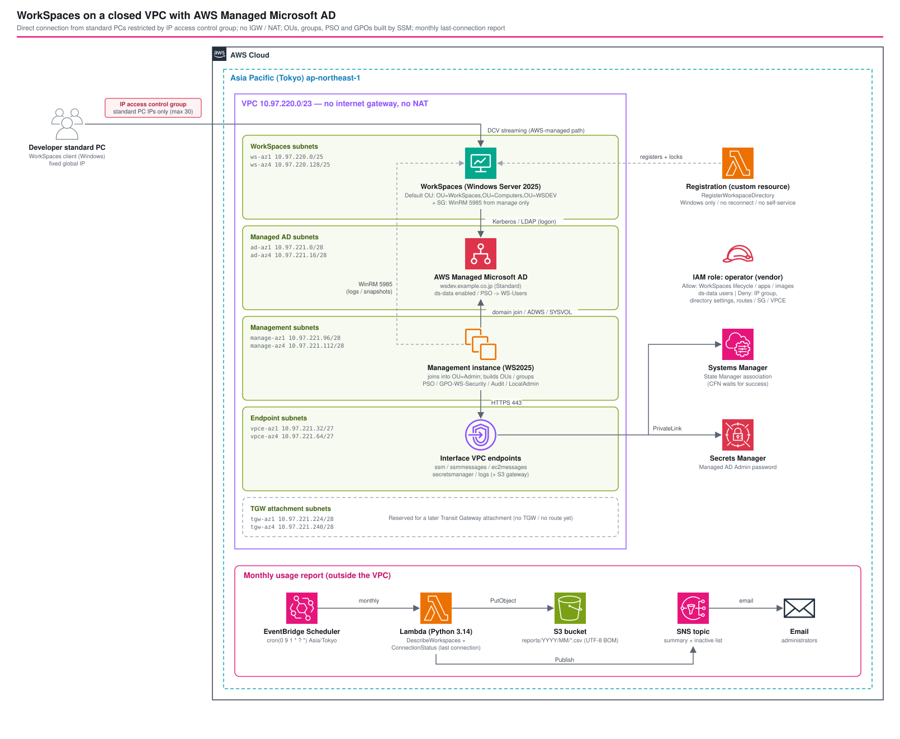

*Read this in other languages:* [](./README.ja.md) [](./README.md)

# インターネットに出ない VPC で動かす WorkSpaces と AWS Managed Microsoft AD - AWS CDK リファレンスアーキテクチャ


開発者に WorkSpaces（Windows Server 2025）を配るための基盤です。次の 3 つを満たすように作っています。

- 標準 PC からだけ接続できる（**IP アクセス制御グループ**で、標準 PC のグローバル IP 以外からのストリーミングを拒否する）
- WorkSpaces を置く VPC に**インターネットゲートウェイも NAT もない**（あとで Transit Gateway をつなぐ前提で、そのためのサブネットだけ用意しておく）
- WorkSpaces の立ち上げをベンダーに任せても、IP 制限やディレクトリの設定、経路は**変えられない IAM ロール**を渡す

AD の OU・グループ・パスワードポリシー（PSO）・GPO は、管理用インスタンスの PowerShell で自動作成します。月に 1 回、WorkSpaces ごとの最終接続日時をまとめた CSV を S3 に保存し、要約を SNS で送ります。

> **状態：コードのみ（未デプロイ）。** ユニットテスト、スナップショットテスト、CDK Nag、`cdk synth` と `cdk validate` は通っていますが、実際の環境へのデプロイ検証はしていません。実際の環境で確認が必要な点は[未検証の点](#️-未検証の点)にまとめています。



## 📑 目次

- [アーキテクチャ概要](#️-アーキテクチャ概要)
- [設計判断とベストプラクティス](#-設計判断とベストプラクティス)
- [未検証の点](#️-未検証の点)
- [Well-Architected との対応](#️-well-architected-との対応)
- [コスト](#-コスト)
- [セキュリティ](#-セキュリティ)
- [前提条件](#-前提条件)
- [デプロイ](#-デプロイ)
- [デプロイ後の作業](#-デプロイ後の作業)
- [テスト戦略](#-テスト戦略)
- [カスタマイズ](#️-カスタマイズ)
- [トラブルシューティング](#-トラブルシューティング)
- [クリーンアップ](#-クリーンアップ)
- [参考資料](#-参考資料)

## 🏗️ アーキテクチャ概要

### 主要コンポーネント

| コンポーネント | 役割 |
| --- | --- |
| VPC `10.97.220.0/23` | IGW・NAT なし。5 種類のサブネット（下表）を `apne1-az1` / `apne1-az4` に置く |
| IP アクセス制御グループ | 標準 PC のグローバル IP（最大 30 ルール）だけにストリーミングを許可する |
| WorkSpaces ディレクトリ登録 | Python のカスタムリソース。登録後に、許可するクライアント（Windows のみ）、既定の OU、再接続の無効化、セルフサービスの無効化、IP アクセス制御グループの関連付けを設定する |
| AWS Managed Microsoft AD（Standard） | `wsdev.example.co.jp`、NetBIOS 名 `WSDEV`。ds-data を有効化する |
| 管理用インスタンス（Windows Server 2025） | SSM の関連付けでドメインに参加し、OU・グループ・PSO・GPO を作る |
| VPC エンドポイント | インターフェース型：`ssm` / `ssmmessages` / `ec2messages` / `secretsmanager` / `logs`。ゲートウェイ型：S3 |
| 運用者ロール | WorkSpaces の作成・再起動・再構築・削除・停止と起動、アプリの追加、イメージとバンドルの作成、ds-data のユーザー管理を許可する。IP 制限・ディレクトリ設定・経路の変更は明示的に拒否する |
| 利用状況レポート | EventBridge Scheduler（毎月 1 日 9:00 JST）→ Lambda（Python）→ S3（CSV）と SNS（要約） |

### サブネット

| 名前 | 用途 | AZ ID | CIDR |
| --- | --- | --- | --- |
| ws-az1 / ws-az4 | WorkSpaces | apne1-az1 / apne1-az4 | 10.97.220.0/25 / 10.97.220.128/25 |
| ad-az1 / ad-az4 | Managed AD | apne1-az1 / apne1-az4 | 10.97.221.0/28 / 10.97.221.16/28 |
| vpce-az1 / vpce-az4 | VPC エンドポイント | apne1-az1 / apne1-az4 | 10.97.221.32/27 / 10.97.221.64/27 |
| manage-az1 / manage-az4 | 管理用インスタンス | apne1-az1 / apne1-az4 | 10.97.221.96/28 / 10.97.221.112/28 |
| （空き） | 予備 | ― | 10.97.221.128/26、10.97.221.192/27 |
| tgw-az1 / tgw-az4 | TGW アタッチメント（作成はしない） | apne1-az1 / apne1-az4 | 10.97.221.224/28 / 10.97.221.240/28 |

### AD の構成（ブートストラップで作るもの）

```text
OU=WSDEV,DC=wsdev,DC=example,DC=co,DC=jp      (Managed AD が作成)
├─ OU=Computers                               (Managed AD が作成)
│  ├─ OU=WorkSpaces   ← WorkSpaces の既定の OU。GPO-WS-Security / Audit / LocalAdmin をリンク
│  ├─ OU=ImageBuild
│  └─ OU=Admin        ← 管理用インスタンスの参加先。GPO-Admin をリンク
├─ OU=Users                                   (Managed AD が作成)
│  ├─ OU=Employees / OU=Vendors / OU=Admins / OU=Disabled
└─ OU=Groups
   └─ WS-Users / WS-LocalAdmins / WS-Admins / Vendor-UserManagers
PSO：CustomerPSO-01 を編集して WS-Users に適用
```

| GPO | リンク先 | 自動で設定する内容 |
| --- | --- | --- |
| GPO-WS-Security | OU=WorkSpaces | Windows の画面ロック（`InactivityTimeoutSecs`）。DCV の項目は ADMX を入れたあとに GPMC で設定する（[デプロイ後の作業](#-デプロイ後の作業)） |
| GPO-WS-Audit | OU=WorkSpaces | プロセス作成の監査（成功）、コマンドラインの記録、PowerShell スクリプトブロックのログ、セキュリティログの最大サイズ、WinRM（IPv4 フィルター＝管理用サブネット、サービスの自動起動、ファイアウォールの 5985 受信許可） |
| GPO-WS-LocalAdmin | OU=WorkSpaces | 組み込みの Administrators を「全員削除」したうえで、`Administrator`、`WSDEV\WS-Admins`、`WSDEV\WS-LocalAdmins` を追加する（グループポリシーの基本設定） |
| GPO-Admin | OU=Admin | 画面ロック |

### スタック構成

| スタック | 内容 | 依存 |
| --- | --- | --- |
| `<project>-<env>-ws-network` | VPC、サブネット、ルートテーブル、フローログ、VPC エンドポイント | ― |
| `<project>-<env>-ws-directory` | Managed AD、管理者パスワード（Secrets Manager）、ds-data の有効化、管理用インスタンス、SSM ドキュメント 2 つと関連付け | network |
| `<project>-<env>-ws-workspaces` | IP アクセス制御グループ、WorkSpaces 用の追加セキュリティグループ、`workspaces_DefaultRole`、ディレクトリ登録、運用者ロール | network、directory |
| `<project>-<env>-ws-usage-report` | S3、SNS、Lambda、EventBridge Scheduler | ― |

## 🎯 設計判断とベストプラクティス

### 1. サブネットは AZ 名ではなく AZ ID で固定する

東京リージョンで WorkSpaces Personal が使えるのは `apne1-az1` と `apne1-az4` だけです。AZ 名（`ap-northeast-1a` など）と物理的な AZ の対応はアカウントごとに違うため、AZ 名で指定すると、別のアカウントでは WorkSpaces が使えない AZ にサブネットができることがあります。CDK の L2 の `Subnet` は AZ 名しか受け取らないので、L1 の `CfnSubnet` に `availabilityZoneId` を渡し、L2 には `Subnet.fromSubnetAttributes` で取り込んでいます（AZ 名はデプロイ時に `Fn::GetAtt` で解決）。

### 2. IGW なしでも WorkSpaces と Managed AD は動く

WorkSpaces のストリーミングは AWS が管理するネットワークインターフェース側を通るので、VPC 側にインターネットへの経路がなくても、IP アクセス制御グループで許可した PC からは接続できます。Managed AD も VPC 内で完結します。エンドポイントが必要なのは、SSM で管理する管理用インスタンス（Run Command、Session Manager、Secrets Manager、ログ）だけです。開発用のエンドポイント（CodeCommit、CodeArtifact、ECR、STS など）は `network.interfaceEndpoints` に追加します。

### 3. IP アクセス制御グループで「標準 PC からだけ」にする

IP アクセス制御グループは、接続元のグローバル IP（IPv4 のみ）で判定します。動的な IP は使えないので、オフィスや VPN の固定の出口 IP が前提です。1 グループあたりのルールは 30 件までです。CDK 側で、IPv4 以外の CIDR、`/0`、31 件以上のルールを synth 時に拒否します。再起動などの API 操作は IP 制限の対象外なので、そちらは運用者ロールで制御します。

### 4. ディレクトリの登録と設定はカスタムリソースで行う

手元の aws-cdk-lib（2.273.0）には `AWS::WorkSpaces::Directory` の L1 がありません。そこで Python のカスタムリソースが `RegisterWorkspaceDirectory` を呼び、`REGISTERED` になるのを `isComplete` で待ってから、運用者ロールで変更を禁じた 4 つの設定と IP アクセス制御グループを適用します。設定に失敗したらスタックの作成も失敗するので、中途半端な状態のディレクトリが残りません。

### 5. ds-data では作れない OU とグループは、管理用インスタンスで作る

ds-data（Directory Service Data）が書き込めるのはユーザー、グループ、グループのメンバーだけで、OU を作る API はありません。`CreateUser` には作成先の OU を指定する項目もなく、ユーザーは `OU=Users,OU=WSDEV` の直下に作られます。そこで管理用インスタンスを置き、SSM の関連付けで次の処理を行います。

1. **1 段目（LocalSystem）**：DNS を DC に向け、RSAT と GPMC を入れ、`OU=Admin` を先に作ってからそこへドメイン参加し、`exit 3010` で再起動する
2. **2 段目（WSDEV\Admin）**：OU、グループ、PSO、GPO を作る

2 段目をドメイン管理者で動かすのは、`GroupPolicy` のコマンドレットに `-Credential` がなく、LocalSystem（コンピューターアカウント）には GPO を編集する権限がないためです。使い捨てのスケジュールタスクを `WSDEV\Admin` で登録し、終わったら消します。処理はすべて冪等に書いてあり、パラメーターを変えれば関連付けが再実行されます。

### 6. CloudFormation に、OU ができるまで待たせる

WorkSpaces の既定の OU（`OU=WorkSpaces`）は、ブートストラップが作ります。`AWS::SSM::Association` の `WaitForSuccessTimeoutSeconds` を使って、関連付けが成功するまで directory スタックを完了させず、workspaces スタックはそのあとに作ります。

### 7. 運用者ロールは Deny を明示する

許可する操作は Allow、変えられては困る操作（IP アクセス制御グループ、ディレクトリの登録と解除、`ModifyWorkspaceAccessProperties` / `CreationProperties` / `ClientProperties` / `SelfservicePermissions`、ルートテーブル・NACL・セキュリティグループ・VPC エンドポイント・ピアリング、`ds` の設定系の操作）は明示的な Deny で書いています。あとから別のポリシーで Allow を足されても、Deny が勝ちます。`ds:ResetUserPassword` は、どの Deny のパターンにも一致しないようにしています。信頼ポリシーでは MFA を必須にしています。

### 8. 利用状況レポートは VPC の外の Lambda で作る

最終接続日時は `DescribeWorkspacesConnectionStatus` の `LastKnownUserConnectionTimestamp` から取ります（1 回で 25 件まで）。Lambda は WorkSpaces、S3、SNS の API を呼ぶだけなので、VPC に入れるとエンドポイントが増えるだけです。CSV は Excel で文字化けしないよう BOM 付きの UTF-8 にし、一度も接続していないもの、しきい値（既定 30 日）以上使っていないもの、使っているもの、の順に並べます。

## ⚠️ 未検証の点

実際の環境にデプロイするときに確認が必要な点です。

| # | 内容 | 確認方法・代替案 |
| --- | --- | --- |
| 1 | ブートストラップ（ドメイン参加、`exit 3010` での再起動と再実行、スケジュールタスク、`audit.csv` と `Groups.xml` の書き込み） | 関連付けの実行履歴と `C:\ProgramData\WorkSpacesAdBootstrap\build-ad-objects.log` |
| 2 | `RegisterWorkspaceDirectory` の呼び出し元に必要な権限（ds / ec2 の操作を列挙済み） | 足りなければ CloudTrail の `AccessDenied` から追加する |
| 3 | GPO-WS-LocalAdmin が Administrators を作り直すため、`userEnabledAsLocalAdministrator: true`（PoC）で WorkSpaces が利用者に付けたローカル管理者も外れる | 設計どおり、まず 1 台で確認する。PoC 中はリンクを無効にしておく手もある |
| 4 | CloudFormation の `WorkspaceProperties` には接続方式の項目がない | ベンダーは API またはコンソールで、`Protocols: ["WSP"]`（DCV）を指定して作る |
| 5 | IGW のない VPC での Windows Update や、Microsoft 365 のライセンス認証などの外向きの通信 | 経路は TGW 経由の共通出口で用意する（このスタックでは作らない） |
| 6 | Managed AD の PSO 名（`CustomerPSO-01`） | `Get-ADFineGrainedPasswordPolicy -Filter *` で名前を確認する |

## 🏛️ Well-Architected との対応

| 柱 | このアーキテクチャでの対応 |
| --- | --- |
| 運用上の優秀性 | OU、グループ、PSO、GPO をコードで作る（冪等、パラメーターを変えれば再適用）。月次の利用状況レポート。DCV の ADMX を入れる手順も SSM ドキュメントにしている |
| セキュリティ | IP アクセス制御グループ、Windows クライアントのみ、再接続の無効化、IGW・NAT なし、運用者ロールの明示的な Deny、MFA 必須、管理者パスワードは Secrets Manager、IMDSv2、EBS の暗号化、フローログ、監査用の GPO |
| 信頼性 | AD と WorkSpaces は 2 AZ。ブートストラップの成功を CloudFormation が待つので、中途半端な状態でデプロイが終わらない |
| パフォーマンス効率 | バンドルは用途で選ぶ（WSL2 や Docker を使うなら、入れ子の仮想化のため Power 以上） |
| コスト最適化 | 下の試算を参照。使う時間が月約 82 時間を超えるなら AlwaysOn のほうが安い。管理用インスタンスは使わないときは止められる |
| 持続可能性 | 使っていない WorkSpaces を月次レポートで見つけて止める・消す |

## 💰 コスト

ap-northeast-1、月 730 時間、2026-11 時点の AWS の価格表。

| 項目 | 単価 | 月額 |
| --- | --- | --- |
| Managed AD Standard（DC 2 台） | $0.073 × 2 / 時間 | **$106.6** |
| 管理用インスタンス t3.medium（Windows） | $0.0728 / 時間 | $53.1（止めればその分減る） |
| EBS gp3 50 GB | $0.096 / GB 月 | $4.8 |
| インターフェースエンドポイント 5 種 × 2 AZ | $0.014 / 時間 | **$102.2** |
| S3 ゲートウェイエンドポイント | 無料 | $0 |
| フローログ、CloudWatch Logs、Lambda、S3、SNS | 従量 | 数ドル |
| **基盤の合計（WorkSpaces を除く）** | | **約 $270** |

WorkSpaces（Windows Server 2025、ライセンス込み）は 1 台ごとに次のとおりです。

| バンドル | AlwaysOn（月額） | AutoStop（月額＋時間） | AutoStop が安い時間の上限 |
| --- | --- | --- | --- |
| Standard 2 vCPU / 4 GB（80 + 50 GB） | $47 | $14 + $0.40/時間 | 約 82 時間 |
| Performance 2 vCPU / 8 GB（80 + 100 GB） | $65 | $19 + $0.61/時間 | 約 75 時間 |
| Power 4 vCPU / 16 GB（175 + 100 GB） | $118 | $26 + $0.89/時間 | 約 103 時間 |

- 例：開発者 10 人が毎日 8 時間 × 21 日使う（168 時間）なら AlwaysOn のほうが安く、Standard で 10 × $47 = $470。基盤と合わせて月約 $740 です。
- 月額料金は初月だけ日割りになり、そのあと削除しても減りません。
- Visual Studio 2022 や Office LTSC 2024 などのライセンス込みアプリは、別に料金がかかります。
- 検証で 8 時間だけ動かした場合：AD $1.2 ＋ 管理用インスタンス $0.6 ＋ エンドポイント $1.1 ＋ Standard 1 台 $3.2 ＋ 月額の日割り（月の半ばなら約 $7）＝ 約 $13。

## 🔒 セキュリティ

- **接続元**：IP アクセス制御グループ（標準 PC の固定 IP のみ）、Windows クライアントのみ（Web アクセスを含め、それ以外はすべて DENY）、再接続（ログイン情報の保存）を無効化。
- **ネットワーク**：IGW・NAT なし。エンドポイントのセキュリティグループは、VPC の CIDR からの 443 のみ受け付ける。管理用インスタンスへのインバウンドはなく、WorkSpaces へは管理用サブネットからの WinRM 5985 のみ（追加のセキュリティグループと GPO のファイアウォール規則の両方で制限）。
- **権限**：運用者ロールは MFA 必須で、セッションは最大 1 時間。明示的な Deny で R1（IP 制限）と R2（経路）を守る。ds-data の操作はこのディレクトリに限定。
- **秘密情報**：Managed AD の管理者パスワードは Secrets Manager で生成し、CloudFormation へは動的参照で渡すので、テンプレートには平文で出ない。読めるのは管理用インスタンスのロールだけ。
- **監査**：プロセス作成（4688、コマンドライン付き）と PowerShell（4104）を記録する。VPC のフローログはすべてのトラフィックを対象にする。

CDK Nag の抑制（すべて `test/compliance/cdk-nag.test.ts`）：EC28/EC29（管理用インスタンス）、IAM4（`AmazonSSMManagedInstanceCore`、WorkSpaces の既定ロールのマネージドポリシー、`AWSLambdaBasicExecutionRole`）、IAM5（リソースレベルの権限に対応していない WorkSpaces / DS / EC2 の API、Provider フレームワーク、`reports/*` への Put、`alias/aws/sns` の KMS）、L1・SF1・SF2（CDK の Provider フレームワーク）、SMG4（Managed AD の Admin はローテーションに `ResetUserPassword` を呼ぶ独自の処理が必要）。`cdk validate` の F3006（`AWS::WorkSpaces::WorkspaceIpGroup`）は、同梱の cfn-lint の情報が古いことによる誤検知です。ap-northeast-1 の CloudFormation レジストリには `LIVE` で登録されています。

## 📋 前提条件

- Node.js 24、AWS CDK CLI、ブートストラップ済みのアカウント
- 標準 PC の出口の固定グローバル IP
- アカウントに `workspaces_DefaultRole` がすでにある場合は `workspaces.createDefaultRole: false`
- Python 3（Lambda のユニットテストを手元で動かす場合）

## 🚀 デプロイ

```bash
cd infrastructure/workspaces/workspaces-managed-ad-closed-vpc

# 1. parameters/dev-params.ts を編集する
#    workspaces.allowedSources ← 標準 PC の出口 IP
#    usageReport.notificationEmails ← 通知先
#    （1 回だけ IP を差し替えるなら ALLOWED_IPS=203.0.113.10/32,198.51.100.0/28 でもよい）

# 2. デプロイ（Managed AD 約 30〜45 分 + ブートストラップ 10〜20 分）
PROJECT=myproject ENV=dev npm run stage:deploy:all
```

出力：`RegistrationCode`（WorkSpaces クライアントに入力するコード）、`OperatorRoleArn`、`InstallDcvAdmxDocumentName`、`ManagementInstanceId`。

## 🧭 デプロイ後の作業

1. **SNS の購読を確認する**：届いたメールのリンクを開く。
2. **ユーザーを作る**（ds-data）：

   ```bash
   aws ds-data create-user --directory-id d-xxxxxxxxxx --sam-account-name taro.yamada \
     --given-name Taro --surname Yamada
   aws ds reset-user-password --directory-id d-xxxxxxxxxx --user-name taro.yamada --new-password '...'
   aws ds-data add-group-member --directory-id d-xxxxxxxxxx --group-name WS-Users --member-name taro.yamada
   ```

   ユーザーは `OU=Users,OU=WSDEV` の直下に作られます。`Employees` / `Vendors` に移すのは、管理用インスタンスの `Move-ADObject` で行います。
3. **WorkSpaces を作る**（運用者ロール）：Windows Server 2025 のバンドル（例：東京の日本語版 Standard は `wsb-jg3rsnz01`）で、`Protocols` に `WSP` を指定します。
4. **DCV の ADMX を入れる**：最初の WorkSpace が `AVAILABLE` になり、GPO-WS-Audit が効いて WinRM が開いたら実行します。

   ```bash
   aws ssm send-command --document-name <InstallDcvAdmxDocumentName> \
     --instance-ids <ManagementInstanceId> --parameters WorkSpaceComputerName=WSAMZN-XXXXXXXX
   ```

5. **DCV の項目を GPMC で設定する**（GPO-WS-Security）：クリップボードのリダイレクト（標準 PC から WorkSpaces への貼り付けのみ）、画面キャプチャの防止、ファイル転送、プリンター、USB のリダイレクト、アイドル時の切断。正確な項目名は ADMX で確認します。

## 🧪 テスト戦略

| 種類 | ファイル | 内容 |
| --- | --- | --- |
| ユニット | `test/unit/stage.test.ts` | IGW・NAT がないこと、10 個のサブネットの AZ ID と CIDR、予備の CIDR を使っていないこと、TGW を作っていないこと、エンドポイント、ブートストラップの設定（OU、グループ、PSO、WinRM フィルター、4 つの GPO）、ディレクトリの設定、運用者ロールの Allow / Deny（Deny のパターンが Allow を潰していないことも確認）、レポート、パラメーターの検証 |
| スナップショット | `test/snapshot/snapshot.test.ts` | 4 スタックのテンプレートとリソース数 |
| コンプライアンス | `test/compliance/cdk-nag.test.ts` | AwsSolutions。抑制はすべて理由付き |
| Python | `src/lambda/*/test_*.py` | CSV（BOM、JST）、並び順、メールの本文と件名の長さ、デバイスの許可と拒否、IP グループの差分 |

```bash
npm test -w workspaces/workspaces-managed-ad-closed-vpc
npm run test:python -w workspaces/workspaces-managed-ad-closed-vpc
PROJECT=myproject ENV=dev npm run validate -w workspaces/workspaces-managed-ad-closed-vpc
```

## ⚙️ カスタマイズ

| パラメーター | 既定値 | 内容 |
| --- | --- | --- |
| `network.interfaceEndpoints` | ssm 系 + secretsmanager + logs | 開発で使うエンドポイントを追加する |
| `directory.organizationalUnits` / `groups` | 上記の設計 | 追加すれば、次の関連付けの実行で作られる |
| `directory.passwordPolicy` | 14 文字、90 日、5 回で 30 分ロック | セキュリティ部署の規定に合わせる |
| `directory.groupPolicy.securityLogMaxSizeKb` | 1048576（1 GB） | 4688 の量を見て調整する |
| `workspaces.userEnabledAsLocalAdministrator` | `true`（PoC） | 本番は `false` |
| `usageReport.inactiveThresholdDays` | 30 | 「使っていない」とみなす日数 |
| `operatorRole.trustedPrincipalArns` | `[]`（このアカウント） | ベンダーの IAM ユーザーやロールに絞る |

## 🔧 トラブルシューティング

| 症状 | 確認すること |
| --- | --- |
| directory スタックが関連付けの待機で失敗する | SSM の関連付けの実行履歴、インスタンスが SSM に登録されているか（エンドポイントの DNS、セキュリティグループ）、`C:\ProgramData\WorkSpacesAdBootstrap\build-ad-objects.log` |
| ディレクトリの登録が `ERROR` になる | サブネットの AZ ID が `apne1-az1` / `apne1-az4` か、`workspaces_DefaultRole` があるか、Lambda のログ |
| クライアントで「このデバイスにはアクセスが許可されていません」と出る | 接続元のグローバル IP が IP アクセス制御グループにあるか、Windows クライアントを使っているか |
| ds-data が `AccessDeniedException` を返す | 操作対象が委任された OU の外にないか、`ds:AccessDSData` を許可しているか |
| レポートが届かない | SNS の購読が確認済みか、Lambda のログ |

## 🧹 クリーンアップ

WorkSpaces が残っているとディレクトリの登録解除が失敗するので、先にすべて削除します。

```bash
PROJECT=myproject ENV=dev npm run stage:destroy:all
```

## 📚 参考資料

- [WorkSpaces Personal の IP アクセス制御グループ](https://docs.aws.amazon.com/workspaces/latest/adminguide/amazon-workspaces-ip-access-control-groups.html)
- [WorkSpaces Personal の AZ](https://docs.aws.amazon.com/workspaces/latest/adminguide/azs-workspaces.html)
- [DCV の GPO 管理用テンプレートのインストール](https://docs.aws.amazon.com/workspaces/latest/adminguide/group_policy.html)
- [アプリケーションの管理（ライセンス込みアプリ）](https://docs.aws.amazon.com/workspaces/latest/adminguide/manage-applications.html)
- [AWS Directory Service Data API リファレンス](https://docs.aws.amazon.com/directoryservicedata/latest/DirectoryServiceDataAPIReference/Welcome.html)
- [Amazon WorkSpaces の料金](https://aws.amazon.com/workspaces-family/workspaces/pricing/)
- ナレッジベース：[docs/knowledge/workspaces-managed-ad.md](../../../docs/knowledge/workspaces-managed-ad.md)

---

**Level 300** · [AWS CDK Reference Architectures](../../../README.ja.md) の一部
