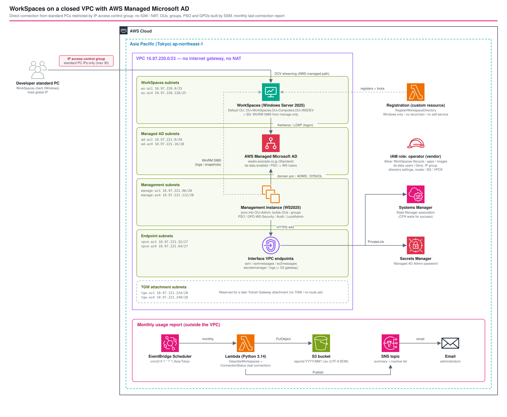

*Read this in other languages:* [](./README.ja.md) [](./README.md)

# WorkSpaces and AWS Managed Microsoft AD on a VPC with no internet path - AWS CDK Reference Architecture


A foundation for handing out WorkSpaces (Windows Server 2025) to developers, built around three constraints:

- Only the company's standard PCs can connect: an **IP access control group** rejects streaming from anything but their global IPs.
- The WorkSpaces VPC has **no internet gateway and no NAT**. Subnets for a later Transit Gateway attachment are reserved.
- The vendor who launches WorkSpaces gets an **IAM role that cannot change** the IP restriction, the directory settings or the network path.

The AD OU tree, security groups, fine-grained password policy (PSO) and GPOs are created by PowerShell on a management instance. Once a month, a CSV with each WorkSpace's last connection time is stored in S3 and a summary is sent through SNS.

> **Status: code only (not deployed).** Unit, snapshot and CDK Nag tests, `cdk synth` and `cdk validate` pass, but the stacks have not been deployed to a real environment. What still needs checking there is listed under [Not yet verified](#️-not-yet-verified).



## 📑 Table of Contents

- [Architecture Overview](#️-architecture-overview)
- [Design Decisions & Best Practices](#-design-decisions--best-practices)
- [Not yet verified](#️-not-yet-verified)
- [Well-Architected Alignment](#️-well-architected-alignment)
- [Cost](#-cost)
- [Security](#-security)
- [Prerequisites](#-prerequisites)
- [Deployment](#-deployment)
- [After Deployment](#-after-deployment)
- [Testing Strategy](#-testing-strategy)
- [Customization](#️-customization)
- [Troubleshooting](#-troubleshooting)
- [Cleanup](#-cleanup)
- [References](#-references)

## 🏗️ Architecture Overview

### Key Components

| Component | Role |
| --- | --- |
| VPC `10.97.220.0/23` | No IGW, no NAT. Five subnet tiers (below) in `apne1-az1` / `apne1-az4` |
| IP access control group | Allows streaming only from the standard PCs' global IPs (max 30 rules) |
| WorkSpaces directory registration | Python custom resource. After registration it sets the allowed clients (Windows only), default OU, reconnect off, self-service off and the IP group association |
| AWS Managed Microsoft AD (Standard) | `wsdev.example.co.jp`, NetBIOS `WSDEV`, ds-data enabled |
| Management instance (Windows Server 2025) | Joins the domain through an SSM association and builds OUs, groups, PSO and GPOs |
| VPC endpoints | Interface: `ssm` / `ssmmessages` / `ec2messages` / `secretsmanager` / `logs`. Gateway: S3 |
| Operator role | Allows WorkSpaces create / reboot / rebuild / terminate / stop / start, license-included apps, images and bundles, ds-data user management. Explicitly denies IP restriction, directory settings and network changes |
| Usage report | EventBridge Scheduler (1st of each month, 09:00 JST) → Lambda (Python) → S3 (CSV) and SNS (summary) |

### Subnets

| Name | Purpose | AZ ID | CIDR |
| --- | --- | --- | --- |
| ws-az1 / ws-az4 | WorkSpaces | apne1-az1 / apne1-az4 | 10.97.220.0/25 / 10.97.220.128/25 |
| ad-az1 / ad-az4 | Managed AD | apne1-az1 / apne1-az4 | 10.97.221.0/28 / 10.97.221.16/28 |
| vpce-az1 / vpce-az4 | VPC endpoints | apne1-az1 / apne1-az4 | 10.97.221.32/27 / 10.97.221.64/27 |
| manage-az1 / manage-az4 | Management instances | apne1-az1 / apne1-az4 | 10.97.221.96/28 / 10.97.221.112/28 |
| (free) | Spare | ― | 10.97.221.128/26, 10.97.221.192/27 |
| tgw-az1 / tgw-az4 | TGW attachment (not created) | apne1-az1 / apne1-az4 | 10.97.221.224/28 / 10.97.221.240/28 |

### AD design (created by the bootstrap)

```text
OU=WSDEV,DC=wsdev,DC=example,DC=co,DC=jp      (created by Managed AD)
├─ OU=Computers                               (created by Managed AD)
│  ├─ OU=WorkSpaces   ← default OU for WorkSpaces; GPO-WS-Security / Audit / LocalAdmin linked
│  ├─ OU=ImageBuild
│  └─ OU=Admin        ← the management instance joins here; GPO-Admin linked
├─ OU=Users                                   (created by Managed AD)
│  ├─ OU=Employees / OU=Vendors / OU=Admins / OU=Disabled
└─ OU=Groups
   └─ WS-Users / WS-LocalAdmins / WS-Admins / Vendor-UserManagers
PSO: CustomerPSO-01 edited and applied to WS-Users
```

| GPO | Linked to | Set automatically |
| --- | --- | --- |
| GPO-WS-Security | OU=WorkSpaces | Windows idle lock (`InactivityTimeoutSecs`). DCV settings are set in GPMC after the ADMX is installed ([After Deployment](#-after-deployment)) |
| GPO-WS-Audit | OU=WorkSpaces | Process creation audit (success), command line in 4688, PowerShell script block logging, Security log size, WinRM (IPv4 filter = management subnets, service auto start, firewall rule for 5985) |
| GPO-WS-LocalAdmin | OU=WorkSpaces | Group Policy Preferences: rebuild the built-in Administrators group with `Administrator`, `WSDEV\WS-Admins`, `WSDEV\WS-LocalAdmins` (delete all other members) |
| GPO-Admin | OU=Admin | Idle lock |

### Stacks

| Stack | Contents | Depends on |
| --- | --- | --- |
| `<project>-<env>-ws-network` | VPC, subnets, route tables, flow logs, VPC endpoints | ― |
| `<project>-<env>-ws-directory` | Managed AD, admin password (Secrets Manager), ds-data enablement, management instance, two SSM documents and the association | network |
| `<project>-<env>-ws-workspaces` | IP access control group, extra WorkSpaces security group, `workspaces_DefaultRole`, directory registration, operator role | network, directory |
| `<project>-<env>-ws-usage-report` | S3, SNS, Lambda, EventBridge Scheduler | ― |

## 🎯 Design Decisions & Best Practices

### 1. Pin subnets by AZ ID, not AZ name

In Tokyo, WorkSpaces Personal is only available in `apne1-az1` and `apne1-az4`. AZ names (`ap-northeast-1a`, ...) map to different physical zones in each account, so pinning by name can put a subnet in an unsupported zone in another account. The L2 `Subnet` only accepts AZ names, so subnets are L1 `CfnSubnet`s with `availabilityZoneId`, imported back with `Subnet.fromSubnetAttributes` (the AZ name is resolved at deploy time with `Fn::GetAtt`).

### 2. WorkSpaces and Managed AD work without an IGW

WorkSpaces streaming uses the AWS-managed network interface, so allowed PCs can connect even though the VPC has no route to the internet. Managed AD lives entirely in the VPC. Endpoints are only needed for the SSM-managed management instance (Run Command, Session Manager, Secrets Manager, logs). Add development endpoints (CodeCommit, CodeArtifact, ECR, STS, ...) to `network.interfaceEndpoints`.

### 3. "Standard PCs only" with an IP access control group

The group matches the client's global IPv4 address. Dynamic IPs do not work, so a fixed office or VPN egress IP is required. A group holds at most 30 rules. The CDK code rejects non-IPv4 CIDRs, `/0` and more than 30 rules at synth time. API actions such as reboot are not covered by the IP restriction; the operator role controls those.

### 4. Register and lock the directory with a custom resource

aws-cdk-lib 2.273.0 has no L1 for `AWS::WorkSpaces::Directory`. A Python custom resource calls `RegisterWorkspaceDirectory`, waits for `REGISTERED` in `isComplete`, then applies the four settings the operator role must not change and the IP group. If a setting fails, the stack fails instead of leaving a half-configured directory.

### 5. OUs and groups come from a management instance, not ds-data

ds-data (Directory Service Data) writes users, groups and memberships only; it has no API for OUs, and `CreateUser` has no target OU (users land directly in `OU=Users,OU=WSDEV`). The management instance runs an SSM association in two phases:

1. **Phase 1 (LocalSystem)**: point DNS at the DCs, install RSAT and GPMC, create `OU=Admin` first, join the domain into it and `exit 3010` to reboot.
2. **Phase 2 (WSDEV\Admin)**: create OUs, groups, PSO and GPOs.

Phase 2 runs as the domain admin because the `GroupPolicy` cmdlets have no `-Credential` parameter and LocalSystem (the computer account) has no rights on GPOs. A one-shot scheduled task is registered as `WSDEV\Admin` and removed afterwards. Every step is idempotent, and a parameter change re-runs the association.

### 6. Make CloudFormation wait for the OU tree

The default OU (`OU=WorkSpaces`) is created by the bootstrap. `WaitForSuccessTimeoutSeconds` on `AWS::SSM::Association` keeps the directory stack from completing until the association succeeds, and the workspaces stack is created after it.

### 7. Explicit Deny in the operator role

Allowed actions are Allow statements. Actions that must never happen are explicit Deny statements: IP access control groups, directory (de)registration, `ModifyWorkspaceAccessProperties` / `CreationProperties` / `ClientProperties` / `SelfservicePermissions`, route tables / NACLs / security groups / VPC endpoints / peering, and `ds` configuration actions. A Deny wins even if another policy adds an Allow later. No Deny pattern matches `ds:ResetUserPassword`. The trust policy requires MFA.

### 8. The usage report runs outside the VPC

The last connection time comes from `LastKnownUserConnectionTimestamp` of `DescribeWorkspacesConnectionStatus` (25 IDs per call). The function only calls the WorkSpaces, S3 and SNS APIs, so putting it in the VPC would only add endpoints. The CSV is UTF-8 with a BOM so Excel shows Japanese names correctly, and rows are ordered never connected → unused for the threshold (30 days by default) or longer → active.

## ⚠️ Not yet verified

Points to check when deploying to a real environment.

| # | Item | How to check / alternative |
| --- | --- | --- |
| 1 | Bootstrap (domain join, reboot and re-run with `exit 3010`, scheduled task, writing `audit.csv` and `Groups.xml`) | Association execution history and `C:\ProgramData\WorkSpacesAdBootstrap\build-ad-objects.log` |
| 2 | Caller permissions `RegisterWorkspaceDirectory` needs (ds / ec2 actions listed) | Add missing ones from CloudTrail `AccessDenied` events |
| 3 | GPO-WS-LocalAdmin rebuilds Administrators, so with `userEnabledAsLocalAdministrator: true` (PoC) it also removes the local admin WorkSpaces grants the user | As planned, check on one WorkSpace first; the link can stay disabled during the PoC |
| 4 | CloudFormation `WorkspaceProperties` has no protocol property | The vendor creates WorkSpaces through the API or console with `Protocols: ["WSP"]` (DCV) |
| 5 | Outbound traffic from a VPC without an IGW (Windows Update, Microsoft 365 activation, ...) | Provide the path through the shared egress over TGW (not created by these stacks) |
| 6 | Name of the Managed AD PSO (`CustomerPSO-01`) | `Get-ADFineGrainedPasswordPolicy -Filter *` |

## 🏛️ Well-Architected Alignment

| Pillar | How this architecture addresses it |
| --- | --- |
| Operational Excellence | OUs, groups, PSO and GPOs as code (idempotent, re-applied on parameter change), monthly usage report, ADMX installation as an SSM document |
| Security | IP access control group, Windows client only, reconnect disabled, no IGW / NAT, explicit Deny in the operator role, MFA, admin password in Secrets Manager, IMDSv2, encrypted EBS, flow logs, audit GPO |
| Reliability | AD and WorkSpaces in two AZs. CloudFormation waits for the bootstrap, so a deployment never ends half-configured |
| Performance Efficiency | Choose the bundle per workload (Power or larger for WSL2 / Docker, which need nested virtualization) |
| Cost Optimization | See the estimate below. Above ~82 hours a month AlwaysOn is cheaper. The management instance can be stopped when idle |
| Sustainability | Find idle WorkSpaces in the monthly report and stop or remove them |

## 💰 Cost

ap-northeast-1, 730 hours per month, AWS price list as of 2026-11.

| Item | Unit price | Monthly |
| --- | --- | --- |
| Managed AD Standard (2 DCs) | $0.073 × 2 / hour | **$106.6** |
| Management instance t3.medium (Windows) | $0.0728 / hour | $53.1 (less if stopped) |
| EBS gp3 50 GB | $0.096 / GB-month | $4.8 |
| Interface endpoints, 5 services × 2 AZs | $0.014 / hour | **$102.2** |
| S3 gateway endpoint | free | $0 |
| Flow logs, CloudWatch Logs, Lambda, S3, SNS | usage | a few dollars |
| **Foundation total (without WorkSpaces)** | | **~$270** |

WorkSpaces (Windows Server 2025, license included), per WorkSpace:

| Bundle | AlwaysOn (monthly) | AutoStop (monthly + hourly) | AutoStop is cheaper below |
| --- | --- | --- | --- |
| Standard 2 vCPU / 4 GB (80 + 50 GB) | $47 | $14 + $0.40/hour | ~82 hours |
| Performance 2 vCPU / 8 GB (80 + 100 GB) | $65 | $19 + $0.61/hour | ~75 hours |
| Power 4 vCPU / 16 GB (175 + 100 GB) | $118 | $26 + $0.89/hour | ~103 hours |

- Example: 10 developers, 8 hours × 21 days (168 hours) → AlwaysOn is cheaper; Standard is 10 × $47 = $470, about $740 a month with the foundation.
- The monthly fee is prorated in the first month only and is not reduced if you delete the WorkSpace later.
- License-included apps such as Visual Studio 2022 or Office LTSC 2024 are billed separately.
- An 8-hour verification: AD $1.2 + management instance $0.6 + endpoints $1.1 + one Standard WorkSpace $3.2 + prorated monthly fee (~$7 mid-month) = about $13.

## 🔒 Security

- **Clients**: IP access control group (standard PCs' fixed IPs only), Windows client only (everything else, including Web Access, is DENY), reconnect (saved credentials) disabled.
- **Network**: no IGW / NAT. The endpoint security group accepts 443 from the VPC CIDR only. The management instance has no inbound rules; WorkSpaces accept only WinRM 5985 from the management subnets (enforced by both the extra security group and the GPO firewall rule).
- **Permissions**: the operator role requires MFA, sessions last at most 1 hour, explicit Deny protects R1 (IP restriction) and R2 (network path), ds-data actions are scoped to this directory.
- **Secrets**: the Managed AD admin password is generated in Secrets Manager and passed to CloudFormation as a dynamic reference, so it never appears in a template. Only the management instance role can read it.
- **Audit**: process creation (4688 with command line) and PowerShell (4104). VPC flow logs capture all traffic.

CDK Nag suppressions (all in `test/compliance/cdk-nag.test.ts`): EC28/EC29 (management instance), IAM4 (`AmazonSSMManagedInstanceCore`, the WorkSpaces default role's managed policies, `AWSLambdaBasicExecutionRole`), IAM5 (WorkSpaces / DS / EC2 APIs without resource-level permissions, the Provider framework, Put under `reports/*`, KMS for `alias/aws/sns`), L1 / SF1 / SF2 (CDK Provider framework), SMG4 (rotating the Managed AD Admin needs a custom rotation calling `ResetUserPassword`). The `cdk validate` finding F3006 (`AWS::WorkSpaces::WorkspaceIpGroup`) is a false positive from the bundled cfn-lint data; the CloudFormation registry in ap-northeast-1 lists the type as `LIVE`.

## 📋 Prerequisites

- Node.js 24, AWS CDK CLI, a bootstrapped account
- Fixed global egress IPs of the standard PCs
- `workspaces.createDefaultRole: false` if the account already has `workspaces_DefaultRole`
- Python 3 (to run the Lambda unit tests locally)

## 🚀 Deployment

```bash
cd infrastructure/workspaces/workspaces-managed-ad-closed-vpc

# 1. Edit parameters/dev-params.ts
#    workspaces.allowedSources ← egress IPs of the standard PCs
#    usageReport.notificationEmails ← recipients
#    (or override once with ALLOWED_IPS=203.0.113.10/32,198.51.100.0/28)

# 2. Deploy (Managed AD ~30-45 min + bootstrap 10-20 min)
PROJECT=myproject ENV=dev npm run stage:deploy:all
```

Outputs: `RegistrationCode` (entered in the WorkSpaces client), `OperatorRoleArn`, `InstallDcvAdmxDocumentName`, `ManagementInstanceId`.

## 🧭 After Deployment

1. **Confirm the SNS subscription** from the email.
2. **Create users** (ds-data):

   ```bash
   aws ds-data create-user --directory-id d-xxxxxxxxxx --sam-account-name taro.yamada \
     --given-name Taro --surname Yamada
   aws ds reset-user-password --directory-id d-xxxxxxxxxx --user-name taro.yamada --new-password '...'
   aws ds-data add-group-member --directory-id d-xxxxxxxxxx --group-name WS-Users --member-name taro.yamada
   ```

   Users are created directly in `OU=Users,OU=WSDEV`; move them to `Employees` / `Vendors` with `Move-ADObject` on the management instance.
3. **Create WorkSpaces** (operator role) from a Windows Server 2025 bundle (e.g. Standard, Japanese, Tokyo: `wsb-jg3rsnz01`) with `Protocols: ["WSP"]`.
4. **Install the DCV ADMX** once the first WorkSpace is `AVAILABLE` and GPO-WS-Audit has opened WinRM:

   ```bash
   aws ssm send-command --document-name <InstallDcvAdmxDocumentName> \
     --instance-ids <ManagementInstanceId> --parameters WorkSpaceComputerName=WSAMZN-XXXXXXXX
   ```

5. **Set the DCV settings in GPMC** (GPO-WS-Security): clipboard redirection (standard PC → WorkSpaces only), screen capture protection, file transfer, printer and USB redirection, idle disconnect. Check the exact setting names in the ADMX.

## 🧪 Testing Strategy

| Type | File | Covers |
| --- | --- | --- |
| Unit | `test/unit/stage.test.ts` | No IGW / NAT, AZ ID and CIDR of all 10 subnets, spare CIDRs unused, no TGW, endpoints, bootstrap config (OUs, groups, PSO, WinRM filter, the four GPOs), directory settings, operator role Allow / Deny (including "no Deny pattern blocks an Allow"), report, parameter validation |
| Snapshot | `test/snapshot/snapshot.test.ts` | Templates and resource counts of the four stacks |
| Compliance | `test/compliance/cdk-nag.test.ts` | AwsSolutions, every suppression with a reason |
| Python | `src/lambda/*/test_*.py` | CSV (BOM, JST), ordering, mail body and subject length, device allow / deny, IP group diff |

```bash
npm test -w workspaces/workspaces-managed-ad-closed-vpc
npm run test:python -w workspaces/workspaces-managed-ad-closed-vpc
PROJECT=myproject ENV=dev npm run validate -w workspaces/workspaces-managed-ad-closed-vpc
```

## ⚙️ Customization

| Parameter | Default | Purpose |
| --- | --- | --- |
| `network.interfaceEndpoints` | ssm family + secretsmanager + logs | Add development endpoints |
| `directory.organizationalUnits` / `groups` | The design above | New entries are created on the next association run |
| `directory.passwordPolicy` | 14 chars, 90 days, lock 30 min after 5 failures | Align with the security department's standard |
| `directory.groupPolicy.securityLogMaxSizeKb` | 1048576 (1 GB) | Tune after observing the 4688 volume |
| `workspaces.userEnabledAsLocalAdministrator` | `true` (PoC) | `false` in production |
| `usageReport.inactiveThresholdDays` | 30 | Days without connection that count as unused |
| `operatorRole.trustedPrincipalArns` | `[]` (this account) | Restrict to the vendor's IAM users or roles |

## 🔧 Troubleshooting

| Symptom | What to check |
| --- | --- |
| The directory stack fails waiting for the association | Association execution history, whether the instance is registered in SSM (endpoint DNS, security groups), `C:\ProgramData\WorkSpacesAdBootstrap\build-ad-objects.log` |
| Directory registration goes to `ERROR` | Subnet AZ IDs are `apne1-az1` / `apne1-az4`, `workspaces_DefaultRole` exists, Lambda logs |
| The client says "This device is not authorized" | The client's global IP is in the IP access control group, the Windows client is used |
| ds-data returns `AccessDeniedException` | The object is inside the delegated OU, `ds:AccessDSData` is allowed |
| No report arrives | The SNS subscription is confirmed, Lambda logs |

## 🧹 Cleanup

Deregistering the directory fails while WorkSpaces exist, so terminate them first.

```bash
PROJECT=myproject ENV=dev npm run stage:destroy:all
```

## 📚 References

- [IP access control groups for WorkSpaces Personal](https://docs.aws.amazon.com/workspaces/latest/adminguide/amazon-workspaces-ip-access-control-groups.html)
- [Availability Zones for WorkSpaces Personal](https://docs.aws.amazon.com/workspaces/latest/adminguide/azs-workspaces.html)
- [Install the Group Policy administrative template files for DCV](https://docs.aws.amazon.com/workspaces/latest/adminguide/group_policy.html)
- [Manage applications (license-included apps)](https://docs.aws.amazon.com/workspaces/latest/adminguide/manage-applications.html)
- [AWS Directory Service Data API Reference](https://docs.aws.amazon.com/directoryservicedata/latest/DirectoryServiceDataAPIReference/Welcome.html)
- [Amazon WorkSpaces pricing](https://aws.amazon.com/workspaces-family/workspaces/pricing/)
- Knowledge base: [docs/knowledge/workspaces-managed-ad.md](../../../docs/knowledge/workspaces-managed-ad.md)

---

**Level 300** · Part of [AWS CDK Reference Architectures](../../../README.md)
